# FR-001 - Patient Authentication & Profile Management

**Module**: P-01: Auth & Profile Management  
**Feature Branch**: `fr001-patient-authentication`  
**Created**: 2025-10-28  
**Status**: ✅ Verified & Approved  
**Source**: FR-001 from system-prd.md

## Executive Summary

The Patient Authentication & Profile Management module enables patients to securely register, authenticate, and manage their personal profiles within the Hairline platform. This module serves as the foundation for all patient interactions, providing secure access control, profile management, and account recovery capabilities essential for the medical tourism platform.

## Module Scope

### Multi-Tenant Architecture

- **Patient Platform (P-01)**: Auth & Profile Management
- **Provider Platform**: Anonymized patient data access (read-only)
- **Admin Platform (A-01)**: Patient Management & Oversight
- **Shared Services (S-XX)**: Email OTP delivery, session management, audit logging, notification integration

### Multi-Tenant Breakdown

**Patient Platform (P-01)**:

- Register and create accounts via mobile app only (REQ-001-001)
- Login and authenticate with email/password (REQ-001-003)
- Manage profile information (name, email, phone, date of birth, gender, country) (REQ-001-005, REQ-001-010)
- Update profile image and preferences
- Reset password via email OTP (REQ-001-004)
- Manage notification preferences and privacy settings
- Request account deletion (handled by admin; the account is anonymised as FR-023 rules)
- Access profile overview, settings, and account management features

**Provider Platform**:

- Access anonymized patient data only (no direct patient communication) (REQ-001-021)
- View anonymised patient identifiers and basic profile information for assigned cases
- No authentication or profile management capabilities for providers (REQ-001-022)
- Patient data remains anonymized until payment confirmation (per system PRD) (REQ-001-015)

**Admin Platform (A-01)**:

- View all patient accounts and profiles (REQ-001-023)
- Edit patient profile information with audit trail
- Suspend, reactivate and unlock patient accounts through the FR-016 flows (REQ-001-028)
- Reset patient passwords (REQ-001-027)
- View patient account status and verification state; an admin changes status through FR-016 (REQ-001-026)
- View and manage patient authentication logs (REQ-001-030)
- Handle account deletion requests (anonymised as FR-023 rules) (REQ-001-031)
- Cannot create new patient accounts (patients must register via mobile app) (REQ-001-032)

**Shared Services (S-XX)**:

- Email service for OTP delivery and notifications (REQ-001-018)
- Session management and authentication tokens (REQ-001-011)
- Audit logging for all authentication and profile changes (REQ-001-008, REQ-001-038)
- Password hashing and security utilities
- Notification service integration for account-related alerts

### Communication Structure

**In Scope**:

- Patient → System: Registration, login, profile updates, password management
- System → Patient: One-time passcodes (OTP) for email confirmation and password reset, profile update notifications
- Admin → Patient Data: Admin can view and manage patient profiles (with audit trail)
- System → Provider Platform: Anonymized patient data (no direct communication) (REQ-001-021)
- System → Admin: Authentication logs, security events, and account status updates (REQ-001-143)

**Out of Scope**:

- Direct patient-provider communication (handled by FR-012) (REQ-001-036)
- Provider-initiated patient account creation
- Admin-initiated patient account creation (patients must register via mobile app) (REQ-001-032)
- Social authentication (Google, Apple, Facebook OAuth - future enhancement) (REQ-001-036)
- Multi-factor authentication beyond email OTP (future enhancement) (REQ-001-036)

### Entry Points

1. **Patient-Initiated**: Primary flow through mobile app registration and login (patients can ONLY be registered via the mobile app) (REQ-001-037)
2. **Admin-Managed**: Admin can manage patient accounts (view/edit/suspend) but CANNOT create new patient accounts (REQ-001-037, REQ-001-032)
3. **System-Triggered**: Automatic notifications and confirmations (OTP delivery, security alerts) (REQ-001-037)

## Business Workflows

### Workflow 1: Patient Registration (Primary Flow)

**Actors**: Patient, System, Email Service

**Main Flow**:

```mermaid
flowchart TD
   subgraph W1S1["1. App Launch & Introduction"]
     direction TB
     W1S1_1["Patient opens Hairline mobile app"] --> W1S1_2["Patient sees splash screen (new visual)"] --> W1S1_2b["Patient sees two explanation screens of what Hairline offers"] --> W1S1_3["Patient navigates to landing screen with &quot;Get Started&quot; option"] --> W1S1_4["Patient taps &quot;Get Started&quot; to begin registration"]
   end

   subgraph W1S2["2. Name Collection"]
     direction TB
     W1S2_1["System displays &quot;First, tell us your name&quot; screen"] --> W1S2_2["Patient enters first name and last name"] --> W1S2_3["Patient taps &quot;Continue&quot; button"] --> W1S2_4["System validates name fields (required, minimum 2 characters)"]
   end

   subgraph W1S3["3. Account Creation"]
     direction TB
     W1S3_1["System displays &quot;Let's create an account with your email&quot; screen"] --> W1S3_2["Patient enters email address"] --> W1S3_3["Patient creates password (12+ characters, at least one uppercase, one lowercase, one digit, and one special character from !@#$%^&(),.?&quot;:{}|&lt;&gt;)"] --> W1S3_4["Patient confirms password"] --> W1S3_5["Patient taps &quot;Create account&quot; button"] --> W1S3_6["System validates email format and password strength"]
   end

   subgraph W1S4["4. Email Verification (OTP)"]
     direction TB
     W1S4_1["System displays &quot;Enter verification code&quot; screen"] --> W1S4_2["System sends a 6-digit OTP code to the patient's email"] --> W1S4_3["Patient enters the 6-digit OTP in the app"] --> W1S4_4["System validates the OTP and confirms email verification (codes expire after 15 minutes; resend available with rate limiting)"]
   end

   subgraph W1S5["5. Profile Completion"]
     direction TB
     W1S5_1["System displays &quot;Create your profile&quot; screen"] --> W1S5_2["Patient selects gender (Male, Female, Other, Prefer not to say)"] --> W1S5_3["Patient selects date of birth using calendar picker"] --> W1S5_4["Patient enters phone number with country code selection"] --> W1S5_5["Patient selects country of residence"] --> W1S5_6["Patient taps &quot;Create account&quot; to complete registration"]
   end

   subgraph W1S6["6. Discovery Question"]
     direction TB
     W1S6_1["System displays &quot;How did you find out about us?&quot; screen"] --> W1S6_2["Patient selects from centrally-managed options configured in Admin Settings (A-09)"] --> W1S6_3["Patient taps &quot;Continue&quot; to proceed to service selection"]
   end

   subgraph W1S7["7. Service Selection"]
     direction TB
     W1S7_1["System displays the four Hairline services"] --> W1S7_2["Patient picks one of the four services"] --> W1S7_3["System lands the patient in the chosen service"]
   end

  W1S1_4 --> W1S2_1
  W1S2_4 --> W1S3_1
  W1S3_6 --> W1S4_1
  W1S4_4 --> W1S5_1
  W1S5_6 --> W1S6_1
  W1S6_3 --> W1S7_1
```

**Alternative Flows**:

#### A1: Patient abandons registration mid-process (REQ-001-051, REQ-001-133)

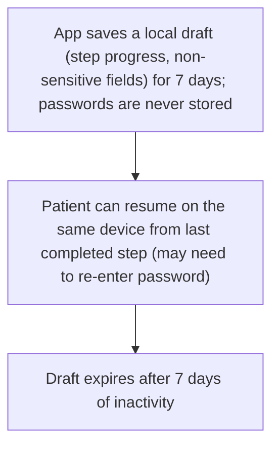

#### A2: Email verification fails or expires

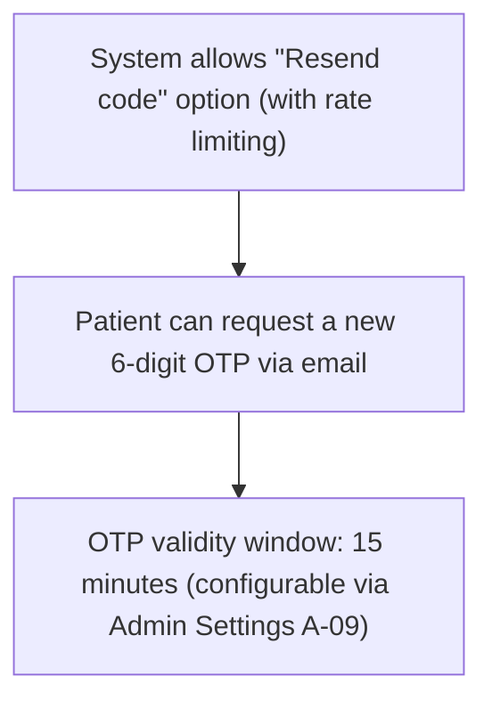

#### A3: Invalid email format or weak password

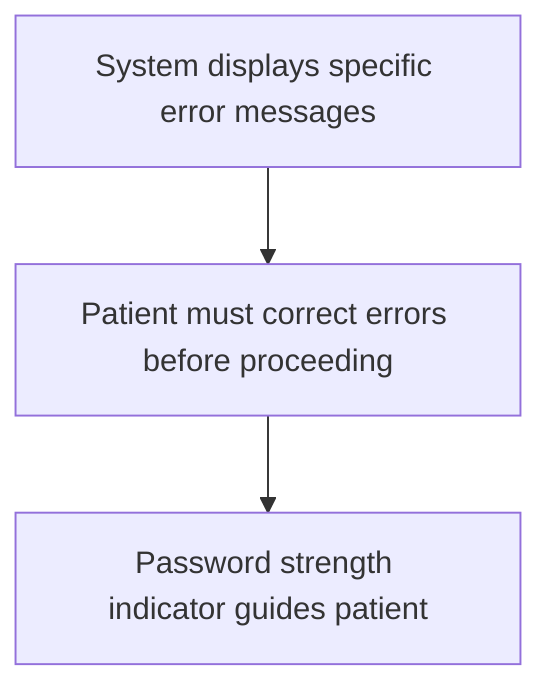

### Workflow 2: Patient Login (Primary Flow)

**Actors**: Patient, System

**Main Flow**:

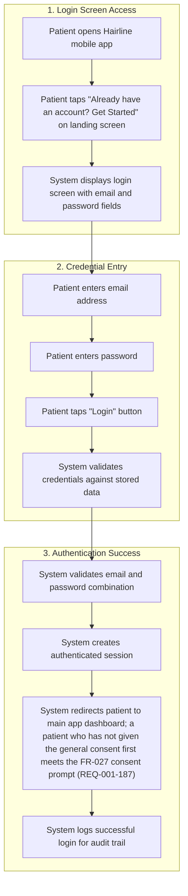

**Alternative Flows**:

#### B1: Invalid credentials (REQ-001-065, REQ-001-007)

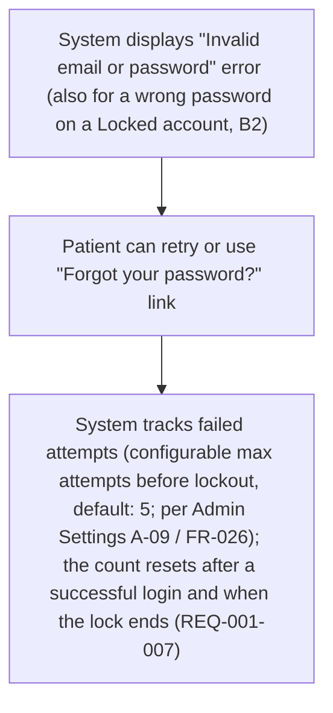

#### B2: Account locked due to failed attempts (REQ-001-066)

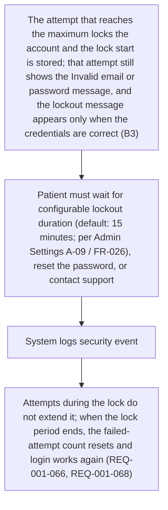

#### B3: Login outcome by account state (REQ-001-068, REQ-001-069, REQ-001-189)

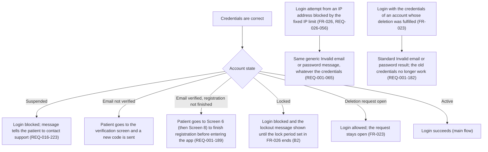

### Workflow 3: Password Reset (Recovery Flow)

**Actors**: Patient, System, Email Service

**Main Flow**:

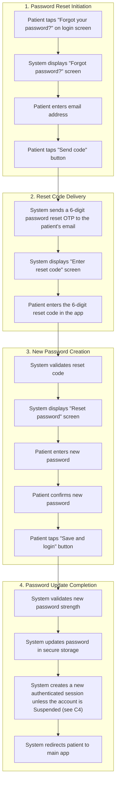

**Alternative Flows**:

#### C1: Reset code expires or is invalid

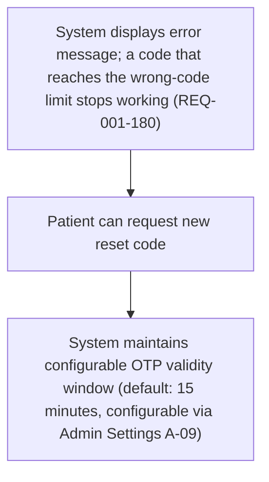

#### C2: Patient doesn't receive email (REQ-001-077)

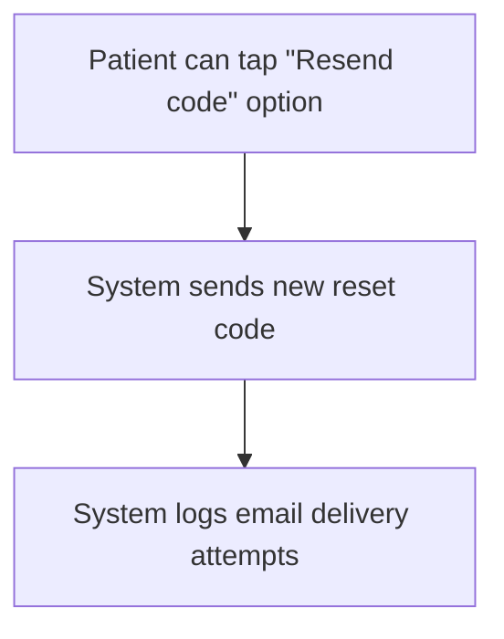

#### C3: Email address not registered (REQ-001-073, REQ-001-074)

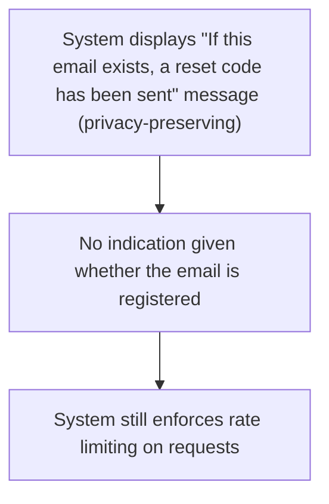

#### C4: Password reset outcome by account status (REQ-001-076, REQ-016-223)

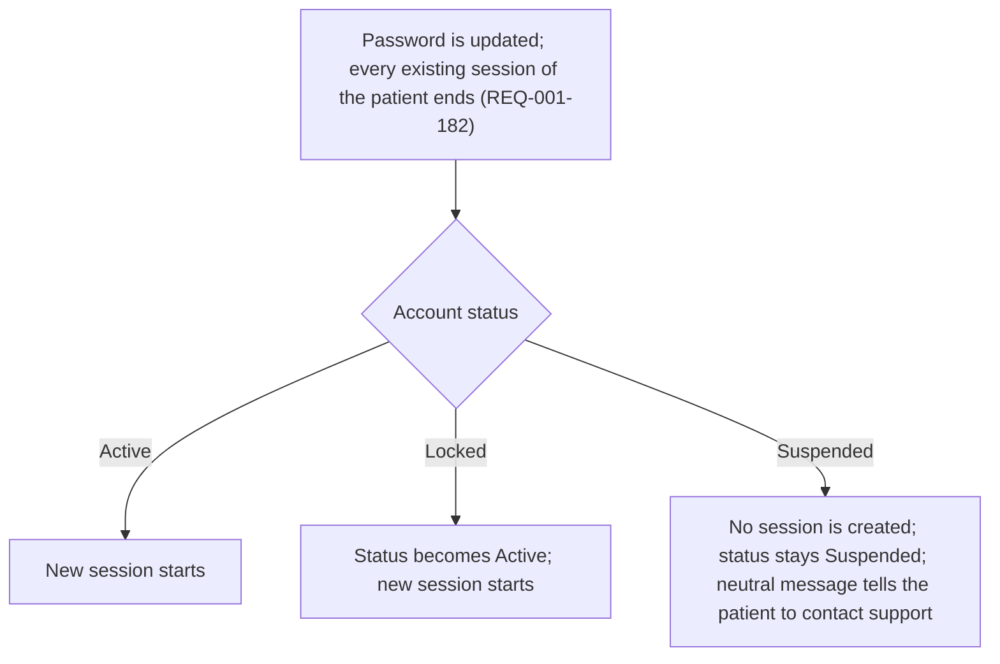

### Workflow 4: Profile Management (Ongoing Flow)

**Actors**: Patient, System, Admin

**Main Flow**: (REQ-001-082)

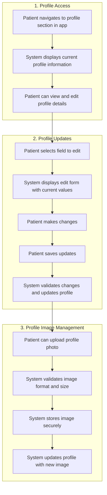

**Alternative Flows**:

#### D1: Admin profile modification (REQ-001-017, REQ-001-035)

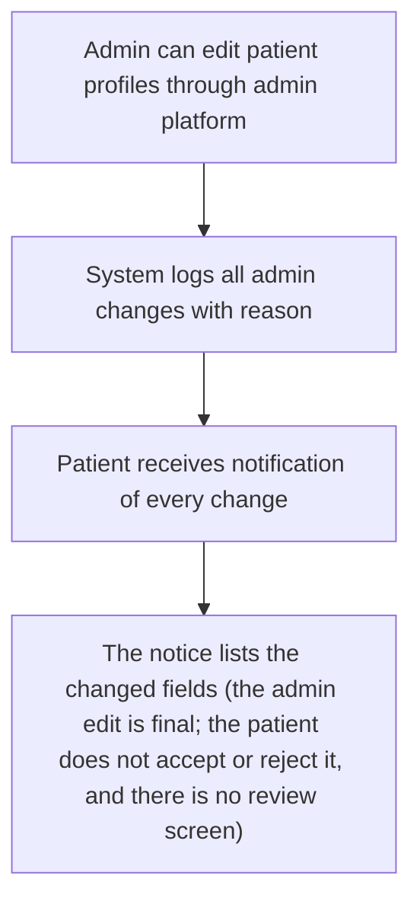

---

## Screen Specifications

### Patient Platform Screens

#### Screen 1: Splash Screen

**Purpose**: Initial app loading and branding display

**Data Fields**:

| Field Name | Type | Required | Description | Validation Rules | Graph field |
|---|---|---|---|---|---|
| Hairline Logo | image | Yes | Hairline logo with integrated green plus sign | Branding consistent across all platforms (REQ-001-135) | no graph field (static content) |
| Loading Indicator | display | Yes | Animated loading indicator with dots | Displays for maximum 3 seconds (REQ-001-039) | no graph field (static content) |
| App Version | text | No | App version number (system-populated) | Displayed as informational metadata | no graph field (static content) |

**Business Rules**:

- Splash screen displays for maximum 3 seconds (REQ-001-039)
- Loading animation provides visual feedback (REQ-001-134)
- See REQ-001-135.
- The splash screen uses a new visual (REQ-001-168)
- On first start the app language is the phone's language; if the app does not offer that language, it shows the default locale set in FR-021 (English until a Super Admin changes it), and a text missing in the shown language falls back until it ends at the English source. The patient can change the language later. (REQ-001-165, REQ-021-074, REQ-021-078)

#### Screen 1a: Explanation Screens

**Purpose**: Explain what Hairline offers before the patient registers

**Data Fields**:

| Field Name | Type | Required | Description | Validation Rules | Graph field |
|---|---|---|---|---|---|
| Explanation Content | display | Yes | Two screens explaining what Hairline offers | Display-only; shown after the splash screen and before the Landing Screen (Screen 2) (REQ-001-167) | no graph field (static content) |

**Business Rules**:

- Two explanation screens follow the splash screen, then the patient reaches the Landing Screen where "Get Started" begins registration (REQ-001-167)
- Explanation screens are display-only and collect no data (REQ-001-167)

#### Screen 2: Landing Screen

**Purpose**: Welcome screen with call-to-action for new and returning users

**Data Fields**:

| Field Name | Type | Required | Description | Validation Rules | Graph field |
|---|---|---|---|---|---|
| Background Image | image | Yes | Background image of satisfied patient | Rotates based on admin configuration (landing background is a platform setting managed in FR-026) (REQ-001-040) | no graph field (static content) |
| Background Overlay | display | Yes | Semi-transparent overlay for text readability | Static styling element | no graph field (static content) |
| Headline Text | text | Yes | "Begin Your Transformation Journey with Hairline" | Static marketing copy | no graph field (static content) |
| Get Started Button | button | Yes | Primary CTA (green) | Leads to registration flow (Screen 3) (REQ-001-041) | no graph field (control) |
| Login Link | link | Yes | "Already have an account? Get Started" secondary link | Leads to login flow (Screen 9) (REQ-001-041) | no graph field (control) |

**Business Rules**:

- Background image rotates based on admin configuration (FR-026 platform setting) (REQ-001-040)
- Primary CTA leads to registration flow (REQ-001-041)
- Secondary link leads to login flow (REQ-001-041)
- Screen responsive to different device sizes (REQ-001-136)

#### Screen 3: Name Collection Screen

**Purpose**: Collect patient's first and last name

**Data Fields**:

| Field Name | Type | Required | Description | Validation Rules | Graph field |
|---|---|---|---|---|---|
| Screen Title | text | Yes | "First, tell us your name" | Displayed at top | no graph field (static content) |
| Back Navigation | action | Yes | Back arrow to return to previous screen | Top-left corner | no graph field (control) |
| First Name | text | Yes | Patient's first name input | Min 2, max 50 characters (REQ-001-042) | ENT-patient.first_name |
| Last Name | text | Yes | Patient's last name input | Min 2, max 50 characters (REQ-001-042) | ENT-patient.last_name |
| Continue Button | button | Yes | Primary CTA (green) | Disabled until both name fields are valid and the Terms and Privacy Policy acceptance is checked (REQ-001-043) | no graph field (control) |
| Terms & Conditions Link | link | Yes | Opens the Current version of the Terms & Conditions (FR-027) | Navigates to Terms content; does not disrupt form state (REQ-001-144) | no graph field (control) |
| Privacy Policy Link | link | Yes | Opens the Current version of the Privacy Policy (FR-027) | Navigates to Privacy Policy content; does not disrupt form state (REQ-001-144) | no graph field (control) |
| Terms Acceptance Checkbox | checkbox | Yes | "I agree to the Terms & Conditions and the Privacy Policy" | Required; one checkbox covers both documents; nothing is recorded on this screen; both acceptances are recorded when the account is created on Screen 4, each naming the version displayed when the box was ticked; if a newer version is Current by then, the checkbox is shown again with a link to the new text before Screen 4 completes (REQ-001-044) | ENT-legal-acceptance.accepted_at, ENT-legal-acceptance.document_type, ENT-legal-acceptance.version, ENT-legal-acceptance.locale, ENT-legal-acceptance.channel |

**Business Rules**:

- Both name fields are required (REQ-001-042)
- Minimum 2 characters per field (REQ-001-042)
- Maximum 50 characters per field (REQ-001-042)
- Continue button disabled until both name fields are valid and the Terms and Privacy Policy acceptance is checked (REQ-001-043)
- The one checkbox covers the Terms & Conditions and the Privacy Policy. When the account is created (Screen 4), not before, the app MUST record both acceptances via FR-027 acceptance tracking (document type, version, locale, acceptedAt, channel), each naming the version that was displayed when the box was ticked. If a newer version is Current when the account is created, the checkbox is shown again with a link to the new text before Screen 4 completes (REQ-001-044)

#### Screen 4: Account Creation Screen

**Purpose**: Create patient account with email and password

**Data Fields**:

| Field Name | Type | Required | Description | Validation Rules | Graph field |
|---|---|---|---|---|---|
| Screen Title | text | Yes | "Let's create an account with your email" | Displayed at top | no graph field (static content) |
| Back Navigation | action | Yes | Back arrow to return to previous screen | Top-left corner | no graph field (control) |
| Email Address | text | Yes | Patient email address input | Valid email format required; must be unique across platform (REQ-001-045, REQ-001-009) | ENT-patient.email |
| Password | text | Yes | Account password input (masked) | Min 12 chars, at least 1 uppercase, 1 lowercase, 1 digit, 1 special char from `!@#$%^&(),.?":{}\|<>`; real-time strength validation (REQ-001-128, REQ-SYS-007) | ENT-patient.password_hash |
| Confirm Password | text | Yes | Password confirmation input (masked) | Must match Password field exactly (REQ-001-046) | ENT-patient.password_hash |
| Create Account Button | button | Yes | Primary CTA (green) | Disabled until all fields valid (REQ-001-047) | no graph field (control) |
| Legal Footer Text | text | Yes | Terms of Service and Privacy Policy reference | Static informational text; non-interactive (REQ-001-145) | no graph field (static content) |

**Business Rules**:

- Email must be valid format (REQ-001-045)
- Password policy: see system PRD, Platform-Wide Rules: Password and one-time-code policy (REQ-SYS-007)
- Password confirmation must match (REQ-001-046)
- Create account button disabled until all fields valid (REQ-001-047)
- Real-time password strength validation (REQ-001-128)
- An email that belongs to an existing account gets the same neutral result as a new email: the screen goes on to the verification screen with a "check your email" message and reveals nothing, and the system sends the existing owner an email saying an account already exists. An existing account is every record except a registration that never had a verified email, including an account whose email is unverified after an admin change (REQ-001-181)
- A registration that never had a verified email (it was never finished) may register again with the same email: only that unfinished record is replaced by the new one, and a new code is sent (REQ-001-181)
- If a newer version of the Terms or the Privacy Policy is Current than the one displayed when the box was ticked on Screen 3, the checkbox is shown again with a link to the new text before account creation completes (REQ-001-044)

**Notes**:

- The client transcription mentioned "email, confirmation of email" during signup. This PRD omits a separate "Confirm email" re-entry field because email correctness is verified via 6-digit OTP in the next step (Screen 5), which provides stronger validation than a re-entry field.

#### Screen 5: Email Verification Screen

**Purpose**: Verify patient's email address with OTP

**Data Fields**:

| Field Name | Type | Required | Description | Validation Rules | Graph field |
|---|---|---|---|---|---|
| Screen Title | text | Yes | "Enter verification code" | Displayed at top | no graph field (static content) |
| Back Navigation | action | Yes | Back arrow to return to previous screen | Top-left corner | no graph field (control) |
| OTP Code Input | text | Yes | Six separate input boxes for 6-digit verification code | Numeric only; all 6 digits required before Continue is enabled (REQ-001-146) | ENT-otp-code.code |
| Continue Button | button | Yes | Primary CTA (green) | Disabled until all 6 digits entered; submits OTP for validation (REQ-001-146) | no graph field (control) |
| Resend Code Link | link | Yes | "Resend code" link | Rate-limited; triggers new OTP email to registered address (REQ-001-049) | no graph field (control) |
| Help and Support Entry | link | Conditional | "Contact support" entry | Shown only when the resend limit is reached or the email service is down; opens the support contact details (REQ-001-170, REQ-035-024) | no graph field (control) |

**Business Rules**:

- Email verification required for account activation (REQ-001-002)
- 6-digit OTP sent automatically to email; codes expire after 15 minutes (configurable) (REQ-001-048, REQ-001-050)
- Resend option available with rate limiting (REQ-001-049)
- Wrong codes are limited as on the verification, reset and re-verification screens: after the same number of wrong codes as failed logins (FR-026 max login attempts, default 5) the code stops working and a new one must be requested, with the resend cooldown applying (REQ-001-180)
- After a correct code the next screen depends on the registration state: a patient whose profile or discovery step is unfinished goes to Screen 6 (then Screen 8); a patient whose registration is finished goes to the login success step and the session starts. A patient who verified the email but never finished the profile is sent back to finish it at the next login, on any device, before entering the app (REQ-001-189)
- The code sent at the next login after an admin email change (REQ-001-184) uses this screen with the same expiry, resend and wrong-code rules

#### Screen 6: Profile Creation Screen

**Purpose**: Complete patient profile with additional information

**Data Fields**:

| Field Name | Type | Required | Description | Validation Rules | Graph field |
|---|---|---|---|---|---|
| Screen Title | text | Yes | "Create your profile" | Displayed at top | no graph field (static content) |
| Back Navigation | action | Yes | Back arrow to return to previous screen | Top-left corner | no graph field (control) |
| Avatar Placeholder | image | No | Large green circular icon with person silhouette | Decorative; updatable after account creation via Edit Profile (REQ-001-163) | no graph field (static content) |
| Gender | select | Yes | Dropdown for gender selection | Options: Male, Female, Other, Prefer not to say | ENT-patient.gender |
| Date of Birth | date | Yes | Date picker for patient's date of birth | Opens Screen 7 (Calendar Picker); minimum age 18; maximum age 100 (REQ-001-052) | ENT-patient.date_of_birth |
| Phone Number | text | Yes | Phone number input with country code dropdown | Country code list centrally managed in Admin Settings (A-09); format validated per selected country code (REQ-001-054, REQ-001-053) | ENT-patient.phone, ENT-patient.phone_country_code |
| Country | select | Yes | Dropdown for country selection | Centrally managed list (Admin Settings A-09); selection sets the currency preference only (language is independent of country) (REQ-001-054, REQ-001-055) | ENT-patient.country |
| Create Account Button | button | Yes | Primary CTA (green) | Disabled until all required fields are complete (REQ-001-155) | no graph field (control) |

**Business Rules**:

- Gender options: Male, Female, Other, Prefer not to say
- Date of birth required (minimum age 18) (REQ-001-052)
- Phone number with country code validation (REQ-001-053)
- Country and country code lists are centrally managed in Admin Settings (A-09) (REQ-001-054)
- Country selection sets the currency preference only; language is independent of country (REQ-001-055)
- All fields required to complete registration (REQ-001-056)

#### Screen 7: Calendar Picker Overlay

**Purpose**: Date selection for date of birth

**Data Fields**:

| Field Name | Type | Required | Description | Validation Rules | Graph field |
|---|---|---|---|---|---|
| Month/Year Navigation | action | Yes | Left/right arrows to navigate between months and years | Defaults to current month/year on open (REQ-001-175) | no graph field (control) |
| Calendar Grid | date | Yes | Grid of selectable dates for the displayed month | Dates exceeding minimum age (18 years) or maximum age (100 years) are disabled (REQ-001-052) | ENT-patient.date_of_birth |
| Selected Date Indicator | display | Conditional | Highlights the currently selected date in green | Shown when a date is selected | ENT-patient.date_of_birth |
| Done Button | button | Yes | "Done" confirmation button | Confirms selection and updates the Date of Birth field in Screen 6 (REQ-001-176) | no graph field (control) |

**Business Rules**:

- Default to current month/year (REQ-001-175)
- Minimum age 18 years enforced (REQ-001-052)
- Maximum age 100 years (REQ-001-052)
- Selected date updates parent form (REQ-001-176)

#### Screen 8: Discovery Question Screen

**Purpose**: Collect information about how patient discovered Hairline

**Data Fields**:

| Field Name | Type | Required | Description | Validation Rules | Graph field |
|---|---|---|---|---|---|
| Screen Title | text | Yes | "How did you find out about us?" | Displayed at top | no graph field (static content) |
| Back Navigation | action | Yes | Back arrow to return to previous screen | Top-left corner | no graph field (control) |
| Discovery Source | select | Yes | "Select an option" dropdown | Options centrally managed in Admin Settings (A-09); selection required before Continue is enabled (REQ-001-059, REQ-001-058) | ENT-patient.discovery_source |
| Continue Button | button | Yes | Primary CTA (green) | Disabled until an option is selected; proceeds to service selection (Screen 8a) on tap (REQ-001-139, REQ-001-140) | no graph field (control) |

**Business Rules**:

- Options centrally managed in Admin Settings (A-09) (REQ-001-059)
- Selection required before proceeding (per client transcription: discovery question is part of the mandatory registration flow) (REQ-001-058)
- Data used for marketing analytics (REQ-001-060)
- Continue button disabled until an option is selected (REQ-001-139)
- Continue button proceeds to service selection (Screen 8a) (REQ-001-140)

#### Screen 8a: Service Selection Screen

**Purpose**: Let the newly registered patient pick the Hairline service to start with

**Data Fields**:

| Field Name | Type | Required | Description | Validation Rules | Graph field |
|---|---|---|---|---|---|
| Screen Title | text | Yes | Prompt asking the patient which service to start with | Displayed at top | no graph field (static content) |
| Service Options | select | Yes | The four Hairline services, one option each | Exactly one service is picked; the four services are defined in the platform requirements, not in this module (REQ-001-169) | no graph field (options defined outside this module) |
| Continue Button | button | Yes | Primary CTA (green) | Disabled until a service is picked; lands the patient in the chosen service (REQ-001-169) | no graph field (control) |

**Business Rules**:

- Shown directly after the discovery question (Screen 8), as the last step of the new-patient entry flow (REQ-001-169)
- The patient picks one of the four services and lands in the chosen service (REQ-001-169)

#### Screen 9: Login Screen

**Purpose**: Authenticate existing patients

**Data Fields**:

| Field Name | Type | Required | Description | Validation Rules | Graph field |
|---|---|---|---|---|---|
| Background Image | image | Yes | Background image with semi-transparent overlay | Static branding element | no graph field (static content) |
| Screen Title | text | Yes | "Login" | Displayed at top | no graph field (static content) |
| Subtitle Text | text | Yes | "Login with email and password" | Displayed below screen title | no graph field (static content) |
| Email Address | text | Yes | Patient email address input | Valid email format required (REQ-001-045) | ENT-patient.email |
| Password | text | Yes | Patient password input (masked) | Masked by default; show/hide toggle available (REQ-001-158) | ENT-patient.password_hash |
| Forgot Password Link | link | Yes | "Forgot your password?" link | Navigates to Screen 10 (Password Reset Initiation) (REQ-001-137) | no graph field (control) |
| Login Button | button | Yes | Primary CTA (green) | Disabled until both fields have input; submits credentials (REQ-001-148) | no graph field (control) |
| Register Link | link | Yes | "New to Hairline? Get Started" footer link | Navigates to registration flow (Screen 3) (REQ-001-138) | no graph field (control) |

**Business Rules**:

- Email and password required (REQ-001-072)
- Password field masked by default (REQ-001-072)
- Forgot password link leads to recovery flow (REQ-001-137)
- Footer link leads to registration flow (REQ-001-138)
- Failed attempts tracked for security; the count resets after a successful login and when the lock ends (REQ-001-007)
- Login outcome by account state, when the credentials are correct (same list as Workflow 2, B3) (REQ-001-068, REQ-001-069):
  - Suspended: login is blocked and the message tells the patient to contact support
  - Email not verified: the patient goes to the verification screen (Screen 5) and a new code is sent
  - Email verified but registration not finished: the patient goes to Screen 6 (then Screen 8) before entering the app (REQ-001-189)
  - Locked: login is blocked and the lockout message is shown until the lock period set in FR-026 ends; after that login works again; attempts during the lock do not extend it (REQ-001-066)
  - Deletion request open: login is allowed and the request stays open (FR-023)
- A wrong password on a Locked account shows the normal "Invalid email or password" message; the lockout message appears only with correct credentials (REQ-001-065, REQ-001-066)
- A login from an IP address blocked under the fixed IP limit (FR-026, REQ-026-056) shows the same generic "Invalid email or password" message whatever the credentials (REQ-001-065)
- Login with the credentials of an account whose deletion was fulfilled (FR-023) gets the same standard "Invalid email or password" result (REQ-001-182)
- First sign-in consent gate: after a successful login, a patient who has not yet given the general consent is shown the FR-027 consent prompt before the main app (REQ-027-062, REQ-001-187)

#### Screen 10: Password Reset Initiation Screen

**Purpose**: Initiate password reset process

**Data Fields**:

| Field Name | Type | Required | Description | Validation Rules | Graph field |
|---|---|---|---|---|---|
| Screen Title | text | Yes | "Forgot password?" | Displayed at top | no graph field (static content) |
| Back Navigation | action | Yes | Back arrow to return to previous screen | Top-left corner | no graph field (control) |
| Instruction Text | text | Yes | "Enter your email to request a password reset code" | Static instructional copy | no graph field (static content) |
| Email Address | text | Yes | Patient email address input | Valid email format required (REQ-001-045) | ENT-patient.email |
| Send Code Button | button | Yes | Primary CTA (green) | Disabled until email field has valid input; sends OTP to registered email (REQ-001-149) | no graph field (control) |

**Business Rules**:

- Email address required
- Reset code sent to registered email (REQ-001-004)
- OTP validity window: 15 minutes (configurable via Admin Settings A-09) (REQ-001-048, REQ-001-157)
- Rate limiting prevents abuse (REQ-001-074)

#### Screen 11: Reset Code Entry Screen

**Purpose**: Enter 6-digit password reset verification code

**Data Fields**:

| Field Name | Type | Required | Description | Validation Rules | Graph field |
|---|---|---|---|---|---|
| Screen Title | text | Yes | "Enter reset code" | Displayed at top | no graph field (static content) |
| Back Navigation | action | Yes | Back arrow to return to previous screen | Top-left corner | no graph field (control) |
| Instruction Text | text | Yes | "Enter the 6 digit code that you received in your email" | Static instructional copy | no graph field (static content) |
| OTP Code Input | text | Yes | Six separate input boxes for 6-digit reset code | Numeric only; all 6 digits required; code expires after 15 minutes (configurable via Admin Settings A-09) (REQ-001-146, REQ-001-157) | ENT-otp-code.code |
| Continue Button | button | Yes | Primary CTA (green) | Disabled until all 6 digits entered; submits code for validation (REQ-001-146) | no graph field (control) |
| Resend Code Link | link | Yes | "Resend code" link | Triggers new OTP email; rate-limited (REQ-001-049) | no graph field (control) |

**Business Rules**:

- 6-digit numeric code required (REQ-001-146)
- Code expires after 15 minutes (configurable via Admin Settings A-09) (REQ-001-157)
- Resend option available (REQ-001-049)
- Invalid code shows error message (REQ-001-075)
- After the same number of wrong codes as failed logins (FR-026 max login attempts, default 5) the code stops working and a new one must be requested; the resend cooldown applies (REQ-001-180)

#### Screen 12: Password Reset Screen

**Purpose**: Create new password

**Data Fields**:

| Field Name | Type | Required | Description | Validation Rules | Graph field |
|---|---|---|---|---|---|
| Screen Title | text | Yes | "Reset password" | Displayed at top | no graph field (static content) |
| Back Navigation | action | Yes | Back arrow to return to previous screen | Top-left corner | no graph field (control) |
| Instruction Text | text | Yes | "Enter a new password and login to their account" | Static instructional copy | no graph field (static content) |
| New Password | text | Yes | New password input (masked) with visibility toggle | Must meet strength requirements: 12+ chars, 1 upper, 1 lower, 1 digit, 1 special char from `!@#$%^&(),.?":{}\|<>` (REQ-SYS-007) | ENT-patient.password_hash |
| Confirm Password | text | Yes | Password confirmation input | Must match New Password field exactly (REQ-001-046) | ENT-patient.password_hash |
| Save and Login Button | button | Yes | Primary CTA (green) | Disabled until both fields valid and matching; updates the password and, unless the account is Suspended, creates a new session (REQ-001-150, REQ-001-076) | no graph field (control) |

**Business Rules**:

- New password must meet strength requirements (12+ chars, 1 upper, 1 lower, 1 digit, 1 special from !@#$%^&(),.?":{}|<>) (REQ-SYS-007)
- Password confirmation must match (REQ-001-046)
- Password visibility toggle available (REQ-001-159)
- A successful reset ends every existing session of the patient on every device (REQ-001-182), then by account status (REQ-001-076, REQ-016-223):
  - Active: a new session is created
  - Locked: the status becomes Active and a new session is created
  - Suspended: the password is updated, no session is created, the status stays Suspended, and a neutral message tells the patient to contact support

#### Screen 13: Profile Overview (Patient)

**Purpose**: Show patient's profile with key actions

**Data Fields**:

| Field Name | Type | Required | Description | Validation Rules | Graph field |
|---|---|---|---|---|---|
| Avatar | image | No | Large circular patient profile photo or placeholder | Tappable to navigate to Edit Profile (Screen 14) | ENT-patient.profile_image_url |
| Patient Name | text | Yes | Patient's full name (first + last) | Read-only display; sourced from profile (REQ-001-084) | ENT-patient.name |
| Patient Email | text | Yes | Patient's registered email address | Read-only display | ENT-patient.email |
| Profile Edit Button | button | Yes | "Profile edit" action button (top section) | Navigates to Screen 14 (Edit Profile) | no graph field (control) |
| Settings Button | button | Yes | "Settings" action button (top section) | Navigates to Screen 15 (Settings Main) | no graph field (control) |
| Payment Method | link | Yes | Scrollable menu item: Payment method | Navigates to payment method management (REQ-001-151) | no graph field (control) |
| Previous Treatments | link | Yes | Scrollable menu item: Previous treatment | Shows Completed treatments only (REQ-001-086) | no graph field (control) |
| Reviews | link | Yes | Scrollable menu item: Reviews | Shows "Write review" CTA if eligible (Completed ≥ 3 months); else read-only history (REQ-001-087) | no graph field (control) |
| Delete Account | link | Yes | Scrollable menu item: Delete account (destructive) | Navigates to Screen 16 (DSR); the re-authentication check runs at the Request deletion button on Screen 16 (REQ-001-089, REQ-001-156) | no graph field (control) |
| Logout | link | Yes | Scrollable menu item: Logout | Revokes session tokens and returns patient to Landing screen (Screen 2) (REQ-001-088) | no graph field (control) |

**Business Rules**:

- All items navigable; back navigation available
- Delete account submits a data deletion request (DSR) queued for Admin review per FR-023 (REQ-001-090)
- Sensitive actions (delete account) require re-auth within the last 5 minutes (password or 6-digit OTP); the check runs at the Request deletion button on Screen 16, not at this link (REQ-001-089, REQ-001-156)
- If there is an active treatment or aftercare case, delete account is blocked with guidance to contact support (REQ-001-091)
- If there is an active payment in progress, delete account is blocked until payment flow completes (REQ-001-092)
- A deletion request is blocked while the patient has an inquiry at the Accepted stage or later (REQ-003-103, REQ-001-091)
- An open inquiry in stage Inquiry or Quoted does not block the request: it is cancelled when an admin approves the request (FR-023), not at submission, using FR-003 cancellation mechanics (status = "Cancelled"; cancellation reason = "Account Deleted (System)"; reason is not shared with providers); a refused request cancels nothing (REQ-003-103)
- **Note**: System-triggered inquiry cancellation due to account deletion approval is distinct from patient-initiated inquiry cancellation (FR-003 Workflow 5). Both end in status "Cancelled", but the cancellation reason provenance differs (system-generated vs patient-provided).

**Acceptance Scenarios**:

1. Given patient is authenticated, When opening Profile tab, Then avatar, name, email, and actions (Profile edit, Settings) are visible and tappable.
2. Given patient taps Request deletion on Screen 16, When re-auth is not fresh (>5 minutes), Then system prompts for password or sends 6-digit OTP to email and only proceeds on success. (REQ-001-089, REQ-001-156)
3. Given patient has an active treatment or aftercare, or an inquiry at the Accepted stage or later, When confirming Delete account, Then system blocks action and shows message “Account deletion is unavailable during active care; contact support.” (REQ-001-091)
4. Given patient has a payment in progress, When confirming Delete account, Then system blocks action until payment finishes, with a message to retry later. (REQ-001-092)
5. Given patient selects Logout, When confirmed, Then session tokens are revoked and user returns to Landing screen. (REQ-001-088)
6. Given patient selects Reviews, When eligible (Completed ≥ 3 months), Then “Write review” CTA is shown; else read-only history only. (REQ-001-087)
7. Given patient opens Previous treatment, Then list shows only Completed items with links to details. (REQ-001-086)

#### Screen 14: Edit Profile

**Purpose**: Allow patient to edit core profile fields

**Data Fields**:

| Field Name | Type | Required | Description | Validation Rules | Graph field |
|---|---|---|---|---|---|
| Avatar | image | No | Patient profile photo with add/update overlay | Tappable; opens image picker to update profile photo | ENT-patient.profile_image_url |
| First Name | text | Yes | Patient's first name | Min 2, max 50 characters (REQ-001-042) | ENT-patient.first_name |
| Last Name | text | Yes | Patient's last name | Min 2, max 50 characters (REQ-001-042) | ENT-patient.last_name |
| Email Address | text | Yes | Patient's registered email address | Valid format and unique across the platform (REQ-001-009); if changed, a 6-digit code is sent to the new address and the login email stays the old one until the code is confirmed (REQ-001-081, REQ-001-183) | ENT-patient.email |
| Pending Email Address | text | Conditional | The new address waiting for confirmation; shown while a pending email exists | Read-only (REQ-001-183) | ENT-patient.pending_email |
| Email Code Input | text | Conditional | Six separate input boxes for the 6-digit code sent to the pending address; shown while a pending email exists | Numeric only; the code lives 15 minutes (REQ-001-098); same wrong-code limit as the other codes (REQ-001-180) | ENT-otp-code.code |
| Resend Code Link | link | Conditional | "Resend code" for the pending address; shown while a pending email exists | Same resend limit as the other codes (REQ-001-049, REQ-001-183) | no graph field (control) |
| Cancel Email Change | link | Conditional | "Cancel change"; shown while a pending email exists | Clears the pending address; the login email is unchanged (REQ-001-183) | no graph field (control) |
| Phone Number | text | Yes | Phone number input with country code dropdown | Country code list centrally managed (Admin A-09); format validated per country code (REQ-001-054, REQ-001-053) | ENT-patient.phone, ENT-patient.phone_country_code |
| Date of Birth | date | Yes | Date of birth picker | Minimum age 18; maximum age 100; uses date picker overlay (REQ-001-052) | ENT-patient.date_of_birth |
| Gender | select | Yes | Gender selection dropdown | Options: Male, Female, Other, Prefer not to say | ENT-patient.gender |
| Country | select | Yes | Country selection dropdown | Centrally managed list (Admin A-09); sets the currency preference only (language is independent of country) (REQ-001-054, REQ-001-055) | ENT-patient.country |
| Save and Update Button | button | Yes | Primary CTA: "Save and update" | Disabled until all required fields are valid; persists changes (REQ-001-153) | no graph field (control) |

**Business Rules**:

- Validation applied per field; back navigation available (REQ-001-085)
- Email change triggers re-verification via 6-digit OTP (REQ-001-081). Save on a changed email first runs identity re-verification (Screen 18) when the last sign-in check is older than 5 minutes (REQ-001-016, REQ-001-131), then sends the code to the NEW address. The login email stays the old address until the code is confirmed; after confirmation a notice goes to the old address (REQ-001-183)
- While a pending email exists the screen shows the pending address, the code input, Resend code and Cancel change. The email-change code is sent with the email verification template and lives a fixed 15 minutes, outside the FR-026 OTP Expiry Time (REQ-001-098); it follows the same resend limit and wrong-code limit as the other codes (REQ-001-049, REQ-001-180). When the code expires the pending address stays until the patient resends or cancels (REQ-001-183). The code sent at the next login after an admin email change (REQ-001-184) uses Screen 5 with the same rules
- The uniqueness check (REQ-001-009) runs when the pending email is saved and again at code confirmation. An address that belongs to another account gets the same neutral result as on Screen 4 and the existing owner is emailed (REQ-001-181); if the address was taken between save and confirmation, the confirmation fails with the same neutral message and the pending address is cleared (REQ-001-009)
- Profile completion is the share of required profile fields that are filled, shown as a percentage from 0 to 100, with equal weight per field. The required fields are: First Name, Last Name, Email Address, Phone Number, Date of Birth, Gender and Country. The Avatar is optional and does not count. (REQ-001-166)

#### Screen 15: Settings Main Screen

**Purpose**: Top-level settings navigation hub

**Data Fields**:

| Field Name | Type | Required | Description | Validation Rules | Graph field |
|---|---|---|---|---|---|
| Screen Title | text | Yes | "Settings" | Displayed at top of screen | no graph field (static content) |
| Back Navigation | action | Yes | Back arrow to return to Profile screen (Screen 13) | Top-left corner | no graph field (control) |
| Notification Settings | link | Yes | Row with bell icon + "Notification Settings" label + chevron | Navigates to Screen 15a | no graph field (control) |
| Privacy & Security | link | Yes | Row with lock icon + "Privacy & Security" label + chevron | Navigates to Screen 15b | no graph field (control) |
| Terms & Conditions | link | Yes | Row with document icon + "Terms & Conditions" label + chevron | Navigates to Screen 15d | no graph field (control) |
| Consent | link | Yes | Row with consent icon + "Consent" label + chevron | Opens the general Consent view owned by FR-027 (REQ-027-016, REQ-001-185) | no graph field (control) |
| Language | link | Yes | Row with globe icon + "Language" label + chevron | Opens the app language choice owned by FR-021 (REQ-021-002, REQ-001-165, REQ-001-185) | no graph field (control) |
| Help & Support | link | Yes | Row with help/question icon + "Help & Support" label + chevron | Navigates to Help & Support flow (FR-033/FR-034) (REQ-001-103) | no graph field (control) |

**Business Rules**:

- Navigation sections are static items — always visible in the same order (REQ-001-152)
- Tapping a navigation row opens the corresponding sub-screen and preserves back navigation to Screen 15 (REQ-001-160)
- Help & Support routes to the Help Center & Support Access module (FR-033/FR-034) (REQ-001-103)
- Settings items are patient-app only; no provider/admin controls appear here (REQ-001-102)
- FR-001 owns this Settings Main screen and the Notification, Privacy and Terms sub-screens (Screens 15a to 15d); the Consent row opens the general Consent view (FR-027) and the Language row opens the language choice (FR-021) (REQ-001-185)

**Minimal API/State (Reference)**:

- GET/PUT user profile (firstName, lastName, phone, countryCode, country)
- GET/PUT notificationPreferences { email, push }
- POST changePassword { oldPassword, newPassword }
- POST deleteAccountRequest { reason? } (deletion request / DSR; queued for Admin review per FR-023)
- Read-only lists: previousTreatments[], reviews[]

#### Screen 15a: Notification Settings

**Purpose**: Manage push and email notification preferences

**Data Fields**:

| Field Name | Type | Required | Description | Validation Rules | Graph field |
|---|---|---|---|---|---|
| Screen Title | text | Yes | "Notification Settings" | Displayed at top | no graph field (static content) |
| Back Navigation | action | Yes | Back arrow to return to Settings Main (Screen 15) | Top-left corner | no graph field (control) |
| Explanation Text | text | Yes | "Choose how you want to receive notifications from Hairline." | Displayed below title for context | no graph field (static content) |
| MVP Notice (Conditional) | text | Conditional | "Per-category preferences coming soon. For now, you can enable/disable all notifications by channel." | Shown only in MVP; removed in V2 when per-category toggles ship (REQ-001-104) | no graph field (static content) |
| Global Email Toggle | toggle | Yes | Master switch: "Email Notifications" with ON/OFF state | Auto-saves immediately on toggle; default for new accounts: ON (REQ-001-107) | ENT-patient-notification-preferences.email_enabled |
| Global Push Toggle | toggle | Yes | Master switch: "Push Notifications" with ON/OFF state | Auto-saves immediately on toggle; default for new accounts: ON (REQ-001-107) | ENT-patient-notification-preferences.push_enabled |
| Mandatory Notifications Note | text | Yes | "Mandatory notices (such as password reset and account security notices) are always sent by email and cannot be disabled." | Displayed below toggles as info text (REQ-001-105) | no graph field (static content) |
| System Event Notifications Note | text | Yes | "You will receive automatic notifications when your inquiry, booking, or payment status changes (including Inquiry Cancelled, Quote Received, Booking Confirmed, Payment events, and Aftercare reminders). These keep you informed of important updates." | Read-only informational text; per FR-020, apart from mandatory notices (REQ-020-038) (REQ-001-106) | no graph field (static content) |
| Save Status Indicator (Conditional) | text | Conditional | "Saved" or "Saving..." feedback | Shown briefly after toggle change; success message: "Preferences saved" (REQ-001-154) | no graph field (static content) |
| Error Message (Conditional) | text | Conditional | Displayed if save fails | "Failed to save preferences. Please try again." with Retry button; on failure, UI reverts to last saved state (REQ-001-109) | no graph field (static content) |

**Business Rules**:

- **MVP scope**: Only global Email/Push toggles available; per-category preferences (Inquiry, Quote, Booking, Payment, Aftercare, Marketing) are deferred to V2 (REQ-001-104)
- Mandatory notices as FR-020 defines them (REQ-020-038) are always sent by email and are not affected by global toggles; push for these notices follows the patient's push setting (owner ruling 2026-11-25, FR-030 locked notices) (REQ-001-105)
- All other system event notifications (inquiry stage changes including Inquiry Cancelled, quote received, booking confirmed, payment events, aftercare reminders) are sent per FR-020 and follow the channel toggles; user cannot disable individual events in MVP (REQ-001-106)
- Changes auto-save immediately upon toggle (no explicit "Save" button); preference changes effective within 1 minute; default for new accounts: both Email and Push toggles ON (REQ-001-107)
- Marketing notifications are OFF by default unless explicit consent is stored (applies when V2 categories ship) (REQ-001-108)
- Notification preference records are owned by FR-030; this screen shows and edits them
- If save fails, UI MUST revert to previous toggle state and show actionable error with Retry option (REQ-001-109)

**Acceptance Scenarios**:

1. Given user toggles Push OFF, When saved (immediate), Then push notifications stop within 1 minute. (REQ-001-107)
2. Given a save error occurs, When toggling a global control (Email/Push), Then UI reverts to prior state and displays error message with retry option. (REQ-001-109)
3. Given inquiry stage changes (e.g., Quote received), When Email or Push is ON, Then the user receives a stage update notification according to FR-020. (REQ-001-106)
4. Given user changes notification preferences, Then a preference-change audit entry is recorded with who/when/before/after. (REQ-001-110)

#### Screen 15b: Privacy & Security Menu

**Purpose**: Provide access to security and privacy items

**Data Fields**:

| Field Name | Type | Required | Description | Validation Rules | Graph field |
|---|---|---|---|---|---|
| Screen Title | text | Yes | "Privacy & Security" | Displayed at top | no graph field (static content) |
| Back Navigation | action | Yes | Back arrow to return to Settings Main (Screen 15) | Top-left corner | no graph field (control) |
| Change Password | link | Yes | Row with key icon + "Change Password" label + chevron | Navigates to Screen 17 (Change Password flow) (REQ-001-112) | no graph field (control) |
| Privacy Policy | link | Yes | Row with shield/document icon + "Privacy Policy" label + chevron | Navigates to Screen 15c | no graph field (control) |

**Business Rules**:

- Change Password always routes to Screen 17; this menu does not embed inline password-edit controls (REQ-001-112)
- Privacy Policy is read-only static content sourced from the Legal Content system (FR-027) (REQ-001-113)
- If legal content cannot be loaded, show a retry state and allow returning to Screen 15 without blocking the user (REQ-001-114)
- This menu contains only patient-facing items (no admin/provider configuration)
- All server-write actions use optimistic UI with retry/backoff; on final failure, UI rolls back to last persisted values (REQ-001-111)

**Acceptance Scenarios**:

1. Given user selects Change Password and submits currentPassword and a new password that meets policy, When request succeeds, Then prior refresh tokens are revoked and user remains logged in with current session. (REQ-001-119)
2. Given user cannot remember current password, When they tap "Forgot your password?" on the Change Password screen, Then the app routes to Password Reset Initiation (Screen 10). (REQ-001-117)

#### Screen 15c: Privacy Policy

**Purpose**: Display Privacy Policy content (static/read-only)

**Data Fields**:

| Field Name | Type | Required | Description | Validation Rules | Graph field |
|---|---|---|---|---|---|
| Screen Title | text | Yes | "Privacy Policy" | Displayed at top | no graph field (static content) |
| Back Navigation | action | Yes | Back arrow to return to Privacy & Security menu (Screen 15b) | Top-left corner | no graph field (control) |
| Policy Version | badge | Conditional | Current legal content version label | Shown if version metadata is available (FR-027) | ENT-legal-document.version |
| Last Updated | datetime | Conditional | Last updated timestamp for the policy | Shown if available (FR-027) | ENT-legal-document.last_updated_at |
| Policy Content | text | Yes | Scrollable rich-text policy body | Must be readable and selectable; supports long content | ENT-legal-document.content |
| Loading State (Conditional) | text | Conditional | Loading indicator while content fetches | Shown during content load | no graph field (static content) |
| Error State (Conditional) | text | Conditional | Non-blocking error with Retry and Back options | "Unable to load content. Please try again." with Retry button (REQ-001-114) | no graph field (static content) |

**Business Rules**:

- Policy content is read-only and must match the Current version of the Privacy Policy for the patient app (FR-027) (REQ-001-113)
- If a newer version is published while the user is viewing, the app may prompt to refresh but must not interrupt reading (REQ-001-115)
- If content fails to load, show a non-blocking error state with Retry and Back navigation (REQ-001-114)
- Analytics/audit (if implemented) must not capture the policy text itself; only view events and version identifiers (privacy-by-design) (REQ-001-116)

**Acceptance Scenarios**:

1. Given user opens Privacy Policy, Then the Current version of the policy is shown with version label, last updated date (if available), and working back navigation (FR-027). (REQ-001-113)

#### Screen 15d: Terms & Conditions

**Purpose**: Display Terms & Conditions content (static/read-only)

**Data Fields**:

| Field Name | Type | Required | Description | Validation Rules | Graph field |
|---|---|---|---|---|---|
| Screen Title | text | Yes | "Terms & Conditions" | Displayed at top | no graph field (static content) |
| Back Navigation | action | Yes | Back arrow to return to Settings Main (Screen 15) | Top-left corner | no graph field (control) |
| Document Version | badge | Conditional | Current legal content version label | Shown if version metadata is available (FR-027) | ENT-legal-document.version |
| Last Updated | datetime | Conditional | Last updated timestamp for the document | Shown if available (FR-027) | ENT-legal-document.last_updated_at |
| Document Content | text | Yes | Scrollable rich-text terms body | Must be readable and selectable; supports long content | ENT-legal-document.content |
| Loading State (Conditional) | text | Conditional | Loading indicator while content fetches | Shown during content load | no graph field (static content) |
| Error State (Conditional) | text | Conditional | Non-blocking error with Retry and Back options | "Unable to load content. Please try again." with Retry button (REQ-001-114) | no graph field (static content) |

**Business Rules**:

- Terms content is read-only and must match the Current version of the Terms & Conditions for the patient app (FR-027)
- If a newer version is published while the user is viewing, the app may prompt to refresh but must not interrupt reading (REQ-001-115)
- If content fails to load, show a non-blocking error state with Retry and Back navigation (REQ-001-114)
- Analytics/audit (if implemented) must not capture the document text itself; only view events and version identifiers (privacy-by-design)

**Acceptance Scenarios**:

1. Given user opens Terms & Conditions, Then the Current version of the terms is shown with version label, last updated date (if available), and working back navigation (FR-027).

**Help & Support Acceptance Scenario**:

1. Report a problem is owned by the support-ticket feature (FR-034, Report-a-problem Rule); Help and Support from Settings routes there (see Screen 15 rules). (REQ-034-164)

**Data/Validation & Audit Acceptance Scenarios**:

1. Given user changes password, Then a security audit entry is recorded and password policy is enforced. (REQ-001-079)
2. Given user initiates a password reset (forgot password), Then audit captures the reset request event (without storing OTP codes). (REQ-001-078)

#### Screen 16: Delete Account (Deletion Request / DSR)

**Purpose**: Allow patient to submit a data deletion request (right to erasure) with clear expectations and legal retention disclosures

**Data Fields**:

| Field Name | Type | Required | Description | Validation Rules | Graph field |
|---|---|---|---|---|---|
| Back Navigation | action | Yes | Back arrow to return to Profile Overview (Screen 13) | Top-left corner; cancels the deletion flow | no graph field (control) |
| Warning Header | display | Yes | Warning icon + "Delete your account" title | Displayed at top; signals destructive action | no graph field (static content) |
| Blocking Message | text | Conditional | Shown if active treatment/aftercare, an inquiry at the Accepted stage or later, or payment in progress; includes "Contact support" link | Blocks request submission until blocking condition is resolved (REQ-001-091) | no graph field (static content) |
| Consequences Section | text | Yes | Lists items that may be deleted/anonymized: PII, preferences, messages, reviews, uploaded media where not legally retained | Read-only informational text (REQ-001-093) | no graph field (static content) |
| Retained Data Section | text | Yes | Explains what will be retained and why: medical + financial records retained for the one 10-year retention period (retention follows the system PRD, Platform-Wide Rules: One 10-year retention period); restricted access | Read-only informational text (REQ-001-012) | no graph field (static content) |
| Processing Timeline Notice | text | Yes | "Deletion requests are completed within 30 calendar days of submission" | Read-only informational text (REQ-001-094) | no graph field (static content) |
| Reason for Deletion | select | No | Optional reason selector for account deletion | Optional; does not block submission; `deleteAccountRequest { reason? }`; options centrally managed in Admin Settings (FR-026, App Data → Account Deletion Reasons) (REQ-001-096) | ENT-deletion-request.reason |
| Reason Explanation | text | Conditional | Optional free-text field (max 500 characters) | Shown only when the selected reason requires an explanation (FR-026 setting); optional (REQ-026-092, REQ-001-186) | ENT-deletion-request.reason |
| Request Deletion Button | button | Yes | Primary CTA: "Request deletion" | Hidden while a deletion request is open (REQ-001-186); triggers identity re-verification (Screen 18) if last auth > 5 minutes; else shows confirmation modal (REQ-001-156) | no graph field (control) |
| Confirmation Modal | modal | Yes | "Submit deletion request?" with Confirm / Cancel actions | Shown after re-auth passes; Confirm submits DSR; Cancel returns to screen (REQ-001-162) | no graph field (control) |
| Identity Re-verification | action | Conditional | Navigates to Screen 18 when last successful auth > 5 minutes | Required before showing confirmation modal when auth is stale | no graph field (control) |
| Submission Confirmation | display | Conditional | "Deletion request submitted" with request reference and next-step instructions | Shown after successful DSR submission | ENT-deletion-request.request_id |
| Additional Verification Input | action | Conditional | "Provide additional verification" input | Shown only while the request is in Verification Required; the patient gives the proof an admin asked for (REQ-023-034, REQ-001-186) | no graph field (control) |
| Request Status Line | text | Conditional | Read-only status of the open request | Shown while a deletion request is open; the status is set by FR-023 (REQ-023-046, REQ-001-186) | no graph field (static content) |

**Business Rules**:

- Delete account is a request flow (DSR) queued for Admin review and fulfillment per FR-023; no immediate hard-delete occurs in-app (REQ-001-090)
- If active treatment/aftercare exists, deletion request is blocked with guidance to contact support (patient safety) (REQ-001-091)
- If payment is in progress, deletion request is blocked until payment completes (REQ-001-092)
- The request is blocked while the patient has an inquiry at the Accepted stage or later; an open inquiry in stage Inquiry or Quoted does not block it and is cancelled when an admin approves the request (FR-023), not at submission; a refused request cancels nothing (REQ-003-103)
- While a deletion request is open the screen shows the read-only request status, hides the Request Deletion button, and shows the additional-verification input only in Verification Required; the free-text reason field follows the selected reason (REQ-001-186)
- Sensitive action re-auth required when last successful auth > 5 minutes; re-auth via Screen 18 (Identity Re-verification) using password or 6-digit email OTP (REQ-001-089, REQ-001-142)
- Deletion reason is optional and must not block request submission (`deleteAccountRequest { reason? }`) (REQ-001-096)
- Verification failures and throttling/lockout behavior follow configured authentication security policy (do not hardcode attempt counts in UI copy) (REQ-001-097)
- On submission: system creates the one deletion request record (owned by FR-023), sends confirmation to the patient, and later sends status updates and outcome (including legal basis for any retained records) (REQ-001-095)
- The Admin is told of the new request through the same "account deletion requested" event the patient confirmation uses, with the Admin added as a recipient (FR-023 handles the request) (REQ-001-174)

#### Screen 17: Change Password

**Purpose**: Allow an authenticated patient to change their password (with an in-flow link to password reset if they forgot the current password)

**Data Fields**:

| Field Name | Type | Required | Description | Validation Rules | Graph field |
|---|---|---|---|---|---|
| Screen Title | text | Yes | "Change Password" | Displayed at top | no graph field (static content) |
| Back Navigation | action | Yes | Back arrow to return to Privacy & Security menu (Screen 15b) | Top-left corner | no graph field (control) |
| Current Password | text | Yes | Masked password input | Required; show/hide toggle icon (REQ-001-117) | ENT-patient.password_hash |
| Forgot Your Password Link | link | Yes | "Forgot your password?" link shown under Current Password | Navigates to Password Reset Initiation (Screen 10) (REQ-001-117) | no graph field (control) |
| New Password | text | Yes | Masked password input | Must meet password policy (12+ chars, mixed case, digit, special char) (REQ-SYS-007) | ENT-patient.password_hash |
| Confirm New Password | text | Yes | Masked password input | Must match New Password exactly (REQ-001-046) | ENT-patient.password_hash |
| Password Policy Helper | text | Yes | Short reminder of password requirements | Must not list attempt limits; reference policy only (REQ-001-097) | no graph field (static content) |
| Save Button | button | Yes | Primary CTA: "Save" | Disabled until all required fields are present (REQ-001-161) | no graph field (control) |
| Error Message (Conditional) | text | Conditional | Inline field-level errors for validation or server failures | Must not reveal whether current password is correct — use generic "Unable to change password. Please check your entries and try again." (REQ-001-118) | no graph field (static content) |
| Throttle/Lockout Message (Conditional) | text | Conditional | Displayed when authentication throttling or lockout is triggered | "Too many attempts. Please try again later." with back navigation to Screen 15b (REQ-001-120) | no graph field (static content) |

**Business Rules**:

- Current password is required for in-session password change; user must use Password Reset if they cannot provide current password (Screens 10–12) (REQ-001-117)
- New password must meet password rules and cannot reuse last 5 passwords (REQ-001-080)
- Do not hardcode attempt counts in UI copy; throttling/lockout follows configured authentication security policy (REQ-001-097)
- Validation errors shown inline without revealing sensitive details (avoid "current password incorrect" style disclosures) (REQ-001-118)
- On success: prior refresh tokens are revoked and current session remains active; system displays Screen 17a (success confirmation) (REQ-001-119)
- If throttled/locked, show blocked message and navigate back to Screen 15b (REQ-001-120)

#### Screen 17a: Password Changed Confirmation

**Purpose**: Confirm password change succeeded and return user back to settings

**Data Fields**:

| Field Name | Type | Required | Description | Validation Rules | Graph field |
|---|---|---|---|---|---|
| Confirmation Icon | icon | Yes | Green success checkmark icon | Displayed prominently at top center | no graph field (static content) |
| Screen Title | text | Yes | "Password Updated" | Displayed prominently | no graph field (static content) |
| Message Text | text | Yes | Short confirmation copy (e.g., "Your password has been successfully changed.") | Must not include attempt limits or sensitive details (REQ-001-179) | no graph field (static content) |
| Done Button | button | Yes | Primary CTA: "Done" | Returns to Privacy & Security menu (Screen 15b) | no graph field (control) |

**Business Rules**:

- Confirmation screen is shown only after the server confirms the password change (REQ-001-121)
- If token revocation fails after password change succeeds, the user still sees success but the app MUST retry revocation in background and log a security event (REQ-001-122)
- Returning to Settings must preserve navigation state (back stack returns to Screen 15b) (REQ-001-141)

#### Screen 18: Identity Re-verification (Shared Component)

**Purpose**: Verify patient identity before performing sensitive actions (used by Screen 14 Edit Profile on an email change, Screen 16 Delete Account and any future sensitive action requiring re-auth)

**Data Fields**:

| Field Name | Type | Required | Description | Validation Rules | Graph field |
|---|---|---|---|---|---|
| Screen Title | text | Yes | "Verify Your Identity" | Displayed at top | no graph field (static content) |
| Back Navigation | action | Yes | Back arrow to return to the calling screen | Top-left corner; cancels the sensitive action flow | no graph field (control) |
| Security Icon | icon | Yes | Lock or shield icon indicating security step | Displayed at top center | no graph field (static content) |
| Instruction Text | text | Yes | "For your security, please verify your identity before proceeding." | Clear, concise explanation | no graph field (static content) |
| Verification Method Selector | chips | Yes | Options: "Password" or "Email OTP" | Patient can switch methods; methods per FR-001 auth policy (REQ-001-177) | no graph field (control) |
| Password Field (Conditional) | text | Conditional | Masked password input; shown if "Password" method selected | Must match current account password; show/hide toggle icon | ENT-patient.password_hash |
| Email OTP Field (Conditional) | text | Conditional | 6-digit OTP input; shown if "Email OTP" method selected | System sends OTP to registered email; code expires after a fixed 15 minutes (REQ-001-098) | ENT-otp-code.code |
| Resend OTP Link (Conditional) | link | Conditional | Shown only if "Email OTP" method selected | Rate-limited; cooldown applies per OTP rules (REQ-001-098) | no graph field (control) |
| Error Message (Conditional) | text | Conditional | Displayed on verification failure | Actionable: "Invalid password/code. Please try again." (REQ-001-178) | no graph field (static content) |
| Verify Button | button | Yes | Primary CTA: "Verify" | Disabled until password entered OR 6-digit OTP entered; on success, returns to calling screen's next step | no graph field (control) |
| Cancel Button | button | Yes | Secondary CTA: "Cancel" | Returns to the calling screen; cancels the sensitive action (REQ-001-100) | no graph field (control) |

**Business Rules**:

- Re-verification is required when last successful auth is older than the re-verification threshold, a platform setting managed in FR-026 (whole minutes from 1 to 60, default 5; the 5 minutes named on Screens 16 and 18 is that default) (REQ-001-142)
- Selecting "Email OTP" sends a 6-digit code to the registered email with the email verification template; the code expires after a fixed 15 minutes (it does not follow the FR-026 OTP Expiry Time, as the email-change code does not); resend is rate-limited (REQ-001-098)
- Verification failures, throttling, and any lockout behavior follow the configured authentication security policy (do not hardcode attempt counts in UI copy) (REQ-001-097)
- A wrong email code counts toward the same limit as failed logins (FR-026 max login attempts, default 5); after the limit the code stops working and a new one must be requested, with the resend cooldown applying (REQ-001-180)
- Successful verification returns the patient to the calling screen's next step (e.g., final confirmation modal for Delete Account) (REQ-001-099)
- Patient can cancel at any time to exit without completing the sensitive action (REQ-001-100)
- This screen is a shared component reused across all sensitive actions requiring re-auth (currently: Edit Profile Screen 14 when the email changes (REQ-001-016, REQ-001-131) and Delete Account Screen 16; extensible to future sensitive actions) (REQ-001-101)

### Admin Platform Screens

#### Screen 19: Patient Management Dashboard

**Purpose**: Admin oversight of patient accounts

**Data Fields**:

| Field Name | Type | Required | Description | Validation Rules | Graph field |
|---|---|---|---|---|---|
| Patient List | list | Yes | Searchable and filterable list of all patient accounts | Supports search by name/email; filter by status (REQ-001-123) | ENT-patient.name, ENT-patient.email |
| Status Indicator | display | Yes | Patient account status badge: Active, Suspended, Locked | Colour-coded for quick visual scan | ENT-patient.account_status |
| Email Verified | display | Yes | Whether the patient's email is verified, with an "email change pending" mark while a pending email exists | Read-only; after an admin email change it shows not verified until the patient confirms the code at the next login (REQ-001-026, REQ-001-184) | ENT-patient.email_verified, ENT-patient.pending_email |
| Profile Completion | display | Yes | Profile completion per patient, shown as a percentage from 0 to 100 | Read-only; share of required profile fields filled, equal weight per field (fields listed on Screen 14) (REQ-001-124) | ENT-patient.profile_completion_status |
| Last Login | display | Yes | Timestamp of the patient's most recent login | Read-only; shown in the admin's browser timezone with the zone named beside the time (REQ-026-050, REQ-001-125) | ENT-patient.last_login_at |
| Action Buttons | button | Yes | Per-row action set: Edit, View, Suspend | Edit: modifies patient data with audit trail; View: read-only; Suspend: starts the FR-016 suspension flow (A6, REQ-016-012); an admin changes account status only through FR-016 flows (REQ-001-028) | no graph field (control) |

**Business Rules**:

- Admin can view all patient profiles (REQ-001-023)
- Admin can edit patient information with reason logging (REQ-001-017)
- An admin changes account status only through the FR-016 flows (suspend A6, lift a suspension, unlock); FR-001 does not edit status. The system also locks an account after failed logins (REQ-001-007), unlocks it when the lock period ends, and returns a Locked account to Active after a password reset (REQ-001-076) (REQ-001-028, REQ-001-188)
- The status list keeps the value Deactivated as a reserved value: nothing sets it, nothing shows it, and it has no behaviour (REQ-001-188)
- All admin actions logged for audit trail (REQ-001-033)

## Business Rules

### General Authentication Rules

1. **Registration Rules**
   - Email addresses must be unique across the platform; the check also runs when a patient saves a pending email, when an admin saves an email, and again at code confirmation (REQ-001-009)
   - Password must meet minimum security requirements
   - Email verification required for account activation; the patient has no access until the email is verified, and a login before that goes to the verification screen with a new code (REQ-001-002, REQ-001-069)
   - Profile completion required before inquiry submission (REQ-001-057)

2. **Login Rules**
   - Maximum failed login attempts before account lockout (configurable in Admin Settings A-09) (REQ-001-007)
   - Lockout duration after failed attempts (configurable in Admin Settings A-09) (REQ-001-066)
   - A wrong password on a Locked account shows the normal "Invalid email or password" message; the lockout message shows only with correct credentials. The failed-attempt count resets after a successful login and when the lock ends; attempts during the lock do not extend it. The account stores the count and the time the lock started (REQ-001-007, REQ-001-066)
   - A login from an IP address blocked under FR-026 (REQ-026-056) gets the same generic "Invalid email or password" message (REQ-001-065)
   - Session timeout after 24 hours of inactivity (REQ-001-067)
   - Successful logins logged for security monitoring (REQ-001-008)
   - Login outcome by account state (Suspended, email not verified, Locked, deletion request open): see Workflow 2, B3 (REQ-001-068, REQ-001-069)
   - Wrong codes (registration, password reset, re-verification, email change) share the failed-login limit: after it the code stops working and a new one is requested. One failed-attempt counter per account serves both sign-in and code entry; it resets after a successful sign-in or code entry and when a lockout ends, and a lowered limit applies from the next failed attempt (REQ-001-180, REQ-026-145)
   - A password reset by the patient, a password reset by an admin and a suspension each end every existing session of the patient on every device, as Change Password does (REQ-001-119); a reset then starts one new session where the account status allows it (REQ-001-182)
   - When FR-023 sets a deletion request to Fulfilled, every session of the patient ends, login with the old credentials gets the standard "Invalid email or password" result, and the email address is free for a new registration, which creates a new account with no link to the old data (REQ-001-182)

3. **Password Rules**
   - Password strength: see system PRD, Platform-Wide Rules: Password and one-time-code policy (REQ-SYS-007)
   - Cannot reuse last 5 passwords (REQ-001-080)
   - Email verification and password reset use 6-digit OTP codes (REQ-001-050)
   - OTP validity windows and resend rate limits are configurable (Admin Settings A-09) (REQ-001-048)

### Data and Privacy Rules

1. **Data Protection**
   - All passwords hashed using bcrypt (cost factor 12+) (REQ-001-013)
   - Personal data encrypted at rest (REQ-001-014)
   - Profile images stored securely with access controls (REQ-001-083)
   - Audit trail maintained for all profile changes (REQ-001-038)

2. **Data Access**
   - Patients can only access their own profile data (REQ-001-071)
   - Admin can access all patient data with justification logging (REQ-001-024)
   - Provider platform receives anonymized patient data only (REQ-001-021, REQ-001-015)
   - Retention follows the system PRD, Platform-Wide Rules: One 10-year retention period (REQ-001-012)

3. **Data Security**
   - All authentication attempts logged (REQ-001-008)
   - Failed login attempts monitored for security threats (REQ-001-070)
   - Changing the email address on the profile requires re-authentication (the email address is the only sensitive profile field) (REQ-001-131, REQ-001-016)
   - Account lockout prevents brute force attacks (REQ-001-007)

### Admin Editability Rules

1. **Full Admin Override**
   - Admin can edit all patient profile data, not account status (REQ-001-025)
   - Admin can view patient account status and verification state; an admin changes status only through the FR-016 flows, and the system itself locks, unlocks and returns a Locked account to Active as REQ-001-188 states (REQ-001-026)
   - Admin can reset patient passwords; the reset ends every existing session of the patient (REQ-001-027, REQ-001-182)
   - Suspending, reactivating and unlocking accounts run through FR-016 (suspension is FR-016 A6, REQ-016-012); suspension ends every existing session of the patient (REQ-001-028, REQ-001-182)

2. **Edit Capabilities**
   - **Profile Data**: Modify name, email, phone, address, preferences (REQ-001-029). An admin email change saves the new address as unverified, sends a notice to the old address, and at the patient's next login a code goes to the new address and the patient confirms it before the session starts (REQ-001-184). The uniqueness check applies: an address already in use gets a plain "address already in use" error (REQ-001-009)
   - **Account Status**: Not edited in FR-001; suspend, lift and unlock run through FR-016 (REQ-001-029)
   - **Security**: Reset passwords, modify security settings (REQ-001-029)
   - **Preferences**: Update language, currency, notification settings (REQ-001-029)

3. **Edit Tracking**
   - All admin edits logged with timestamp and admin identification (REQ-001-033)
   - Change reason required for all modifications (REQ-001-132)
   - Patient notified of every admin edit via email; the notice lists the changed fields, and there is no review screen (REQ-001-034, REQ-001-035)
   - Edit history maintained for audit trail (REQ-001-038)

### UI/UX Display Rules

1. **Form Validation**
   - Real-time validation for email format and password strength (REQ-001-128)
   - Clear error messages for invalid inputs (REQ-001-062)
   - Visual indicators for required fields (REQ-001-062)
   - Progress indicators for multi-step processes (REQ-001-062)
   - Clear error messages, required-field indicators and progress indicators apply in every Hairline app (patient, provider and admin), not only the patient app (REQ-001-062)

2. **Error Handling**
   - Patient app: specific guidance for password requirements; clear instructions for email verification (REQ-001-063)
   - Every app (platform-wide Rule): user-friendly error messages; graceful handling of network errors (REQ-001-164)

3. **Accessibility**
   - Support for screen readers and assistive technologies (REQ-001-064)
   - High contrast mode support (REQ-001-064)
   - Large text options for readability (REQ-001-064)
   - Voice input support where applicable (REQ-001-064)
   - Every screen MUST provide a clear route to go back to the previous step when applicable (REQ-001-061)

### Validation and Constraints

1. **Input Validation**
   - Email format validation (RFC 5322 compliant) (REQ-001-129)
   - Password strength validation with visual indicators (REQ-001-130)
   - Phone number format validation by country (REQ-001-053)
   - Date of birth validation (age restrictions) (REQ-001-052)

2. **Business Logic Validation**
   - Unique email address enforcement (REQ-001-009)
   - Account status validation for login attempts (REQ-001-068)
   - Verification status checking for account access (REQ-001-069)
   - Rate limiting for password reset requests (REQ-001-074)

### Integration, Security and Compliance Rules

- **Email Service**: SendGrid for verification and reset emails
- **SMS Service**: Twilio for phone number verification (future; **no SMS-based verification is available in MVP and may be introduced in a later phase in coordination with S-03/FR-020/FR-030**)
- **Notification Module**: Automated email notifications in MVP; SMS notifications are a future enhancement dependent on S-03/FR-020/FR-030 and are **not** available currently
- **Offline Capability**: Core authentication features should work with limited connectivity
- **Analytics Module**: User behavior tracking and security monitoring
- **Rate Limiting**: Protection against abuse and brute force attacks
- Strict role-based access to patient data (REQ-SYS-009)
- Healthcare data handling meets regulatory requirements (HIPAA/GDPR compliance) (REQ-SYS-011)
- **AuditLog** key attributes: Immutable log entry, change tracking, audit trail (REQ-001-126)

**Carried from dropped sections (original wording)**:

- **analyticsConsent**: yes/no consent for analytics, kept on the patient record; the compliance feature (FR-023) reads it
- **emailDeliveryIssue**: flag on the patient account set when an email to the patient bounces; the notification feature (FR-030) sets it
- **Not kept here**: flags and alerts (owned by FR-016) and preferred region (owned by FR-021); notification preference records are owned by FR-030
- **Relationships**: Belongs to Patient; can be revoked independently
- **OTPCode**: otpId, email, code (hashed), type (verification/reset), expiresAt, used, attempts, createdAt
- **Relationships**: Linked to email address; one-time use

## Dependencies

- **FR-003**: Inquiry Submission & Distribution (requires completed profile)
- **FR-020**: Notifications & Alerts (email verification, password reset)
- **FR-026**: App Settings & Security Policies (OTP + throttling config; re-verification threshold; landing background; centrally managed lists including account deletion reason options for Screen 16)
- **FR-027**: Legal Content Management (Terms/Privacy content + acceptance tracking)
- **FR-023**: Data Retention & Compliance (DSR deletion request handling)
- **FR-016**: Admin account actions (suspension A6, lifting a suspension, unlock; an admin changes account status only through these flows)

---

## User Scenarios & Testing

### User Story 1 - Patient Registration (Priority: P1)

A new patient successfully registers an account through the mobile app, completes email verification, and sets up their profile.

**Why this priority**: This is the foundational user journey that enables all other platform interactions. Without successful registration, patients cannot access any platform features.

**Independent Test**: Can be fully tested by walking through the complete registration flow from app launch to profile completion, verifying each step completes successfully and account is created.

**Acceptance Scenarios**:

1. **Given** patient opens the mobile app for the first time, **When** patient taps "Get Started", **Then** system displays name collection screen
2. **Given** patient enters name and email/password, **When** patient submits account creation form, **Then** system validates inputs and sends OTP email
3. **Given** patient receives OTP email, **When** patient enters correct 6-digit code, **Then** system verifies email and proceeds to profile completion
4. **Given** patient completes profile with all required fields, **When** patient submits profile, **Then** system creates account and redirects to discovery question
5. **Given** patient answers discovery question, **When** patient taps Continue, **Then** system completes registration and shows service selection (Screen 8a)
6. **Given** patient is on service selection, **When** patient picks one of the four services, **Then** system lands the patient in the chosen service

---

### User Story 2 - Patient Login (Priority: P1)

An existing patient successfully logs into their account using email and password credentials.

**Why this priority**: This is essential for returning users to access the platform. All authenticated features depend on successful login.

**Independent Test**: Can be fully tested by attempting login with valid credentials, verifying session creation and dashboard access.

**Acceptance Scenarios**:

1. **Given** patient has an existing account, **When** patient enters correct email and password, **Then** system authenticates and creates session
2. **Given** patient enters incorrect credentials, **When** patient attempts login, **Then** system displays error message and tracks failed attempt
3. **Given** patient reaches the configured max failed login attempts (default: 5; per Admin Settings A-09 / FR-026), **When** the last allowed wrong attempt is made, **Then** system locks the account and still shows the normal wrong-password message; the lockout message shows only when the correct credentials are entered while the account is Locked
4. **Given** patient successfully logs in, **When** session is created, **Then** system logs authentication event and redirects to dashboard

---

### User Story 3 - Password Reset (Priority: P2)

A patient who forgot their password successfully resets it using email OTP verification.

**Why this priority**: Password recovery is critical for account accessibility and reduces support burden. However, it's secondary to initial registration and login flows.

**Independent Test**: Can be fully tested by initiating password reset flow, verifying OTP delivery, and confirming password change completes successfully.

**Acceptance Scenarios**:

1. **Given** patient forgot password, **When** patient requests password reset, **Then** system sends OTP to registered email
2. **Given** patient receives reset OTP, **When** patient enters correct code, **Then** system validates code and allows new password entry
3. **Given** patient enters new password meeting requirements, **When** patient confirms password, **Then** system updates password and creates new session
4. **Given** reset OTP expires, **When** patient tries to use expired code, **Then** system displays error and allows requesting new code

---

### User Story 4 - Profile Management (Priority: P2)

A patient successfully updates their profile information and manages account settings.

**Why this priority**: Profile management enables users to maintain accurate information and customize their experience. Important but not blocking for core platform functionality.

**Independent Test**: Can be fully tested by accessing profile, editing fields, and verifying changes are saved and reflected correctly.

**Acceptance Scenarios**:

1. **Given** patient is authenticated, **When** patient navigates to profile, **Then** system displays current profile information
2. **Given** patient edits profile field, **When** patient saves changes, **Then** system validates and updates profile with audit log
3. **Given** patient changes email address, **When** patient saves, **Then** system triggers email re-verification via OTP
4. **Given** patient updates notification preferences, **When** patient saves, **Then** system applies changes within 1 minute

---

### Edge Cases

- What happens when patient attempts to register with an email that already exists?
  - **Ruling**: The patient sees the same neutral "check your email" result as for a new email, and the existing owner is emailed that an account already exists. A registration that never had a verified email may register again with the same email; only that unfinished record is replaced. An account whose email is unverified after an admin change is an existing account and gets the neutral result. (REQ-001-181)
- How does system handle OTP delivery failure or email service unavailability?
  - **Ruling**: The patient sees a message and can tap Resend. When the resend limit is reached (the existing resend rate limit; no new setting) or the email service is still down, the app shows the Help and Support entry. (REQ-001-170)
- What occurs if patient's device loses internet connection during registration process?
  - **Ruling**: The app shows a "no connection" message and lets the patient retry. If the app is closed, the abandoned-registration flow (A1) applies: the local draft is kept for 7 days. No new rule beyond the message. (REQ-001-171)
- How to manage concurrent login attempts from multiple devices?
  - **Ruling**: Several devices are allowed. Each device has its own session; there is no limit on the number of devices. (REQ-001-172)
- What happens when patient attempts to reset password for non-existent email?
- How does system handle account lockout expiration and unlock process?
  - **Ruling**: Login is blocked until the lock period set in FR-026 ends; after that login works again. A password reset also returns a Locked account to Active. (REQ-001-068, REQ-016-223)
- What occurs if patient tries to delete account with active treatment/aftercare case?
- How to manage session timeout and automatic logout behavior?
- What happens when admin modifies patient profile while patient is viewing it?
  - **Ruling**: The patient sees the new data on the next load. There is no live update and no message. Known risk: a patient save made from an older view can overwrite the admin's change. (REQ-001-173)
- How does system handle password reset OTP expiration mid-flow?

---

## Functional Requirements Summary

### Core Requirements

- **REQ-001-001**: System MUST allow patients to register accounts via mobile app only with email and password
- **REQ-001-002**: System MUST require email verification via 6-digit OTP before account activation
- **REQ-001-003**: System MUST authenticate patients with email and password credentials
- **REQ-001-004**: System MUST support password reset via email OTP verification
- **REQ-001-005**: System MUST allow patients to view and edit their profile information
- **REQ-001-006**: Retired. Password strength follows the system PRD, Platform-Wide Rules: Password and one-time-code policy.
- **REQ-001-007**: System MUST track and lock accounts after configurable max failed login attempts (default: 5; per Admin Settings A-09 / FR-026)
- **REQ-001-008**: System MUST log all authentication events for audit trail

### Data Requirements

- **REQ-001-009**: System MUST maintain unique email addresses across all patient accounts
- **REQ-001-010**: System MUST store patient profile data (name, email, phone, DOB, gender, country)
- **REQ-001-011**: System MUST maintain session management for authenticated users
- **REQ-001-012**: Patient data retention follows the system PRD, Platform-Wide Rules: One 10-year retention period

### Security & Privacy Requirements

- **REQ-001-013**: System MUST hash passwords using bcrypt (cost factor 12+)
- **REQ-001-014**: System MUST encrypt patient data at rest and in transit
- **REQ-001-015**: System MUST anonymize patient data when shared with providers (until payment confirmation)
- **REQ-001-016**: System MUST require re-authentication for sensitive actions (delete account, password change) and when the patient changes the email address on the profile (the email address is the only sensitive profile field)
- **REQ-001-017**: System MUST log all admin profile modifications with reason and timestamp

### Integration Requirements

- **REQ-001-018**: System MUST integrate with email service for OTP delivery and notifications
- **REQ-001-019**: System MUST expose APIs for profile management and authentication
- **REQ-001-020**: Retired. Use of the notification service for account-related alerts follows the single platform-wide notification-service Rule owned by FR-020.

---

## Appendix: Change Log

| Date | Version | Changes | Author |
|------|---------|---------|--------|
| 2026-11-22 | 1.7 | Requirements graph programme baseline: PRD compressed to the checklist structure (each rule stated once, field rows tagged with graph field ids, dropped classes removed). No rule changes. Earlier history (v1.0 to v1.6) is in `archived/prd-baseline-2026-11-08/fr001-patient-authentication/` and in git history. | AI |
| 2026-11-23 | 1.8 | Independent compression review: 6 clause(s) from dropped sections restored in original wording under Business Rules. No rule changes. | AI |
| 2026-11-24 | 1.9 | Logic review pass 1: deletion request rules aligned with FR-003 and FR-023 (inquiries cancelled at approval, 30 days from submission, Screen 16 status and verification blocks); account status changes only through FR-016 (Deactivated kept as reserved); login outcomes by account state and password reset outcomes by status; sessions end on reset and suspension; wrong-code limit shares the failed-login setting; duplicate-email registration neutral; Current version wording for legal texts and Terms plus Privacy acceptance recorded at account creation; first-sign-in consent gate; Settings Consent and Language rows; mandatory notices follow FR-020; email change and admin email change confirmed by code to the new address. New rules REQ-001-180 to REQ-001-188. | AI |
| 2026-11-24 | 2.0 | Logic review pass 2: replace-on-register limited to a registration that never had a verified email; routing after a correct code by registration state (new rule REQ-001-189); Screen 14 code block with resend and cancel; email uniqueness also on email change and admin save; wrong password on a Locked account shows the normal message, failed-attempt count and lock start stored, IP block message; a fulfilled deletion ends sessions and frees the email; Delete Account path and re-authentication check at Screen 16; Terms version named at the tick; status-change wording corrected; Screen 19 shows email verification state; Screen 14 date of birth maximum age 100. | AI |
| 2026-11-25 | 2.1 | Cross-FR alignment: FR-012 no longer called future; default locale shown when the device language is not offered; re-verification threshold range 1 to 60 minutes (default 5); email-change and re-verification codes use the email verification template with a fixed 15 minutes; one failed-attempt counter per account shared by sign-in and code entry with its reset rule; admin last-login time in the admin's browser timezone. | AI |
| 2026-11-25 | 2.2 | Owner ruling 2026-11-25: a mandatory notice is guaranteed by email only; push follows the patient setting (REQ-001-105, settings note text). | AI |

## Appendix: Approvals

| Role | Name | Date | Signature/Approval |
|------|------|------|--------------------|

---

**Document Status**: ✅ Complete  
**Next Steps**: Technical specification and implementation planning  
**Maintained By**: Product & Engineering Teams  
**Review Cycle**: Monthly or upon major changes
