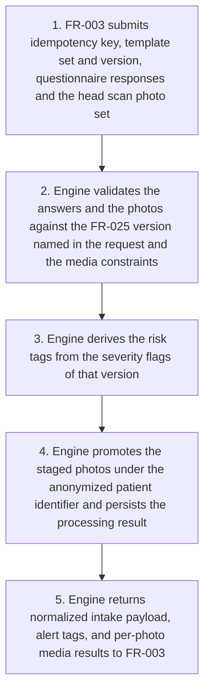
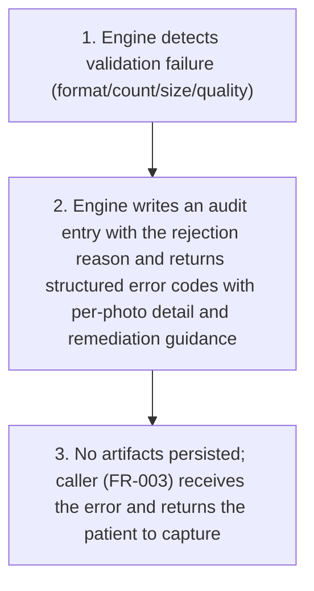
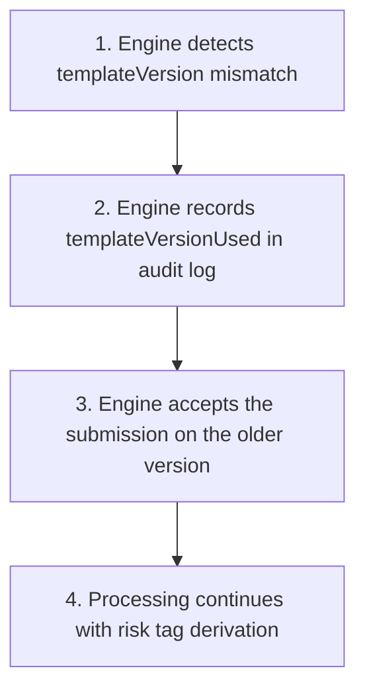
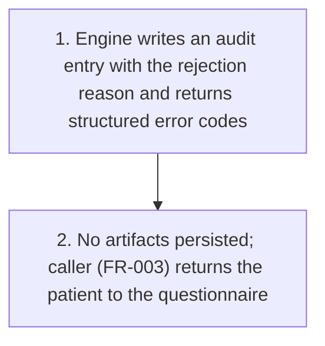
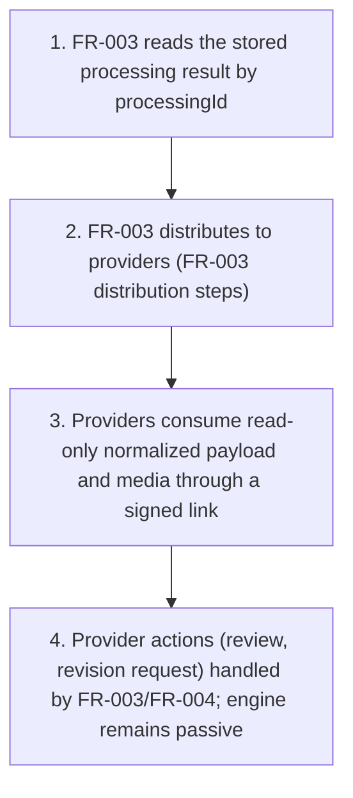
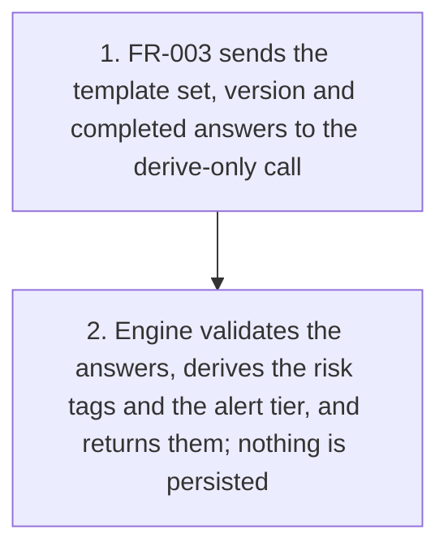

# FR-002 - Medical History & 3D Scanning

**Module**: P-07: 3D Scan Capture & Viewing (consumer) | S-01: 3D Media Processing Service | S-05: Media Storage Service | A-09: System Settings & Configuration (Questionnaire Templates Integration)  
**Feature Branch**: `002-medical-history-spec`  
**Created**: 2025-10-30  
**Status**: ✅ Verified & Approved  
**Source**: FR-002 from system-prd.md

## Executive Summary

FR-002 defines shared backend engines for processing medical intake data and head media, consumed by FR-003 (Inquiry) and others. It excludes patient-facing UI. The engine ingests medical questionnaire responses (defined/versioned via FR-025), generates severity alerts, validates and processes head media, stores it under an anonymized patient identifier, and persists the processing result and media for provider review. For V1, the patient app supplies a standardized head scan photo set (multiple 2D views; not a true 3D model); the engine validates and stores this media.
This FR covers backend engines only; patient capture UX is handled by FR-003 and consumed by `P-07` for V1.
For V1, "3D scan" capture is implemented as a standardized head scan photo set (multiple 2D views). True 3D capture is deferred to V2. (REQ-002-031)

## Module Scope

### Multi-Tenant Architecture

- **Shared Services (S-01, S-05)**: 3D Media Processing Service | Media Storage Service | Medical Intake Engine
- **Patient Platform (P-07)**: 3D Scan Capture & Viewing (consumer via FR-003)
- **Provider Platform (PR-02)**: Inquiry & Quote Management (read-only consumption)
- **Admin Platform (A-09)**: System Settings & Configuration (Questionnaire Templates Integration)

### Multi-Tenant Breakdown

**Patient Platform (P-07)**:

- Patient-facing capture UI: see REQ-002-025.
- Patient app submits questionnaire responses and head scan photo set (V1) to engine via FR-003
- Patients do not directly interact with FR-002 engine; all interaction through FR-003 (REQ-002-015)

**Provider Platform (PR-02)**:

- Providers consume read-only processed artifacts (normalized questionnaire, alerts, the provider copy of the media) (REQ-002-016, REQ-002-048); media access is by a time-limited signed link scoped to the providers the inquiry was distributed to (REQ-002-049)
- Provider review UI is handled by FR-003/PR-02; engine remains passive after initial processing (REQ-002-017)

**Admin Platform (A-09)**:

- Admin manages questionnaire templates, sections, fields, and risk-tag rules via FR-025 (REQ-002-019)
- Admin configures the head scan quality thresholds and video duration limits in FR-026; the head scan photo count, per-file size, formats and views are fixed by the product and are not admin settings (see Media Rules). Alert severity is driven by the severity flags admins set on questionnaire answers in FR-025; there is no separate alert threshold setting (REQ-002-020)
- Admin cannot modify fixed security constraints (encryption, retention policies) (REQ-002-021)
- Template versioning and publishing managed through FR-025; engine consumes the version of the set currently designated Active for Inquiry (FR-025 REQ-025-049, REQ-025-050) (REQ-002-022)

**Shared Services (S-01, S-05)**:

- **S-01: 3D Media Processing Service**: Validates head scan media (V1 photo set) and handles media transformations (the original file stays unmodified; see Media Rules) (REQ-002-023)
- **S-05: Media Storage Service**: Stores processed media artifacts with secure access controls; holds photos in a staging location from capture until the engine promotes them (REQ-002-024, REQ-002-046)
- **Medical Intake Engine**: Validates questionnaire responses, computes severity alerts, normalizes data, manages versioning, persists the processing result
- See REQ-002-027.
- See REQ-002-005.

### Communication Structure

**In Scope**:

- FR-003 → Engine: Submission of questionnaire responses and head scan media for processing; derive-only call when the questionnaire is completed (REQ-002-044); read of the stored result by processingId (REQ-002-043)
- Engine → FR-003: Return of normalized payload, alert tags, and per-photo media results
- Engine → Providers (via FR-003/PR-02): Read-only access to processed artifacts (REQ-002-016, REQ-002-039)
- Admin → Engine (via FR-025): Template and rule configuration updates
- Engine → System: Automatic consumption of the set FR-025 designates Active for Inquiry
- FR-011 and FR-037 → Engine: Media-only validation and storage of scans (REQ-002-047)

**Out of Scope** (REQ-002-025):

- Patient-facing capture UI (handled by FR-003)
- Provider review UI (handled by FR-003/PR-02)
- Real-time chat between patients and providers
- Appointment scheduling functionality
- Pricing setup and quote management (covered by FR-004)
- Direct patient-provider communication

### Entry Points

1. **FR-003 Submission**: FR-003 (Inquiry Submission) calls engine API with questionnaire responses and head scan media (REQ-002-014)
2. **Template Updates**: Engine automatically consumes the set FR-025 designates Active for Inquiry and its updated versions (REQ-002-014)
3. **Admin Configuration**: Admin designates a published set Active for Inquiry via FR-025 (A-09 settings); engine applies it to new inquiries (REQ-002-014, REQ-002-041)

## Business Workflows

### Workflow 1: Intake Processing (Engine Flow)

**Actors**: FR-003 (caller), Engine  
**Trigger**: FR-003 submits questionnaire responses and the head scan photo set to the engine  
**Outcome**: Engine returns normalized intake payload, derived alerts, and the stored media result per photo; the processing result is persisted under a processingId

**Flow Diagram**:

### Alternative Flows

**A1: Media validation fails**:

- **Trigger**: A photo does not meet the format, count, size or quality constraints
- **Outcome**: Engine returns structured error codes with per-photo detail and guidance for re-upload; the caller returns the patient to capture
- **Flow Diagram**:

**A2: Template version mismatch**:

- **Trigger**: Submitted templateVersion is a prior version of the same set, or belongs to the prior Active set
- **Outcome**: Engine accepts the submission and records the version used; validation and alert derivation use that version
- **Flow Diagram**:

**A3: Questionnaire or template version rejected**:

- **Trigger**: A required answer is missing, the templateVersion is unknown or was never published, or no set is designated Active for Inquiry (REQ-025-052)
- **Outcome**: Engine returns structured error codes naming each missing question or the version problem; nothing is persisted; the caller returns the patient to the questionnaire
- **Flow Diagram**:

---

### Workflow 2: Distribution Consumption (Read Flow)

**Actors**: FR-003 (distributor), Providers (consumers)  
**Trigger**: FR-003 reads the stored processing result by processingId for distribution  
**Outcome**: Providers receive the read-only normalized payload and the provider copy of the media via FR-003

**Flow Diagram**:

---

### Workflow 3: Admin Template Management (Management)

Template creation, editing, publishing and deprecation are owned by FR-025 (Medical Questionnaire Management); FR-002 defines no admin template Steps of its own.

**Outcome**: Engine consumes the version of the set currently designated Active for Inquiry and applies it to new submissions only; prior versions are kept for existing inquiries.

### Alternative Flows

**C1: Admin deprecates a template**:

- Owned by FR-025. FR-002 only consumes the result: prior versions are kept for existing inquiries and new inquiries use the version of the set currently designated Active for Inquiry.

---

### Workflow 4: Derive Only (Questionnaire Completed)

**Actors**: FR-003 (caller), Engine  
**Trigger**: The patient completes the questionnaire in FR-003  
**Outcome**: Engine returns the risk tags and the alert tier; nothing is persisted

**Flow Diagram**:

A missing required answer is returned as ANSWER_REQUIRED_MISSING (REQ-002-036); nothing is persisted, not even an audit entry.

---

## Screen Specifications (Minimal - Integration Contracts)

Backend-only: This FR provides integration contracts used by FR-003 (patient capture/distribution), FR-011 and FR-037 (scan intake without a questionnaire), and PR-02 (provider read-only). No user-facing screens are defined in this FR.

**Submit request (from FR-003)**:

- idempotencyKey (string): a retry with the same key replaces the earlier artifact set (REQ-002-045)
- templateSetId (string), templateVersion (string): the FR-025 set and version the patient answered (REQ-002-037, REQ-002-041)
- responses (object keyed by questionId per FR-025)
- headScanPhotoSet (required): list of up to 5 photo items { stagedRef, viewHint? } (REQ-002-038)
- patientContext { anonymizedPatientId }

headVideo is a future form and is not part of the V1 contract (REQ-002-035). FR-003 visual evidence is validated and stored by FR-003 and does not pass through this call (REQ-002-038).

**Submit response (to FR-003 / PR-02)**:

- processingId (string): the key for the later read (REQ-002-043)
- normalized { responsesNormalized, templateVersionUsed, templateSetId }
- alerts RiskTag[] { code, label, severity (critical|standard|none), rationale, derivedFrom } (REQ-002-002)
- scanRef (string): the reference FR-003 reads to reach the stored head scan photo set
- headScanPhotos: one item per photo { storedUri, validationStatus, qualityScore (0 to 100, the value the threshold check used) } (REQ-002-006, REQ-002-034)
- audit { processingId, processedAt }

**Other calls**:

- Derive only (from FR-003 when the questionnaire is completed): templateSetId, templateVersion, responses. Returns the alerts or the error codes; persists nothing (REQ-002-044).
- Read (from FR-003): processingId. Returns the stored submit response (REQ-002-043).
- Media only (from FR-011 and FR-037): anonymizedPatientId and headScanPhotoSet, with no responses or templateVersion. Returns scanRef and the per-photo items (REQ-002-047).

**Rules**:

- Enforce FR-025 required answers and the media constraints (REQ-002-001, REQ-002-003); stamping: see REQ-002-005.
- Store media under anonymizedPatientId; no PII in payloads. (REQ-002-009, REQ-002-008)
- Error codes: see REQ-002-036.

## Business Rules

### General Rules

1. Engine operations are fully auditable (timestamps, actor/service, the rejection reason on rejected attempts). (REQ-002-026)
2. Draft/submit/edit UX is defined in FR-003; the engine keeps no session state between calls, and the processing result and media are persisted. (REQ-002-027)
3. All processing stamps one configuration version: templateVersionUsed, with the set identifier (templateSetId). Validation and alert derivation use the version named in the request. (REQ-002-005)
4. All access is mediated by platform RBAC and immutable audit logging (REQ-002-026, REQ-002-029).

### Data & Privacy Rules

1. See system PRD, Platform-Wide Rules: Patient identity hidden until booking confirmation (this FR does not restate it). A visible face in the head scan photos and the free-text answers are a documented exception: providers see them before payment. (REQ-SYS-001; REQ-002-048)
2. Retention follows the system PRD, Platform-Wide Rules: One 10-year retention period; deletion requests result in archival/anonymization (no hard deletes). Photos held in staging before submit are outside this rule (REQ-002-046). (REQ-SYS-002; REQ-002-028)
3. All access is role-based; admin access is logged with justification for sensitive views. (REQ-002-029)
4. Intake payloads and media artifacts processed under this FR are encrypted in transit (TLS 1.3) and at rest (AES-256), in alignment with the Constitution and FR-026. (REQ-002-030)
5. Providers receive a transformed copy of the head scan photos with device and location metadata stripped; the original stays unmodified for the patient and Admin. (REQ-002-048)
6. Providers reach the media by a time-limited signed link, scoped to the providers the inquiry was distributed to; the link is withdrawn when the inquiry is cancelled or the provider leaves the distribution. (REQ-002-049)

### Media Rules (Head Scan Media Intake)

1. For V1, head media is a standardized **photo set** captured in the patient app and uploaded to the system (not a true 3D model). (REQ-002-031)
2. The head scan offers five views (front, top, left, right, back). At least one photo is required; no single view is compulsory. The product fixes these views; they are not an admin setting. (REQ-002-032)
3. Allowed formats: JPG/PNG. A head scan holds up to 5 photos of at most 2 MB each, with no total-size limit, counted on its own (separate from the FR-003 visual evidence limit, which has its own count). The product fixes the count, size and formats; they are not admin settings. (REQ-002-033)
4. Basic quality checks (e.g., brightness/blur) MUST be enforced against the FR-026 quality thresholds and actionable guidance returned on failure. The quality score is 0 to 100 and is returned per photo. (REQ-002-034)
5. `headVideo` is a future form and is not part of the V1 contract; if it is added, the FR-026 duration limits (min/max) apply. (REQ-002-035)
6. On validation failure, engine returns structured error codes with per-photo detail and guidance to the caller (FR-003); no artifacts persisted; an audit entry records the rejection reason. Error codes cover every enforced rule: MEDIA_FORMAT_NOT_ALLOWED, MEDIA_COUNT_EXCEEDED, MEDIA_SIZE_EXCEEDED, MEDIA_QUALITY_INSUFFICIENT, MEDIA_NO_PHOTO, TEMPLATE_VERSION_UNKNOWN, NO_ACTIVE_TEMPLATE_SET, ANSWER_REQUIRED_MISSING. (REQ-002-036)
7. The original media file is kept unmodified; any transformation creates a separate copy. (REQ-002-042)
8. Photos are staged at capture and promoted under anonymizedPatientId at submit. A retry with the same idempotencyKey replaces the earlier artifact set. Staged photos are removed when the 7-day draft expires. (REQ-002-045, REQ-002-046)
9. FR-011 and FR-037 call the engine with the head scan photo set alone: the same media limits apply and no responses or templateVersion are sent. (REQ-002-047)
10. The engine's check is authoritative. The device check is advisory and uses the same FR-026 thresholds; FR-003 returns the patient to capture when the engine rejects the media. (REQ-002-050)

### Admin Editability

1. Admin can manage templates, guidance copy, and risk-tag rules. (REQ-002-019)
2. Admin cannot alter fixed security constraints (e.g., password policy, OTP length). (REQ-002-021)
3. Admin edits are versioned; prior versions remain accessible for existing inquiries. (REQ-002-040)

**Carried from dropped sections (original wording)**:

- Email/Notification Service (indirect via consumer modules): surface validation failures to patients/providers
- FR-003 manages drafts/resubmissions and user communications
- Deterministic normalization and alert derivation based on versioned rules
- Horizontal scaling of processing workers; rate limiting to protect services

## User Scenarios & Testing

### User Story 1 - Process Intake Payload (Priority: P1)

Why: Core value of engine; required for all downstream flows.

Independent Test: Submit valid responses + a compliant head scan photo set and verify normalized payload, alerts, and per-photo stored media results are returned within SLA, and that the stored result can be read back by processingId.

Acceptance Scenarios:

1. Given valid responses and compliant media, When submitted, Then engine returns normalized payload, alerts, and a stored URI per photo in < 3s (p95)
2. Given responses reference a published templateVersion, When processed, Then response stamps templateVersionUsed and the set identifier
3. Given anonymizedPatientId in context, When media is stored, Then storedUri is present and no PII appears in payloads
4. Given a stored processingId, When FR-003 reads it, Then the stored normalized payload, alerts and media results are returned
5. Given completed answers, When the derive-only call is made, Then the alerts are returned and nothing is stored

### User Story 2 - Handle Validation Failures (Priority: P1)

Why: Clear guidance reduces retries and support burden.

Independent Test: Submit payloads violating media format/count/size/quality, a missing required answer, or an unusable template version, and verify structured error codes with remediation guidance and per-photo detail; no artifacts persisted.

Acceptance Scenarios:

1. Given no head scan photo is supplied, When processed, Then engine returns MEDIA_NO_PHOTO with guidance; no storage
2. Given file size exceeds limit, When processed, Then engine returns MEDIA_SIZE_EXCEEDED with compression guidance; no storage
3. Given brightness/blur below threshold, When processed, Then engine returns MEDIA_QUALITY_INSUFFICIENT with retake instructions; no storage
4. Given a photo in another format or more than 5 photos, When processed, Then engine returns MEDIA_FORMAT_NOT_ALLOWED or MEDIA_COUNT_EXCEEDED, naming the photo; no storage
5. Given a required answer is missing, When processed, Then engine returns ANSWER_REQUIRED_MISSING naming the question; no storage
6. Given a never-published templateVersion or no Active set, When processed, Then engine returns TEMPLATE_VERSION_UNKNOWN or NO_ACTIVE_TEMPLATE_SET; no storage
7. Given any rejected attempt, When it is rejected, Then an audit entry records the rejection reason and no artifacts are stored

### Edge Cases

- Poor lighting: engine rejects with specific error codes and guidance. (REQ-002-034, REQ-002-036)
- Template version mismatch: see REQ-002-037 (Alternative Flow A2).
- Oversize file: engine rejects with size error and suggested compression guidance. (REQ-002-033, REQ-002-036)
- Retry after a dropped response: the same idempotencyKey replaces the earlier artifact set. (REQ-002-045)

## Functional Requirements Summary

### Core Requirements

- **REQ-002-001**: Engine MUST validate responses against the FR-025 template version named in the request
- **REQ-002-002**: Engine MUST derive risk/alert tags deterministically from the severity flags of that version and is the only producer of risk tags: one tag per Yes answer, and the highest severity among them sets the tier (Critical is Red, Standard is Amber; FR-025 REQ-025-064); when every answer is No it returns one tag with severity none (Green)
- **REQ-002-003**: Engine MUST validate and persist media artifacts
- **REQ-002-004**: Engine MUST return normalized payload, alerts, per-photo media results, scanRef and audit fields

### Data Requirements

- **REQ-002-005**: Responses MUST be stamped with templateVersionUsed and the set identifier; there is no separate ruleset stamp, and FR-003 questionnaireVersion is a copy of templateVersionUsed
- **REQ-002-006**: Media artifacts MUST store validationStatus and qualityScore
- **REQ-002-007**: Audit records MUST capture processingId and processedAt

### Security & Privacy Requirements

- **REQ-002-008**: No PII in engine responses; anonymized identifiers only. This covers the structured fields; free-text answers and a visible face are the exception in REQ-002-048
- **REQ-002-009**: Media MUST be stored under anonymizedPatientId
- **REQ-002-010**: All operations MUST be fully auditable and retention-compliant

### Integration Requirements

- **REQ-002-011**: Engine MUST consume questionnaire templates/rules from FR-025 (read-only)
- **REQ-002-012**: Engine MUST expose the submit, derive-only and read calls consumed by FR-003, and the media-only call consumed by FR-011 and FR-037
- **REQ-002-013**: Engine MUST return structured error codes for validation failures (full list: REQ-002-036)
- **REQ-002-043**: Engine MUST persist the processing result keyed by processingId and return it on a read by processingId; retention follows REQ-SYS-002
- **REQ-002-044**: Engine MUST offer a derive-only call that validates the answers, returns the tags and persists nothing; submit runs the same derivation
- **REQ-002-045**: A submit retry with the same idempotencyKey MUST replace the earlier artifact set
- **REQ-002-046**: Photos MUST be staged at capture and promoted under anonymizedPatientId at submit; staged photos are removed when the 7-day draft expires and are outside the retention rule
- **REQ-002-047**: Engine MUST offer a media-only call (no responses, no templateVersion) for FR-011 and FR-037, under the limits of REQ-002-032 to REQ-002-036
- **REQ-002-048**: Providers MUST receive a transformed copy of the head scan photos with device and location metadata stripped; the original stays unmodified for the patient and Admin. A visible face and free-text answers are a documented exception to REQ-SYS-001 (owner default 75)
- **REQ-002-049**: Media access for providers MUST use a time-limited signed link scoped to the providers the inquiry was distributed to, withdrawn on cancellation or when the provider leaves the distribution
- **REQ-002-050**: The engine check MUST be authoritative; the device check is advisory with the same FR-026 thresholds

## Dependencies

- FR-003: Inquiry Submission & Distribution (caller for capture and distribution)
- FR-011 and FR-037: callers of the media-only call
- FR-025: Medical Questionnaire Management (templates, rules and the Active-for-Inquiry designation)
- FR-026: System Settings (head scan quality thresholds and video duration limits)
- FR-020: Notifications & Alerts (used by consumer modules for user messaging)

---

## Appendix: Change Log

| Date | Version | Changes | Author |
| --- | --- | --- | --- |
| 2026-11-22 | 1.4 | Requirements graph programme baseline: PRD compressed to the checklist structure (each rule stated once, field rows tagged with graph field ids, dropped classes removed). No rule changes. Earlier history (v1.0 to v1.3) and the change requests (the PRD names none) are in `archived/prd-baseline-2026-11-08/` and in git history. | AI |
| 2026-11-23 | 1.5 | Independent compression review: 4 clause(s) from dropped sections restored in original wording under Business Rules. No rule changes. | AI |
| 2026-11-24 | 1.6 | Logic review pass 1 (14 findings, 13 applied here). The engine persists the processing result by processingId and offers derive-only, read and media-only calls; it is the only producer of risk tags. One version stamp (ruleset stamp removed); the Active-for-Inquiry set replaces "latest published". Head scan count, size, formats and views are fixed by the product. Per-photo results, staging and idempotency, wider error-code list, provider copy and signed link (owner defaults 74 and 75). New REQ-002-043 to REQ-002-050. | AI |

## Appendix: Approvals

| Role | Name | Date | Signature/Approval |
| --- | --- | --- | --- |

---

**Document Status**: ✅ Complete  
**Maintained By**: Product & Engineering Teams  
**Review Cycle**: Monthly or upon major changes
