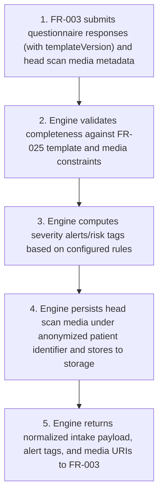
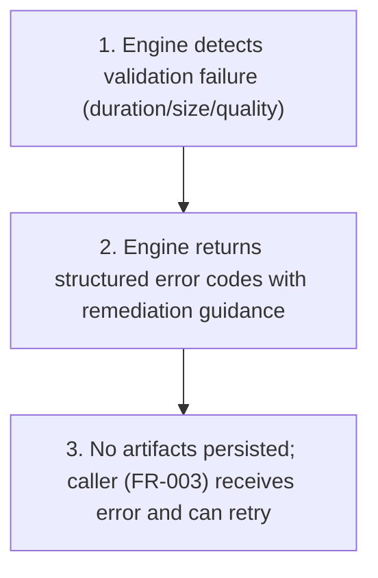
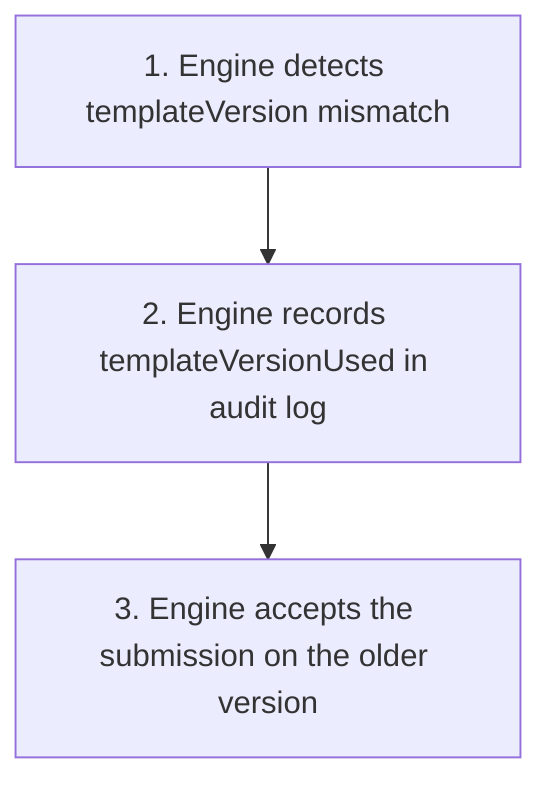
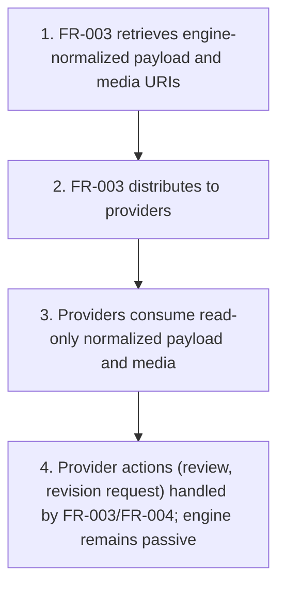

# FR-002 - Medical History & 3D Scanning

**Module**: P-07: 3D Scan Capture & Viewing (consumer) | S-01: 3D Media Processing Service | S-05: Media Storage Service | A-09: System Settings & Configuration (Questionnaire Templates Integration)  
**Feature Branch**: `002-medical-history-spec`  
**Created**: 2025-10-30  
**Status**: ✅ Verified & Approved  
**Source**: FR-002 from system-prd.md

## Executive Summary

FR-002 defines shared backend engines for processing medical intake data and head media, consumed by FR-003 (Inquiry) and others. It excludes patient-facing UI. The engine ingests medical questionnaire responses (defined/versioned via FR-025), generates severity alerts, validates and processes head media, applies anonymization, and persists artifacts for provider review. For V1, the patient app supplies a standardized head scan photo set (multiple 2D views; not a true 3D model); the engine validates and stores this media.
This FR covers backend engines only; patient capture UX is handled by FR-003 and consumed by `P-07` for V1.
For V1, "3D scan" capture is implemented as a standardized head scan photo set (multiple 2D views). True 3D capture is deferred to V2. (REQ-002-031)

## Module Scope

### Multi-Tenant Architecture

- **Shared Services (S-01, S-05)**: 3D Media Processing Service | Media Storage Service | Medical Intake Engine
- **Patient Platform (P-07)**: 3D Scan Capture & Viewing (consumer via FR-003)
- **Provider Platform (PR-02)**: Inquiry & Quote Management (read-only consumption)
- **Admin Platform (A-09)**: System Settings & Configuration (Questionnaire Templates Integration)

### Multi-Tenant Breakdown

**Patient Platform (P-07)**:

- Patient-facing capture UI: see REQ-002-025.
- Patient app submits questionnaire responses and head scan photo set (V1) to engine via FR-003
- Patients do not directly interact with FR-002 engine; all interaction through FR-003 (REQ-002-015)

**Provider Platform (PR-02)**:

- Providers consume read-only processed artifacts (normalized questionnaire, alerts, processed media) (REQ-002-016)
- Provider review UI is handled by FR-003/PR-02; engine remains passive after initial processing (REQ-002-017)

**Admin Platform (A-09)**:

- Admin manages questionnaire templates, sections, fields, and risk-tag rules via FR-025 (REQ-002-019)
- Admin configures validation rules and media constraints (head scan photo limits are fixed; see Media Rules). Alert severity is driven by the severity flags admins set on questionnaire answers in FR-025; there is no separate alert threshold setting (REQ-002-020)
- Admin cannot modify fixed security constraints (encryption, retention policies) (REQ-002-021)
- Template versioning and publishing managed through FR-025; engine consumes published versions (REQ-002-022)

**Shared Services (S-01, S-05)**:

- **S-01: 3D Media Processing Service**: Validates head scan media (V1 photo set) and handles media transformations (the original file stays unmodified; see Media Rules) (REQ-002-023)
- **S-05: Media Storage Service**: Stores processed media artifacts with secure access controls (REQ-002-024)
- **Medical Intake Engine**: Validates questionnaire responses, computes severity alerts, normalizes data, manages versioning
- See REQ-002-027.
- See REQ-002-005.

### Communication Structure

**In Scope**:

- FR-003 → Engine: Submission of questionnaire responses and head scan media for processing
- Engine → FR-003: Return of normalized payload, alert tags, and media URIs
- Engine → Providers (via FR-003/PR-02): Read-only access to processed artifacts (REQ-002-016, REQ-002-039)
- Admin → Engine (via FR-025): Template and rule configuration updates
- Engine → System: Automatic consumption of published template versions

**Out of Scope** (REQ-002-025):

- Patient-facing capture UI (handled by FR-003)
- Provider review UI (handled by FR-003/PR-02)
- Real-time chat between patients and providers
- Appointment scheduling functionality
- Pricing setup and quote management (covered by FR-004)
- Direct patient-provider communication

### Entry Points

1. **FR-003 Submission**: FR-003 (Inquiry Submission) calls engine API with questionnaire responses and head scan media (REQ-002-014)
2. **Template Updates**: Engine automatically consumes updated templates/rules when FR-025 publishes new versions (REQ-002-014)
3. **Admin Configuration**: Admin publishes template versions via FR-025 (A-09 settings); engine applies to new inquiries (REQ-002-014, REQ-002-041)

## Business Workflows

### Workflow 1: Intake Processing (Engine Flow)

**Actors**: FR-003 (caller), Engine  
**Trigger**: FR-003 submits questionnaire responses and media metadata to the engine  
**Outcome**: Engine returns normalized intake payload, derived alerts, and stored media URI(s)

**Flow Diagram**:

### Alternative Flows

**A1: Media validation fails**:

- **Trigger**: Media does not meet quality, duration, or size constraints
- **Outcome**: Engine returns structured error codes and guidance for re-upload
- **Flow Diagram**:

**A2: Template version mismatch**:

- **Trigger**: Submitted templateVersion is older than the currently published version
- **Outcome**: Engine accepts the submission and records the version used
- **Flow Diagram**:

---

### Workflow 2: Distribution Consumption (Read Flow)

**Actors**: FR-003 (distributor), Providers (consumers)  
**Trigger**: FR-003 requests engine-normalized payload and media URIs for distribution  
**Outcome**: Providers receive read-only normalized payload and media links via FR-003

**Flow Diagram**:

---

### Workflow 3: Admin Template Management (Management)

Template creation, editing, publishing and deprecation are owned by FR-025 (Medical Questionnaire Management); FR-002 defines no admin template Steps of its own.

**Outcome**: Engine consumes the published version and applies it to new submissions only; prior versions are kept for existing inquiries.

### Alternative Flows

**C1: Admin deprecates a template**:

- Owned by FR-025. FR-002 only consumes the result: prior versions are kept for existing inquiries and new inquiries use the latest published version.

---

## Screen Specifications (Minimal - Integration Contracts)

Backend-only: This FR provides integration contracts used by FR-003 (patient capture/distribution) and PR-02 (provider read-only). No user-facing screens are defined in this FR.

**Request (from FR-003)**:

- templateVersion (string)
- responses (object keyed by questionId per FR-025)
- media: one of (REQ-002-038)
  - headScanPhotoSet { uris[], sizeBytesTotal?, viewHints? }  // V1: standardized photo set capture
  - headVideo { uri, durationSeconds, sizeBytes, frameHints? } // optional fallback / future
  - altPhotos { uris[] } | altClips { uris[] }  // aligns with system PRD supplemental media support
- patientContext { anonymizedPatientId }

**Response (to FR-003 / PR-02)**:

- normalized { responsesNormalized, templateVersionUsed }
- alerts RiskTag[] { code, label, severity (critical|standard|none), rationale, derivedFrom }
- media { storedUri, validationStatus }
- audit { processingId, processedAt }

**Rules**:

- Enforce FR-025 required fields and media constraints (REQ-002-001, REQ-002-003); stamping: see REQ-002-005.
- Store media under anonymizedPatientId; no PII in payloads. (REQ-002-009, REQ-002-008)
- See REQ-002-036.

## Business Rules

### General Rules

1. Engine operations are fully auditable (timestamps, actor/service, reasons on overrides). (REQ-002-026)
2. Draft/submit/edit UX is defined in FR-003; engine is stateless between calls except persisted artifacts. (REQ-002-027)
3. All processing includes configuration version stamping (templateVersion, rulesetVersion). rulesetVersion is the FR-025 questionnaire set version. (REQ-002-005)
4. All access is mediated by platform RBAC and immutable audit logging (REQ-002-026, REQ-002-029).

### Data & Privacy Rules

1. See system PRD, Platform-Wide Rules: Patient identity hidden until booking confirmation (this FR does not restate it). (REQ-SYS-001)
2. Retention follows the system PRD, Platform-Wide Rules: One 10-year retention period; deletion requests result in archival/anonymization (no hard deletes). (REQ-SYS-002; REQ-002-028)
3. All access is role-based; admin access is logged with justification for sensitive views. (REQ-002-029)
4. Intake payloads and media artifacts processed under this FR are encrypted in transit (TLS 1.3) and at rest (AES-256), in alignment with the Constitution and FR-026. (REQ-002-030)

### Media Rules (Head Scan Media Intake)

1. For V1, head media is a standardized **photo set** captured in the patient app and uploaded to the system (not a true 3D model). (REQ-002-031)
2. The head scan offers five views (front, top, left, right, back). At least one photo is required; no single view is compulsory. (REQ-002-032)
3. Allowed formats: JPG/PNG. A head scan holds up to 5 photos of at most 2 MB each, counted on its own (separate from the FR-003 visual evidence limit, which has its own count). (REQ-002-033)
4. Basic quality checks (e.g., brightness/blur) MUST be enforced and actionable guidance returned on failure. (REQ-002-034)
5. If `headVideo` is accepted (optional fallback/future), duration constraints (min/max) apply via policy (A-09). (REQ-002-035)
6. On validation failure, engine returns structured error codes and guidance to the caller (FR-003); no artifacts persisted. (REQ-002-036)
7. The original media file is kept unmodified; any transformation creates a separate copy. (REQ-002-042)

### Admin Editability

1. Admin can manage templates, guidance copy, and risk-tag rules. (REQ-002-019)
2. Admin cannot alter fixed security constraints (e.g., password policy, OTP length). (REQ-002-021)
3. Admin edits are versioned; prior versions remain accessible for existing inquiries. (REQ-002-040)

## User Scenarios & Testing

### User Story 1 - Process Intake Payload (Priority: P1)

Why: Core value of engine; required for all downstream flows.

Independent Test: Submit valid responses + compliant head scan media metadata and verify normalized payload, alerts, and stored media URIs are returned within SLA.

Acceptance Scenarios:

1. Given valid responses and compliant media, When submitted, Then engine returns normalized payload, alerts, and stored URI in < 3s (p95)
2. Given responses reference a published templateVersion, When processed, Then response stamps templateVersionUsed and rulesetVersion
3. Given anonymizedPatientId in context, When media is stored, Then storedUri is present and no PII appears in payloads

### User Story 2 - Handle Validation Failures (Priority: P1)

Why: Clear guidance reduces retries and support burden.

Independent Test: Submit payloads violating media completeness/size/quality (and duration if video) and verify structured error codes with remediation guidance; no artifacts persisted.

Acceptance Scenarios:

1. Given no head scan photo is supplied, When processed, Then engine returns MEDIA_INCOMPLETE_VIEW_SET with guidance; no storage
2. Given file size exceeds limit, When processed, Then engine returns MEDIA_SIZE_EXCEEDED with compression guidance; no storage
3. Given brightness/blur below threshold, When processed, Then engine returns MEDIA_QUALITY_INSUFFICIENT with retake instructions; no storage

### Edge Cases

- Media too short or poor lighting: engine rejects with specific error codes and guidance. (REQ-002-034, REQ-002-036)
- Template version mismatch: see REQ-002-037 (Alternative Flow A2).
- Oversize file: engine rejects with size error and suggested compression guidance. (REQ-002-033, REQ-002-036)

## Functional Requirements Summary

### Core Requirements

- **REQ-002-001**: Engine MUST validate responses against FR-025 template requirements
- **REQ-002-002**: Engine MUST derive risk/alert tags deterministically from rules
- **REQ-002-003**: Engine MUST validate and persist media artifacts
- **REQ-002-004**: Engine MUST return normalized payload, alerts, media URIs, and audit fields

### Data Requirements

- **REQ-002-005**: Responses MUST be stamped with templateVersionUsed and rulesetVersion
- **REQ-002-006**: Media artifacts MUST store validationStatus
- **REQ-002-007**: Audit records MUST capture processingId and processedAt

### Security & Privacy Requirements

- **REQ-002-008**: No PII in engine responses; anonymized identifiers only
- **REQ-002-009**: Media MUST be stored under anonymizedPatientId
- **REQ-002-010**: All operations MUST be fully auditable and retention-compliant

### Integration Requirements

- **REQ-002-011**: Engine MUST consume questionnaire templates/rules from FR-025 (read-only)
- **REQ-002-012**: Engine MUST expose processing API consumed by FR-003
- **REQ-002-013**: Engine MUST return structured error codes for validation failures

## Dependencies

- FR-003: Inquiry Submission & Distribution (caller for capture and distribution)
- FR-025: Medical Questionnaire Management (templates and rules)
- FR-020: Notifications & Alerts (used by consumer modules for user messaging)

---

## Appendix: Change Log

| Date | Version | Changes | Author |
| --- | --- | --- | --- |
| 2026-11-22 | 1.4 | Requirements graph programme baseline: PRD compressed to the checklist structure (each rule stated once, field rows tagged with graph field ids, dropped classes removed). No rule changes. Earlier history (v1.0 to v1.3) and the change requests (the PRD names none) are in `archived/prd-baseline-2026-11-08/` and in git history. | AI |

## Appendix: Approvals

| Role | Name | Date | Signature/Approval |
| --- | --- | --- | --- |

---

**Document Status**: ✅ Complete  
**Maintained By**: Product & Engineering Teams  
**Review Cycle**: Monthly or upon major changes
