# FR-003 - Inquiry Submission & Distribution

**Module**: P-02: Quote Request & Management | PR-02: Inquiry & Quote Management | A-01: Patient Management & Oversight  
**Feature Branch**: `fr003-inquiry-submission`  
**Created**: 2025-10-23  
**Status**: ✅ Documentation Approved (baseline 2026-11-25); implementation reconciliation pending  
**Source**: FR-003 from system-prd.md  

## Executive Summary

The Inquiry Submission & Distribution module enables patients to submit comprehensive treatment requests through the mobile app, which are then automatically distributed to relevant providers based on location and availability. The module supports multi-country selection, detailed medical questionnaires, head scan capture *(V1 photo set; true 3D in V2)*, and comprehensive inquiry management across all platform tenants.
In V1, "3D head scan" capture is implemented as a standardized head scan photo set (multiple 2D views). True 3D capture is deferred to V2. (REQ-003-039)

## Module Scope

### Multi-Tenant Architecture

- **Patient Platform (P-02)**: Quote Request & Management
- **Provider Platform (PR-02)**: Inquiry & Quote Management  
- **Admin Platform (A-01)**: Patient Management & Oversight

### Multi-Tenant Breakdown

**Patient Platform (P-02)**:

- Create and manage inquiries on mobile (service selection, destinations, medical questionnaire, media upload, date ranges)
- Resume drafts; view inquiry dashboard and status timeline
- Review anonymized provider responses (quotes handled by FR-004)

**Provider Platform (PR-02)**:

- View distributed inquiries with anonymized patient info and medical alerts
- Review inquiry details including head scan capture assets *(V1 photo set; true 3D in V2)* and questionnaire
- Manage inquiry status prior to quote creation (quote creation in FR-004)

**Admin Platform (A-01)**:

- Global oversight of all inquiries across lifecycle stages
- Edit/override inquiry details; reassign providers; soft-delete with audit
- Configure distribution rules aligned with system PRD

**Shared Services (S-XX)**:

- Notification service for distribution and status changes
- Media service for secure storage and retrieval of head scan capture assets *(V1 photo sets; V2 true 3D)*
- Audit logging, anonymization and soft delete utilities

### Communication Structure

**In Scope**:

- Patient → System: Inquiry submission with comprehensive data
- System → Provider: Automatic inquiry distribution and notifications
- Provider → System: Inquiry management prior to quote (quotes in FR-004)
- Admin → All Parties: Oversight, edit, and management actions
- Structured Updates: System-generated notifications and status updates

**Out of Scope**:

- Direct patient-provider chat (handled by FR-012) (REQ-003-023)

### Entry Points

1. **Patient-Initiated**: Primary flow through mobile app inquiry creation (REQ-003-022)
2. **Admin-Managed**: Direct inquiry creation and management by admin team (REQ-003-022)
3. **Provider-Viewed**: Provider access to distributed inquiries (REQ-003-022)

## Business Workflows

### Workflow 1: Patient Inquiry Creation (Primary Flow)

**Actors**: Patient, System, Medical Questionnaire Engine, Head Scan Media Service  
**Trigger**: Patient starts a new inquiry in the mobile app and proceeds through the creation steps  
**Outcome**: A complete inquiry is created with destinations, media, head scan reference, date ranges, and medical questionnaire; inquiry ID generated (REQ-003-026, REQ-003-059)

**Flow Diagram**:

```mermaid
flowchart TD
    Start["Service Selection"] --> Service["Patient opens mobile app and selects &quot;Get a Hair Transplant&quot;<br/>System retrieves the active treatment-area catalog<br/>Patient selects one active treatment-area option<br/>System validates patient eligibility"]
    Service --> Eligible{"Eligibility valid?"}
    Eligible -->|No| EligibleErr["Show eligibility error + block progression"]
    Eligible -->|Yes| Dest["Destination Selection<br/>Patient selects preferred countries/locations (max 10 countries)<br/>System displays starting prices for each location<br/>Patient can select multiple destinations<br/>System suggests nearest countries to patient's location first"]

    Dest --> DestOk{"Destination selection valid?"}
    DestOk -->|No| DestErr["Show validation error + stay on destination selection"] --> Dest
    DestOk -->|Yes| Details["Detailed Information Collection<br/>Patient provides detailed hair concerns:<br/>- Nature of concern (text)<br/>- Duration of concern (choice from the Admin-managed duration list)<br/>- Previous treatments (text)<br/>- Symptom severity (1-10 slider)<br/>- Lifestyle factors (optional text)<br/>- Additional notes (optional text)"]

    Details --> Upload["Visual Evidence Upload<br/>Patient uploads visual evidence (max 5 photos/videos)<br/>Photos: JPG/PNG &lt;= 2MB each<br/>Videos: MP4 &lt;= 30s, &lt;= 20MB each"]
    Upload --> MediaOk{"Uploads meet policy?"}
    MediaOk -->|No| MediaErr["Show upload policy error + require changes"] --> Upload
    MediaOk -->|Yes| Scan["Head Scan Photo Set Capture (V1)<br/>Patient receives capture instructions<br/>Patient captures standardized head scan photo set (multiple 2D views)<br/>System validates capture quality<br/>Media stored for provider review"]

    Scan --> ScanOk{"Scan quality valid?"}
    ScanOk -->|No| Retake["Prompt retake + guidance"] --> Scan
    ScanOk -->|Yes| Dates["Treatment Date Selection<br/>Patient selects preferred treatment dates (max 10 date ranges)<br/>Date ranges can be up to 2 years in the future<br/>Patient can select multiple non-overlapping ranges<br/>System validates date availability"]

    Dates --> DatesOk{"Date selection valid?"}
    DatesOk -->|No| DatesErr["Show validation error + stay on date selection"] --> Dates
    DatesOk -->|Yes| Med["Medical Questionnaire Completion<br/>Patient completes comprehensive medical questionnaire (allergies, medications, chronic diseases, previous surgeries, etc.)<br/>Each question requires Yes/No answer<br/>Detailed explanation required for &quot;Yes&quot; answers<br/>System reads the 3-tier medical alert level from the patient's risk tags (FR-002; tier rule REQ-025-064):<br/>- Critical (red)<br/>- Standard (yellow/amber)<br/>- None (green)"]

    Med --> MedOk{"Questionnaire complete + valid?"}
    MedOk -->|No| MedErr["Show validation error + stay on medical questionnaire"] --> Med
    MedOk -->|Yes| ProviderSel["Provider Selection<br/>Patient selects preferred providers (max 5 providers) on Screen 7a<br/>System suggests providers based on positive reviews and admin curation<br/>Patient can search/filter providers by country, rating, and specialty"]

    ProviderSel --> ProvOk{"Provider selection valid?"}
    ProvOk -->|No| ProvErr["Show validation error + stay on provider selection"] --> ProviderSel
    ProvOk -->|Yes| Review["Inquiry Review &amp; Submission<br/>Patient reviews complete inquiry summary (including selected providers)<br/>Patient confirms all information accuracy<br/>Patient submits inquiry to system<br/>System generates unique inquiry ID (HPID format)"]

    Review --> SubmitOk{"Submission succeeds?"}
    SubmitOk -->|No| SubmitErr["Show submission error + allow retry"] --> Review
    SubmitOk -->|Selected provider no longer eligible| ProvGone["Show &quot;[Provider name] is no longer available.<br/>Please choose another provider.&quot;"] --> ProviderSel
    SubmitOk -->|Yes| Created["Inquiry created (HPID generated)"]
```

### Alternative Flows

**A1: Patient abandons inquiry mid-process**:

- **Trigger**: Patient leaves the inquiry creation flow before submission
- **Outcome**: Draft saved; patient can resume within 7 days (REQ-003-058)
- **Flow Diagram**:

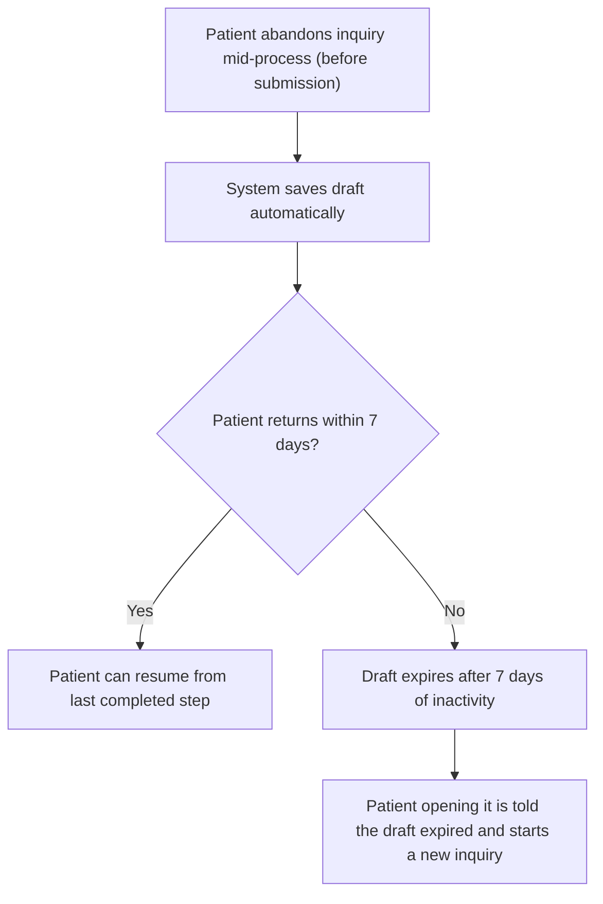

The 7 days is fixed at launch and is not an admin setting. (REQ-003-004)

**A2: Patient has existing incomplete inquiry**:

- **Trigger**: Patient returns to the app with an existing incomplete inquiry
- **Outcome**: Patient resumes or modifies existing inquiry (REQ-003-057, REQ-003-058)
- **Flow Diagram**:

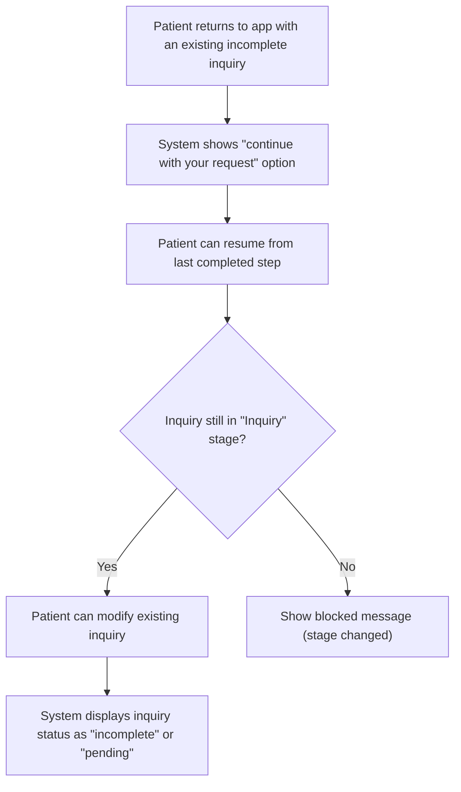

**A3: Medical questionnaire reveals critical conditions**:

- **Trigger**: Patient answers indicate high-risk medical conditions
- **Outcome**: Inquiry flagged with critical alerts for provider awareness (not patient rejection); "critical" means the FR-025 Red tier, and the admin sees it as a badge on the inquiry in the queue (Screen 11) with no separate notification (REQ-003-050)
- **Flow Diagram**:

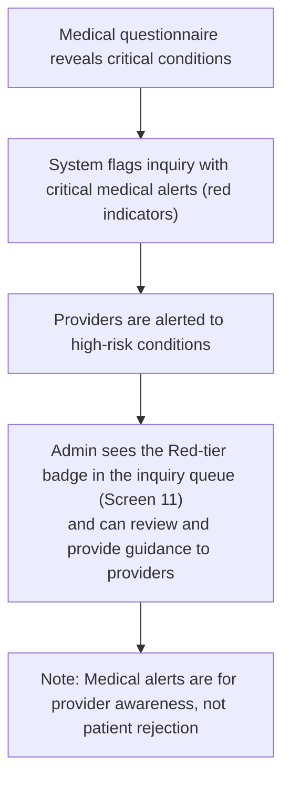

**A4: Patient cancels inquiry (see Workflow 5)**:

- **Trigger**: Patient initiates cancellation from Inquiry Dashboard (Screen 8) in stages: Inquiry or Quoted. From acceptance onward the patient sees "Contact support" instead, and only an admin can cancel the booking (FR-006). (REQ-003-106)
- **Outcome**: Inquiry cancelled; draft, sent, and expired quotes auto-cancelled; their providers notified; inquiry becomes read-only
- **Flow Diagram**:

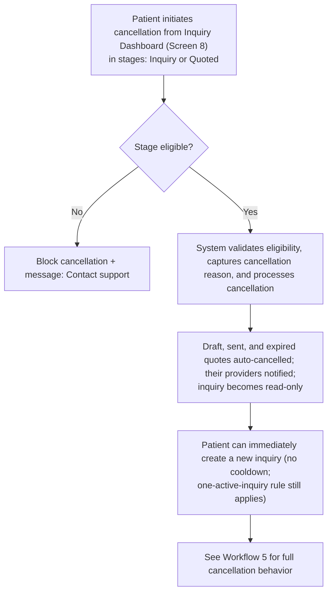

---

### Workflow 2: Inquiry Distribution (System Flow)

**Actors**: System, Providers, Admin  
**Trigger**: System detects a newly submitted inquiry meeting completeness requirements  
**Outcome**: Inquiry is distributed to matching providers; provider dashboards updated and notifications sent (REQ-003-060, REQ-003-061, REQ-003-062, REQ-003-063)

**Flow Diagram**:

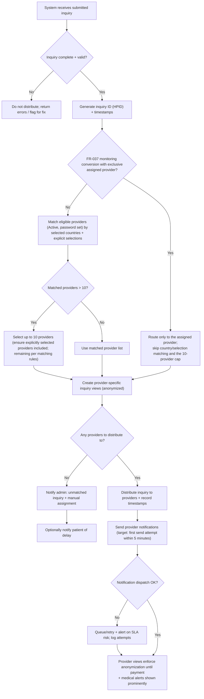

### Alternative Flows

**B1: No providers available in selected countries**:

- **Trigger**: No active providers found in patient's selected countries
- **Outcome**: Admin manually assigns providers; patient notified of potential delay (REQ-003-064)
- **Flow Diagram**:

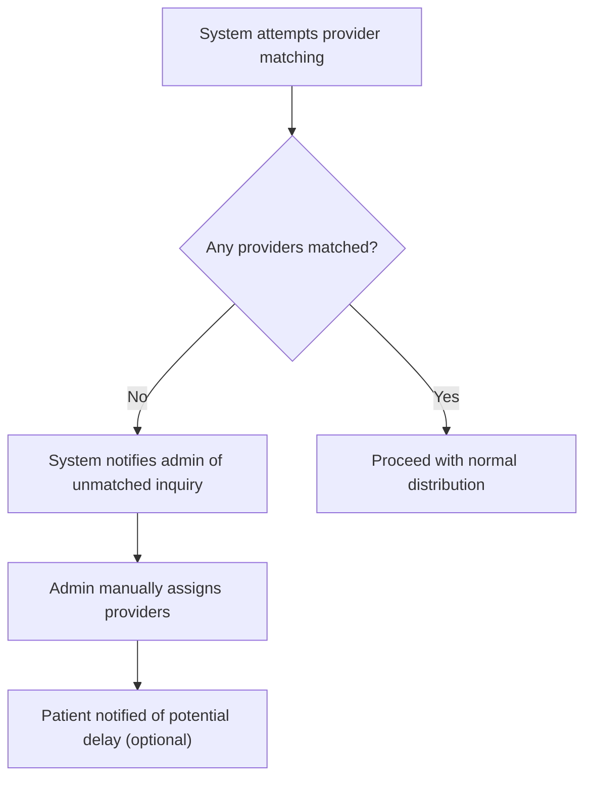

**B2: Provider capacity exceeded**:

- **Trigger**: Provider's inquiry capacity is reached
- **Outcome**: Deferred to separate FR for provider capacity management (REQ-003-065)
- **Flow Diagram**:

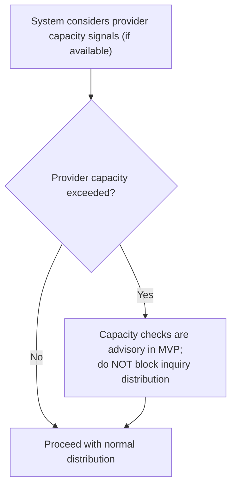

**B3: Inquiry originates from a monitoring-case conversion with an exclusive assigned provider**:

- **Trigger**: Inquiry is created via FR-037 (Monitor Your Hair Loss) conversion, and the source monitoring case has an active provider assignment at the time of conversion (REQ-037-029, Business Rule 7)
- **Outcome**: Normal country/selection matching and the 10-provider distribution cap are bypassed; the inquiry is distributed exclusively to the assigned provider. Standard anonymization, notification timing, and dashboard behavior are unchanged
- **Flow Diagram**:

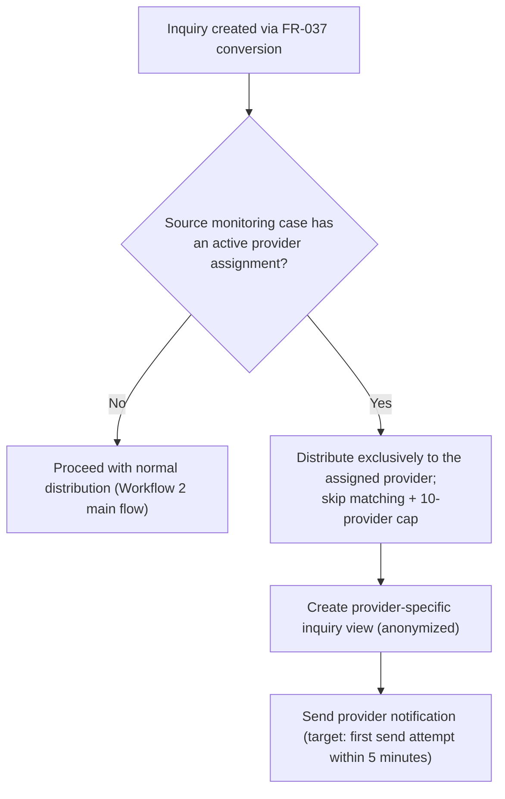

**B4: Provider becomes Suspended or Deactivated**:

- **Trigger**: A provider's `Suspended` or `Deactivated` status becomes effective under FR-015 (Alternative Flow A5 and Screen 4).
- **Steps**:
  1. From the effective time, the provider is ineligible for new inquiry allocation. Workflow 2 matching, exclusive routing, and Workflow 4 reassignment revalidate provider status immediately before creating a ProviderInquiry; in-flight distribution jobs, retries, or callbacks MUST NOT create or reopen that provider's participation.
  2. If the inquiry's accepted treatment belongs to the affected provider (stage Accepted, Confirmed, In progress, or Aftercare), the inquiry is not cancelled; it keeps its current stage and is flagged `supportRequired = true`. FR-006 Alternative Flow B4 records cause `ProviderSuspended` or `ProviderDeactivated` on the booking. Before treatment starts (Accepted or Confirmed), B4 closes the booking and an admin rehomes the patient to a replacement provider in the same inquiry through FR-006 Alternative Flow B5. An `In progress` booking is not closed or transferred; it stays `In progress` and an admin decides under FR-006 Alternative Flow B7 whether to move it to Aftercare with aftercare reassignment or cancel it with a reason. An `Aftercare` booking stays `Aftercare` and follows the aftercare reassignment in FR-006 Alternative Flow B6. FR-004 cancels the provider's unaccepted quotes; FR-005 and FR-006 own hold release, payment blocking, and the linked replacement acceptance record.
  3. If the inquiry is still comparing providers (stage Inquiry or Quoted), only the affected provider's ProviderInquiry participation and quotes are cancelled. The inquiry keeps its current stage and is flagged `supportRequired = true`; other providers' participation and offers remain available. Automatic redistribution then applies as follows:
     - If the cascade cancels the last live offer on the inquiry (a sent quote of the affected provider that has not expired, with no other live offer remaining) and the patient had not explicitly selected the affected provider, the system automatically redistributes the inquiry to eligible providers that have not yet received it. It uses the normal Workflow 2 matching, eligibility, and cap rules, so a `Suspended`, `Deactivated`, or password-not-set provider is never chosen. For an FR-037 exclusive inquiry, redistribution removes the exclusive restriction in the same way as the explicit-decline fallback (REQ-037-029). The `supportRequired` marker stays on the inquiry. (REQ-003-072)
     - If the cascade cancels the last live offer on the inquiry and the patient had explicitly selected the affected provider (Screen 7a), the system asks the patient to confirm before it redistributes, sets `redistribution_state` to `awaiting_patient_confirmation`, and redistributes only after the patient confirms with the Confirm action on Screen 8. The patient keeps the Contact Admin/Support action while waiting. (REQ-003-128)
       - On confirm, `redistribution_state` becomes `confirmed` and the inquiry goes back to normal Workflow 2 matching; Alternative Flow B1 applies when no eligible provider is found.
       - On decline, `redistribution_state` becomes `declined`; the inquiry stays as it is, flagged `supportRequired = true`, and is not redistributed.
       - With no answer after a fixed 48 hours, the system sends one reminder (`provider.status_redistribution_reminder`, FR-020 REQ-020-159), sets `redistribution_state` to `admin_follow_up`, and the inquiry appears in the admin inquiry queue (Screen 11) for follow-up. No second reminder is sent, and the patient can still confirm or decline.
       - `redistribution_state` returns to `none`, and any pending reminder is dropped, when the inquiry is cancelled, when an admin reassigns providers or reruns distribution on Screen 12, or when an admin clears `supportRequired`. The reminder is sent only while the state is `awaiting_patient_confirmation`.
     - If the patient still has another live offer on the inquiry, the inquiry is not redistributed.
     - If the inquiry is still at stage Inquiry with no quote, only the affected provider's participation is cancelled and no redistribution runs; the `supportRequired` marker stays, and an admin reassigns through Screen 12 if no other provider holds the inquiry.
     - If redistribution finds no eligible provider, Alternative Flow B1 applies.
     - Redistribution runs at most once per provider-status event and inquiry; a replayed cascade does not distribute again. (REQ-003-115, REQ-003-021)
  4. Before acceptance (stage Inquiry or Quoted), the patient receives the offer-unavailability message (`provider.status_cancellation_patient`) with a Contact Admin/Support action (FR-020). When other offers remain open, the message says "[Clinic] is no longer available. Your other offers are still open." When no offer remains and the inquiry is redistributed, it says "[Clinic] is no longer available. We are finding new offers for you." When the patient must confirm first (step 3), the message asks the patient to confirm the redistribution. After acceptance and before treatment starts (stage Accepted or Confirmed), the patient receives the `booking.provider_fault_replacement` notice (FR-020) saying that the provider can no longer perform the treatment and that an admin will arrange a replacement provider within the same inquiry; no cancellation copy is shown. For stage In progress or Aftercare, patient notices follow FR-006 Alternative Flows B7 and B6 and FR-015 Screen 4. In neither case does the patient see the Workflow 5 patient-cancellation confirmation, and no patient cancellation reason is requested. (REQ-003-116)
  5. Completed and already-cancelled inquiries are not reclassified. Later reactivation does not restore cancelled participation or quotes and does not clear `supportRequired`; only an audited admin resolution clears it. (REQ-003-111, REQ-003-113)
- **Outcome**: Affected inquiries stay open and are flagged for special admin support under a provider-caused cause; a still-comparing inquiry left with no live offer is redistributed automatically to other eligible providers (after patient confirmation when the patient had selected the affected provider); accepted cases before treatment are rehomed through FR-006 Alternative Flow B5, `In progress` cases follow the admin decision in FR-006 Alternative Flow B7, `Aftercare` cases follow FR-006 Alternative Flow B6, and unrelated providers' offers are unaffected.
- **Boundary**: Distinct from Workflow 5 patient cancellation, E3 account-deletion cancellation, and Payment Window Expired. Cascade processing is deduplicated per provider-status event and inquiry. FR-015 A5/Screen 4 owns the triggering event and cross-module cascade. (REQ-003-112, REQ-003-115)

---

### Workflow 3: Provider Inquiry Management (Provider Flow)

**Actors**: Provider, System, Admin  
**Trigger**: Provider receives a distributed inquiry or opens an assigned inquiry from the dashboard  
**Outcome**: Provider reviews anonymized details and manages status prior to quote creation

**Flow Diagram**:

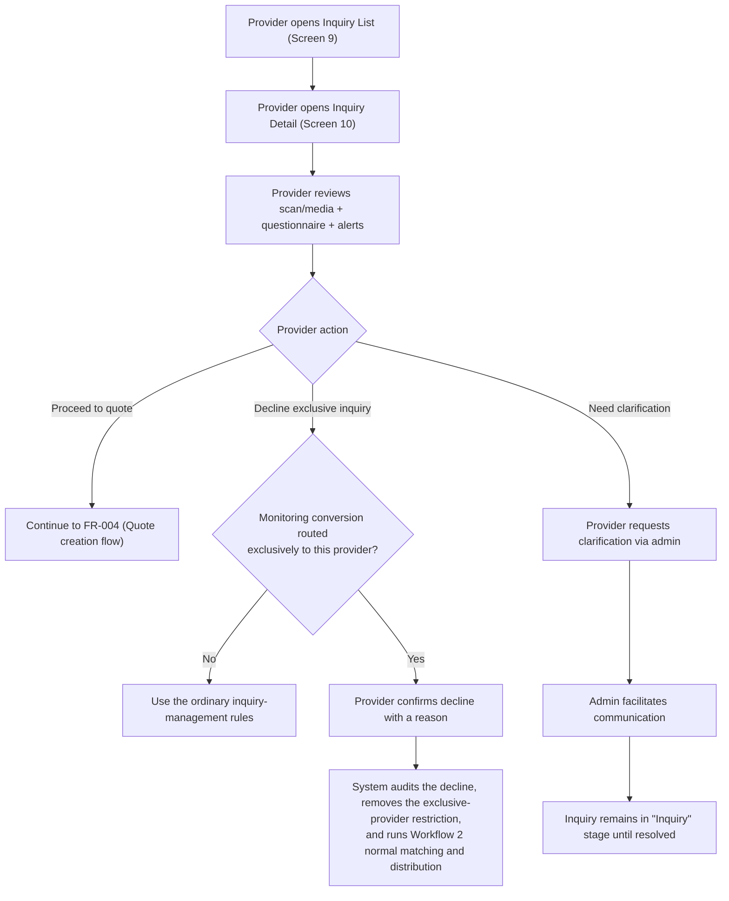

### Alternative Flows

**C1: Provider needs additional information**:

- **Trigger**: Provider cannot make assessment based on submitted inquiry data
- **Outcome**: Clarification requested through admin; inquiry stays in current stage (REQ-003-073)
- **Flow Diagram**:

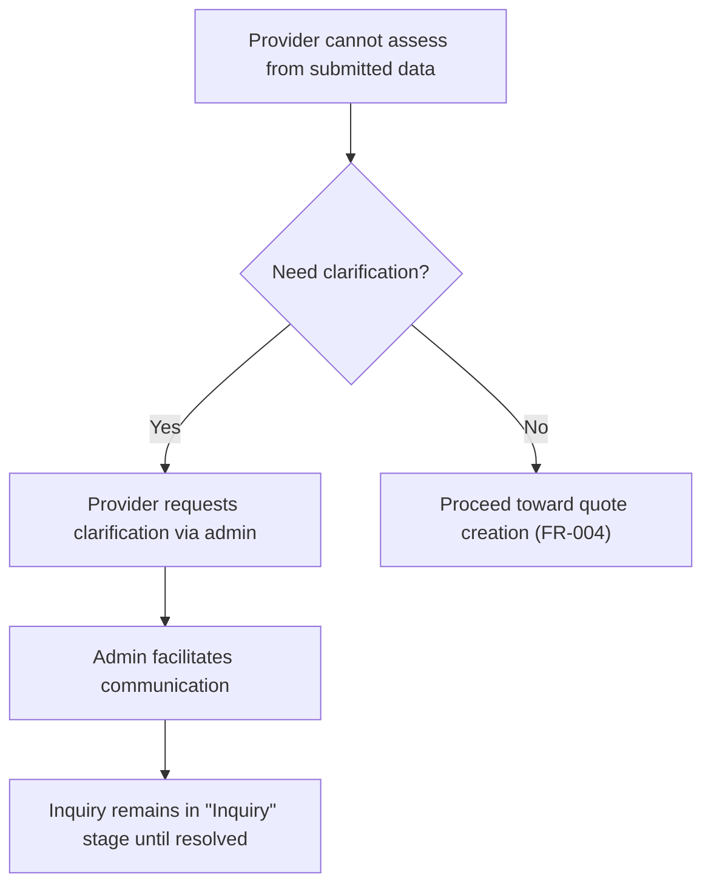

**C2: Exclusive monitoring-conversion provider declines the inquiry**:

- **Trigger**: The sole provider receiving an FR-037 monitoring-conversion inquiry declines before creating a quote
- **Outcome**: The system records the provider and reason, removes the exclusive-provider restriction, and immediately reruns Workflow 2 through normal country, patient-selection, matching, and provider-cap rules. Repeated decline requests MUST NOT distribute the inquiry more than once (REQ-003-070)
- **Expiry boundary**: This automatic fallback is triggered by an explicit provider decline only. Quote expiry (FR-004) does not trigger it, and inquiries do not expire at launch (REQ-003-071, REQ-003-067)

---

### Workflow 4: Admin Inquiry Management (Admin Flow)

**Actors**: Admin, System, Providers, Patients  
**Trigger**: Admin opens an inquiry for oversight or intervention, or a policy/action requires admin processing  
**Outcome**: Admin edits/overrides/reassigns/archives with full audit; re-notifications triggered when an impactful field changes (REQ-003-083); urgent cases escalated (REQ-003-089) and interventions logged (REQ-003-090)

**Flow Diagram**:

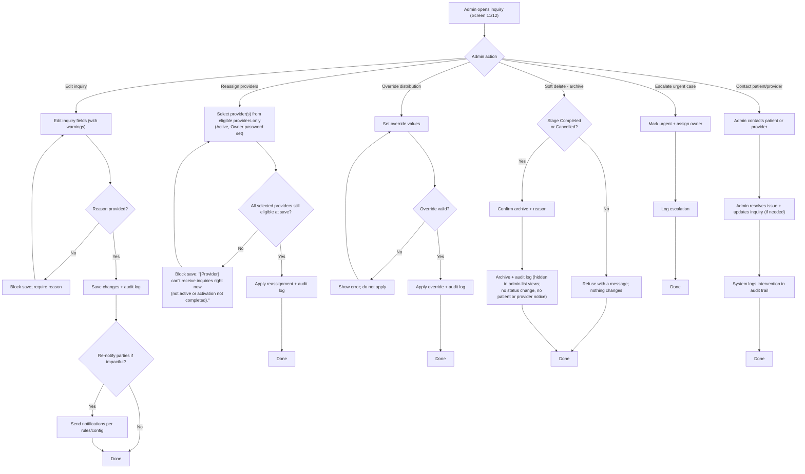

---

### Workflow 5: Patient-Initiated Inquiry Cancellation

**Actors**: Patient, System, Providers (notified), Admin (observer)  
**Trigger**: Patient opens the Inquiry Dashboard (Screen 8), taps into an inquiry detail view, and selects "Cancel Inquiry" from the action menu, for an inquiry in stage Inquiry or Quoted. The patient can also start the cancel from the quote comparison screen (FR-005 Screen 1), which uses the same confirmation modal and the same commit steps. From the Accepted stage onward the action is replaced by "Contact support" (see Alternative Flow E2)  
**Outcome**: Inquiry transitions to "Cancelled"; only quotes in draft, sent, or expired status are auto-cancelled to "Cancelled (Inquiry Cancelled)", and quotes in any other status keep their status and cause; `quote.cancelled_inquiry` goes only to providers whose quotes were cancelled by this cascade; inquiry becomes read-only in patient dashboard (REQ-003-097, REQ-003-098)

**Flow Diagram**:

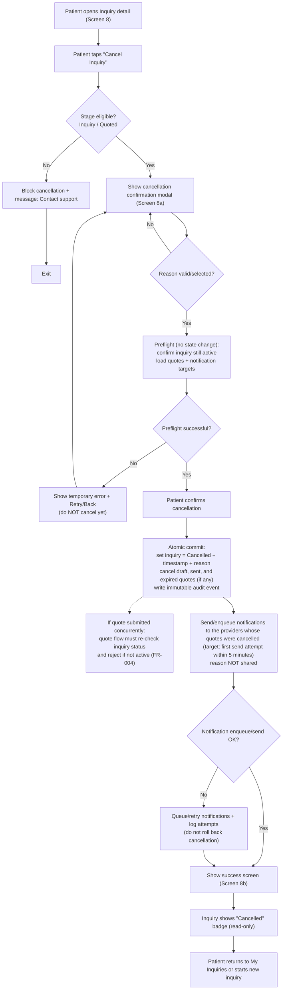

### Alternative Flows

**E1: Patient cancels inquiry with no quotes received (Inquiry stage)**:

- **Trigger**: Patient cancels an inquiry that has not yet received any quotes
- **Outcome**: Only inquiry status updated; no quote cascade needed (REQ-003-098)
- **Flow Diagram**:

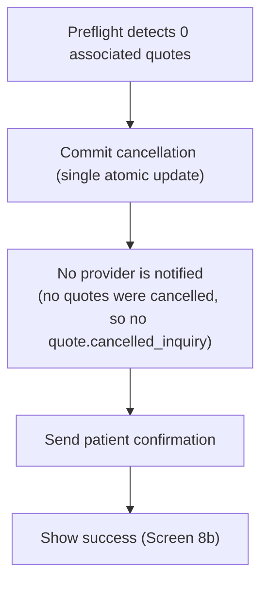

**E2: Patient wants to cancel after acceptance (Accepted stage onward)**:

- **Trigger**: Patient wants to cancel an inquiry that has an accepted quote (stage Accepted, Confirmed, In progress or Aftercare)
- **Outcome**: The patient cannot cancel in the app. The inquiry dashboard shows "Contact support" instead of "Cancel Inquiry". An admin cancels the booking through FR-006 with a mandatory reason and an audit entry. The booking and the inquiry become `Cancelled`, the inquiry records `cancelled_by = admin` and no patient cancellation reason (the admin's reason is the booking's cancellation reason in FR-006), any active appointment hold is released, and the accepted quote keeps the status `accepted`. Any open replacement quote (draft or sent) of the inquiry is also cancelled, and an admin cancellation or close sends `quote.cancelled_inquiry` to no provider (REQ-003-127, REQ-020-020; the quote side is FR-004 REQ-004-111). The same applies when the admin closes the inquiry through Close inquiry on FR-006 Screen 6. Any refund or fee follows the refund rules in FR-006 (Payment & Billing Rules: the refund ladder set in FR-029, or the provider-fault terms where the provider is at fault), not this FR. (REQ-003-110)
- **Flow Diagram**:

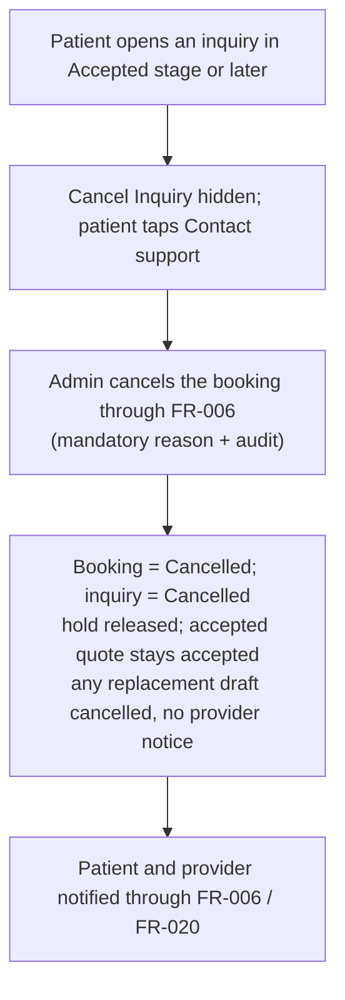

**E3: System cancels inquiry due to account deletion request (DSR)**:

- **Trigger**: An admin approves the patient's account-deletion request (FR-023). The cancellation happens at approval, not when the patient submits the request, and a refused request cancels nothing
- **Eligibility**: Only an inquiry in stage Inquiry or Quoted is cancelled here. A deletion request is blocked while the patient has an inquiry at the Accepted stage or later (FR-001)
- **Outcome**: Inquiry transitions to "Cancelled" without prompting for a patient-entered cancellation reason; system stores a system-generated cancellation reason for audit ("Account Deleted (System)") and `cancelled_by = system`; draft, sent, and expired quotes auto-cancelled as in Workflow 5, other quotes keep their status and cause; only providers whose quotes were cancelled are notified; inquiry becomes read-only (REQ-003-103)
- **Notes**:
  - Provider-facing cancellation notifications MUST NOT reveal the cancellation reason (treat as patient-private/system-private data), consistent with Workflow 5 stakeholder notification rules. (REQ-003-100)

## Screen Specifications

### Patient Platform Screens

#### Screen 1: Service Selection

**Purpose**: Patient selects desired hair transplant service

**Data Fields**:

| Field Name | Type | Required | Description | Validation Rules | Graph field |
| --- | --- | --- | --- | --- | --- |
| Service Option | select (single) | Yes | Primary service selection | Must select one | ENT-inquiry.service_option |
| Treatment Area | select | Conditional | One active, Admin-managed treatment-area option | Asked and required only when Service Option is Get a Hair Transplant; must select one active option returned by the Inquiry Configuration API; the other service options leave Screen 1 for their own workflows without a treatment area (REQ-003-027) | ENT-inquiry.treatment_area_id, ENT-treatment-area.label |

**Notes**:

- Service Options:
  - "Get a Hair Transplant" (primary option)
  - "Monitor Hair Loss" (secondary - different workflow)
  - "Aftercare: Monitor Transplant Progress" (secondary - different workflow)
  - "Aftercare for Transplant" (secondary - different workflow)
- Treatment Area Selection:
  - The active, ordered catalog is retrieved from the Inquiry Configuration API.
  - Each option contains a stable identifier, patient-facing label, and image/icon URL.
  - Hair, Beard, and Both remain the default seeded options; they are not a fixed client-side enum. (REQ-003-120)

**Business Rules**:

- When the service is Get a Hair Transplant, patient must select one active treatment-area option; the other services do not ask for one (REQ-003-027)
- The selected option must be active when the inquiry is created; inactive options remain readable on historical inquiries through their saved snapshot. (REQ-003-027)
- Primary focus on "Get a Hair Transplant" option (REQ-003-025)
- Other services are secondary features (REQ-003-025)

#### Screen 2: Destination Selection

**Purpose**: Patient selects preferred treatment locations

**Data Fields**:

| Field Name | Type | Required | Description | Validation Rules | Graph field |
| --- | --- | --- | --- | --- | --- |
| Countries | multiselect | Yes | Up to 10 preferred countries | Max 10; ordered by FR-028 regional configuration when available, otherwise proximity | ENT-inquiry.treatment_countries |
| Price Display | derived | No | Starting price per country | Fallback currency support | ENT-location-starting-price.starting_price_amount, ENT-location-starting-price.currency_code |

**Notes**:

- Country List:
  - Show country name with starting price
  - Order by proximity to patient location
  - Support fallback currency/pricing display
- Price Display:
  - Starting price per country
  - Starting prices are owned and configured in FR-028; this module only displays them
  - Currency based on patient location
  - Price range indicators

**Business Rules**:

- Maximum 10 countries selectable (REQ-003-031)
- Countries ordered by FR-028 regional configuration when available, otherwise by proximity to patient location
- Starting prices displayed for transparency (REQ-003-033)
- Fallback pricing for unsupported currencies (REQ-003-033)

#### Screen 3: Detailed Information Form

**Purpose**: Patient provides comprehensive hair concern details

**Data Fields**:

| Field Name | Type | Required | Description | Validation Rules | Graph field |
| --- | --- | --- | --- | --- | --- |
| Nature of concern | text | Yes | Patient description | Max length; not empty | ENT-inquiry.problem_concern |
| Duration | select | Yes | One option from the Admin-managed problem-duration list | Must select one active option | ENT-inquiry.problem_duration |
| Previous treatments | text | Yes | Prior treatments | Max length | ENT-inquiry.previous_treatments |
| Symptom severity | slider (1-10) | Yes | Severity index | Integer 1-10 | ENT-inquiry.symptom_severity |
| Lifestyle factors | text | No | Optional context | Max length | ENT-inquiry.lifestyle_factors |
| Additional notes | text | No | Optional notes | Max length | ENT-inquiry.additional_notes |
| Photos | file (image) | No | Photos and videos together: up to 5 files | JPG/PNG ≤ 2MB each; photos and videos together ≤ 5 files | ENT-inquiry.media |
| Videos | file (video) | No | Counts toward the same 5-file total as photos | MP4 ≤ 30s, ≤ 20MB each; photos and videos together ≤ 5 files | ENT-inquiry.media |

**Notes**:

- Visual Evidence:
  - Photo upload: JPG/PNG ≤ 2MB each; counts toward the 5-file total
  - Video upload: MP4 ≤ 30s, ≤ 20MB each; counts toward the 5-file total
  - Enforce file size/format and total file count (REQ-003-035)
  - The 5-file total covers the inquiry's photos and videos together. It does not include the head scan photo set (Screen 4), which has its own limit, or photos in other fields elsewhere in the app
- Duration Options:
  - The choices come from an Admin-managed problem-duration list retrieved from the backend, not a fixed client-side enum; the list is managed with the other inquiry configuration owned by FR-026 (REQ-003-122)
  - Starting values, editable by Admin: Less than 6 months; 6 to 12 months; 1 to 2 years; 2 to 5 years; More than 5 years (REQ-003-122)

**Business Rules**:

- All required fields must be completed (REQ-003-034)
- Visual evidence limited to 5 files total (photos and videos together; the head scan photo set is counted separately) (REQ-003-035)
- Duration is chosen from the Admin-managed problem-duration list, not a fixed enum; the inquiry stores the chosen option's label as text, so a later edit or deactivation of the option changes no saved inquiry, and an inquiry created by an FR-037 conversion takes the label the monitoring case saved (REQ-003-122)
- Photos: JPG/PNG ≤ 2MB each (REQ-003-035)
- Videos: MP4 ≤ 30s, ≤ 20MB each (REQ-003-035)
- Text fields have character limits (REQ-003-034)

#### Screen 4: Head Scan Photo Set Capture (V1)

**Purpose**: Patient captures standardized head scan photo set for provider assessment *(V1 implementation of “3D scan”; true 3D deferred to V2)*

**Data Fields**:

| Field Name | Type | Required | Description | Validation Rules | Graph field |
| --- | --- | --- | --- | --- | --- |
| Head Scan Photo Set (V1) | capture/upload | Yes | Standardized head scan photo set (multiple 2D views of patient’s head) | Must meet completeness/quality/file constraints from FR-002; up to 5 photos, JPG or PNG, ≤ 2MB each, counted on their own (separate from the visual evidence on Screen 3) | ENT-inquiry.scan_ref |
| Quality Indicators | derived | Yes | Real-time quality feedback | Retake if below threshold | ENT-scan.quality_score |

**Notes**:

- Capture Instructions:
  - Visual guidance for positioning (front, top, left, right angles)
  - Quality indicators and feedback
  - Retake options available
- Media Characteristics (V1):
  - Standardized photo set (multiple 2D views; not a true 3D model)
  - Validated and processed by FR-002 engine and S-01/S-05
  - Future 3D model capture and interactive viewer deferred to V2 (per system PRD)

**Business Rules**:

- Head scan photo set must meet minimum completeness/quality thresholds required by FR-002 (REQ-003-036)
- Head scan photo limit: up to 5 photos, JPG or PNG, 2 MB each. This limit is counted on its own and is separate from the 5-file visual-evidence limit on Screen 3 and from the limits of other photo fields (REQ-003-036)
- Patient can retake capture if quality poor (REQ-003-037)
- Captured media encrypted and stored securely (REQ-003-038)
- Media accessible to providers for assessment via engine outputs (REQ-003-038)

#### Screen 5: Treatment Date Selection

**Purpose**: Patient selects preferred treatment dates

**Data Fields**:

| Field Name | Type | Required | Description | Validation Rules | Graph field |
| --- | --- | --- | --- | --- | --- |
| Date Ranges | date range (multi) | Yes | Up to 10 ranges | Max 10; non-overlapping; ≤ 2 years out | ENT-inquiry-date-range.start_date, ENT-inquiry-date-range.end_date |

**Notes**:

- Date Range Selection:
  - Multiple pickers (max 10)
  - Calendar with availability
  - Non-overlapping validation
- Date Constraints:
  - Max 2 years in future
- Minimum lead time from inquiry date is the active Admin-configured blocked window (default: 3 days)
  - Consider provider availability

**Business Rules**:

- Maximum 10 date ranges selectable (REQ-003-041)
- Date ranges cannot overlap (REQ-003-042)
- Dates limited to 2 years in future (REQ-003-043)
- System validates provider availability (REQ-003-044)
- Calendar eligibility and submission validation must use the same configured minimum lead-time value. (REQ-003-018)

#### Screen 6: Medical Questionnaire

**Purpose**: Patient completes comprehensive medical history assessment

**Data Fields**:

| Field Name | Type | Required | Description | Validation Rules | Graph field |
| --- | --- | --- | --- | --- | --- |
| Question | enum | Yes | Medical question item | Must answer Yes/No | ENT-medical-questionnaire-response.question_id |
| Answer | boolean | Yes | Yes/No | Required | ENT-medical-questionnaire-response.answer |
| Details | text | Cond. | Required if Answer = Yes | Non-empty when required | ENT-medical-questionnaire-response.details |
| Alert Level | derived | No | Critical/Standard/None | Read from the patient's risk tags (FR-002); the overall level is the highest severity among the tags (REQ-002-002); tier rule REQ-025-064 | ENT-risk-tag.severity |

**Notes**:

- Question List:
  - Allergies to medications (Yes/No + details)
  - Other allergies (Yes/No + details)
  - Respiratory conditions (Yes/No + details)
  - Cardiovascular disease (Yes/No + details)
  - Hypertension (Yes/No + details)
  - Diabetes (Yes/No + details)
  - Implanted medical devices (Yes/No + details)
  - Hepatitis B/C (Yes/No + details)
  - HIV/AIDS (Yes/No + details)
  - Arthritis (Yes/No + details)
  - Neurological disorders (Yes/No + details)
  - Other medical conditions (Yes/No + details)
  - Bleeding disorders (Yes/No + details)
  - Kidney disease (Yes/No + details)
  - Cancer history (Yes/No + details)
  - Digestive diseases (Yes/No + details)
  - Mental health disorders (Yes/No + details)
  - Blood clots/DVT (Yes/No + details)
  - Previous surgeries (Yes/No + details)
  - Pregnancy status (Yes/No + details)
  - Regular medications (Yes/No + details)
- Alert System:
  - Critical (red)
  - Standard (amber)
  - None (green)

**Business Rules**:

- All questions require Yes/No answers (REQ-003-045)
- See REQ-003-045.
- Medical alerts are read from the patient's risk tags (FR-002); the red, amber, green tier rule is owned by FR-025 (REQ-025-064)
- Questionnaire managed by admin (not hard-coded) via FR-025 (Medical Questionnaire Management) (REQ-003-046)
- **MVP**: Inquiry questionnaires support Yes/No questions only (enforced in FR-025 publishing/activation rules) (REQ-003-047)
- **Future (V2+)**: If Inquiry questionnaires allow non-Yes/No question types, the inquiry response schema and UI must be extended to support typed answers (e.g., numeric scale, multi-select, free text) (REQ-003-047)

#### Screen 7: Inquiry Summary & Submission

**Purpose**: Patient reviews complete inquiry before submission

**Data Fields**:

| Field Name | Type | Required | Description | Validation Rules | Graph field |
| --- | --- | --- | --- | --- | --- |
| Section Summary | group | Yes | Read-only summary of prior steps | Must reflect latest data | ENT-inquiry.service_option, ENT-inquiry.treatment_area_id, ENT-inquiry.treatment_countries, ENT-inquiry.problem_concern, ENT-inquiry.problem_duration, ENT-inquiry.previous_treatments, ENT-inquiry.symptom_severity, ENT-inquiry.media, ENT-inquiry.scan_ref, ENT-inquiry.questionnaire_summary, ENT-inquiry.selected_provider_ids, ENT-location-starting-price.starting_price_amount, ENT-location-starting-price.currency_code, ENT-inquiry-date-range.start_date, ENT-inquiry-date-range.end_date |
| Terms Acceptance | checkbox | Conditional | Accept the Current Terms & Conditions before submission | Shown only when the patient has not accepted the Current Terms & Conditions (acceptance is once per version, FR-027 REQ-027-035); Submit stays disabled until accepted; the acceptance is recorded through FR-027 (REQ-003-054) | no graph field (control) |

**Notes**:

- Summary includes: treatment type, countries with prices, concern details, media, head scan photo set (V1), date ranges, questionnaire summary
- Submission Controls: per-section Edit, Submit button, T&C acceptance

**Business Rules**:

- Patient must review all sections (REQ-003-054)
- Patient can edit any section before submission (REQ-003-054)
- The Current Terms & Conditions must be accepted before submission: the checkbox appears only when the patient has not yet accepted them, and submission stays blocked until they are accepted (REQ-003-054, FR-027 REQ-027-033)
- Submission generates unique inquiry ID (REQ-003-055)

#### Screen 7a: Provider Selection

**Purpose**: Patient selects preferred providers to receive the inquiry

**Data Fields**:

| Field Name | Type | Required | Description | Validation Rules | Graph field |
| --- | --- | --- | --- | --- | --- |
| Suggested Providers | list | Yes | System-suggested providers based on reviews and admin curation | Non-empty; ordered by rating/curation score | ENT-provider.name, ENT-provider-review-summary.average_rating |
| Provider Card | group | Yes | Provider summary: name, country, rating, review count, specialty, starting price | Read-only per card | ENT-provider.name, ENT-provider.country, ENT-provider-review-summary.average_rating, ENT-provider-review-summary.review_count, ENT-provider.specialty, ENT-provider.starting_price |
| Selected Providers | multiselect | Yes | Patient's chosen providers | Min 1, max 5 | ENT-inquiry.selected_provider_ids |
| Search | control | No | Search by provider name or keyword | Debounced; case-insensitive (REQ-003-123) | no graph field (control) |
| Filters | control | No | Filter by country (from selected destinations), rating range, specialty | Valid enums/ranges | no graph field (control) |

**Notes**:

- Provider Suggestions:
  - Ordered by positive reviews and admin curation score
  - Filtered to providers in patient's selected destination countries
  - Each card shows: provider name, country, star rating, review count, specialty tags, starting price in patient's currency
- Selection Controls:
  - Tap to select/deselect provider card
  - Visual indicator (checkmark/highlight) on selected providers
  - Counter shows "X of 5 selected"
  - "Continue" button enabled when at least 1 provider selected

**Business Rules**:

- Maximum 5 providers selectable (REQ-003-051)
- Only providers in patient's selected destination countries are shown (REQ-003-052)
- Provider suggestions based on positive reviews and admin curation (system PRD) (REQ-003-052)
- Patient must select at least 1 provider to proceed (REQ-003-051)
- Selected providers are included in the inquiry for distribution; system may also distribute to additional matching providers per distribution rules (REQ-003-053)
- Only eligible providers are shown and selectable: provider status Active and Owner `password_set` = true (Rule 6, REQ-003-019)
- On submit, the system revalidates every explicitly selected provider. If one has become ineligible since it was selected, the API returns a validation error naming that provider, and the app returns the patient to provider selection with the message "[Provider name] is no longer available. Please choose another provider." Nothing is skipped silently. In the inquiry flow diagram this is the "Selected provider no longer eligible" branch of the submit step, which returns the patient to Provider Selection

#### Screen 8: Inquiry Dashboard (Post-Submission)

**Purpose**: Patient views submitted inquiry status and details

**Data Fields**:

| Field Name | Type | Required | Description | Validation Rules | Graph field |
| --- | --- | --- | --- | --- | --- |
| Current Stage | badge | Yes | Inquiry stage (Inquiry/Quoted/Accepted/Cancelled/...) | Valid lifecycle value; includes "Cancelled" | ENT-inquiry.stage |
| Timeline | timeline | Yes | Chronological status changes | Timestamps present | ENT-inquiry.status_timeline |
| Responses Count | number | Yes | Number of the inquiry's provider rows with status quoted or declined (counted per provider; separate from the quote count on the admin overview; REQ-003-129) | Non-negative integer; recomputed each time it is shown | ENT-inquiry.responses_count |
| Inquiry Summary | group | Yes | Read-only inquiry info | Complete and consistent | ENT-inquiry.treatment_area_id, ENT-inquiry.treatment_countries, ENT-inquiry.problem_concern, ENT-inquiry.problem_duration, ENT-inquiry.previous_treatments, ENT-inquiry.symptom_severity, ENT-inquiry.media, ENT-inquiry.scan_ref, ENT-inquiry.questionnaire_summary, ENT-risk-tag.severity, ENT-inquiry.selected_provider_ids, ENT-inquiry-date-range.start_date, ENT-inquiry-date-range.end_date |
| Quotes Received | list | No | Provider quotes (from FR-004) | Read-only links | ENT-quote.id |
| Deadlines | datetime | Yes | Informational response deadline; there is no expiry deadline because inquiries do not expire at launch (REQ-003-067) | Future or past allowed | ENT-inquiry.response_deadline |
| Next Actions | actions | Yes | Available user actions | Based on stage/permissions | no graph field (control) |
| Cancel Inquiry | action | Conditional | "Cancel Inquiry" button; visible only in Inquiry or Quoted stages | Hidden when stage is Accepted, Confirmed, In progress, Aftercare, Completed, or Cancelled; triggers Workflow 5 cancellation flow (REQ-003-106) | no graph field (control) |
| Contact Support | action | Conditional | "Contact support" action shown in place of "Cancel Inquiry" from the Accepted stage onward | Visible when stage is Accepted, Confirmed, In progress or Aftercare; opens Help & Support so an admin can act on the request (REQ-003-106) | no graph field (control) |
| Redistribution Confirmation | actions | Conditional | Confirm and Decline buttons with the text "Do you want us to find other clinics for you?" | Shown only while `redistribution_state` is `awaiting_patient_confirmation` or `admin_follow_up`; Confirm and Decline act per REQ-003-128; the Confirm and Decline links in the confirmation request and in the 48-hour reminder open Screen 8 at this block (FR-020 REQ-020-013, REQ-020-159) | ENT-inquiry.redistribution_state |

**Notes**:

- Dashboard shows: full inquiry summary, provider responses, deadlines, and context-aware next actions
- Inquiry Summary shows: treatment type, destination countries, concern details, visual evidence, head scan photo set, treatment date ranges, questionnaire summary with the medical alert level, and the selected providers
- "Cancel Inquiry" action appears in Next Actions area only for eligible stages (Inquiry, Quoted). From the Accepted stage onward, Next Actions shows "Contact support" instead, and any booking cancellation is performed by an admin through FR-006 (REQ-003-106)
- If inquiry is in "Cancelled" stage, dashboard is read-only with "Cancelled" badge; no actions available except viewing details (REQ-003-104)
- A provider-caused status change (`ProviderSuspended` or `ProviderDeactivated`) never shows patient-cancellation copy. For a still-comparing inquiry (Inquiry or Quoted stage), the dashboard shows a provider-unavailable banner with a Contact Admin/Support action, and the affected provider's offers show as unavailable while other offers remain actionable. If other offers remain open, the banner says "[Clinic] is no longer available. Your other offers are still open." If no offer remains and the inquiry is being redistributed, the banner says "[Clinic] is no longer available. We are finding new offers for you." When no live offer remains and the patient had explicitly selected the affected provider, the dashboard first asks the patient to confirm the redistribution with Confirm and Decline actions (REQ-003-128). After acceptance, the dashboard keeps the current stage and tells the patient that an admin will arrange a replacement provider within the same inquiry (Workflow 2 Alternative Flow B4) (REQ-003-117)

**Business Rules**:

- See REQ-003-056.
- See REQ-003-057.
- Patient can cancel inquiry if in Inquiry or Quoted stage (see Workflow 5); from the Accepted stage onward the patient contacts support and an admin cancels through FR-006 (REQ-003-110)
- Patient receives notifications for status changes (REQ-003-121)
- Inquiry data is kept for the single platform-wide retention period (10 years), defined once in the system PRD
- Cancelled inquiries are not counted as "active" — patient can create a new inquiry immediately after cancellation (REQ-003-105, REQ-003-056)

#### Screen 8a: Cancel Inquiry Confirmation Modal

**Purpose**: Confirm patient's intent to cancel and capture cancellation reason (Workflow 5 step 2)

**Data Fields**:

| Field Name | Type | Required | Description | Validation Rules | Graph field |
| --- | --- | --- | --- | --- | --- |
| Warning Icon | icon | Yes | Red warning triangle or alert icon | Displayed at top of modal | no graph field (control) |
| Modal Title | text | Yes | "Cancel Inquiry?" | Displayed prominently in red/destructive color | no graph field (control) |
| Warning Message | text | Yes | Explanation of consequences: "Canceling this inquiry is irreversible. All open quotes you've received will be cancelled and the providers of those quotes will be notified." | Read-only informational text | no graph field (control) |
| Current Stage Badge | badge | Yes | Shows inquiry current stage | Enum: "Inquiry", "Quoted"; read-only | ENT-inquiry.stage |
| Inquiry Reference | text | Yes | Inquiry ID (HPID format) | Read-only; format: HPID + YY + MM + 4-digit sequence | ENT-inquiry.reference |
| Impact Summary | text | Yes | Summary of cancellation impact based on current stage | Conditional: "X quotes will be cancelled" OR "No quotes to cancel"; X counts the inquiry's draft, sent and expired quotes when the modal opens (REQ-003-125) | ENT-inquiry.preview_quote_count |
| Cancellation Reason Selector | select | Yes | Dropdown or radio list of predefined reasons | Must select one option; default options: "Changed my mind", "Found a better option elsewhere", "Medical concerns", "Financial reasons", "Travel restrictions", "Timeline doesn't work", "Other" (admin-configurable via FR-026 Screen 5a) | ENT-inquiry.cancellation_reason |
| Additional Notes | text | Conditional | Free text field; shown when "Other" selected | Required if "Other" selected; max 500 characters | ENT-inquiry.cancellation_reason_notes |
| Optional Feedback | text | No | General feedback text area | Max 1000 characters; placeholder: "Any additional feedback? (Optional)" | ENT-inquiry.cancellation_feedback |
| Provider Notification Note | text | Conditional | Informational message: "Providers of the quotes being cancelled will be notified of this cancellation, normally within 5 minutes" | Read-only; shown only when there are quotes to cancel (REQ-003-125) | no graph field (control) |
| Confirm Cancellation Button | button | Yes | Destructive primary CTA | Red/destructive style; label: "Confirm Cancellation"; disabled until reason selected | no graph field (control) |
| Go Back Button | button | Yes | Secondary CTA to dismiss modal | Default/neutral style; label: "Go Back"; closes modal without action | no graph field (control) |

**Business Rules**:

- Modal is triggered from the "Cancel Inquiry" action on Screen 8 (Inquiry Dashboard)
- Modal is only reachable when inquiry stage is Inquiry or Quoted (Workflow 5 step 1 validates this)
- Cancellation reason is required before the Confirm button becomes active (REQ-003-102)
- Cancellation reason is patient-private data (not shared with providers; stored for analytics and audit) (REQ-003-101)
- On "Confirm Cancellation", system processes Workflow 5 steps 3–5; modal is dismissed and Screen 8b is shown
- On "Go Back", modal is dismissed with no state change (REQ-003-125)

**Acceptance Scenarios**:

1. **Given** inquiry in eligible stage, **When** patient opens modal, **Then** Current Stage Badge and Impact Summary reflect actual inquiry state and quote count
2. **Given** patient has not selected a reason, **When** patient taps Confirm Cancellation, **Then** button remains disabled
3. **Given** patient selects "Other", **When** Additional Notes is empty, **Then** Confirm Cancellation remains disabled until notes entered
4. **Given** patient taps Go Back, **When** modal dismisses, **Then** no inquiry state is changed

#### Screen 8b: Cancellation Success Confirmation

**Purpose**: Confirm the inquiry has been successfully cancelled and provide next-step navigation (Workflow 5 step 5)

**Data Fields**:

| Field Name | Type | Required | Description | Validation Rules | Graph field |
| --- | --- | --- | --- | --- | --- |
| Success Icon | icon | Yes | Checkmark or completion illustration | Green color; displayed at top center | no graph field (control) |
| Confirmation Title | text | Yes | "Inquiry Cancelled" | Displayed prominently below icon | no graph field (control) |
| Confirmation Message | text | Yes | "Your inquiry has been successfully cancelled." | Read-only | no graph field (control) |
| Inquiry Reference | text | Yes | Inquiry ID (HPID format) | Read-only; label: "Reference:" | ENT-inquiry.reference |
| Cancellation Timestamp | datetime | Yes | Server-side cancellation timestamp | Format: "Cancelled on [Month DD, YYYY] at [HH:MM AM/PM]"; reflects server time, not client | ENT-inquiry.cancelled_at |
| Impact Summary | text | Yes | Summary of what was cancelled | Conditional based on stage: "Your inquiry was cancelled." or "Your inquiry and X quote(s) were cancelled." (REQ-003-126) | ENT-inquiry.cascade_quote_count |
| Provider Notification Status | text | Conditional | "The providers of the cancelled quotes have been notified of this cancellation." | Read-only; shown only when at least one quote was cancelled (REQ-003-126) | no graph field (control) |
| Back to My Inquiries Button | button | Yes | Primary CTA | Default style; label: "Back to My Inquiries"; navigates to Inquiry Dashboard (Screen 8) | no graph field (control) |
| Start New Inquiry Button | button | Yes | Secondary CTA | Outlined/secondary style; label: "Start New Inquiry"; navigates to Inquiry Creation flow (Screen 1) | no graph field (control) |
| Contact Support Link | link | No | Optional support contact link | Text link; label: "Need help? Contact support"; navigates to Help & Support | no graph field (control) |

**Business Rules**:

- This screen is shown only after Workflow 5 completes successfully (steps 3–4 finished) (REQ-003-109)
- Cancellation Timestamp reflects server-side time (not client clock) for audit consistency (REQ-003-109)
- Impact Summary must match the actual cascade results (number of quotes cancelled) (REQ-003-109)
- Cancelled inquiry is now read-only; "Back to My Inquiries" returns to Screen 8 where it shows "Cancelled" badge (REQ-003-104)
- "Start New Inquiry" navigates to Screen 1; patient can create immediately (one-active-inquiry rule: cancelled inquiry is no longer "active") (REQ-003-105)

**Acceptance Scenarios**:

1. **Given** cancellation completed for Inquiry-stage inquiry with 0 quotes, **When** Screen 8b displays, **Then** Impact Summary shows "Your inquiry was cancelled." with no quote mention
2. **Given** cancellation completed for Quoted-stage inquiry with 3 quotes, **When** Screen 8b displays, **Then** Impact Summary shows "Your inquiry and 3 quote(s) were cancelled."

### Provider Platform Screens

#### Screen 9: Inquiry List Dashboard

**Purpose**: Provider views all distributed inquiries

**Data Fields**:

| Field Name | Type | Required | Description | Validation Rules | Graph field |
| --- | --- | --- | --- | --- | --- |
| Patient ID | column | Yes | HPID + YY + MM + 4-digit sequence | Sortable; searchable | ENT-patient.anonymized_id |
| Patient Name | column | Yes | Partially masked name | Mask until payment confirmation | ENT-patient.name |
| Age | column | No | Patient age | Number; sortable | ENT-patient.age |
| Problem/Concern | column | No | Primary concern enum | Filterable | ENT-inquiry.problem_concern |
| Requested Date Ranges | column | Yes | Primary + tooltip for others | Non-overlap; tooltip expansion | ENT-inquiry-date-range.start_date, ENT-inquiry-date-range.end_date |
| Location | column | No | Patient country | Filterable | ENT-patient.country |
| Medical Alerts | column | Yes | Color-coded chips | Critical/Standard/None | ENT-risk-tag.severity |
| Inquiry Date | column | Yes | Created timestamp | Relative formatting rules | ENT-inquiry.created_at |
| Action | column | Yes | View/Create Quote buttons | State-aware actions | no graph field (control) |
| Search | control | No | Search by patient ID | Debounced; case-insensitive (REQ-003-124) | no graph field (control) |
| Filters | control | No | Age range, Concern, Date range (requested treatment dates), Alerts, Location (patient country), Stage, Inquiry date | Valid ranges/enums; Stage is the inquiry stage; Inquiry date is the period of the Inquiry Date column (REQ-003-124) | no graph field (control) |

**Notes**:

- Requested Date Ranges: primary displayed; all ranges via tooltip
- Patient Name: masked until payment confirmation
- Time Display: relative for recent; formatted for older
- Empty States: Loading, Error, No permission

**Business Rules**:

- A provider sees an inquiry only through a ProviderInquiry row that is not cancelled; a provider in a matching country that was not matched into the capped list and was not selected by the patient does not see it (REQ-003-074)
- Patient names partially masked until payment confirmation (REQ-003-075)
- Medical alerts prominently displayed with color coding (REQ-003-049)
- The list can open with Stage, Location (country) and an Inquiry date period already applied, as when a provider follows an FR-014 analytics drill-down; the provider can change or clear them (REQ-003-124)
- Inquiries do not expire automatically at launch (REQ-003-067)
- Date ranges display primary range with tooltip for additional ranges (REQ-003-077)
- Time display: relative for recent ("X minutes ago"), specific for older ("Sep 22, 2025") (REQ-003-078)
- Empty states: Loading, Error, No permission

#### Screen 10: Inquiry Detailed View

**Purpose**: Provider reviews comprehensive inquiry details

**Data Fields**:

| Field Name | Type | Required | Description | Validation Rules | Graph field |
| --- | --- | --- | --- | --- | --- |
| Inquiry ID | text | Yes | Unique ID and current stage | Read-only | ENT-inquiry.reference, ENT-inquiry.stage |
| Timestamps | group | Yes | Created/updated/activity times | ISO 8601 | ENT-inquiry.created_at, ENT-inquiry.updated_at, ENT-inquiry.last_activity_at |
| Patient (masked) | group | Yes | Partially masked identity | Reveal post-payment confirmation | ENT-patient.name, ENT-patient.anonymized_id, ENT-patient.age, ENT-patient.gender, ENT-patient.country |
| Countries | list | Yes | Selected treatment countries | Non-empty | ENT-inquiry.treatment_countries |
| Problem Details | group | Yes | Concern text, duration, previous treatments | Complete | ENT-inquiry.problem_concern, ENT-inquiry.problem_duration, ENT-inquiry.previous_treatments, ENT-inquiry.symptom_severity, ENT-inquiry.lifestyle_factors, ENT-inquiry.additional_notes |
| Media | gallery | No | Photos/videos previews | File constraints enforced | ENT-inquiry.media |
| Head Scan (V1 Photo Set) | viewer/gallery | No | Head scan capture assets (photo set in V1; 3D model in V2) | Available if captured | ENT-inquiry.scan_ref, ENT-scan.quality_score, ENT-scan.metadata |
| Date Ranges | list | Yes | All selected date ranges | Non-overlapping | ENT-inquiry-date-range.start_date, ENT-inquiry-date-range.end_date |
| Medical Questionnaire | group | Yes | Full Q&A responses | Completed | ENT-medical-questionnaire-response.question_id, ENT-medical-questionnaire-response.answer, ENT-medical-questionnaire-response.details |
| Medical Alerts | chips | Yes | Tiered alert indicators | Critical/Standard/None | ENT-risk-tag.severity |
| Decline Exclusive Inquiry | action | Conditional | Declines an FR-037 monitoring-conversion inquiry before quote creation | Exclusive assigned provider only; confirmation and reason required (REQ-003-069) | no graph field (control) |

**Notes**:

- Inquiry Metadata:
  - Inquiry ID (HPID + YY + MM + 4-digit sequence) (REQ-003-076)
  - Current stage (Inquiry/Quoted/Accepted/...)
  - Created at, Updated at, Last activity timestamps (ISO 8601)
- Patient (Masked):
  - Display name: First name + last initial + asterisks (e.g., "John D*****") (REQ-003-075)
  - Age, Gender, Country (contact details masked until payment)
  - Patient ID (HPID-based) visible; name, phone number, and email remain masked/hidden until payment confirmation (REQ-003-075)
- Countries:
  - Full list of selected treatment countries (ISO country + display name)
  - Primary country highlighted; remaining listed in order selected (REQ-003-119)
- Problem Details:
  - Nature of concern (required)
  - Duration (option from the Admin-managed list)
  - Previous treatments (required)
  - Symptom severity (1–10)
  - Lifestyle factors (optional)
  - Additional notes (optional)
- Media:
  - Photos (JPG/PNG ≤ 2MB each; photos and videos together max 5 files): show thumbnails with modal preview (REQ-003-119)
  - Videos (MP4 ≤ 30s, ≤ 20MB each; counted in the same 5-file total): show poster frame with player
  - Validation messages for any file policy violations
- Head Scan:
  - V1: Photo set gallery viewer (zoom/compare) (REQ-003-119)
  - Quality score and capture metadata if available
  - Retake indicator if replaced after initial capture
  - V2 (future): If a true 3D model exists, viewer may support orbit/zoom
- Date Ranges:
  - Display all selected ranges, non-overlapping
  - Primary range shown first; additional ranges listed below (REQ-003-119)
  - Server-side validation notes for overlaps and max count (10)
- Medical Questionnaire:
  - Full Q&A list (Yes/No + required details for Yes)
  - Derived medical alerts: Critical (red), Standard (amber), None (green)
  - Link to audit trail of questionnaire version used (REQ-003-119)
- Timeline:
  - Creation, distribution to providers, provider views, status changes
  - Sorted descending by time with relative and absolute timestamps (REQ-003-079)

**Business Rules**:

- Full patient details visible only after payment confirmation (REQ-003-075)
- Medical alerts color-coded by severity (REQ-003-049)
- Head scan requires viewer (photo set gallery in V1; interactive 3D in V2) (REQ-003-039)
- All data editable by admin (REQ-003-080)
- Provider can review inquiry details (REQ-003-024)
- When the exclusive provider declines before quote creation, the system must audit the reason, clear the exclusive routing restriction, and invoke normal Workflow 2 distribution exactly once. (REQ-003-069)
- **Note**: Quote creation functionality handled in FR-004

### Admin Platform Screens

#### Screen 11: Hairline Overview Dashboard

**Purpose**: Admin monitors all inquiries across all stages

**Data Fields**:

| Field Name | Type | Required | Description | Validation Rules | Graph field |
| --- | --- | --- | --- | --- | --- |
| Patient ID | column | Yes | HPID + YY + MM + 4-digit sequence | Sortable; searchable | ENT-patient.anonymized_id |
| Full Patient Name | column | Yes | Unmasked name | Admin only | ENT-patient.name |
| Age | column | No | Patient age | Number; sortable | ENT-patient.age |
| Problem/Concern | column | No | Primary concern enum | Filterable | ENT-inquiry.problem_concern |
| Requested Date Ranges | column | Yes | Primary + tooltip for others | Non-overlap; tooltip expansion | ENT-inquiry-date-range.start_date, ENT-inquiry-date-range.end_date |
| Location | column | No | Patient country | Filterable | ENT-patient.country |
| Medical Alerts | column | Yes | Color-coded chips; Critical is the FR-025 Red tier and shows as a badge in this queue, with no separate notification (REQ-003-050) | Critical/Standard/None | ENT-risk-tag.severity |
| Inquiry Date | column | Yes | Created timestamp | Relative date logic | ENT-inquiry.created_at |
| Current Status | column | Yes | Lifecycle stage | Enum validation | ENT-inquiry.stage |
| Redistribution Follow-up | column | No | Marks an inquiry whose redistribution waits for the patient: awaiting confirmation, declined, or no answer after 48 hours (admin follow-up; REQ-003-128) | System calculated; filterable | ENT-inquiry.redistribution_state |
| Quotes Count | column | No | Number of the inquiry's quotes in sent, accepted or expired status (counted per quote; separate from the provider responses count on the patient dashboard; REQ-003-129) | Non-negative integer | ENT-inquiry.quotes_count |
| Payment Status | column | No | Payment indicator, taken from the single payment status list owned by FR-007 | Value from the FR-007 list | ENT-booking.payment_status |
| Last Active | column | No | Last activity timestamp | ISO 8601 | ENT-inquiry.last_activity_at |
| Assigned Providers | column | No | Provider(s) assigned | List formatting | ENT-provider-inquiry.provider_id |
| Action | column | Yes | Action buttons | State-aware actions | no graph field (control) |
| Advanced Filters | control | No | Patient/Provider locations, Stage, Payment, Date ranges | Valid enums/ranges | no graph field (control) |

**Business Rules**:

- Shows all inquiries in all lifecycle stages (REQ-003-091)
- Admin has full visibility of all data (REQ-003-091)
- Advanced filtering capabilities (REQ-003-091)
- Bulk actions available (REQ-003-091)
- Real-time status updates (REQ-003-091)

#### Screen 12: Inquiry Detailed Management (Admin)

**Purpose**: Admin manages individual inquiry with full control

**Data Fields**:

| Field Name | Type | Required | Description | Validation Rules | Graph field |
| --- | --- | --- | --- | --- | --- |
| Full Inquiry | group | Yes | All patient and inquiry data | Admin-only visibility | ENT-inquiry.reference, ENT-inquiry.stage, ENT-inquiry.cancelled_by, ENT-inquiry.created_at, ENT-inquiry.updated_at, ENT-inquiry.last_activity_at, ENT-inquiry.treatment_countries, ENT-inquiry.problem_concern, ENT-inquiry.problem_duration, ENT-inquiry.previous_treatments, ENT-inquiry.symptom_severity, ENT-inquiry.lifestyle_factors, ENT-inquiry.additional_notes, ENT-inquiry.media, ENT-inquiry.scan_ref, ENT-inquiry.support_required, ENT-inquiry-date-range.start_date, ENT-inquiry-date-range.end_date, ENT-medical-questionnaire-response.question_id, ENT-medical-questionnaire-response.answer, ENT-medical-questionnaire-response.details, ENT-risk-tag.severity, ENT-patient.name, ENT-patient.email, ENT-patient.phone, ENT-patient.country |
| Admin Actions | actions | Yes | Edit, reassign, override, soft delete | Reason required; audited | no graph field (control) |
| Override Controls | form | No | Distribution overrides (no expiry override: inquiries do not expire at launch) | Confirmation + reason required | no graph field (control) |
| Reassignment | control | No | Assign/reassign providers | Validation on provider eligibility | ENT-provider-inquiry.provider_id |
| Soft Delete | control | No | Archive inquiry; offered only when the stage is Completed or Cancelled | Requires reason; read-only view after archive; any other stage is refused with a message | ENT-inquiry.is_archived |
| Audit Trail | log | Yes | Full change history | Immutable; timestamped | ENT-inquiry-audit-entry.actor, ENT-inquiry-audit-entry.occurred_at, ENT-inquiry-audit-entry.field_changed, ENT-inquiry-audit-entry.old_value, ENT-inquiry-audit-entry.new_value, ENT-inquiry-audit-entry.reason, ENT-inquiry-audit-entry.ip_address |

**Notes**:

- Full Inquiry (read-only groups):
  - Patient (unmasked for admin): name, contact, country
  - Inquiry metadata: ID, stage, who cancelled (patient, system or admin), created/updated/activity times, and the support-required marker (REQ-003-111)
  - Countries, Problem details, Media, head scan viewer, Date ranges
  - Medical questionnaire Q&A and derived alerts
- Admin Actions:
  - Edit inquiry details with caution banners and field-level audit (REQ-003-084)
  - Reassign providers (single/multi) with eligibility checks (REQ-003-086)
  - Override distribution with required reason (REQ-003-087)
  - Soft delete (archive) with reason; read-only view after deletion; refused with a message unless the stage is Completed or Cancelled; hides the inquiry in admin list views only, with no status change and no patient or provider notice (REQ-003-088)
  - Add admin notes (time-stamped; visible to admins only) (REQ-003-090)
  - Trigger re-notifications when impactful fields change (REQ-003-083)
- Override Controls:
  - Distribution: re-run matching; include/exclude specific providers (REQ-003-087)
  - All overrides require confirmation and reason entry (REQ-003-087)
- Reassignment:
  - Search providers by country/specialty; multi-select (REQ-003-086)
  - Validation: avoid duplicates; respect provider capacity policies (if enabled) (REQ-003-086)
  - Ineligible providers (status not Active, or Owner password not set) are hidden from the admin provider picker. If a selected provider becomes ineligible before the admin saves, the save is blocked with "[Provider] can't receive inquiries right now (not active or activation not completed)." The same check applies to providers included through the distribution override (REQ-003-085)
  - Optional note sent to provider(s) upon assignment (REQ-003-086)
- Soft Delete:
  - Requires reason; retains data for audit; prevents further edits (REQ-003-088)
  - Allowed only when the inquiry stage is Completed or Cancelled; any other stage is refused with a message. Archiving hides the inquiry in admin list views, sends no patient or provider notice and changes no status (REQ-003-088)
  - Display badge "Archived" wherever an archived inquiry is shown in admin views (REQ-003-088)
- Audit Trail:
  - Records: who, when, what changed (old → new), reason, IP (if available) (REQ-003-082)
  - Filterable by field, user, date range (REQ-003-082)
  - Exportable (CSV/JSON) for compliance (REQ-003-082)

**Business Rules**:

- Admin can edit any inquiry data (REQ-003-080)
- All changes require reason documentation (REQ-003-081)
- Soft delete only (no hard deletes) (REQ-003-088)
- Visual warnings for data modification (REQ-003-084)
- Complete audit trail maintained (REQ-003-082)

**Note**: Medical questionnaire and system configuration management will be handled in a separate FR for centralized settings management.

## Business Rules

### General Inquiry Rules

1. **Submission Rules**
   - Patient must complete medical questionnaire before submission (REQ-003-045)
   - Patient can only have one active inquiry at a time (REQ-003-056)
   - No inquiry expires automatically at launch; an inquiry stays open until the patient or an admin cancels it, or the patient decides on a quote (REQ-003-067)
   - Patient can modify inquiry if still in "Inquiry" stage (REQ-003-057)
   - An inquiry created by an FR-037 conversion arrives with the compatible fields pre-filled, completes on the FR-003 screens for the inquiry-only information, records its source monitoring case, and carries the monitoring-summary PDF, showing "summary pending" until the PDF is attached (REQ-003-130)
   - **Offline Capability**: Core inquiry features should work with limited connectivity

2. **Distribution Rules**
   - System distributes inquiry to providers in selected countries OR explicitly selected by patient
   - Providers must respond within 72 hours (configurable) (REQ-003-066)
   - Provider capacity limits affect distribution where capacity data is available; until the dedicated Provider Capacity Management FR is delivered, capacity checks are advisory and MUST NOT block inquiry distribution (REQ-003-065)
   - Admin can manually assign inquiries (REQ-003-064)
   - Only providers in `Active` status are eligible for distribution, exclusive routing, or reassignment; eligibility is revalidated at allocation time (Workflow 2 Alternative Flow B4)
   - Patient can select maximum 5 preferred providers (REQ-003-051)
   - Provider suggestions based on positive reviews and admin curation (REQ-003-052)
   - An FR-037 monitoring-conversion inquiry is initially restricted to its assigned provider. If that provider explicitly declines before quote creation, the system removes the restriction and immediately reruns normal distribution. Quote expiry does not use this decline fallback (REQ-037-029)
   - **Real-time Distribution**: Inquiry distribution requires real-time processing
   - `distributed_at` (timestamp, UTC): set once per provider when the inquiry is distributed to that provider, including when an inquiry is released to normal distribution after an exclusive provider declines (REQ-037-029). Distribution retries or re-sends to the same provider never overwrite it. It is the start point for FR-014 time to first quote (TTFQ) and response rate, and for the FR-020/FR-030 `inquiry.ttfq_sla_breached` alert. (REQ-003-118)

3. **Data Access Rules**
   - Patient direct identifiers (name, phone number, email) anonymized until payment confirmation (one platform-wide Rule in the system PRD) (REQ-003-075)
   - A provider sees an inquiry only through a ProviderInquiry row that is not cancelled (REQ-003-074)
   - Admin has full access to all inquiry data (REQ-003-091)
   - All data access logged for audit trail (REQ-003-092)

4. **Cancellation Rules**
   - These rules govern patient- and account-deletion-initiated cancellation. Provider-status cancellation follows Rule 6 and does not use the patient cancellation reason, confirmation, or messaging.
   - Patient can cancel their own inquiry in stages: Inquiry or Quoted (before acceptance)
   - Patient cancellation is blocked for inquiries in Accepted, Confirmed, In progress, Aftercare, or Completed stages — the patient sees "Contact support" (REQ-003-106)
   - From acceptance onward, only an admin can cancel, through the FR-006 booking cancellation, from any booking state, with a mandatory reason and an audit entry. The booking and the inquiry become `Cancelled` with `cancelled_by = admin` and no patient cancellation reason (the admin's reason is the booking's cancellation reason in FR-006), any active appointment hold is released, and the accepted quote keeps the status `accepted`. Closing the inquiry through FR-006 Close inquiry sets `cancelled_by = admin` the same way (REQ-003-014). Any open replacement quote (draft or sent) is cancelled with no notice to the replacement provider, also when the admin closes the inquiry through Close inquiry (REQ-003-127). Refunds and fees follow the refund rules in FR-006 (Payment & Billing Rules: the refund ladder set in FR-029, or the provider-fault terms where the provider is at fault) (REQ-003-110)
   - Cancellation is immediate and irreversible; no grace period, no admin approval required
   - Cancellation reason is required (predefined options; see Workflow 5). The stored `cancellation_reason` is the label of the selected option, checked against the options active at the time; who cancelled is recorded separately in `cancelled_by` (patient, system or admin); for an admin cancellation the field stays empty and the admin's reason is the booking's cancellation reason in FR-006 (REQ-003-102, REQ-003-012, REQ-003-014)
   - When an admin approves a patient's account-deletion request (FR-023), the system cancels the patient's open inquiry in stage Inquiry or Quoted. The cancellation happens at approval, not at submission, and a refused request cancels nothing. A deletion request is blocked while the patient has an inquiry at the Accepted stage or later (FR-001). The system MUST set the system-generated cancellation reason "Account Deleted (System)" and `cancelled_by = system`, and MUST NOT prompt the patient for a cancellation reason. (REQ-003-103)
   - All associated draft, sent and expired quotes are auto-cancelled with status "Cancelled (Inquiry Cancelled)" (FR-004)
   - Only providers whose quotes were cancelled receive notification of the cancellation; cancellation reason is NOT shared with providers (patient-private analytics data) (REQ-003-100)
   - Cancelled inquiry remains visible in patient dashboard with "Cancelled" badge (read-only); the same read-only state applies to the quote comparison screen (FR-005 Screen 1) (REQ-003-104)
   - No cooldown period after cancellation — patient can immediately create a new inquiry (one-active-inquiry rule: cancelled inquiry is no longer "active") (REQ-003-105)
   - Admin has oversight visibility of patient-initiated cancellations but cannot block or reverse them (REQ-003-096)
   - Cancellation event is logged in immutable audit trail with: patient ID, inquiry ID, timestamp, reason, optional feedback (REQ-003-099)

5. **Inquiry Configuration Rules**
   - Admin-managed treatment-area options control the choices presented at inquiry creation. Each active option has a stable ID, label, display order, and image/icon URL. (REQ-003-017)
   - A treatment-area option used by an existing inquiry cannot be deleted. It may be deactivated for future inquiries while historical inquiry display retains the saved label and asset reference. (REQ-003-028)
   - Admin configures the minimum inquiry lead time as a whole number of blocked days. The default is 3; the permitted value is 0 through 730, consistent with the existing two-year date horizon. (REQ-003-029)
   - The patient platform retrieves the current catalog and lead-time setting from the backend. A client release is not required for ordinary option or lead-time changes only after implementation verifies compatibility with this dynamic response. (REQ-003-030)
   - **FR-026**: App Settings & Security Policies (owns the treatment-area catalog, the problem-duration list and minimum inquiry lead-time configuration consumed by FR-003)

6. **Provider Status Cancellation Rules** (FR-015 Alternative Flow A5 and Screen 4)
   - A provider's effective `Suspended` or `Deactivated` status blocks new inquiry allocation to that provider; in-flight requests or callbacks MUST NOT revive cancelled participation.
   - An `Active` provider that has not yet set its password (FR-015 `password_set = false`) is not eligible for allocation, explicit patient selection, or reassignment. It becomes eligible once the password is set; inquiries distributed before then are not re-sent to it. (REQ-003-114)
   - An inquiry whose accepted treatment belongs to the affected provider is not cancelled: its booking carries cause `ProviderSuspended` or `ProviderDeactivated` and the inquiry is flagged `supportRequired = true`. Before treatment starts the booking is closed and an admin rehomes the patient through FR-006 Alternative Flow B5; an `In progress` booking stays `In progress` for the admin decision in FR-006 Alternative Flow B7; an `Aftercare` booking follows FR-006 Alternative Flow B6. (REQ-003-020)
   - An inquiry still comparing providers keeps its stage; only the affected provider's ProviderInquiry participation and quotes are cancelled, the inquiry is flagged `supportRequired = true`, and other providers' offers stay available. (REQ-003-020)
   - When that cancellation removes the last live offer on the inquiry and the patient had not explicitly selected the affected provider, the system automatically redistributes the inquiry to eligible providers that have not yet received it, under the normal distribution rules. If the patient had explicitly selected the affected provider, the patient confirms first: on confirm the inquiry goes back to matching, on decline it stays as it is, and with no answer after a fixed 48 hours one reminder is sent and the case appears in the admin inquiry queue; the state returns to `none` when the inquiry is cancelled, an admin reassigns or reruns distribution, or an admin clears `supportRequired` (REQ-003-128). No redistribution happens while another live offer remains (Workflow 2 Alternative Flow B4 step 3). (REQ-003-021)
   - `supportRequired` is an independent marker, not a lifecycle stage. Clearing it requires an audited admin resolution. (REQ-003-111)
   - Provider-caused causes are distinct from patient cancellation, account-deletion cancellation, and Payment Window Expired, and are never overwritten by later provider status changes. (REQ-003-112)
   - Provider suspension or deactivation never cancels an inquiry; the causes `ProviderSuspended` and `ProviderDeactivated` are stored on the affected ProviderInquiry and on the FR-006 booking. `supportRequired` (boolean) is an independent admin-support marker with audited resolution, not a stage (Workflow 2 Alternative Flow B4) (REQ-003-112, REQ-003-111)
   - `status` includes Cancelled with cause `ProviderSuspended` or `ProviderDeactivated` when only that provider's participation is cancelled; the record is retained and never reopened by reactivation. (REQ-003-113)

7. **Vocabulary**
   - The requirements graph names stages Quote and Acceptance where this PRD names the `inquiry.stage` values Quoted and Accepted; they are the same stages. The Payment stage of the graph has no `inquiry.stage` value in this PRD (open item).
   - "Critical alert" means the FR-025 Red tier (REQ-003-050).

### Medical Data Rules

1. **Medical Alert System**
   - 3-tier color-coded alert system:
     - Critical alerts (red - high risk conditions)
     - Standard alerts (yellow/amber - moderate concerns)
     - No alerts (green - no medical concerns)
   - Alert level is read from the patient's risk tags (FR-002); it is not stored as a separate FR-003 alert record, and the tier rule is owned by FR-025 (REQ-025-064)
   - Alerts prominently displayed to providers (REQ-003-049)

2. **Questionnaire Management**
   - Medical questionnaire managed by admin through FR-025 (not hard-coded) (REQ-003-046)
   - Questions require Yes/No answers (REQ-003-045)
   - Detailed explanations required for "Yes" answers (REQ-003-045)
   - Questionnaire content versioned and auditable (REQ-003-046)
   - `questionnaireVersion`: the version of the medical questionnaire (FR-025, REQ-003-046) that the patient answered, stamped when the inquiry is submitted; kept in addition to FR-002's `template_version_used` stamp (REQ-003-046)
   - **Note**: Centralized questionnaire management handled in FR-025

### Data and Privacy Rules

1. **Data Retention**
   - Inquiry data, head scan media (photo sets in V1; 3D scans in V2) and medical questionnaire responses are all kept for the single platform-wide retention period (10 years), defined once in the system PRD; this module sets no separate period
   - All data encrypted at rest and in transit (REQ-003-009)
   - Cancelled inquiries are subject to the same retention policy as completed inquiries; cancellation does not accelerate data deletion timelines (REQ-003-095)

2. **Data Access**
   - See REQ-003-075.
   - See REQ-003-074.
   - Admin access logged for audit trail (REQ-003-092)
   - Cross-tenant data access through authenticated APIs only (REQ-003-093)

3. **Data Security**
   - All inquiry data encrypted at rest and in transit (REQ-003-009)
   - Head scan media stored securely with access controls (REQ-003-038)
   - Access attempts logged and monitored (REQ-003-092)
   - Soft deletes only (no hard deletes allowed) (REQ-003-088)
   - Role-based access to inquiry data and healthcare data-protection compliance are Platform-Wide Rules in the system PRD (NFR-003: Security); logging of all inquiry access and activity is REQ-003-092, and immutable audit logs are REQ-003-009

### Admin Editability Rules

1. **Full Admin Override**
   - Admin can edit ALL inquiry data in the system (REQ-003-080)
   - Admin can modify any patient's inquiry details (REQ-003-080)
   - Admin can reassign inquiries to different providers (REQ-003-080)
   - Admin can override any system-calculated settings (REQ-003-080)

2. **Edit Capabilities**
   - **Inquiry Data**: Modify all patient-submitted information (REQ-003-080)
   - **Patient Data**: Edit patient information, contact details (REQ-003-080)
   - **Provider Data**: Modify provider assignments and settings (REQ-003-080)
   - **System Data**: Override capacity limits (REQ-003-080)
   - **Medical Data**: Edit questionnaire responses and alerts (REQ-003-080)

3. **Edit Tracking**
   - All admin edits logged with timestamp and admin identification (REQ-003-082)
   - Change reason required for all modifications (REQ-003-081)
   - Edit history maintained for audit trail (REQ-003-082)
   - Patient and provider notified of significant changes (REQ-003-083)
   - Visual warnings displayed for data modification (REQ-003-084)

### UI/UX Display Rules

1. **Date Range Display**
   - Primary date range displayed prominently (REQ-003-077)
   - Additional ranges shown as "[+ X other ranges]" with tooltip expansion (REQ-003-077)
   - Tooltip shows all date ranges with full details (REQ-003-077)

2. **Time Display Logic**
   - Recent inquiries: Relative format ("X minutes ago", "X hours ago") (REQ-003-078)
   - Previous day: Specific format ("Yesterday at 3:45 PM") (REQ-003-078)
   - Older inquiries: Date format ("Sep 22, 2025") (REQ-003-078)

3. **Patient ID Format**
   - Format: HPID + YY + MM + 4-digit sequence (REQ-003-076)
   - Example: HPID2501001 (HPID + 25 + 01 + 0001) (REQ-003-076)

4. **Medical Alert Display**
   - Critical alerts: Red color-coded chips (REQ-003-049)
   - Standard alerts: Yellow/amber color-coded chips (REQ-003-049)
   - No alerts: Green color-coded chips (REQ-003-049)

5. **Patient Name Masking**
   - Format: First name + last initial + asterisks (e.g., "John D*****") (REQ-003-075)
   - Full name revealed only after payment confirmation (REQ-003-075)

### Validation and Constraints

1. **Input Validation**
   - Country selection limited to 10 countries maximum (REQ-003-031)
   - Date ranges limited to 2 years in future (REQ-003-043)
   - Visual evidence limited to 5 files total (REQ-003-035)
   - File size and format validation enforced (REQ-003-035)
   - Text field character limits enforced (REQ-003-034)

2. **Business Logic Validation**
   - Date ranges cannot overlap (REQ-003-042)
   - Provider capacity validation (REQ-003-065)
   - Medical questionnaire completeness validation (REQ-003-045)
   - Head scan media quality validation (REQ-003-036)
   - Inquiry uniqueness validation (REQ-003-055)

### Inquiry Payload (Composition)

- Every Inquiry record MUST, at minimum, include:
  - Destinations (selected treatment countries/locations)
  - Treatment date ranges (up to configured limits)
    - dateRanges[] (each entry carries a stable ID, persisted as `inquiry_date_ranges`, so FR-004 date-price rows can reference the source range)
  - Problem details and questionnaireSummary (including derived medical alerts)
  - Media attachments (photos/videos and head scan photo set / scanRef from FR-002)
  - Linked patient identifier (HPID-based patientId)
  - Distribution metadata via related ProviderInquiry records
- These fields MUST be fully populated before an inquiry is eligible for distribution to providers. (REQ-003-060)

**Carried from dropped sections (original wording)**:

- **Location Data**: From admin-configured country/location lists

## Functional Requirements Summary

### Core Requirements

- **REQ-003-001**: System MUST allow patients to create and submit inquiries with destinations, media, date ranges, head scan media (V1 photo set; V2 true 3D), and medical questionnaire.
- **REQ-003-002**: System MUST distribute completed inquiries to matching providers in selected countries and those explicitly chosen by the patient.
- **REQ-003-003**: Providers MUST see anonymized patient data and tiered medical alerts until payment confirmation per system PRD.
- **REQ-003-004**: System MUST support draft autosave and resume for incomplete inquiries. A draft expires after 7 days of inactivity; the 7 days is fixed at launch and is not an admin setting. A patient who opens an expired draft is told it has expired and starts a new inquiry.
- **REQ-003-005**: Admin MUST be able to view, edit (with warnings), reassign, soft delete (archive), and override distribution with a full audit trail. Inquiries do not expire automatically at launch, so there is no expiry override.

### Data Requirements

- **REQ-003-006** (retired; owned by the system PRD): how long inquiry data, head scan media and questionnaire responses are kept is the single platform-wide retention Rule in the system PRD (one 10-year period for all record types); this module keeps no separate period.
- **REQ-003-007**: System MUST link inquiries to patients, providers, locations, head scan media, and questionnaire responses.

### Security & Privacy Requirements

- **REQ-003-008** (retired; owned by the system PRD): keeping patient name, phone number and email hidden from providers until payment confirmation is one platform-wide Rule in the system PRD, which this module cites instead of restating; patient ID (HPID-based) may remain visible as a pseudonymous identifier.
- **REQ-003-009**: System MUST encrypt all inquiry-related data at rest and in transit, and maintain immutable audit logs.

### Integration Requirements

- **REQ-003-010**: System MUST integrate with Shared Services for notifications and media/scan handling.
- **REQ-003-011**: System MUST expose internal APIs required by FR-004 (quote) to consume inquiry data without mutation.
- **REQ-003-017**: System MUST expose an active, ordered treatment-area catalog for inquiry creation, including a stable option identifier, label, and image/icon URL; Admin manages the catalog under FR-026.
- **REQ-003-018**: System MUST enforce the Admin-configured minimum inquiry lead time consistently in the patient date picker and at submission. The default blocked window is 3 days and does not change the existing two-year, non-overlap, or availability rules.
- **REQ-003-130**: An inquiry created by an FR-037 conversion MUST arrive with the compatible fields pre-filled, which the patient has reviewed and edited in FR-037; the patient completes the inquiry-only information (destinations, dates, provider selection and the terms check) on the FR-003 screens. The source monitoring case is recorded by the conversion record (REQ-037-062) and the monitoring-summary PDF is attached to the inquiry. Until the PDF is attached, the inquiry shows "summary pending" to the patient on Screen 8 and to providers on Screen 10; a later attachment appears with no change of inquiry stage (REQ-037-059).
- **REQ-003-016** (retired; owned by FR-037 REQ-037-029): exclusive routing of a monitoring-conversion inquiry to its assigned provider, and the fallback to normal distribution exactly once after an explicit decline, are defined in REQ-037-029; Workflow 2 Alternative Flow B3 and Workflow 3 Alternative Flow C2 describe how this module distributes after it.

### Cancellation Requirements

- **REQ-003-012**: System MUST allow patients to cancel their own inquiry in Inquiry or Quoted stages with a required cancellation reason; cancellation is immediate and irreversible. From the Accepted stage onward, System MUST NOT offer patient cancellation; it MUST show "Contact support", and cancellation is performed only by an admin through FR-006. System MUST record who cancelled in `cancelled_by` (patient, system or admin).
- **REQ-003-013**: System MUST auto-cancel only the draft, sent, and expired quotes when an inquiry is cancelled by the patient or by an approved account deletion, with distinct cancellation status "Cancelled (Inquiry Cancelled)"; quotes in any other status MUST keep their status and cause, and `quote.cancelled_inquiry` (FR-020) MUST go only to providers whose quotes were cancelled by this cascade.
- **REQ-003-014**: When an admin cancels a booking through FR-006, or closes the inquiry through Close inquiry on FR-006 Screen 6, System MUST set the inquiry to `Cancelled` with `cancelled_by = admin`, leave `cancellation_reason` empty (the admin's reason is the booking's cancellation reason in FR-006, shown to the patient and the provider as FR-006 defines), release any active appointment slot hold (FR-006 hold of the FR-026 configured duration) immediately, and leave the accepted quote with the status `accepted`. Any open replacement quote (draft or sent) follows REQ-003-127.
- **REQ-003-019**: System MUST revalidate provider status at allocation, exclusive routing, and reassignment, and MUST NOT allocate inquiries to a `Suspended` or `Deactivated` provider from the effective time, including through in-flight jobs or retries, or to an `Active` provider whose FR-015 `password_set` is false. On inquiry submission, an explicitly selected provider that has become ineligible MUST be rejected with a validation error that names the provider, so the patient can choose another; it MUST NOT be removed from the selection silently (Screen 7a).
- **REQ-003-020**: When a provider becomes `Suspended` or `Deactivated`, System MUST NOT cancel an inquiry whose accepted treatment belongs to that provider; it MUST keep the inquiry open with `supportRequired = true` while FR-006 Alternative Flow B4 records cause `ProviderSuspended` or `ProviderDeactivated` on the booking; before treatment starts, B4 closes the booking and an admin rehomes the patient through FR-006 Alternative Flow B5, an `In progress` booking stays `In progress` for the admin decision in FR-006 Alternative Flow B7, and an `Aftercare` booking follows FR-006 Alternative Flow B6; for inquiries still comparing providers, System MUST cancel only that provider's ProviderInquiry participation and quotes, keep the inquiry stage, flag it `supportRequired = true`, and preserve other providers' offers. Before acceptance, patients MUST receive the offer-unavailability message with Contact Admin/Support; after acceptance and before treatment starts, they MUST receive the `booking.provider_fault_replacement` notice that an admin will arrange a replacement provider within the same inquiry. Patients MUST NOT receive the patient-cancellation message in either case (FR-015 A5/Screen 4).
- **REQ-003-021**: Before acceptance, when the provider-status cascade cancels the last live offer on the inquiry (a sent quote that has not expired, with no other live offer remaining), System MUST redistribute the inquiry, at most once per provider-status event, to eligible providers that have not yet received it under the normal Workflow 2 distribution rules, keep `supportRequired = true`, and tell the patient "[Clinic] is no longer available. We are finding new offers for you." If the patient had not explicitly selected the affected provider, the redistribution is automatic. Only if the patient had explicitly selected the affected provider, System MUST first ask the patient to confirm and MUST redistribute only after confirmation; confirm, decline and no-answer follow REQ-003-128. System MUST NOT redistribute while another live offer remains (Workflow 2 Alternative Flow B4).
- **REQ-003-127**: When an admin cancels the booking through FR-006 Screen 9 or closes the inquiry through Close inquiry on FR-006 Screen 6, System MUST move any open replacement quote (draft or sent) of that inquiry to `Cancelled (Inquiry Cancelled)`, MUST NOT send `quote.cancelled_inquiry` to any provider (an admin cancellation or close sends no provider notice, REQ-020-020), and no `quote.expired` follows. The quote-side behaviour is owned by FR-004 (REQ-004-111). The patient cancellation path has no replacement quote, because a replacement exists only after acceptance.
- **REQ-003-128**: When System asks the patient to confirm a redistribution (REQ-003-021), it MUST set `redistribution_state` to `awaiting_patient_confirmation`. On confirm, it MUST set `confirmed` and run normal Workflow 2 matching (Alternative Flow B1 applies when no eligible provider is found). On decline, it MUST set `declined`, leave the inquiry as it is with `supportRequired = true` and the Contact Admin/Support action, and not redistribute. If the patient has not answered after a fixed 48 hours, System MUST send one reminder, set `admin_follow_up`, and show the inquiry in the admin inquiry queue (Screen 11); it MUST NOT send a second reminder. The patient can still confirm or decline after the reminder. The state returns to `none`, and any pending reminder is dropped, when the inquiry is cancelled, when an admin reassigns providers or reruns distribution on Screen 12, or when an admin clears `supportRequired` (REQ-003-111). The reminder is sent only while the state is `awaiting_patient_confirmation`.
- **REQ-003-129**: `quotes_count` is the number of the inquiry's quotes in sent, accepted or expired status (FR-004) and is shown on the admin overview. `responses_count` is the number of the inquiry's ProviderInquiry rows with status `quoted` or `declined` and is shown on the patient dashboard. Both are recomputed from current data each time they are shown. A ProviderInquiry row becomes `viewed` when the provider first opens the inquiry detail (Screen 10). It becomes `quoted` when the provider first sends a quote for the inquiry (FR-004) and stays `quoted` afterwards, even if that quote later expires or is withdrawn; a quote that is only a draft does not count.

### Marking Unclear Requirements

- **REQ-003-015**: Provider capacity management is referenced but handled by a separate FR (TBD); integration expectations remain.

## Dependencies

- **FR-001**: Patient Authentication & Profile Management (patient registration)
- **FR-002**: Medical History & 3D Scanning (head scan media validation/processing; V1 photo set; V2 true 3D)
- **FR-004**: Quote Submission & Management (provider quote creation)
- **FR-015**: Provider Management (provider status eligibility and the suspension/deactivation cancellation cascade)
- **FR-020**: Notifications & Alerts (inquiry notifications)
- **FR-025**: Medical Questionnaire Management (centralized settings; REQ-025-064 owns the red, amber, green alert tier rule)
- **FR-026**: App Settings & Security Policies (treatment-area catalog, problem-duration list, minimum inquiry lead-time configuration)
- **FR-037**: Monitor Your Hair Loss (advice-mode monitoring conversion with an exclusive assigned provider; REQ-037-029 owns the exclusive routing and decline fallback Rule)
- **FR-007**: Payment Processing (single payment status list shown on Screen 11)
- **FR-028**: Regional Configuration & Pricing (starting prices and regional ordering of destinations)
- **Future FR**: Provider Capacity Management (provider availability)

---

## User Scenarios & Testing

### User Story 1 - Submit Complete Inquiry (Priority: P1)

Why: Core entry point that powers distribution and provider review.

Independent Test: Patient completes all sections (destinations, media, head scan media, date ranges, questionnaire) and submits; verify inquiry creation and distribution readiness.

Acceptance Scenarios:

1. Given patient completes required fields, When submitting inquiry, Then system validates and creates inquiry with unique ID
2. Given a created inquiry, When distribution runs, Then matching providers are identified and prepared for notification
3. Given a created inquiry, When viewing patient dashboard, Then status shows Inquiry with full summary

### User Story 2 - Draft Autosave & Resume (Priority: P2)

Why: Reduces drop-off and improves completion rates.

Independent Test: Patient abandons mid-flow; later resumes and completes submission.

Acceptance Scenarios:

1. Given patient leaves mid-inquiry, When returning within 7 days, Then system restores last step and data (REQ-003-058)
2. Given a restored draft, When continuing, Then previously validated sections remain intact (REQ-003-058)
3. Given 7 days of inactivity, When the patient opens the draft, Then the patient is told it has expired and starts a new inquiry (REQ-003-004)

### User Story 3 - Provider Review Read-Only (Priority: P2)

Why: Ensures providers can triage efficiently while protecting patient privacy.

Independent Test: Provider opens distributed inquiry and reviews anonymized details, media, head scan media, date ranges, and medical alerts.

Acceptance Scenarios:

1. Given distributed inquiry, When provider opens it, Then anonymized patient and medical alerts are visible
2. Given head scan media and media, When provider views, Then performance and policy constraints are respected
3. Given pre-quote stage, When provider attempts to modify patient data, Then system blocks and logs read-only access (REQ-003-024)
4. Given an FR-037 inquiry routed exclusively to the provider, When the provider confirms decline with a reason before creating a quote, Then the system removes the restriction and distributes the inquiry through normal Workflow 2 exactly once

### User Story 4 - Patient Cancels Inquiry (Priority: P2)

Why: Gives patients autonomy to cancel inquiries they no longer wish to pursue, reducing provider effort on abandoned inquiries.

Independent Test: Patient cancels inquiry at each eligible stage; verify status update, quote cascade, provider notifications, and dashboard state.

Acceptance Scenarios:

1. Given inquiry in "Inquiry" stage (no quotes), When patient cancels with reason, Then inquiry status becomes Cancelled; no quote cascade; no provider is notified
2. Given inquiry in "Quoted" stage with 3 sent quotes, When patient cancels, Then inquiry and all 3 quotes are cancelled; all 3 providers notified
3. Given inquiry in "Accepted" stage with a slot hold active, When patient opens the inquiry, Then "Cancel Inquiry" is hidden and "Contact support" is shown; When an admin then cancels the booking through FR-006 with a reason, Then booking and inquiry become Cancelled, the hold is released and the accepted quote stays accepted
4. Given inquiry in "Confirmed" stage, When patient looks for Cancel Inquiry, Then it is not shown and the patient is directed to "Contact support"
5. Given patient cancels inquiry, When patient returns to Inquiry Dashboard, Then cancelled inquiry visible with "Cancelled" badge (read-only); patient can create new inquiry immediately

### Edge Cases

- Patient uploads invalid media exceeding limits: validation blocks with actionable guidance (REQ-003-035)
- Overlapping date ranges: server-side validation rejects with correction prompts (REQ-003-042)
- Missing questionnaire details for "Yes" answers: system requires completion before submission (REQ-003-045)
- Patient cancels inquiry while provider is drafting a quote: provider's draft is locked with "Inquiry Cancelled" banner upon next save/refresh (REQ-003-108)
- Patient cancels inquiry during simultaneous provider quote submission: system processes cancellation first (inquiry status is source of truth); incoming quote submission rejected with "Inquiry no longer active" error. **Cross-FR note**: FR-004 must implement corresponding rejection handling for this edge case. (REQ-003-107)
- Exclusive provider submits duplicate decline requests: the first accepted request releases the inquiry to normal distribution; later duplicates return the committed result without creating duplicate provider views or notifications. (REQ-003-070)
- Exclusive inquiry sits with its provider and no explicit decline arrives: the inquiry does not expire at launch and the decline-triggered redistribution path does not run. (REQ-003-071, REQ-003-067)
- Distribution job or retry targets a provider that became `Suspended` or `Deactivated` after matching: allocation is revalidated and skipped; no ProviderInquiry or notification is created. (REQ-003-019)
- Provider-status cascade is replayed for the same event: no duplicate cancellations, support flags, or patient messages are produced. (REQ-003-115)
- Provider-status cascade removes the patient's only live offer and the patient had explicitly selected that provider: the inquiry is redistributed only after the patient confirms; until then the patient keeps the Contact Admin/Support action and the inquiry stays flagged `supportRequired = true`. (REQ-003-021)

---

**Document Status**: ✅ Complete  
**Next Steps**: Technical specification and implementation planning  
**Maintained By**: Product & Engineering Teams  
**Review Cycle**: Monthly or upon major changes

## Appendix: Change Log

| Date | Version | Changes | Author |
| --- | --- | --- | --- |
| 2026-11-22 | 2.16 | Requirements graph programme baseline: PRD compressed to the checklist structure (each rule stated once, field rows tagged with graph field ids, dropped classes removed). No rule changes. Earlier history (v1.0 to v2.15) and the change requests (CR-FR003-20261014-01, CR-FR003-20261015-01, CR-FR003-20261016-01, CR-FR003-20261027-01, CR-FR003-20261027-02, CR-FR015-20261013-01 named in v2.7, and the change request files change-request-2026-08-20-fr037-monitoring-conversion-alignment.md and change-request-2026-09-04-inquiry-configuration.md named in v2.0 to v2.3) are in `archived/prd-baseline-2026-11-08/` and in git history. | Claude (AI Assistant) |
| 2026-11-23 | 2.17 | Independent compression review: 1 clause(s) from dropped sections restored in original wording under Business Rules. No rule changes. | Claude (AI Assistant) |
| 2026-11-24 | 2.18 | Logic review pass 1. Owner defaults: archive refused while a live quote or an accepted quote or booking exists; no automatic inquiry expiry at launch; account-deletion cancellation at admin approval and deletion blocked from Accepted stage; redistribution asks the patient, one reminder after 48 hours, then the admin queue; critical alert is a badge in the admin queue. Also: quote-review cancel uses the same modal, admin cancel and Close inquiry cover a replacement draft (REQ-003-127), `cancelled_by` added, quote counts defined (REQ-003-129), cancel preview count separated from the committed count, provider access wording, fixed 7-day draft rule, vocabulary note. New rules REQ-003-127, 128 and 129. | Claude (AI Assistant) |
| 2026-11-24 | 2.19 | Logic review pass 2. Owner default: an admin may archive only an inquiry in stage Completed or Cancelled; archive hides it in admin list views and changes no status or notice (replaces the pass 1 live-quote guard); "reversible" removed. Redistribution confirmation is scoped to the last live offer with a patient-selected provider, the pending state is reset on cancel, admin reassign or rerun, or clearing `supportRequired`, and Screen 8 gets the Confirm and Decline actions (REQ-003-021, REQ-003-128). Admin cancel and Close inquiry set `cancelled_by = admin` and leave `cancellation_reason` empty (REQ-003-014); `cancelled_by` shown on Screen 12. ProviderInquiry `viewed` and `quoted` triggers stated (REQ-003-129). | Claude (AI Assistant) |
| 2026-11-25 | 2.20 | Cross-FR alignment: Terms checkbox shown only when the Current Terms are not accepted, with submission blocked until then (REQ-003-054); Treatment Area asked only for Get a Hair Transplant (REQ-003-027); 5-minute provider notice stated as a target for the first send attempt (REQ-003-100, REQ-003-125); admin cancel or close sends no provider notice (REQ-003-127); redistribution Confirm and Decline links and the 48-hour reminder notice named (REQ-003-128); intake side of an FR-037 conversion inquiry (REQ-003-130); duration stored as the option label (REQ-003-122); provider inquiry list gains Stage and Inquiry date filters and opens pre-filtered from FR-014 (REQ-003-124). | Claude (AI Assistant) |
| 2026-11-25 | 2.21 | Owner ruling 2026-11-25 follow-up: a replacement quote can now be sent (FR-004 v4.6), so the admin cancel and Close inquiry cascade covers any open replacement quote, draft or sent (REQ-003-013, REQ-003-014, REQ-003-127). | Claude (AI Assistant) |
| 2026-11-25 | 2.22 | Backlog points settled: the Alert Level field states that the highest severity among the risk tags is the overall level; Screen 12 lists the support-required marker; the Access Control, Audit Logging and Compliance lines cite the rules that own them; the replacement-provider carve-outs are removed from REQ-003-013 and REQ-003-127 because the patient cancellation path has no replacement quote. | Claude (AI Assistant) |

## Appendix: Approvals

Approved by the Product Owner as part of the requirements baseline of 2026-11-25. Record: `project-requirements/baseline-sign-off.md`. Changes after that date are listed in the Change Log above.

---

**Template Version**: 2.0.0 (Constitution-Compliant)
**Constitution Reference**: Hairline Platform Constitution v1.0.0, Section III.B (Lines 799-883)
**Based on**: FR-003 from system-prd.md
**Last Updated**: 2026-11-25
