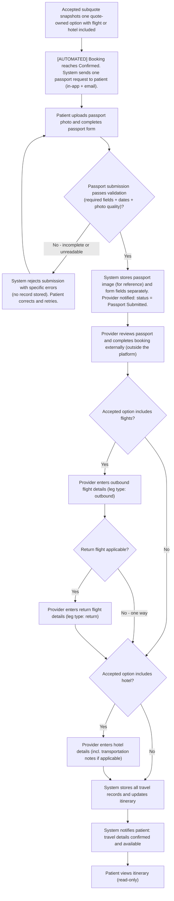
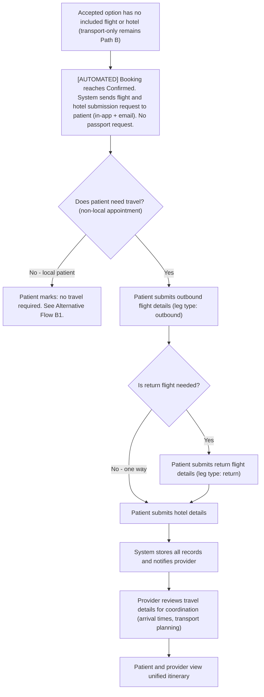
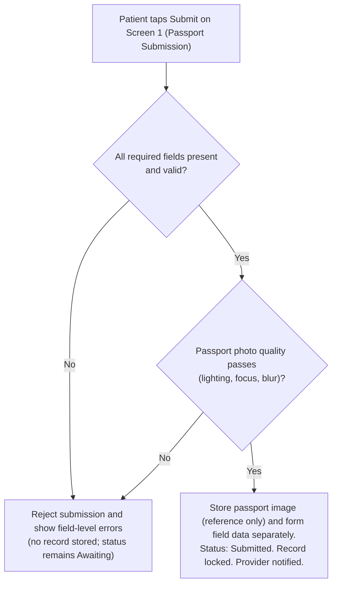
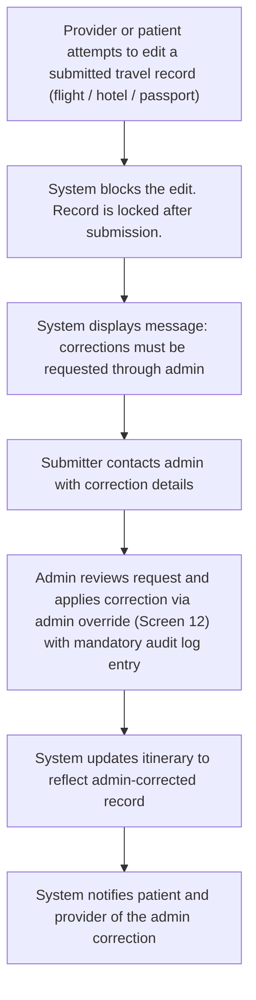
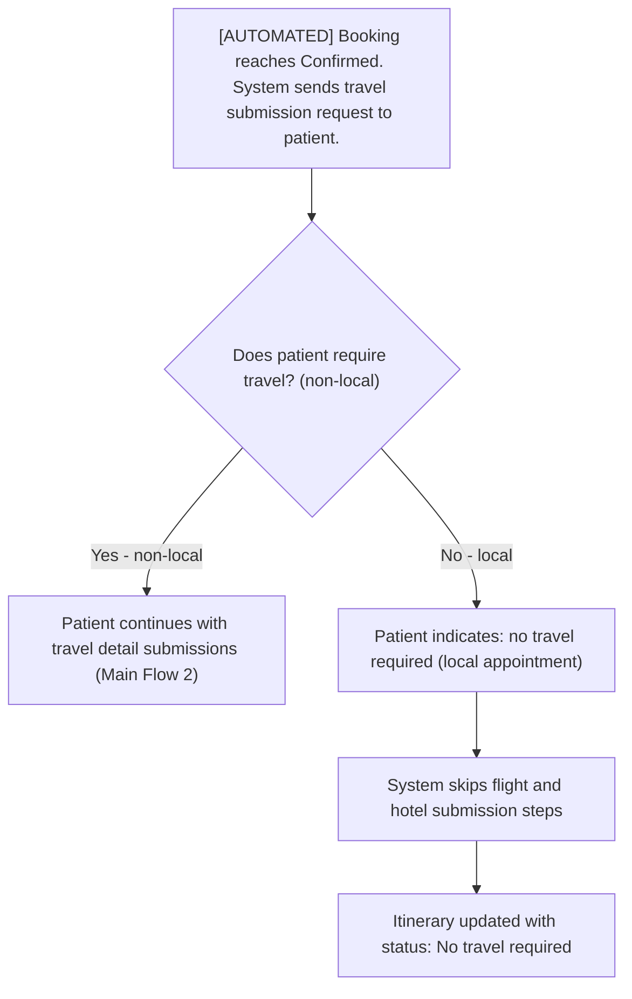
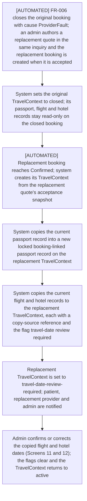

# FR-008 - Travel & Logistics Coordination

**Module**: P-04: Travel & Logistics | A-04: Travel Management | S-04: Travel API Gateway (future phase)
**Feature Branch**: `fr008-travel-booking-integration`
**Created**: 2025-11-10
**Last Updated**: 2026-11-22
**Status**: 🟡 Revised — Pending Consolidated Verification
**Source**: FR-008 from system-prd.md; cross-checked with transcriptions (HairlineApp-Part1/2, ProviderPlatformPart1, AdminPlatformPart1/2, HairlineOverview); SRC-MTG-002, CR-FR008-20260929-01, CR-FR008-20261016-01, and Product Owner binary-path decision of 2026-09-29

---

## Executive Summary

Enable coordinated travel logistics for patients and providers across the full appointment lifecycle. In MVP, the platform does **not** support in-app flight or hotel booking — instead it facilitates information capture and coordination between patients and providers. There are two distinct travel paths: (REQ-008-040)

1. **Provider-included travel**: The accepted option includes flight and/or hotel, possibly with transport. The patient submits passport details so the provider can complete the included bookings externally. Travel items appear in the accepted option breakdown.
2. **Patient self-booked travel**: The patient arranges their own flights and hotel independently. They submit the confirmed flight and hotel details into the platform so the provider has visibility for coordination (arrival times, airport pickups, etc.).

In both paths, the platform captures, stores, and surfaces travel details to all relevant parties (patient, provider, admin). FR-008 begins only when FR-006 confirms the booking after successful initial payment. Its travel path and included services come from the immutable FR-005 accepted subquote snapshot: one FR-004 Quote Option package snapshot paired with one Option/Date-Price Record and inherited parent quote context. The binary Path A / Path B model remains in force, including the prohibition on mixed patient/provider flight or hotel submissions. In-app booking via flight/hotel APIs and platform-managed transport are planned for a **future phase** (post-MVP).

---

## MVP Scope Boundaries

### In Scope (MVP)

- Passport capture: patient submits photo + form fields for all relevant passport details
- Patient-submitted flight and hotel information (patient self-booked path)
- Provider-entered flight and hotel information (provider-booked path)
- Package travel inclusion: provider configures flight/hotel/transport within each FR-004 Quote Option; FR-008 uses only the accepted option snapshot
- Itinerary aggregation: unified view of all confirmed travel per appointment (read-only for admin)
- Round-trip flight support: two separate flight records (outbound + return) per appointment
- Admin oversight: view and correct the travel records of each confirmed booking from its Travel section (no cross-booking travel list)
- Email notifications for travel record submission and updates

### Out of Scope (MVP — Future Phase)

- In-app flight search and booking via API (e.g. Amadeus, Skyscanner)
- In-app hotel search and booking via API (e.g. Booking.com, Expedia)
- Platform-managed transport (Hairline-owned driver network, driver apps, real-time tracking)
- Commission tracking on platform-facilitated bookings (depends on API booking being live)
- Airport transport booking (informational only in MVP via hotel form's Transportation Details field)
- Travel price preview during inquiry date selection (requires live flight API — future)
- OCR / auto-extraction of flight or hotel booking data from patient screenshots (client expectation noted; deferred to future phase — all travel details entered manually in MVP)

---

## Multi-Tenant Architecture

### Patient Platform (P-04)

- Receive an **automated** passport submission request (in-app prompt + email) when the FR-006 booking becomes **Confirmed** and the accepted subquote's travel path is Path A — no action required from the patient to trigger this
- Submit passport details (photo upload + form) — **Path A only**; not required when the patient self-books travel
- Receive an **automated** flight and hotel submission request (in-app prompt + email) when the FR-006 booking becomes **Confirmed** — patient self-booked path (Path B) only
- Submit outbound and return flight information per leg — patient self-booked path
- Submit hotel information — patient self-booked path
- View submitted passport data (form fields; masked passport number) — Path A only; passport image is stored for provider reference only and is not auto-parsed
- View unified travel itinerary (flights, hotel, accepted option inclusions) linked to the confirmed booking and its appointment
- Receive notifications when the provider enters or updates travel details on their behalf

### Provider Platform (PR-04)

- Configure travel inclusions in each quote-owned option snapshot in FR-004 (flight / hotel / airport transport). Only the accepted option snapshot determines which records the provider must enter after confirmation; later library-preset changes do not affect the booking.
- View travel status indicators (passport, outbound flight, return flight, hotel) within the **confirmed booking detail screen** — updated automatically when the booking reaches **Confirmed** status (e.g. "Awaiting passport details", "Passport submitted"). No separate travel dashboard. (REQ-008-041)
- View submitted passport details for a confirmed patient (passport number shown in full for booking purposes) — accessed from the Travel section of the booking detail screen.
- Enter confirmed flight details (outbound + return legs) and hotel details on behalf of the patient after completing the external booking — Path A, only for services included in the accepted option; accessed from the Travel section of the booking detail screen.
- View patient-submitted flight and hotel details for coordination — patient self-booked path; read-only view accessed from the Travel section of the booking detail screen.
- View combined travel itinerary per appointment within the booking detail screen.

### Admin Platform (A-04)

- View travel status (passport, flight, hotel) and records within the **confirmed booking detail screen** — no separate travel dashboard. Admin navigates to a booking via the existing admin inquiry/booking management, then accesses the Travel section there. (REQ-008-041)
- Monitor automated travel request status per appointment (whether requests were sent, what is pending) from within each booking's Travel section. (REQ-008-078)
- Manually re-trigger patient-owned pending travel requests from the Travel section: passport in Path A, or flight/hotel in Path B when travel is required.
- Edit or override any travel record via Screen 12, reached from the Travel section of the booking detail screen; all corrections require a mandatory audit log entry.
- Future phase: manage travel API configuration once API booking is live. There are no travel settings in the first release. (REQ-008-075)
- Future: configure commission parameters and per-country enablement once API booking is live.

### Shared Services

> **S-04 (Travel API Gateway)**: In MVP, S-04 provides travel record storage and event dispatch only — no external API integration. Live flight/hotel API connections are deferred to the future phase.

- Consume the FR-006 booking **Confirmed** transition after successful initial payment; initialize one TravelContext per confirmed booking and dispatch the relevant patient request once per booking: passport for Path A, flight and hotel details for Path B
- Store and serve passport, flight, and hotel records through the booking's TravelContext; retain accepted parent quote, subquote, Quote Option, and Option/Date-Price identifiers as read-only provenance. Records are immutable after submission — admin corrections create a new locked version with a mandatory audit log entry
- Send notifications (email + in-app) for all travel record events: automated requests on Confirmed, submissions received, provider updates
- Enforce access control: passport PII restricted to the submitting patient, assigned provider, and admin

---

## Business Workflows

### Main Flow 1: Provider-Included Travel

**Actors**: System (automated), Patient, Provider, Admin
**Trigger**: FR-006 booking transitions to **Confirmed** after successful initial payment and the accepted option snapshot contains flight or hotel. The system initializes the booking's TravelContext and automatically fires one passport request — no manual action from provider or admin required.
**Outcome**: Provider has all patient travel details needed to complete external bookings; patient's itinerary is updated with confirmed flight and hotel records.

**Flow Diagram**:

---

### Main Flow 2: Patient Self-Booked Travel

**Actors**: System (automated), Patient, Provider, Admin
**Trigger**: FR-006 booking transitions to **Confirmed** after successful initial payment and the accepted option snapshot contains neither flight nor hotel. System automatically prompts the patient to submit travel details — no manual trigger required.
**Outcome**: Provider has visibility of the patient's confirmed travel details for coordination; unified itinerary is available to both parties.

**Flow Diagram**:

---

### Alternative Flows

**A1: Passport Submission Rejected (Validation Failure)**

- **Trigger**: Patient attempts to submit passport details but fails validation (missing required fields, invalid dates, or passport photo quality checks fail).
- **Outcome**: Submission is rejected; **no passport record is created/updated**; patient remains on Screen 1 with field-level errors. Passport status remains **Awaiting** until a successful submission is completed.
- **Flow Diagram**:

**A2: Provider or Patient Attempts to Edit a Submitted Record**

- **Trigger**: Provider or patient attempts to modify a flight, hotel, or passport record that has already been submitted.
- **Outcome**: Edit is blocked; submitter is directed to contact admin for any correction.
- **Flow Diagram**:

**B1: No Travel Required (Local Patient)**

- **Trigger**: Patient is local and does not need flights or hotel.
- **Outcome**: Travel submissions are skipped; itinerary is marked &quot;No travel required.&quot; Patient can still continue to procedure.
- **Flow Diagram**:

**B2: Provider-Fault Transfer to a Replacement Booking**

- **Trigger**: An admin transfers the patient to a replacement provider through FR-006 Alternative Flow B5 after the original booking was confirmed and its TravelContext exists, and before treatment starts. A provider fault during `Aftercare` reassigns only the aftercare provider (FR-011) and leaves the booking and its TravelContext unchanged.
- **Outcome**: The original booking's TravelContext closes and its records stay read-only. The replacement booking's TravelContext receives a copy of the passport record and copies of the flight and hotel records, each flight and hotel copy flagged "travel-date review required", so the patient does not re-enter travel details.
- **Flow Diagram**:

---

## Screen Specifications

### Patient Platform

#### Screen 1: Passport Submission

**Purpose**: Capture patient passport details (photo + structured form) after appointment is confirmed, exclusively for use by the provider when booking travel on the patient's behalf (Path A — provider-included travel). Passport submission is **not required** when the patient self-books travel (Path B).

**Data Fields**:

| Field Name | API Field | Type | Required | Description | Validation Rules | Graph field |
|---|---|---|---|---|---|---|
| Passport Photo | `passport_image` | File (image) | Yes | Photo of the passport's data page | JPEG/PNG/HEIC; max 10 MB; must be legible | ENT-passport-record.passport_image |
| Full Name | `passport_name` | Text | Yes | As it appears on passport | Non-empty; max 100 chars | ENT-passport-record.passport_name |
| Passport Number | `passport_number` | Text | Yes | Machine-readable passport number | Non-empty; max 20 chars | ENT-passport-record.passport_number |
| Date of Birth | `passport_dob` | Date | Yes | As on passport | Valid past date | ENT-passport-record.passport_dob |
| Gender | `gender` | Select | Yes | As on passport | Male / Female / Other | ENT-passport-record.gender |
| Location (Nationality) | `location` | Text | Yes | Country of nationality | Non-empty | ENT-passport-record.location |
| Place of Birth | `place_of_birth` | Text | Yes | City/country of birth | Non-empty | ENT-passport-record.place_of_birth |
| Date of Issue | `passport_issue` | Date | Yes | Passport issue date | Valid past date | ENT-passport-record.passport_issue |
| Date of Expiry | `passport_expiry` | Date | Yes | Passport expiry date | Must be a future date | ENT-passport-record.passport_expiry |

**Business Rules**:

- This screen is triggered automatically when the booking reaches **Confirmed** status and the accepted subquote snapshot yields Path A. It is NOT shown for patient self-booked journeys (Path B).
- Passport number is captured and stored but **masked in display** (e.g. `A1234****`); full number visible only to the assigned provider and admin.
- Passport photo is stored in compliant secure storage as a reference document only. It is **not parsed or processed automatically** — all passport fields must be filled in manually by the patient via the form. (REQ-008-042)
- Passport photo upload MUST run an on-device quality check before submission is allowed (lighting conditions, focus, blurriness). Use the app's standard Flutter implementation (Google ML Kit) for this quality gate. If the check fails, the app blocks submission and provides an actionable error (e.g., "Too blurry — retake in better light"). This is a **quality gate only** (no OCR / data extraction). (REQ-008-047, REQ-008-048)
- The stored image is accessible to the assigned provider and admin for manual verification purposes; it is not shown in any list or itinerary view.
- Once submitted, the passport record is **locked** and cannot be edited, deleted, or re-submitted by the patient or provider. Corrections must be requested through admin (Screen 12 replacement + audit reason). Exception: if an admin soft-deletes the passport record, the status returns to Awaiting and the patient may submit one new passport (REQ-008-076); the deleted record stays in the travel audit trail. (REQ-008-052)
- If passport details were previously submitted for an earlier appointment, the passport request is still sent as usual. The patient either confirms the earlier details or enters new ones, and the result is a new booking-linked locked record; the earlier record is not edited. (REQ-008-051)
- All passport fields are treated as PII and subject to GDPR/data protection rules. (REQ-008-049)

**Notes**:

- After submission, the screen transitions to a read-only confirmation view showing the manually entered form fields: Full Name, Date of Birth, Gender, Location, Place of Birth, Date of Issue, Date of Expiry, and masked Passport Number. The passport photo is not displayed in the confirmation view. (REQ-008-082)
- Provide clear progress indication during photo upload. The photo upload and the form fields are submitted together; no automatic data extraction occurs from the photo.

---

#### Screen 2: Travel Requirement Check — Patient (Path B)

**Purpose**: Allow the patient to confirm whether they need to arrange travel for their upcoming appointment. Shown immediately after the automated travel submission request is received (Path B only). Local patients who do not require flights or a hotel can dismiss the submission workflow here, preventing unnecessary prompts.

**UI Layout**: Full-screen prompt with confirmed booking reference and accepted appointment context (clinic name, date/time, timezone) and a single question with two action options.

| Element | Type | Description | Graph field |
|---|---|---|---|
| Appointment summary | Display | Confirmed booking reference, clinic name, current booking appointment date/time/timezone and accepted baseline when an admin-approved date change exists (read-only) | ENT-booking.id, ENT-provider.name, ENT-booking.appointment_at, ENT-booking.appointment_timezone, ENT-travel-context.accepted_appointment_date_time |
| Prompt | Heading | "Do you need to arrange travel for this appointment?" | no graph field (control) |
| Option A | Primary button | "Yes — I need to arrange travel" | ENT-travel-context.travel_required |
| Option B | Secondary button | "No — I am local / no travel needed" | ENT-travel-context.travel_required |

**Business Rules**:

- This screen is shown **only for Path B** (patient self-booked travel). It is not shown for Path A because the provider handles all travel; passport submission is requested instead (Screen 1). (REQ-008-058)
- If the patient selects **"Yes"**: the system proceeds to Screen 3 (Flight Information) and Screen 4 (Hotel Information) in sequence. (REQ-008-058)
- If the patient selects **"No"**: the system sets the booking's TravelContext `travel_required` flag to false (shown as `no_travel_required`), suppresses all further travel submission reminders for this booking, and redirects the patient to Screen 5 (Travel Itinerary View) showing "No travel required." (REQ-008-058)
- Once set to `no_travel_required`, the patient cannot reverse this themselves. If the patient's situation changes, they must contact admin. (REQ-008-059)
- Admin can override `no_travel_required` from Screen 11 (Oversight) and re-send the travel submission request. (REQ-008-059)
- This decision, and any admin override, is recorded on the TravelContext with a timestamp and actor ID. (REQ-008-059)

---

#### Screen 3: Flight Information — Patient Submission (Path B)

**Purpose**: Allow the patient to submit confirmed flight details for one leg of their trip. Used twice for a round-trip: once for the outbound leg and once for the return leg.

**Data Fields**:

| Field Name | API Field | Type | Required | Description | Validation Rules | Graph field |
|---|---|---|---|---|---|---|
| Leg Type | `leg_type` | Select (header) | Yes | Outbound or Return | Must select one; drives form header label | ENT-flight-record.leg_type |
| Airline Name | `airline_name` | Text | Yes | Name of the airline | Non-empty | ENT-flight-record.airline_name |
| Flight Number | `flight_number` | Text | Yes | Specific flight number | Non-empty | ENT-flight-record.flight_number |
| Departure Airport | `departure_airport` | Text | Yes | IATA code + airport name | Non-empty | ENT-flight-record.departure_airport |
| Arrival Airport | `arrival_airport` | Text | Yes | IATA code + airport name | Non-empty | ENT-flight-record.arrival_airport |
| Departure Date | `departure_date` | Date | Yes | Scheduled departure date | Valid date; outbound arrival must be on or before the current booking appointment date; return departure must be after it | ENT-flight-record.departure_date |
| Departure Time | `departure_time` | Time | Yes | Scheduled departure time | Valid time (HH:MM) | ENT-flight-record.departure_time |
| Arrival Date | `arrival_date` | Date | Yes | Scheduled arrival date | Must be ≥ departure date | ENT-flight-record.arrival_date |
| Arrival Time | `arrival_time` | Time | Yes | Scheduled arrival time | Valid time (HH:MM) | ENT-flight-record.arrival_time |
| Ticket Confirmation Number | `ticket_confirmation_number` | Text | Yes | Booking reference from airline | Non-empty | ENT-flight-record.ticket_confirmation_number |
| Ticket Class | `ticket_class` | Select | Yes | Economy / Business / First | Must select one | ENT-flight-record.ticket_class |
| Baggage Allowance | `baggage_allowance` | Text | No | Checked + carry-on allowance details | Free text; max 300 chars | ENT-flight-record.baggage_allowance |
| Special Requests | `special_request` | Text | No | Seat preference, meal preference, etc. | Free text; max 500 chars | ENT-flight-record.special_request |

**Business Rules**:

- `total_price` is explicitly excluded from this form. Flight cost is part of the accepted option/date-price selection (FR-004/FR-005/FR-007). (REQ-008-009)
- The form header must display the leg type label clearly: "Outbound Flight" or "Return Flight." (REQ-008-054)
- After submitting the outbound leg, the system prompts the patient to also submit the return leg. (REQ-008-054)
- See REQ-008-017, REQ-008-052.
- `baggage_allowance` field name corrected from `baggages_allowance` (API normalisation — resolve with backend team).

**Notes**:

- Present outbound and return as two sequential steps or two tabs under "Flight Information."
- Both legs are independent; either may be submitted separately if the return is not yet confirmed.

---

#### Screen 4: Hotel Information — Patient Submission (Path B)

**Purpose**: Allow the patient to submit their confirmed hotel booking details so the provider has visibility for coordination.

**Data Fields**:

| Field Name | API Field | Type | Required | Description | Validation Rules | Graph field |
|---|---|---|---|---|---|---|
| Hotel Name | `hotel_name` | Text | Yes | Full name of the hotel/lodging | Non-empty | ENT-hotel-record.hotel_name |
| Hotel Address | `hotel_address` | Text | Yes | Full address for patient navigation | Non-empty | ENT-hotel-record.hotel_address |
| Check-In Date | `check_in_date` | Date | Yes | Arrival date at hotel | Valid date; must be before check-out | ENT-hotel-record.check_in_date |
| Check-In Time | `check_in_time` | Time | Yes | Expected check-in time | Valid time (HH:MM) | ENT-hotel-record.check_in_time |
| Check-Out Date | `check_out_date` | Date | Yes | Departure date from hotel | Must be after check-in | ENT-hotel-record.check_out_date |
| Check-Out Time | `check_out_time` | Time | Yes | Expected check-out time | Valid time (HH:MM) | ENT-hotel-record.check_out_time |
| Reservation Number | `reservation_number` | Text | Yes | Booking/reservation reference | Non-empty | ENT-hotel-record.reservation_number |
| Room Type | `room_type` | Select/Text | Yes | Room category (e.g. Single, Double, Suite) | Non-empty | ENT-hotel-record.room_type |
| Amenities Included | `amenities` | Text | No | Gym, breakfast, parking, etc. | Free text; max 500 chars | ENT-hotel-record.amenities |
| Transportation Details | `transportation` | Text | No | Transfer/pickup info tied to this stay | Free text; max 500 chars | ENT-hotel-record.transportation |
| Special Requests | `special_request` | Text | No | Accessibility needs, preferences, etc. | Free text; max 500 chars | ENT-hotel-record.special_request |
| Phone Number | `contact_number` | Text | No | Hotel contact phone | Valid phone format | ENT-hotel-record.contact_number |
| Email | `contact_email` | Email | No | Hotel contact email | Valid email format | ENT-hotel-record.contact_email |

**Business Rules**:

- See REQ-008-055.
- The `Transportation Details` field is the canonical field for recording airport pickup and transfer notes. There is no separate transport form in MVP. (REQ-008-013)
- See REQ-008-017, REQ-008-052.

**Notes**:

- Airport transport is not a standalone entity in MVP. Providers should be guided to use the Transportation Details field for any transfer instructions (e.g. "Private limousine from IST Airport — driver meets at arrivals with name sign").

---

#### Screen 5: Travel Itinerary View — Patient

**Purpose**: Unified, read-only view of all confirmed travel details for the booking's accepted appointment, assembled automatically from submitted records each time it is opened (the itinerary is not stored as a separate record).

**Data Fields**:

| Section | Fields Displayed | Notes | Graph field |
|---|---|---|---|
| Booking and Accepted Choice | Booking reference, accepted subquote reference, current booking appointment date/time/timezone, selected package name | Accepted baseline from the immutable snapshot is also shown if an admin-approved date change exists | ENT-booking.id, ENT-subquote.id, ENT-quote-option.package_name_snapshot, ENT-booking.appointment_at, ENT-booking.appointment_timezone, ENT-travel-context.accepted_appointment_date_time |
| Package Travel Items | List of provider-included travel items from the accepted option snapshot (e.g. "Hotel included", "Airport transfer included", or other travel services such as a city tour) | Shown only if provider-included travel items exist, in Path A or Path B (REQ-008-044) | ENT-travel-context.included_services_snapshot |
| Passport | Full Name, masked Passport Number, Date of Expiry | **Shown only for Path A** (provider-booked travel); not shown when patient self-books | ENT-passport-record.passport_name, ENT-passport-record.passport_number, ENT-passport-record.passport_expiry, ENT-passport-record.submitted_by, ENT-passport-record.submitted_at |
| Outbound Flight | Airline, flight number, departure → arrival airport, date/time, confirmation number, ticket class | Always shown if record exists | ENT-flight-record.airline_name, ENT-flight-record.flight_number, ENT-flight-record.departure_airport, ENT-flight-record.arrival_airport, ENT-flight-record.departure_date, ENT-flight-record.departure_time, ENT-flight-record.arrival_date, ENT-flight-record.arrival_time, ENT-flight-record.ticket_confirmation_number, ENT-flight-record.ticket_class, ENT-flight-record.leg_type, ENT-flight-record.submitted_by, ENT-flight-record.submitted_at |
| Return Flight | Same fields as outbound | Shown only if return record exists | ENT-flight-record.airline_name, ENT-flight-record.flight_number, ENT-flight-record.departure_airport, ENT-flight-record.arrival_airport, ENT-flight-record.departure_date, ENT-flight-record.departure_time, ENT-flight-record.arrival_date, ENT-flight-record.arrival_time, ENT-flight-record.ticket_confirmation_number, ENT-flight-record.ticket_class, ENT-flight-record.leg_type, ENT-flight-record.submitted_by, ENT-flight-record.submitted_at |
| Hotel | Hotel name, address, check-in/out date & time, reservation number, transportation details | Shown if record exists | ENT-hotel-record.hotel_name, ENT-hotel-record.hotel_address, ENT-hotel-record.check_in_date, ENT-hotel-record.check_in_time, ENT-hotel-record.check_out_date, ENT-hotel-record.check_out_time, ENT-hotel-record.reservation_number, ENT-hotel-record.transportation, ENT-hotel-record.submitted_by, ENT-hotel-record.submitted_at |

**Business Rules**:

- Patient sees own records only; no access to other patients' data. (REQ-008-057)
- See REQ-008-017, REQ-008-052.
- Each record section shows the submission timestamp and the submitter (patient or provider). (REQ-008-056)
- If a record is pending (not yet submitted), the section displays the relevant "Awaiting submission" state. A submission link appears only when the patient owns that item under Path B or when the patient must provide a Path A passport. (REQ-008-056)
- While the TravelContext is in travel-date review, the screen shows "Travel dates under admin review" next to the affected flight and hotel sections. When the TravelContext is closed, the screen is read-only and shows no submission links. (REQ-008-061, REQ-008-062)

---

### Provider Platform

#### Screen 6: Travel Section — Confirmed Booking Detail Screen (Provider)

**Purpose**: Travel status and actions surfaced as a section within the provider's confirmed booking detail screen (FR-006 Screen 4). No standalone travel dashboard — the provider accesses travel coordination in the context of the accepted appointment.

**Placement**: Rendered as a collapsible "Travel" section at the bottom of the confirmed booking detail screen. Visible only once the booking reaches **Confirmed** status.

**Data Fields**:

| Field Name | Type | Description | Graph field |
|---|---|---|---|
| Booking and Accepted Choice | Read-only summary | Booking reference, accepted subquote reference, package snapshot name, current booking appointment date/time/timezone, and included travel services from the AcceptanceEvent; show accepted appointment baseline if changed by admin | ENT-booking.id, ENT-subquote.id, ENT-quote-option.package_name_snapshot, ENT-booking.appointment_at, ENT-booking.appointment_timezone, ENT-travel-context.included_services_snapshot, ENT-travel-context.accepted_appointment_date_time |
| Travel Path | Badge | Provider-included (Path A) / Patient self-booked (Path B) | ENT-travel-context.travel_path |
| Passport Status | Badge | Awaiting / Submitted / Incomplete — **Path A only**; hidden for Path B | ENT-travel-context.passport_status |
| Outbound Flight Status | Badge | Not included / Awaiting / Submitted | ENT-travel-context.outbound_flight_status, ENT-flight-record.travel_date_review_required |
| Return Flight Status | Badge | Not included / Awaiting / Submitted | ENT-travel-context.return_flight_status, ENT-flight-record.early_departure_acknowledged_at, ENT-flight-record.travel_date_review_required |
| Hotel Status | Badge | Not included / Awaiting / Submitted | ENT-travel-context.hotel_status, ENT-hotel-record.early_departure_acknowledged_at, ENT-hotel-record.travel_date_review_required |
| Actions | Buttons | View Passport (Path A) · Enter Flight / Enter Hotel (Path A, if not yet submitted) · View Travel Details (Path B) | no graph field (control) |

**Business Rules**:

- Status badges update in real-time when travel records are submitted (by patient in Path B, by provider in Path A) and when admin applies corrections. (REQ-008-064)
- Provider can only see and act on the booking currently open; no cross-patient or cross-clinic access from this section. (REQ-008-057)
- For **Path A** appointments, "Enter Flight" and "Enter Hotel" action buttons appear only for travel services in the accepted option snapshot. Services not included show "Not included" — no entry action is rendered, and the patient is not asked to submit them in MVP. (REQ-008-064)
- For **Path B** appointments, only "View Travel Details" is shown (read-only). Provider cannot enter or modify patient-submitted records. (REQ-008-064)
- Provider can contact admin if a patient-submitted record (Path B) needs review; admin resolves the dispute through Screen 12. (REQ-008-052)
- "Incomplete" is an admin-managed status used when a submitted passport record is deemed unusable/incorrect and is pending admin correction (Screen 12). Patients/providers cannot "re-submit" to change a locked record, except after an admin soft-delete returns the passport to Awaiting (REQ-008-076). (REQ-008-065)
- Each action button navigates to the relevant screen: View Passport → Screen 7; Enter Flight → Screen 8; Enter Hotel → Screen 9; View Travel Details → Screen 10.
- While the TravelContext is in travel-date review, the section shows "Travel dates under admin review". When the TravelContext is closed (booking cancelled after confirmation), "Enter Flight" and "Enter Hotel" are not rendered and all records are read-only. (REQ-008-061, REQ-008-062)
- When a return flight departs, or the hotel check-out falls, before the last treatment plan day, the related status badge shows a "Leaves before last treatment day" flag together with the time the submitter acknowledged the warning.
- Flight and hotel records copied from a closed booking after a provider-fault transfer show the label "Travel-date review required" until an admin clears the review.

---

#### Screen 7: Passport View — Provider

**Purpose**: Allow the provider to view a confirmed patient's passport details in order to complete external travel bookings (Path A).

**Data Fields**:

| Field Name | API Field | Display | Graph field |
|---|---|---|---|
| Full Name | `passport_name` | Plain text | ENT-passport-record.passport_image |
| Passport Number | `passport_number` | Shown in full to assigned provider and admin only | ENT-passport-record.passport_name |
| Date of Birth | `passport_dob` | Plain text | ENT-passport-record.passport_number |
| Gender | `gender` | Plain text | ENT-passport-record.passport_dob |
| Location (Nationality) | `location` | Plain text | ENT-passport-record.gender |
| Place of Birth | `place_of_birth` | Plain text | ENT-passport-record.location |
| Date of Issue | `passport_issue` | Plain text | ENT-passport-record.place_of_birth |
| Date of Expiry | `passport_expiry` | Plain text | ENT-passport-record.passport_issue |
| Passport Photo | `passport_image` | Viewable (not downloadable in MVP) | ENT-passport-record.passport_expiry |

**Business Rules**:

- Passport number is shown **in full** to the assigned provider (unlike the patient's own masked view) so the provider can use it for booking. (REQ-008-050)
- Read-only. Provider cannot edit passport data. If the data is incorrect, the provider must contact admin for correction. (REQ-008-050)
- Access is logged (timestamp, provider user ID) for audit purposes. (REQ-008-050)
- Provider must not be able to view passport data for patients not assigned to their clinic. (REQ-008-050)

---

#### Screen 8: Flight Information — Provider Entry (Path A)

**Purpose**: Allow the provider to enter confirmed flight details on behalf of the patient after completing the external booking. Used twice for a round-trip: once for the outbound leg and once for the return leg.

**Data Fields**: Same fields as Screen 3 (Patient Flight Submission), including `leg_type`. Provider-facing form is identical in structure; the submitter is recorded as the provider.

| Field Name | API Field | Type | Required | Description | Validation Rules | Graph field |
|---|---|---|---|---|---|---|
| Leg Type | `leg_type` | Select (header) | Yes | Outbound or Return | Must select one; drives form header label | ENT-flight-record.leg_type |
| Airline Name | `airline_name` | Text | Yes | Name of the airline | Non-empty | ENT-flight-record.airline_name |
| Flight Number | `flight_number` | Text | Yes | Specific flight number | Non-empty | ENT-flight-record.flight_number |
| Departure Airport | `departure_airport` | Text | Yes | IATA code + airport name | Non-empty | ENT-flight-record.departure_airport |
| Arrival Airport | `arrival_airport` | Text | Yes | IATA code + airport name | Non-empty | ENT-flight-record.arrival_airport |
| Departure Date | `departure_date` | Date | Yes | Scheduled departure date | Valid date; outbound arrival must be on or before the current booking appointment date; return departure must be after it | ENT-flight-record.departure_date |
| Departure Time | `departure_time` | Time | Yes | Scheduled departure time | Valid time (HH:MM) | ENT-flight-record.departure_time |
| Arrival Date | `arrival_date` | Date | Yes | Scheduled arrival date | Must be ≥ departure date | ENT-flight-record.arrival_date |
| Arrival Time | `arrival_time` | Time | Yes | Scheduled arrival time | Valid time (HH:MM) | ENT-flight-record.arrival_time |
| Ticket Confirmation Number | `ticket_confirmation_number` | Text | Yes | Booking reference from airline | Non-empty | ENT-flight-record.ticket_confirmation_number |
| Ticket Class | `ticket_class` | Select | Yes | Economy / Business / First | Must select one | ENT-flight-record.ticket_class |
| Baggage Allowance | `baggage_allowance` | Text | No | Checked + carry-on allowance details | Free text; max 300 chars | ENT-flight-record.baggage_allowance |
| Special Requests | `special_request` | Text | No | Seat preference, meal preference, etc. | Free text; max 500 chars | ENT-flight-record.special_request |

**Business Rules**:

- Enabled only for **Path A** confirmed bookings where flights are included in the accepted option snapshot. Patient flight submission is not available in Path A.
- See REQ-008-054.
- After entering the outbound leg, the system prompts the provider to also enter the return leg. (REQ-008-054)
- Both legs are independent; either may be entered separately if the return booking is not yet finalised.
- See REQ-008-009.
- See REQ-008-017, REQ-008-052.

**Notes**:

- Present outbound and return as two sequential steps or two tabs under "Flight Information," consistent with the patient-facing version (Screen 3).

---

#### Screen 9: Hotel Information — Provider Entry (Path A)

**Purpose**: Allow the provider to enter confirmed hotel details on behalf of the patient after completing the external booking (Path A only).

**Data Fields**:

| Field Name | API Field | Type | Required | Description | Validation Rules | Graph field |
|---|---|---|---|---|---|---|
| Hotel Name | `hotel_name` | Text | Yes | Full name of the hotel/lodging | Non-empty | ENT-hotel-record.hotel_name |
| Hotel Address | `hotel_address` | Text | Yes | Full address for patient navigation | Non-empty | ENT-hotel-record.hotel_address |
| Check-In Date | `check_in_date` | Date | Yes | Arrival date at hotel | Valid date; must be before check-out | ENT-hotel-record.check_in_date |
| Check-In Time | `check_in_time` | Time | Yes | Expected check-in time | Valid time (HH:MM) | ENT-hotel-record.check_in_time |
| Check-Out Date | `check_out_date` | Date | Yes | Departure date from hotel | Must be after check-in | ENT-hotel-record.check_out_date |
| Check-Out Time | `check_out_time` | Time | Yes | Expected check-out time | Valid time (HH:MM) | ENT-hotel-record.check_out_time |
| Reservation Number | `reservation_number` | Text | Yes | Booking/reservation reference | Non-empty | ENT-hotel-record.reservation_number |
| Room Type | `room_type` | Select/Text | Yes | Room category (e.g. Single, Double, Suite) | Non-empty | ENT-hotel-record.room_type |
| Amenities Included | `amenities` | Text | No | Gym, breakfast, parking, etc. | Free text; max 500 chars | ENT-hotel-record.amenities |
| Transportation Details | `transportation` | Text | No | Airport pickup and transfer arrangements | Free text; max 500 chars | ENT-hotel-record.transportation |
| Special Requests | `special_request` | Text | No | Accessibility needs, preferences, etc. | Free text; max 500 chars | ENT-hotel-record.special_request |
| Phone Number | `contact_number` | Text | No | Hotel contact phone | Valid phone format | ENT-hotel-record.contact_number |
| Email | `contact_email` | Email | No | Hotel contact email | Valid email format | ENT-hotel-record.contact_email |

**Business Rules**:

- Enabled only for a **Path A** confirmed booking where hotel is included in the accepted option snapshot and no hotel record has been submitted yet for this appointment. (REQ-008-055)
- The `Transportation Details` field is the canonical place to record airport pickup and transfer arrangements (e.g. "Private transfer from IST Airport — driver meets at arrivals with name sign"). (REQ-008-013)
- See REQ-008-017, REQ-008-052.

#### Screen 10: Travel Details — Confirmed Booking Detail Screen (Provider, Path B)

**Purpose**: Patient-submitted flight and hotel details rendered inline within the Travel section of the provider's confirmed booking detail screen for Path B appointments. No separate screen — the provider reads all travel coordination detail without leaving the booking context.

**Placement**: Rendered as two collapsible sub-sections ("Flight Details" and "Hotel Details") that expand within Screen 6's Travel section when the provider opens a Path B booking. Passport sub-section is not present (not collected in Path B).

**Flight Details** *(up to two sub-sections: Outbound and Return)*:

| Field Name | API Field | Display | Graph field |
|---|---|---|---|
| Airline Name | `airline_name` | Plain text | ENT-flight-record.airline_name |
| Flight Number | `flight_number` | Plain text | ENT-flight-record.flight_number |
| Departure Airport | `departure_airport` | Plain text | ENT-flight-record.departure_airport |
| Arrival Airport | `arrival_airport` | Plain text | ENT-flight-record.arrival_airport |
| Departure Date | `departure_date` | Plain text | ENT-flight-record.departure_date |
| Departure Time | `departure_time` | Plain text | ENT-flight-record.departure_time |
| Arrival Date | `arrival_date` | Plain text | ENT-flight-record.arrival_date |
| Arrival Time | `arrival_time` | Plain text | ENT-flight-record.arrival_time |
| Ticket Confirmation Number | `ticket_confirmation_number` | Plain text | ENT-flight-record.ticket_confirmation_number |
| Ticket Class | `ticket_class` | Plain text | ENT-flight-record.ticket_class |
| Baggage Allowance | `baggage_allowance` | Plain text | ENT-flight-record.baggage_allowance |
| Special Requests | `special_request` | Plain text | ENT-flight-record.special_request |
| Submitted By | — | Patient name + submission timestamp | ENT-flight-record.submitted_by, ENT-flight-record.submitted_at |
| Status | — | Submitted / Awaiting | ENT-travel-context.outbound_flight_status, ENT-travel-context.return_flight_status |

Return flight uses the same fields, shown as a separate sub-section. If no return record exists, shows "Return flight not yet submitted." (REQ-008-080)

**Hotel Details**:

| Field Name | API Field | Display | Graph field |
|---|---|---|---|
| Hotel Name | `hotel_name` | Plain text | ENT-hotel-record.hotel_name |
| Hotel Address | `hotel_address` | Plain text | ENT-hotel-record.hotel_address |
| Check-In Date | `check_in_date` | Plain text | ENT-hotel-record.check_in_date |
| Check-In Time | `check_in_time` | Plain text | ENT-hotel-record.check_in_time |
| Check-Out Date | `check_out_date` | Plain text | ENT-hotel-record.check_out_date |
| Check-Out Time | `check_out_time` | Plain text | ENT-hotel-record.check_out_time |
| Reservation Number | `reservation_number` | Plain text | ENT-hotel-record.reservation_number |
| Room Type | `room_type` | Plain text | ENT-hotel-record.room_type |
| Amenities Included | `amenities` | Plain text | ENT-hotel-record.amenities |
| Transportation Details | `transportation` | Plain text | ENT-hotel-record.transportation |
| Special Requests | `special_request` | Plain text | ENT-hotel-record.special_request |
| Phone Number | `contact_number` | Plain text | ENT-hotel-record.contact_number |
| Email | `contact_email` | Plain text | ENT-hotel-record.contact_email |
| Submitted By | — | Patient name + submission timestamp | ENT-hotel-record.submitted_by, ENT-hotel-record.submitted_at |
| Status | — | Submitted / Awaiting | ENT-travel-context.hotel_status |

**Business Rules**:

- Entirely read-only. Provider cannot enter or correct any record in Path B. (REQ-008-064)
- If a flight leg has not been submitted, its sub-section shows "Awaiting patient submission." (REQ-008-080)
- If no hotel record has been submitted, the Hotel Details sub-section shows "Awaiting patient submission." (REQ-008-080)
- Provider can use the Transportation Details field to plan clinic-side logistics (e.g. verifying patient arrival times for airport pickup arrangements). (REQ-008-045)
- Visible only for Path B appointments. For Path A, the provider enters records directly via Screens 8 and 9 from the same Travel section.
- Provider can only view records for patients assigned to their clinic; no cross-clinic access. (REQ-008-057)
- If a record appears incorrect, the provider must contact admin — no edit or flag capability from this view. (REQ-008-052)

---

### Admin Platform

#### Screen 11: Travel Section — Admin Confirmed Booking Detail Screen

**Purpose**: Travel status, records, and correction actions surfaced as a section within the admin's confirmed booking detail screen. No standalone travel oversight dashboard — admin accesses travel coordination for the accepted appointment from its booking.

**Placement**: Rendered as a "Travel" section within the confirmed booking detail screen in the admin platform. Visible for all confirmed bookings regardless of travel path.

**Data Fields**:

| Field Name | Type | Description | Graph field |
|---|---|---|---|
| Booking and Accepted Choice | Read-only summary | Booking reference, accepted subquote reference, package snapshot name, current booking appointment date/time/timezone, and included travel services from the AcceptanceEvent; show accepted appointment baseline if changed by admin | ENT-booking.id, ENT-subquote.id, ENT-quote-option.package_name_snapshot, ENT-booking.appointment_at, ENT-booking.appointment_timezone, ENT-travel-context.included_services_snapshot, ENT-travel-context.accepted_appointment_date_time |
| Travel Path | Badge | Provider-included (Path A) / Patient self-booked (Path B) | ENT-travel-context.travel_path |
| Passport Status | Badge | Awaiting / Submitted / Incomplete — **Path A only**; hidden for Path B | ENT-travel-context.passport_status |
| Outbound Flight Status | Badge | Not included / Awaiting / Submitted | ENT-travel-context.outbound_flight_status |
| Return Flight Status | Badge | Not included / Awaiting / Submitted | ENT-travel-context.return_flight_status |
| Hotel Status | Badge | Not included / Awaiting / Submitted | ENT-travel-context.hotel_status |
| Travel Context Status | Badge | Active / Travel-date review required / Closed; review state shows the accepted appointment baseline, the current booking appointment and the flagged flight and hotel dates (REQ-008-079) | ENT-travel-context.status, ENT-flight-record.travel_date_review_required, ENT-hotel-record.travel_date_review_required |
| Initial Request Sent | Read-only | Whether the first automatic travel request has been sent (yes / no) and the time it was sent (REQ-008-078) | ENT-travel-context.initial_request_dispatched_at |
| Actions | Buttons | Re-notify patient (eligible patient-owned pending record only) · Apply Correction (→ Screen 12) · Confirm Travel Dates (travel-date review only) | no graph field (control) |

**Business Rules**:

- Admin can view all travel records without access restrictions; no cross-clinic filtering needed — admin is already within a specific booking. (REQ-008-057)
- "Re-notify patient" triggers a manual reminder only for a patient-owned pending item: passport in Path A, or flight/hotel in Path B unless the booking is marked `no_travel_required`. Provider-owned Path A flight/hotel items do not create patient submission reminders. (REQ-008-060)
- "Apply Correction" navigates to Screen 12 for the detailed correction workflow.
- "Confirm Travel Dates" is shown only while the TravelContext is in travel-date review. See REQ-008-030.
- When the TravelContext is closed, "Re-notify patient", "Confirm Travel Dates" and "Apply Correction" are not available and all records are read-only. (REQ-008-061)
- See REQ-008-024, REQ-008-066, REQ-008-067.

---

#### Screen 12: Travel Record Detail & Admin Correction

**Purpose**: Full travel record view and correction screen for a confirmed booking, reached via "Apply Correction" from the Travel section of the admin booking detail screen (Screen 11). Admin can inspect all submitted records and apply corrections with a mandatory reason note. Records are locked for patients and providers; only admin can write to them post-submission.

**Screen Header (always visible across all tabs)**:

| Field | Type | Description | Graph field |
|---|---|---|---|
| Booking Reference | Text | Confirmed booking identifier and read-only link to its FR-005 AcceptanceEvent | ENT-booking.id, ENT-acceptance-event.id |
| Accepted Subquote | Text | Accepted subquote identifier and selected package snapshot | ENT-subquote.id, ENT-quote-option.package_name_snapshot |
| Patient Name | Text | Full name of the patient | ENT-patient.name |
| Provider / Clinic | Text | Assigned clinic | ENT-provider.name |
| Appointment Date | Date/time | Current booking procedure date/time/timezone; show immutable accepted baseline if changed by admin | ENT-booking.appointment_at, ENT-booking.appointment_timezone, ENT-travel-context.accepted_appointment_date_time |
| Travel Path | Badge | Provider-included (Path A) / Patient self-booked (Path B) | ENT-travel-context.travel_path |
| Overall Status | Badge | Pending / Partially submitted / Complete | ENT-travel-context.overall_status |

---

**Tab 1: Passport**

*(Visible only for Path A appointments. Hidden for Path B.)* (REQ-008-068)

| Field Name | API Field | Display | Admin Correction | Graph field |
|---|---|---|---|---|
| Passport Photo | `passport_image` | Viewable in full (not downloadable) | Replaceable with new file upload | ENT-passport-record.passport_image |
| Full Name | `passport_name` | Plain text | Editable | ENT-passport-record.passport_name |
| Passport Number | `passport_number` | Shown in full (unmasked) | Editable | ENT-passport-record.passport_number |
| Date of Birth | `passport_dob` | Plain text | Editable | ENT-passport-record.passport_dob |
| Gender | `gender` | Plain text | Editable | ENT-passport-record.gender |
| Location (Nationality) | `location` | Plain text | Editable | ENT-passport-record.location |
| Place of Birth | `place_of_birth` | Plain text | Editable | ENT-passport-record.place_of_birth |
| Date of Issue | `passport_issue` | Plain text | Editable | ENT-passport-record.passport_issue |
| Date of Expiry | `passport_expiry` | Plain text | Editable | ENT-passport-record.passport_expiry |
| Submitted By | — | Patient name + timestamp | Read-only | ENT-passport-record.submitted_by, ENT-passport-record.submitted_at |
| Status | — | Submitted / Incomplete / Awaiting | Read-only badge | ENT-travel-context.passport_status |

**Tab 1 Business Rules**:

- Passport number and photo are shown unmasked/in full to admin only.
- If no passport has been submitted yet, tab shows "Awaiting submission" with a "Re-notify patient" button. (REQ-008-081)
- If the passport record is marked "Incomplete", it indicates admin has determined the submitted passport data/photo is unusable/incorrect and requires correction. The patient cannot re-submit; admin must apply a correction (replace photo and/or edit fields) with a mandatory reason note. (REQ-008-065)
- Admin correction replaces the current record with a new locked version; the previous version is retained in the system's backend records. (REQ-008-017, REQ-008-066)
- See REQ-008-066.

---

**Tab 2: Flight Details**

*(Shown for both Path A and Path B. Contains up to two sub-sections: Outbound and Return.)*

**Outbound Flight**:

| Field Name | API Field | Display | Admin Correction | Graph field |
|---|---|---|---|---|
| Leg Type | `leg_type` | Outbound | Read-only | ENT-flight-record.leg_type |
| Airline Name | `airline_name` | Plain text | Editable | ENT-flight-record.airline_name |
| Flight Number | `flight_number` | Plain text | Editable | ENT-flight-record.flight_number |
| Departure Airport | `departure_airport` | Plain text | Editable | ENT-flight-record.departure_airport |
| Arrival Airport | `arrival_airport` | Plain text | Editable | ENT-flight-record.arrival_airport |
| Departure Date | `departure_date` | Plain text | Editable | ENT-flight-record.departure_date |
| Departure Time | `departure_time` | Plain text | Editable | ENT-flight-record.departure_time |
| Arrival Date | `arrival_date` | Plain text | Editable | ENT-flight-record.arrival_date |
| Arrival Time | `arrival_time` | Plain text | Editable | ENT-flight-record.arrival_time |
| Ticket Confirmation Number | `ticket_confirmation_number` | Plain text | Editable | ENT-flight-record.ticket_confirmation_number |
| Ticket Class | `ticket_class` | Plain text | Editable | ENT-flight-record.ticket_class |
| Baggage Allowance | `baggage_allowance` | Plain text | Editable | ENT-flight-record.baggage_allowance |
| Special Requests | `special_request` | Plain text | Editable | ENT-flight-record.special_request |
| Submitted By | — | Patient or provider name + timestamp | Read-only | ENT-flight-record.submitted_by, ENT-flight-record.submitted_at |
| Status | — | Submitted / Awaiting | Read-only badge | ENT-travel-context.outbound_flight_status, ENT-travel-context.return_flight_status |

**Return Flight**:

Same fields as Outbound Flight. Displayed as a separate sub-section below. If no return record exists, tab shows "Return flight not yet submitted." (REQ-008-081)

**Tab 2 Business Rules**:

- If neither outbound nor return has been submitted, tab shows "Awaiting submission" for each. "Re-notify patient" is available only in Path B; Path A flight entry remains provider-owned. (REQ-008-081, REQ-008-060)
- See REQ-008-017.
- See REQ-008-066.

---

**Tab 3: Hotel Details**

*(Shown for both Path A and Path B.)*

| Field Name | API Field | Display | Admin Correction | Graph field |
|---|---|---|---|---|
| Hotel Name | `hotel_name` | Plain text | Editable | ENT-hotel-record.hotel_name |
| Hotel Address | `hotel_address` | Plain text | Editable | ENT-hotel-record.hotel_address |
| Check-In Date | `check_in_date` | Plain text | Editable | ENT-hotel-record.check_in_date |
| Check-In Time | `check_in_time` | Plain text | Editable | ENT-hotel-record.check_in_time |
| Check-Out Date | `check_out_date` | Plain text | Editable | ENT-hotel-record.check_out_date |
| Check-Out Time | `check_out_time` | Plain text | Editable | ENT-hotel-record.check_out_time |
| Reservation Number | `reservation_number` | Plain text | Editable | ENT-hotel-record.reservation_number |
| Room Type | `room_type` | Plain text | Editable | ENT-hotel-record.room_type |
| Amenities Included | `amenities` | Plain text | Editable | ENT-hotel-record.amenities |
| Transportation Details | `transportation` | Plain text | Editable | ENT-hotel-record.transportation |
| Special Requests | `special_request` | Plain text | Editable | ENT-hotel-record.special_request |
| Phone Number | `contact_number` | Plain text | Editable | ENT-hotel-record.contact_number |
| Email | `contact_email` | Plain text | Editable | ENT-hotel-record.contact_email |
| Submitted By | — | Patient or provider name + timestamp | Read-only | ENT-hotel-record.submitted_by, ENT-hotel-record.submitted_at |
| Status | — | Submitted / Awaiting | Read-only badge | ENT-travel-context.hotel_status |

**Tab 3 Business Rules**:

- If no hotel record has been submitted, tab shows "Awaiting submission". "Re-notify patient" is available only in Path B; Path A hotel entry remains provider-owned. (REQ-008-081, REQ-008-060)
- See REQ-008-017.
- See REQ-008-066.

**General Business Rules (Screen 12)**:

- Admin can soft-delete any record with a mandatory reason; deletion is not permanent and is retained in the system's backend audit trail. After a passport soft-delete the passport status is Awaiting and the patient may submit one new passport (REQ-008-076). (REQ-008-067)
- Overall Status is worked out as follows. **Pending**: nothing has been submitted. **Partially submitted**: some required items are in, or an item is marked Incomplete by an admin. **Complete**: all required items are in and none is marked Incomplete. Required items are the passport, flight and hotel for Path A, and the flight and hotel for Path B, counting only items the accepted option includes. (REQ-008-077)
- Every admin correction requires a mandatory "Reason for correction" note before saving. (REQ-008-066)
- See REQ-008-021, REQ-008-022.
- Passport tab is hidden entirely for Path B appointments (no passport is captured). (REQ-008-068)
- Future: this screen will also surface travel API configuration settings (provider, commission parameters, per-country enablement) once API booking is live.

---

## Business Rules

### Automated Trigger on Confirmed Booking

- The FR-006 booking transition to **Confirmed** after successful initial payment is the single automated trigger for travel coordination. FR-005 subquote acceptance and its exclusive payment-window slot hold do not start the travel workflow.
- On that booking transition, the system MUST create or reuse exactly one TravelContext for the booking, resolve the immutable FR-005 AcceptanceEvent and accepted subquote snapshot, and automatically:
  - **Path A** (provider-included travel): Send a passport submission request to the patient (in-app + email). No flight or hotel submission is requested from the patient — the provider handles all travel bookings externally.
  - **Path B** (patient self-booked): Send a flight and hotel submission request to the patient (in-app + email). **No passport request is sent** — the patient is booking independently.
- These requests are sent without any manual action from the provider or admin. Replayed confirmation events or retries MUST NOT create another TravelContext or duplicate the initial patient request. (REQ-008-027)
- The provider's travel coordination view MUST update immediately to show the relevant "Awaiting..." status indicators as soon as the Confirmed transition fires. (REQ-008-064)
- A pending, expired, or cancelled-before-confirmation booking rejects travel-record creation, and so does a closed TravelContext (booking cancelled after confirmation). (REQ-008-029)

---

### Travel Path Determination

- The travel path remains binary and is **automatically derived** from the `included_services` of the accepted FR-004 Quote Option snapshot contained in the FR-005 accepted subquote. FR-008 reads the accepted appointment and date range from the FR-005 accepted subquote snapshot (the selected Option/Date-Price Record), never from the live quote; the parent quote supplies inherited provider and treatment context. Travel items in the accepted option are FR-004 Quote Option items of a travel item type, which may have been seeded from an FR-024 package and then customised for that quote. Neither the parent quote as a whole nor the reusable package preset determines the accepted travel choice.
  - **Path A (provider-included travel)**: `included_services` contains `flight` or `hotel` (or both). Provider books included travel services externally; the platform captures passport details (from patient) and confirmed travel details (from provider).
  - **Path B (patient self-booked travel)**: `included_services` does not contain `flight` or `hotel` (it may contain only `transport` or other travel services, or be empty). Any included transport or other travel services are listed under Package Travel Items on Screen 5. Patient books externally; the platform captures confirmed travel details (from patient). No passport request is sent.
- `travel_path` is **not a user-selectable field**. The provider edits option-level `included_services` in FR-004 Sub-screen 2A; those changes stay within that quote and do not update the provider's package library. FR-008 derives `travel_path` from the immutable accepted option snapshot when the booking is confirmed, then stores both the derived path and included-service snapshot in the booking's TravelContext. Later package-library or quote changes cannot reroute an existing booking. (REQ-008-043)
- In **Path A**, the accepted option MAY include any mix of travel services (flight, hotel, transport). Services not included are treated as "Not included" for that appointment and are not collected in MVP. A partial inclusion does not create a hybrid patient/provider submission path. (REQ-008-044)
- **No submitter mixing**:
  - See REQ-008-007, REQ-008-011, REQ-008-018.
  - Admin can correct records in both paths (versioned + audited).
- Transport (airport pickup) is always provider-arranged when included; it is not tracked as a separate record in MVP (captured via notes where applicable). (REQ-008-045)
- Provider package library: Source-package ID/version is provenance only; the accepted Quote Option snapshot defines the travel inclusions for this booking. (REQ-008-043)

### Travel Context and Booking Lifecycle

- See REQ-008-025, REQ-008-026.
- The TravelContext and all travel records are operationally keyed to the confirmed booking. Quote, option, and subquote references are immutable provenance for audit; a flat `quote_id` MUST NOT be used as the sole travel-record key or to reconstruct the accepted choice. (REQ-008-025)
- If a confirmed booking is later cancelled, the TravelContext becomes `closed` and pending travel requests and reminders close, while submitted records, versions, and audit history are retained. Any external flight or hotel cancellation is coordinated outside the platform under the governing booking policy; FR-008 does not calculate refunds or cancellation fees. A closed TravelContext rejects new passport, flight and hotel records, patient re-notification and admin corrections; its records stay read-only. (REQ-008-061)
- If an approved admin intervention changes the appointment date after confirmation, the system preserves the immutable accepted appointment baseline, displays the current Booking appointment alongside it, and sets the TravelContext to `travel-date-review-required` so that existing flight and hotel dates are revalidated before the itinerary is treated as current. FR-008 does not automatically rebook external travel. (REQ-008-062)
- Travel-date review is owned by admin. From Screen 11 the admin either confirms that the existing flight and hotel dates still fit the current booking appointment, or corrects the affected records through Screen 12. Either action clears the flag and returns the TravelContext to `active`; the admin, time, reason and outcome are audited. Patients and providers see the review state but cannot clear it. (REQ-008-030, REQ-008-062)
- When FR-006 Alternative Flow B5 transfers the patient to a replacement booking after a provider fault, the original TravelContext closes and its passport, flight and hotel records stay read-only on the closed booking. When the replacement booking's TravelContext is created, the passport record carries over as a new locked booking-linked record, and the current flight and hotel records are copied to it with a reference to their source record and the flag "travel-date review required". The replacement TravelContext starts in `travel-date-review-required`, and the admin review above clears both the context state and the record flags. (REQ-008-072, REQ-008-073)
- Treatment plan days in the accepted option are relative days (Day 1, Day 2, and so on). FR-008 does not store them as calendar dates; it derives the date of the last treatment plan day (current booking appointment date plus the plan day count minus one) only to show the early-departure warning. Later FR-010 changes to the treatment plan, clinicians or grafts do not change the TravelContext or the accepted snapshot. (REQ-008-063)
- `travel_required` (default true; false means `no_travel_required`). (REQ-008-058)
- A TravelContext belongs to one confirmed FR-006 Booking and references its single FR-005 AcceptanceEvent, accepted parent quote and subquote identifiers/aggregate version, Quote Option ID, Option/Date-Price ID, accepted appointment date/time/timezone, accepted date range start and end, and accepted option travel inclusions, all copied from the accepted snapshot. `acceptedSubquoteVersion` equals `acceptedParentQuoteVersion` because both refer to the same FR-004 parent aggregate revision.

### Passport Rules

- Passport submission is **required** for all **Path A** appointments (provider-included travel). (REQ-008-046)
- Passport submission is **not required and not requested** when the patient self-books travel (Path B). The patient manages their own passport for their independent bookings. (REQ-008-046)
- See REQ-008-002.
- See REQ-008-017, REQ-008-052, REQ-008-076.
- One current booking-linked passport record per Path A TravelContext.

### Flight Records

- Maximum of 2 current flight records per confirmed booking/appointment (outbound + return); superseded admin-correction versions remain in history. (REQ-008-053)
- Both legs use the same form; leg type (outbound/return) is set at creation. (REQ-008-053)
- See REQ-008-017.
- If a return flight departs before the last treatment plan day, the submitter (patient, provider or admin on correction) sees a soft warning that must be acknowledged; the record can still be saved, and the provider sees an early-departure flag on the booking. This applies on Screens 3, 8 and 12.
- See REQ-008-010.

### Hotel Records

- One current hotel record per confirmed booking/appointment in MVP; superseded admin-correction versions remain in history. (REQ-008-055)
- One hotel per appointment is sufficient for MVP (no multi-city or multi-hotel scenario). (REQ-008-055)
- If the hotel check-out date is before the last treatment plan day, the submitter sees a soft warning that must be acknowledged; the record can still be saved, and the provider sees an early-departure flag on the booking. This applies on Screens 4, 9 and 12.
- See REQ-008-013.

### Round-Trip

- Round-trip = two `FlightRecord` entries (leg type: outbound / return) linked to the same appointment. (REQ-008-054)
- See REQ-008-054.
- Both legs are independent; either may be missing (e.g. one-way, or return not yet confirmed).
- The UI presents these as two separate tabs or sequential forms under "Flight Information."

### Itinerary Rules

- See REQ-008-014, REQ-008-033.
- Admin corrections automatically refresh the relevant itinerary section. See REQ-008-014, REQ-008-017.
- Admin corrections write a new locked version and mark the previous as superseded; both versions are retained in the audit log. (REQ-008-017)
- See REQ-008-016.

### Notifications

- See REQ-008-020, REQ-008-021.
- See REQ-008-004, REQ-008-022.
- All notifications via email + in-app. (REQ-008-071)
- Patient profile: Home location, preferred language (for notification formatting).

### Data & Privacy

- Passport data (especially `passport_number` and `passport_image`) is PII and must be encrypted at rest and in transit. (REQ-008-049)
- See REQ-008-003.
- Travel records (passport, flight, hotel) and travel audit entries (TravelAuditEntry) follow the one retention period: retention follows the system PRD, Platform-Wide Rules: One 10-year retention period. At account deletion the passport number and passport photo are removed, not kept in anonymised form. (REQ-008-069)
- All access and modification events logged with timestamp, user ID, and IP. (REQ-008-070)
- Only verified, logged-in patients may submit passport and travel records. (REQ-008-074)
- `passport_number` and `passport_image`: encrypted at rest (AES-256); access-controlled. (REQ-008-049)
- Passport image stored in secure object storage (separate from other files) as a reference document for manual provider verification only. Separate access policy from other travel record data. (REQ-008-042)
- All travel record endpoints require valid auth token (patient or provider role).
- Admin endpoints require admin role with audit logging on all writes.
- TLS 1.3 for all data in transit.
- Travel has its own audit entity, owned by FR-008 and not shared with another feature's audit log. Entries belong to a TravelContext, are never edited or removed, and retention follows the system PRD, Platform-Wide Rules: One 10-year retention period.

**Carried from dropped sections (original wording)**:

**Relationships**: One current booking-linked passport record per Path A TravelContext; when the patient confirms earlier details they are saved as a new locked booking-linked record without changing the earlier source record, and a copy keeps the original submitter plus its copy-source reference. Accessible by patient, assigned provider, admin.
**Key attributes**: `id`, `travel_context_id`, the acting user and role, the action (submission, correction, soft-delete, re-notification, travel-date review outcome, record access), the affected record and version, the reason (mandatory for corrections and soft-deletes), timestamp, and IP address.

---

## User Scenarios & Testing

### Acceptance Scenarios

1. **Given** a subquote is accepted and the booking is still awaiting its first payment, **When** the hold expires and the booking becomes `Payment Window Expired`, **Then** no TravelContext is created and no travel request is sent.
2. **Given** a booking becomes Confirmed, **When** the confirmed-booking signal is delivered more than once, **Then** exactly one TravelContext exists and the patient receives one initial travel request.
3. **Given** a confirmed booking whose accepted option includes a hotel, **When** the TravelContext is created, **Then** the travel path is Path A, the patient receives a passport request, and the appointment and date range shown match the accepted snapshot.
4. **Given** a confirmed booking whose accepted option includes only transport or other travel services, **When** the TravelContext is created, **Then** the travel path is Path B, no passport is requested, and the included items are listed under Package Travel Items.
5. **Given** a Path B patient selects "No travel needed", **When** the decision is saved, **Then** the TravelContext `travel_required` flag is false, reminders stop, and only an admin can reverse it.
6. **Given** an admin changes the appointment date after confirmation, **When** the change is saved, **Then** the TravelContext becomes `travel-date-review-required`, the accepted baseline and current appointment are both shown, and the flag clears only when an admin confirms or corrects the travel dates, with an audit entry.
7. **Given** a confirmed booking is cancelled, **When** a patient, provider or admin tries to add a travel record or re-notify the patient, **Then** the request is rejected, the TravelContext is `closed`, and earlier records stay read-only with their audit history.
8. **Given** a booking with a three-day treatment plan, **When** a return flight departing on plan day 2 or a hotel check-out on plan day 2 is submitted, **Then** the submitter sees a warning that must be acknowledged, the record saves, and the provider sees the early-departure flag.
9. **Given** a confirmed booking with passport, flight and hotel records, **When** an admin transfers the patient through FR-006 Alternative Flow B5 and the replacement booking is confirmed, **Then** the original records stay read-only on the closed booking, the passport carries over, the flight and hotel records are copied with their source reference and the flag "travel-date review required", and the patient is not asked to re-enter them.
10. **Given** any confirmed booking, **When** the itinerary is opened, **Then** it is assembled from the TravelContext, the current travel records and the Booking, and no stored itinerary record exists.

---

## Dependencies

Related FRs: FR-001 (patient authentication), FR-004 (quote option `included_services` snapshot), FR-005 (AcceptanceEvent freezes one accepted subquote), FR-006 (booking confirmation and accepted appointment), FR-007 (successful initial payment), S-03 Notification Service (email + in-app notifications).

---

## Functional Requirements Summary

### Passport

- **REQ-008-001**: The system MUST allow patients to submit a passport photo and structured form data only after the linked FR-006 booking is Confirmed.
- **REQ-008-002**: The system MUST store passport data encrypted and mask `passport_number` in patient display views; full passport details are visible only to the assigned provider and admin for the confirmed booking.
- **REQ-008-003**: The system MUST restrict passport data access to the submitting patient, their assigned provider, and admin.
- **REQ-008-004**: The system MUST notify the provider when a patient submits passport details or admin corrects the record.
- **REQ-008-005**: The system MUST automatically request passport details from the patient once when the linked FR-006 booking becomes **Confirmed** and the accepted option snapshot yields Path A. No provider or admin trigger is required.
- **REQ-008-034**: The system MUST automatically request flight and hotel details (no passport) from the patient once when the linked FR-006 booking becomes **Confirmed** and the accepted option snapshot yields Path B. No provider or admin trigger is required.
- **REQ-008-076**: After an admin soft-deletes a passport record, the system MUST set the passport status back to Awaiting and allow exactly one new submission by the patient. The deleted record stays in the travel audit trail.

### Flight Records

- **REQ-008-006**: The system MUST allow flight information to be submitted as two independent records (outbound and return), each with a `leg_type` indicator.
- **REQ-008-007**: The system MUST allow the patient to submit flight records in Path B or the provider to submit them in Path A only when flight is included in the accepted option. It MUST reject mixed submitters for the same booking.
- **REQ-008-008**: The system MUST validate that `arrival_date` is ≥ `departure_date`, that the outbound flight arrives on or before the current booking appointment date, that the return flight departs after it, and that hotel check-in is on or before that date with check-out after check-in. The current booking appointment equals the accepted snapshot appointment unless an admin-approved change exists. Because treatment plan days are relative, a return flight or hotel check-out before the last treatment plan day is not rejected; it raises the soft warning in REQ-008-031.
- **REQ-008-009**: The system MUST NOT include a `total_price` field in the flight record (payment is handled against the accepted option/date-price selection).
- **REQ-008-010**: The system MUST normalise the flight API field to `baggage_allowance` (singular) for consistency.

### Hotel Records

- **REQ-008-011**: The system MUST allow the patient to submit hotel information in Path B or the provider to submit it in Path A only when hotel is included in the accepted option. It MUST reject mixed submitters for the same booking.
- **REQ-008-012**: The system MUST validate that `check_out_date` is after `check_in_date`.
- **REQ-008-013**: The `transportation` field in the hotel record MUST be the canonical field for airport pickup and transfer coordination in MVP.

### Itinerary

- **REQ-008-014**: The system MUST assemble one active travel itinerary per confirmed booking/appointment as a read view from its TravelContext, the current passport, flight, and hotel records, and the Booking; the itinerary MUST NOT be stored as a separate record.
- **REQ-008-015**: The system MUST display the itinerary to the patient, provider (for coordination), and admin.
- **REQ-008-016**: The system MUST log all changes to travel records (who, when, what) for audit.
- **REQ-008-017**: Travel records (passport, flight, hotel) MUST be locked immediately after submission. The system MUST prevent any edit by the patient or provider post-submission. Admin corrections MUST write a new locked version, mark the previous as superseded, and log the correction with a mandatory reason.

### Package Travel Inclusion

- **REQ-008-018**: The binary travel path MUST be derived from `included_services` in the accepted FR-004 Quote Option snapshot carried by the FR-005 AcceptanceEvent, not selected by the provider in FR-008. `flight` or `hotel` yields `provider_included` (Path A); neither yields `patient_self_booked` (Path B), including transport-only options. FR-008 MUST persist the derived path and accepted inclusions in TravelContext at booking confirmation. Path A allows provider entry only for included flight/hotel services and never patient entry; Path B allows patient entry only and never provider entry. An omitted Path A flight/hotel service is "Not included" and is not collected in MVP. The reusable package preset and parent quote are not the authority for this choice.
- **REQ-008-019**: For a Path A booking, the system MUST surface a travel status tracker on the provider's confirmed booking view covering passport, outbound flight, return flight, and hotel; entry actions MUST follow the accepted option's included services.

### Notifications

- **REQ-008-020**: The system MUST automatically send the applicable travel request notification to the patient (in-app + email) once when the booking transitions to Confirmed after successful initial payment — no manual trigger required.
- **REQ-008-021**: The system MUST notify the patient when the provider enters travel details on their behalf (Path A), and when admin applies a correction to any of their travel records.
- **REQ-008-022**: The system MUST notify the provider when the patient submits passport or travel details, and when admin applies a correction to any travel record for their patient.

### Admin

- Retired: there is no cross-booking admin travel list. Admin reaches travel records only through a confirmed booking's Travel section (Screen 11).
- **REQ-008-024**: Admin MUST be able to edit any travel record with a mandatory audit log entry.

### Confirmed Booking Linkage

- **REQ-008-025**: FR-008 MUST create or reuse exactly one TravelContext per confirmed FR-006 Booking, keyed by `booking_id`; passport, flight, and hotel records MUST link to that TravelContext rather than using a flat `quote_id` as their sole operational key.
- **REQ-008-026**: TravelContext MUST retain the immutable AcceptanceEvent ID, accepted parent quote and subquote IDs/aggregate version, Quote Option ID, Option/Date-Price ID, accepted appointment date/time/timezone, accepted date range start and end, and included-service snapshot, all read from the FR-005 accepted snapshot. The accepted parent and subquote versions MUST match the same FR-004 aggregate `QuoteVersion`. FR-008 MUST NOT reselect or reconstruct a different package, date range, appointment, or price.
- **REQ-008-027**: FR-008 MUST NOT create TravelContext or send initial travel requests on subquote acceptance, payment attempts, `Payment Window Expired`, or cancellation before successful initial payment. Repeated delivery of the confirmed-booking signal MUST NOT duplicate TravelContext or the initial request.
- **REQ-008-028**: When a confirmed booking is cancelled, FR-008 MUST set the TravelContext to `closed` and close pending travel requests and reminders while retaining submitted travel records and audit history. An admin-approved appointment change MUST flag existing travel dates for audited revalidation; external travel is not automatically rebooked.
- **REQ-008-029**: Travel record APIs MUST accept a confirmed `booking_id`, resolve TravelContext and acceptance provenance server-side, enforce the Path A / Path B submitter and inclusion rules, and reject client-supplied changes to accepted quote, subquote, option, date-price, path, or inclusion values. Travel record APIs and patient re-notification MUST also reject any write against a closed TravelContext.
- **REQ-008-030**: Only an admin MAY clear `travel-date-review-required`, by confirming that the existing flight and hotel dates still fit the current booking appointment or by correcting the affected records. Either action MUST return the TravelContext to `active` and record the admin, time, reason and outcome in the audit log.
- **REQ-008-031**: When a return flight departs, or the hotel check-out date falls, before the last treatment plan day (current booking appointment date plus the plan day count minus one), the system MUST show the submitter a soft warning that must be acknowledged before saving, MUST still allow the record to be saved, MUST record who acknowledged it and when, and MUST show the provider an early-departure flag on the booking.
- **REQ-008-032**: When FR-006 Alternative Flow B5 transfers a patient to a replacement booking, the system MUST keep the original TravelContext closed with its records read-only, MUST carry the passport record over to the replacement TravelContext as a new locked booking-linked record, MUST copy the current flight and hotel records to it with a copy-source reference and the flag "travel-date review required", and MUST set the replacement TravelContext to `travel-date-review-required` until an admin clears the review under REQ-008-030. Each copied record (passport, flight, hotel) keeps its original submitter plus the copy-source reference; any correction to a copy goes through the admin.
- **REQ-008-033**: The itinerary MUST be a read view assembled from the TravelContext, the current passport, flight, and hotel records, and the Booking; no itinerary table or stored itinerary record MAY exist.

### Future Phase (Out of Scope for MVP)

- **REQ-008-035**: Future phase: The system SHOULD integrate a flight search API (e.g. Amadeus) to enable in-app flight booking in a future phase.
- **REQ-008-036**: Future phase: The system SHOULD integrate a hotel search API (e.g. Booking.com) to enable in-app hotel booking in a future phase.
- **REQ-008-037**: Future phase: The system SHOULD support commission tracking on platform-facilitated bookings once API booking is live.
- **REQ-008-038**: Future phase: The system SHOULD support a dedicated transport record entity when Hairline operates its own driver network.
- **REQ-008-039**: Future phase: The system SHOULD display real-time flight price estimates during inquiry date selection once a flight API is integrated.

---

## Appendix: Change Log

| Date | Version | Changes | Author |
|------|---------|---------|--------|
| 2026-11-22 | 3.1 | Requirements graph programme baseline: PRD compressed to the checklist structure (each rule stated once, field rows tagged with graph field ids, dropped classes removed). No rule changes. Earlier history (v1.0 to v3.0) and the change requests CR-FR008-20260929-01 and CR-FR008-20261016-01 (file `change-request-2026-10-16-mtg002-quote-model-alignment.md`) are in `archived/prd-baseline-2026-11-08/` and in git history. | Product Owner / Documentation |
| 2026-11-23 | 3.2 | Independent compression review: 2 clause(s) from dropped sections restored in original wording under Business Rules. No rule changes. | Product Owner / Documentation |

---

## Appendix: Approvals

| Role | Name | Date | Signature/Approval |
|------|------|------|--------------------|
| Product Owner | [Name] | 2026-02-23 | ✅ Verified & Approved |
| Technical Lead | [Name] | 2026-02-23 | ✅ Verified & Approved |
| Stakeholder | [Name] | 2026-02-23 | ✅ Verified & Approved |
| Product Owner | [Name] | 2026-09-29 | ✅ Approved v2.5 revision scope and binary-path preservation; consolidated verification pending |
| Product Owner | Product Owner | 2026-10-18 | Approved v2.9 via MTG-002 decision log (documentation only) |

The 2026-02-23 verification approvals apply to the earlier baseline, not to the revised v2.5 contract.

---

**Template Version**: 2.0.0 (Constitution-Compliant)
**Constitution Reference**: Hairline Platform Constitution v1.0.0, Section III.B (Lines 799-883)
**Based on**: FR-011 Aftercare & Recovery Management PRD
**Last Updated**: 2026-11-22
