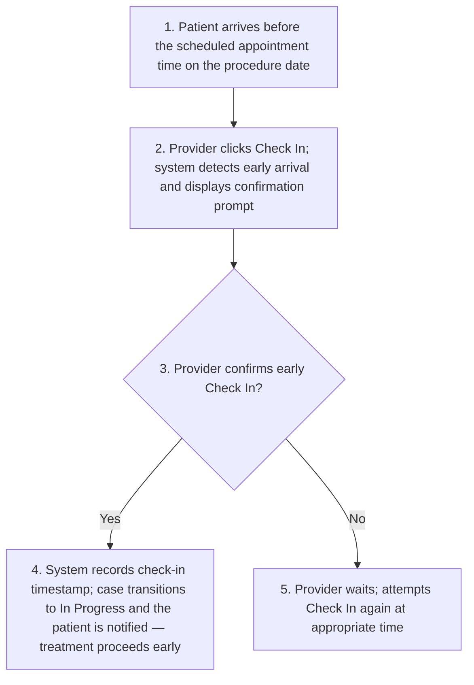
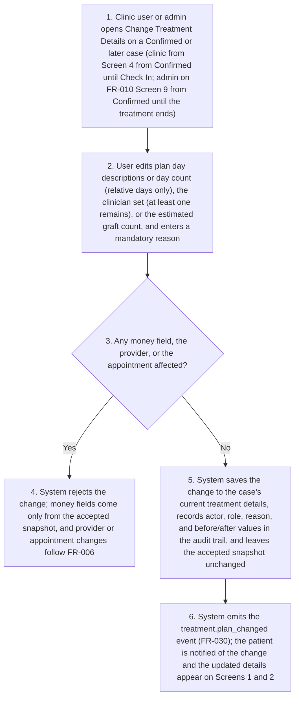
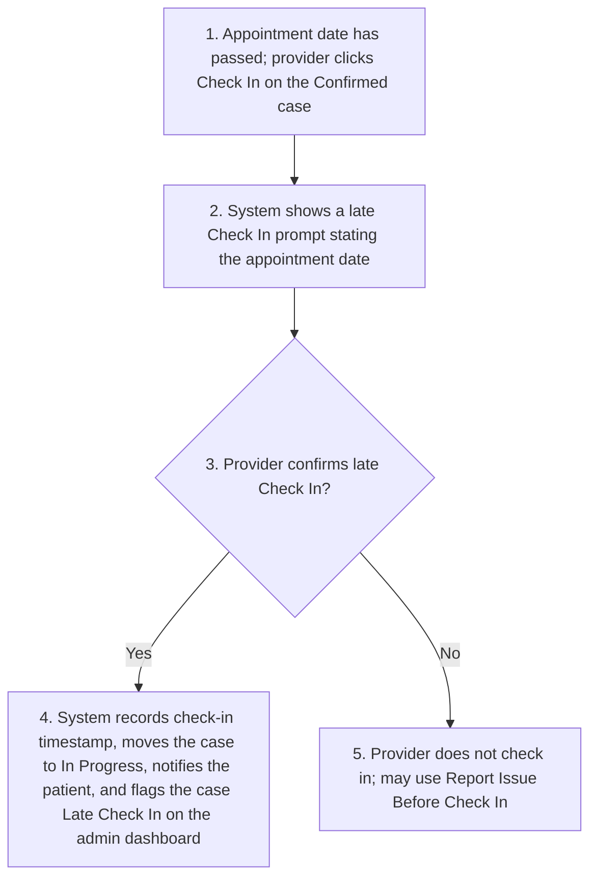
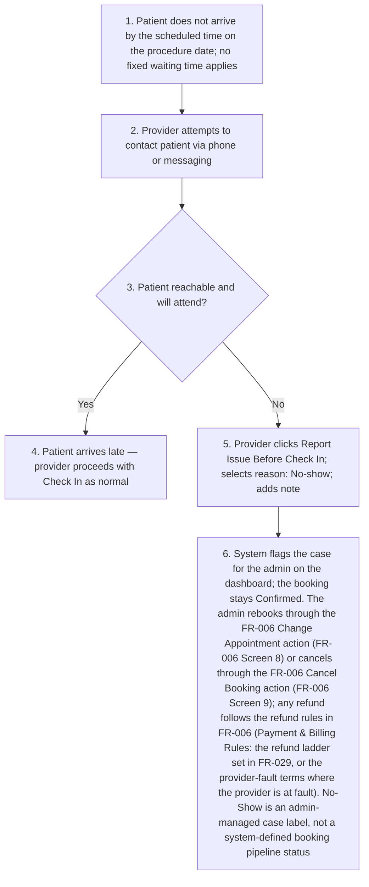
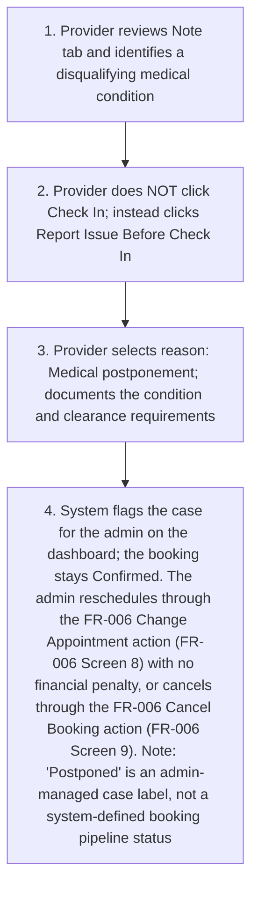
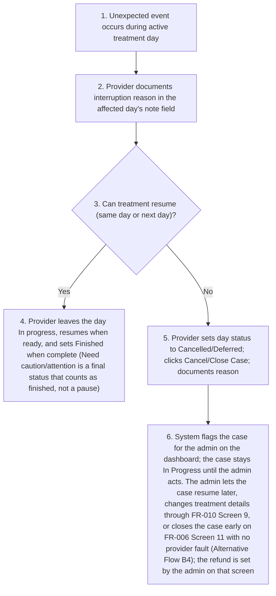
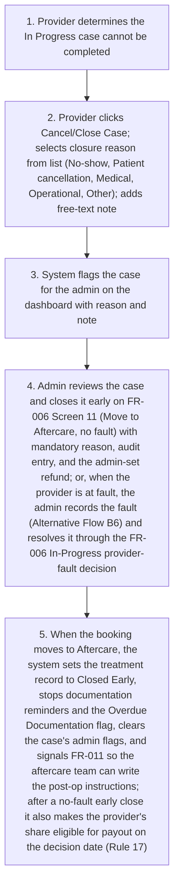
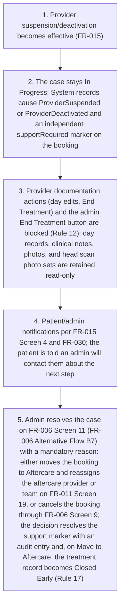
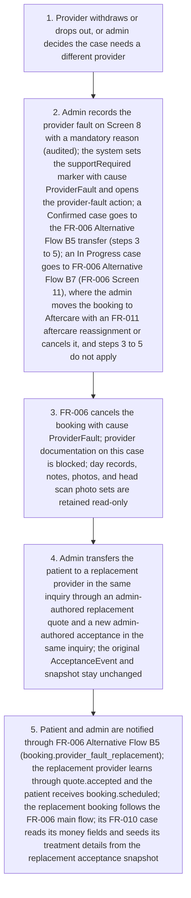

# FR-010 - Treatment Execution & Documentation

**Module**: PR-03: Treatment Execution & Documentation
**Feature Branch**: `fr010-treatment-execution`
**Created**: 2025-11-11
**Status**: ✅ Documentation Approved (baseline 2026-11-25); implementation reconciliation pending
**Source**: FR-010 from system-prd.md; FR-015 v1.9 provider-status cancellation cascade

---

## Executive Summary

The Treatment Execution & Documentation module enables providers to document the entire hair transplant procedure lifecycle from patient arrival through treatment completion. This module serves as the critical transition point where patients move from "Confirmed" bookings to active "In Progress" treatments and eventually to "Aftercare" status. The module captures comprehensive procedure details including clinician information, treatment details, graft counts, day-by-day treatment notes, head scan photo sets *(V1; true 3D scan in V2)*, and post-operative instructions that form the foundation for subsequent aftercare activities.

This module operates exclusively within the Provider Platform (PR-03) tenant, with data outputs consumed by both the Patient Platform (treatment completion notifications, post-op instructions) and Admin Platform (oversight, billing triggers). The module bridges the pre-treatment phase (bookings, scheduling) with the post-treatment phase (aftercare and billing reconciliation), ensuring complete documentation for audit trail, quality assurance, and seamless transition to long-term aftercare.

---

## Module Scope

### Multi-Tenant Architecture

- **Patient Platform (P-05)**: Receives real-time day-based progress updates during treatment execution (current treatment day and day status based on the accepted Quote Option's relative day plan); receives completion notifications and post-op instructions after treatment finishes; NOT involved in detailed clinical documentation
- **Provider Platform (PR-03)**: PRIMARY tenant - providers document treatment progress day-by-day in real-time: update each day’s status and add provider-only day notes against the accepted Quote Option's relative day plan (day descriptions are read-only); day statuses are synced to patient/admin platforms; detailed clinical observations remain provider-only
- **Admin Platform (A-01)**: Real-time oversight and full editorial access — admins monitor all active treatments, can view and edit any treatment record, resolve case exceptions through the FR-006 governed booking actions (never by setting a status by hand), and audit completed documentation
- **Shared Services (S-05)**: Media Storage Service handles head scan photo sets (V1) and treatment documentation uploads; Real-time sync service (WebSocket/SSE) propagates day-based status updates to patient and admin platforms

### Multi-Tenant Breakdown

**Patient Platform (P-05)**:

- Receives real-time status updates (booking moved to "In Progress" when patient arrives)
- **Views current treatment day progress in real-time** (e.g., "Day 1 of 4: Consultation & Scans" or "Day 2 of 4: Hair Transplant Procedure") based on the accepted Quote Option's relative day plan
- Receives treatment completion notification with post-op instructions
- Views provider-authored treatment summary note after completion (high-level outcome, final graft count, treatment type) (REQ-010-062)
- Accesses before/after photos uploaded by provider (after completion) (REQ-010-062)
- NOT involved in clinical documentation (no access to detailed medical notes, complications, or real-time clinical data during procedure) (REQ-010-064)

**Provider Platform (PR-03)**:

- **Check In** patient to trigger "In Progress" status
- **Update each treatment day's status** (Not started / In progress / Finished / Need caution/attention / Cancelled/Deferred) per the accepted Quote Option's relative day plan — synced to patient app and admin
- Add **day notes** for each day (provider-only clinical observations — not visible to patient)
- Add a **beginning-of-treatment note** and upload head scan photo sets at key stages *(V1; true 3D scan in V2)*
- Document actual graft count, conclusion notes, prescription, advice, and medication at end of treatment
- **End Treatment** (completes treatment documentation; signals to FR-011 for aftercare setup)

**Admin Platform (A-01)**:

- View all active treatments across all providers (real-time "In Progress" list with current day and status) (REQ-010-065)
- See REQ-010-065.
- **Edit any treatment record** — admin can update day statuses, notes, and end-of-treatment fields, change treatment details (Screen 9), and trigger End Treatment on behalf of the provider; booking status changes only through the FR-006 governed actions (change appointment, cancel booking, provider-fault transfer, and the In Progress decision on FR-006 Screen 11, which covers an early close and a provider fault)
- Access and audit complete treatment documentation for quality assurance
- View payment status (outstanding balance / split pay) for operational follow-up (view only; no new screen part) (REQ-010-066)

**Shared Services (S-05)**:

- **Media Storage Service**: Secure, encrypted storage for head scan photo sets (V1) and treatment documentation uploads

### Communication Structure

**In Scope**:

- System-generated status notifications to patient (booking moved to "In Progress", treatment completed)
- **Real-time treatment day progress updates to patient app** (current day number, day description from the accepted Quote Option's relative day plan, and day status - NOT detailed clinical data)
- Post-op instruction delivery to patient via email/in-app notification
- Provider-to-patient medication prescription delivery
- Admin notification of treatment completion for billing purposes
- **Admin real-time visibility** into treatment progress across all active procedures (which day + day status + day description — for oversight) (REQ-010-065)

**Out of Scope**:

- Real-time chat between patient and provider during treatment (patients are physically present; messaging stays available under FR-012) (REQ-010-067)
- Video documentation of procedure (future enhancement) (REQ-010-067)
- Live streaming of detailed treatment progress to third parties (e.g., patient's family) (future enhancement) (REQ-010-067)
- SMS notifications to patient's emergency contact (handled by S-03: Notification Service configuration; **no SMS treatment alerts are sent in MVP and this capability is reserved for a future phase once S-03 SMS support is enabled**) (REQ-010-068)

### Entry Points

**Primary Entry Point**:

1. Provider navigates to **"Confirmed"** section in Patient Management (Provider Platform dashboard) (REQ-010-069)
2. Provider selects a confirmed booking whose procedure date is today or past (in the booking's appointment timezone), with no outstanding balance and no `supportRequired` marker
3. System opens the case detail page in tabbed view (tabs: Treatment Plan | Note | Book hotel & Book flight | In Progress) (REQ-010-069)
4. Provider clicks **"Check In"** button to begin the treatment
5. System transitions booking status from "Confirmed" → "In Progress" — this is the moment the case changes stage; the In Progress tab becomes the active documentation workspace as part of this transition

**Secondary Entry Points**:

- Provider can resume documentation for "In Progress" treatments from the "In Progress" section in Patient Management (REQ-010-069)
- Provider can view completed and Closed Early treatments from the "Completed" section (read-only mode) (REQ-010-069)

**Access Requirements**:

- See REQ-010-017.
- Patient must have "Confirmed" booking status (deposit paid), full payment completed with no Defaulted installment, and no `supportRequired` marker (REQ-010-106)
- See REQ-010-106.

---

## Business Workflows

### Main Flow: Treatment Execution & Documentation

**Actors**: Provider (Clinical Staff), Patient, System, Admin
**Trigger**: Patient arrives at clinic on scheduled procedure day
**Outcome**: Treatment documented day by day; patient receives post-op instructions; booking status moves to "Aftercare" under FR-006 and FR-011 sets up aftercare

**Flow Diagram**:

```mermaid
flowchart TD
  S1["1. Patient arrives at clinic; provider navigates to Confirmed list in Patient Management"] --> S2
  S2["2. Provider selects confirmed booking; system opens case in tabbed view (Treatment Plan, Note, travel, In Progress)"] --> S3
  S3{"3. Procedure date ≤ today (appointment timezone) AND booking fully paid with no Defaulted installment AND no supportRequired marker AND no other treatment In Progress for the patient AND provider role = Owner, Manager, or Clinical Staff?"}
  S3 -- Yes --> S4["4. Provider reviews Treatment Plan and Note tabs; confirms readiness"]
  S3 -- No --> E1["Check In button disabled — generic reason shown to provider (future appointment date, outstanding balance or Defaulted installment, supportRequired marker, or another treatment In Progress)"]
  S4 --> S5["5. Provider clicks Check In (when the appointment date has already passed, a late Check In prompt comes first: Alternative Flow A3)"]
  S5 --> S6["6. System transitions case: Confirmed → In Progress; In Progress tab becomes active workspace; patient notified"]
  S6 --> S7["7. Provider adds beginning-of-treatment note and uploads initial head scan photo set (V1)"]
  S7 --> S8["8. For each treatment day: provider updates day status and adds optional day note as the day progresses"]
  S8 --> S9{"9. All days in terminal status (Finished / Need caution/attention / Cancelled/Deferred), at least one day Finished or Need caution/attention, and no supportRequired marker? When met, End Treatment becomes available and the documentation deadline starts"}
  S9 -- No --> S8
  S9 -- Yes --> S10["10. Provider clicks End Treatment button"]
  S10 --> S11["11. End of Treatment modal opens; provider fills: conclusion notes, prescription, advice, medication, actual graft count, final head scan photo set (V1) as end-of-treatment evidence"]
  S11 --> S12{"12. All required fields filled?"}
  S12 -- No --> S11
  S12 -- Yes --> S13["13. Provider saves — system validates and confirms"]
  S13 --> S14["14. System marks the treatment Completed and starts the FR-007 confirmation window; FR-006 moves the booking to Aftercare; system signals treatment completion to FR-011; post-op instructions + medication sent to patient; admin notified. FR-011 handles aftercare template selection and plan activation"]
```

### Alternative Flows

**A1: Patient Arrives Early (Before Scheduled Time)**

- **Trigger**: Patient arrives before the scheduled appointment time on the procedure date, and the provider clicks Check In
- **Outcome**: Treatment proceeds earlier than scheduled; original appointment time preserved in booking record (REQ-010-071)

**A2: Treatment Details Changed After Acceptance**

- **Trigger**: After the booking is `Confirmed`, the clinic or an admin needs to correct the treatment plan days, the assigned clinician set, or the estimated graft count
- **Outcome**: The case's current treatment details are updated through FR-010, the change is audited, and the patient is notified; the accepted snapshot and all money fields stay unchanged
- **Boundary**: This is the only path for changing plan, clinicians, or grafts after acceptance, apart from the admin edit of the accepted quote (REQ-005-023) and the replacement-clinician rewrite when a team member leaves the case (REQ-010-123); FR-004 blocks every provider quote edit once a subquote is accepted. Provider identity, price, currency, date range, appointment, and promotion are never changed here. Treatment details are locked while the booking is `Accepted` (unpaid); no one may change them until the booking is `Confirmed`. From `Confirmed` until Check In, the clinic (Owner, Manager, or Clinical Staff) or an admin may make the change; from Check In until the treatment ends, only an admin may (Rule 8). The treatment ends when End Treatment is saved or the case is closed early; from then the plan days, clinician set, and estimated graft count are locked and the actual graft count (Screen 8) is the correction path

**A3: Check In After the Appointment Date**

- **Trigger**: Provider clicks Check In on a Confirmed, fully paid case whose appointment date has passed (dates compared in the booking's appointment timezone)
- **Outcome**: Check In has no upper limit; the provider confirms a late Check In prompt, the case moves to In Progress, and the admin sees a Late Check In flag on the dashboard (REQ-010-118)

**B1: Patient No-Show (Does Not Arrive)**

- **Trigger**: Patient fails to arrive at clinic on scheduled procedure day
- **Outcome**: Provider reports the no-show to the admin; the booking stays Confirmed; the admin decides case by case whether to rebook or cancel, and any refund follows the FR-006 refund rules (No-Show Rule) (REQ-010-076)

**B2: Medical Complication Prevents Treatment Start**

- **Trigger**: Pre-procedure review (Note tab) reveals an unmanaged medical condition or patient arrives unwell
- **Outcome**: Treatment postponed without financial penalty; patient given medical clearance instructions (REQ-010-077)

**B3: Treatment Interrupted During Procedure**

- **Trigger**: Unexpected event during active treatment (medical emergency, power outage, equipment failure)
- **Outcome**: Interruption documented in day note; the admin closes the case early if it cannot resume (REQ-010-078)

**B4: Provider Cancels or Closes an In Progress Case**

- **Trigger**: Provider needs to close an active case that cannot be completed for a reason that is not a provider fault (no-show discovered after Check In, patient decided not to proceed, medical stop, operational failure)
- **Outcome**: Admin sees a dashboard flag; the case stays In Progress until the admin closes it early on FR-006 Screen 11 without a fault, or, when the provider is at fault, through the FR-006 In-Progress provider-fault decision (Alternative Flow B6 and FR-006 Alternative Flow B7). The early close moves the booking to Aftercare from the decision date, sets no `supportRequired` marker, and holds no payout; the admin sets the refund amount with a reason (an exception refund, which follows the FR-007 approval rule), the refund comes out of what the patient paid, and the provider's share (what is left after the refund and the Hairline commission) becomes eligible for payout on the decision date with no waiting window (REQ-010-079, REQ-010-116, Rule 17)

**B5: Provider Suspended or Deactivated While Case Is In Progress**

- **Trigger**: The treating provider's `Suspended` or `Deactivated` status becomes effective under [FR-015 Alternative Flow A5 and Screen 4](../fr015-provider-management/prd.md#screen-4-provider-suspensiondeactivation-modal)
- **Outcome**: The In Progress case is not cancelled automatically; it stays In Progress with the provider-status cause and `supportRequired`, provider documentation and End Treatment (the admin button too) are blocked, clinical records are preserved, and an admin decides case by case through [FR-006 Alternative Flow B7](../fr006-booking-scheduling/prd.md) (FR-006 Screen 11): move the booking to Aftercare and reassign the aftercare provider through FR-011 Screen 19, or cancel the booking (REQ-010-080)
- **Boundary**: Distinct from B4 provider-requested Cancel/Close Case, which still does not auto-transition status. No replacement quote or replacement acceptance is created for an In Progress case; money follows the admin-set refund in FR-006 Alternative Flow B7 (exact mechanics are defined in FR-007, FR-007B, and FR-017). Provider reactivation does not restore the case; a later deactivation does not overwrite an earlier `ProviderSuspended` cause

**B6: Provider Drops Out or Must Be Replaced After Acceptance**

- **Trigger**: After subquote acceptance, the treating provider withdraws or drops out before or during treatment, or an admin determines the case must move to a different provider and records the provider fault on Screen 8 without the provider withdrawing (mandatory reason, audited) (REQ-010-119)
- **Outcome**: FR-010 never reassigns the provider on the case. Before Check In (booking `Confirmed`), the case is handed to the [FR-006 Alternative Flow B5](../fr006-booking-scheduling/prd.md) provider-fault transfer: the booking is cancelled with cause `ProviderFault` and an admin transfers the patient to a replacement provider in the same inquiry. After Check In (booking `In Progress`), the booking stays In Progress with `supportRequired`, provider documentation and End Treatment are blocked, and the admin decides case by case through FR-006 Alternative Flow B7: move the booking to Aftercare and reassign the aftercare provider through FR-011 Screen 19, or cancel the booking; no replacement acceptance is created (REQ-010-081, REQ-010-082)
- **Boundary**: Distinct from B4 provider-requested Cancel/Close Case for patient or clinical reasons, and from B5 provider suspension/deactivation (which enters the same FR-006 In-Progress decision with its own cause). For the before-Check In transfer the FR-006 Alternative Flow B5 payment terms apply: the patient is refunded in full everything paid, pays no cancellation fee, and the replacement booking takes a new payment; for an In Progress case an admin sets the patient refund amount, from zero up to the full amount paid, with a mandatory reason and audit entry, and the provider's payout for the booking is held until the admin decides (FR-006 Alternative Flow B7). Exact mechanics are defined in FR-007, FR-007B, and FR-017

---

## Screen Specifications

---

### Patient Platform Screens

#### Screen 1: In Progress Case View

**Purpose**: Show the patient a read-only view of their active treatment case, including the provider's beginning-of-treatment note, day-by-day treatment status, and an estimated graft count reference.

**Data Fields**:

| Field Name | Type | Required | Description | Validation Rules | Graph field |
|------------|------|----------|-------------|------------------|-----------|
| Case Status Badge | status badge | Yes (read-only) | "In Progress" badge displayed prominently | Display only | ENT-booking.status |
| Provider / Clinic Name | text | Yes (read-only) | Name of treating provider and clinic | Display only | ENT-provider.name |
| Treatment | text | Yes (read-only) | Treatment name from admin-curated catalog via the treatmentId in the accepted snapshot (e.g., "FUE - Follicular Unit Extraction") — defines the procedure type | Display only | ENT-treatment.name |
| Accepted Quote Option | group | Yes (read-only) | The exact accepted subquote (Quote Option and date-range price row) selected by the patient, including its package snapshot, option-local inclusions, price, currency, date range, and promotion | Read from the accepted snapshot through the booking's AcceptanceEvent; never inferred from a singular quote package or from live FR-004 records | ENT-acceptance-event.snapshot |
| Assigned Clinicians | list | Yes (read-only) | One or more clinicians currently assigned to the patient's case (seeded from the accepted snapshot; changed only through Alternative Flow A2) | Display only | ENT-treatment-record.clinician_ids |
| Procedure Date | date | Yes (read-only) | Current appointment date of the FR-006 booking; equals the accepted snapshot appointment unless an approved FR-006 admin date change applies | Display only | ENT-booking.appointment_at |
| Estimated Graft Count | number | Yes (read-only) | Current graft estimate (seeded from the accepted snapshot; changed only through Alternative Flow A2) — for patient reference | Display only | ENT-treatment-record.estimated_grafts |
| Beginning Note | text area | No (read-only) | Provider's note at treatment start — visible to patient if entered | Hidden if provider has not entered it; no placeholder shown (REQ-010-061) | ENT-treatment-record.beginning_note |
| Overall Progress | progress indicator | Yes (read-only) | Summary of treatment completion (e.g., "2 of 3 days complete") | Display only; auto-calculated from day statuses (REQ-010-100) | ENT-treatment-record.days_status_summary |
| Treatment Days | list | Yes (read-only) | One row per treatment day: day label, description, and current status badge | Tap a row to open Day Details Popup (Screen 2) | ENT-treatment-day-record.day_number, ENT-treatment-day-record.description, ENT-treatment-day-record.status |
| Journey Timeline | timeline | Yes (read-only) | Case stage milestones: Inquiries → Quotes → Accepted → Confirmed → In Progress | Current stage highlighted; timestamps shown | ENT-booking.status_history |

**Business Rules**:

- Patient sees day status badges only — provider clinical notes are NOT visible to the patient. (REQ-010-060)
- Beginning note is visible to the patient only if the provider has entered it; otherwise the section is hidden. (REQ-010-061)
- Estimated graft count is shown for patient reference; actual graft count appears after End of Treatment. (REQ-010-063)
- All fields are read-only; the patient cannot take any action on this screen. (REQ-010-064)
- When the clinic or an admin changes the plan, clinicians, or estimated graft count after acceptance (Alternative Flow A2), the patient is notified and this screen shows the updated details; price, currency, date range, appointment, and promotion always show the accepted snapshot values.

---

#### Screen 2: Day Details Popup

**Purpose**: Show the patient a focused view of a single treatment day's description and current status when they tap a day row in Screen 1.

**Data Fields**:

| Field Name | Type | Required | Description | Validation Rules | Graph field |
|------------|------|----------|-------------|------------------|-----------|
| Day Label | text | Yes (read-only) | "Day 1", "Day 2", etc. | Display only | ENT-treatment-day-record.day_number |
| Plan Day Position | text | Yes (read-only) | Relative position of this day in the treatment plan (e.g., "Day 2 of 4") | Display only; relative day number only, never converted to or shown as a calendar date (REQ-010-101) | ENT-treatment-day-record.plan_day_position |
| Day Description | text | Yes (read-only) | Description from the case's current treatment plan (the accepted Quote Option's relative day plan, as changed through Alternative Flow A2) (e.g., "Hair Transplant Procedure") | Display only | ENT-treatment-day-record.description |
| Status | status badge | Yes (read-only) | Current status for this day — synced from provider in real-time | Display only | ENT-treatment-day-record.status |
| Close | button | — | Dismisses the popup | — | no graph field (control) |

**Business Rules**:

- Status is synced from provider in real-time; the patient sees the updated status immediately after provider saves. (REQ-010-007A)
- See REQ-010-060.
- See REQ-010-064.
- See REQ-010-028.

---

### Provider Platform Screens

#### Screen 3: In Progress Listing

**Purpose**: Display all cases currently in the "In Progress" stage for the provider's clinic, with search and filter capabilities.

**Data Fields**:

| Field Name | Type | Required | Description | Validation Rules | Graph field |
|------------|------|----------|-------------|------------------|-----------|
| Search Bar | text input | No | Search by patient ID, name, or booking reference | Real-time filter | no graph field (control) |
| Filter: Date Range | date range picker | No | Filter by treatment start date | Default: current month | no graph field (control) |
| Filter: Clinician | dropdown | No | Filter by any assigned clinician | Dropdown of clinic's active clinicians | no graph field (control) |
| Patient ID | text | Yes (read-only) | Unique patient identifier (e.g., HP202401) | Clickable — opens case detail (Screen 4) | ENT-booking.patient_id |
| Patient Name | text | Yes (read-only) | Patient's full name | Display only | ENT-patient.name |
| Treatment | text | Yes (read-only) | Treatment name from catalog via treatmentId (e.g., "FUE - Follicular Unit Extraction") | Display only | ENT-treatment.name |
| Assigned Clinicians | list | Yes (read-only) | One or more clinicians assigned at quote stage | Display only | ENT-treatment-record.clinician_ids |
| Procedure Date | date | Yes (read-only) | Current appointment date of the FR-006 booking; equals the accepted snapshot appointment unless an approved FR-006 admin date change applies | Display only | ENT-booking.appointment_at |
| Days Status Summary | progress indicator | Yes (read-only) | Completion summary e.g., "2 / 3 days complete" | Display only (REQ-010-100) | ENT-treatment-record.days_status_summary |
| Current Day Status | status badge | Yes (read-only) | Status of the most recent active day | Display only (REQ-010-100) | ENT-treatment-record.current_day_status |

**Business Rules**:

- List shows only cases in "In Progress" status for the provider's clinic. (REQ-010-102)
- Clicking a row opens Screen 4: In Progress Case Detail. (REQ-010-102)
- Search and filters apply in real-time without page reload. (REQ-010-102)
- Default sort: procedure date ascending. (REQ-010-102)

---

#### Screen 4: In Progress Case Detail

**Purpose**: The primary treatment execution workspace, displayed as a tabbed case detail page with tabs: Treatment Plan | Note | Book hotel & Book flight | **In Progress** (active tab during treatment). The In Progress tab is organised into three stages: Before Procedure, During Procedure, and End of Procedure.

**Stage A — Before Procedure**

| Field Name | Type | Required | Description | Validation Rules | Graph field |
|------------|------|----------|-------------|------------------|-----------|
| Case Status Badge | status badge | Yes (read-only) | Current status (Confirmed or In Progress) | Display only | ENT-booking.status |
| Case Hold Notice | notice | Conditional (read-only) | Shown while the booking carries the `supportRequired` marker; states that documentation and End Treatment are blocked until an admin resolves the case | Display only (Rule 12) | ENT-booking.support_required |
| Patient ID | text | Yes (read-only) | Bold patient identifier | Display only | ENT-booking.patient_id |
| Check In button | button | Conditional | Visible when status = Confirmed; triggers transition to In Progress when the Check In rule is met (Rule 3) | Disabled with a generic reason if any condition is not met; a late Check In asks for confirmation (Alternative Flow A3) | no graph field (control) |
| Report Issue Before Check In button | button | Conditional | Visible when status = Confirmed (before Check In), next to the Check In button; secondary button style; opens a modal where the provider selects a reason (No-show or Medical postponement) and adds a note; only flags the case for the admin on the dashboard | Reason required; the booking stays Confirmed; no status or money action is triggered (Alternative Flows B1 and B2) | no graph field (control) |
| End Treatment button | button | Conditional | Visible when status = In Progress; green button; opens End of Treatment modal (Screen 6) | Enabled only when the End Treatment gate is met (REQ-010-104); hidden or disabled while the case carries the `supportRequired` marker | no graph field (control) |
| Cancel / Close Case button | button | Conditional | Visible when status = In Progress; secondary button style; opens Cancel modal | Provider selects reason and adds note; flags the case for the admin on the dashboard | no graph field (control) |
| Change Treatment Details button | button | Conditional | Visible to Owner, Manager, and Clinical Staff only while the booking is `Confirmed` and before Check In; hidden while the booking is `Accepted` (treatment details locked until confirmation); opens the treatment-detail change form (same fields and rules as Screen 9) for plan days, clinician set, and estimated graft count (Alternative Flow A2) | Reason required; at least one clinician must remain; plan days stay relative; money fields, provider, and appointment are not editable; change audited and patient notified | no graph field (control) |
| Journey Timeline (Right Sidebar) | timeline | Yes (read-only) | Inquiries → Quotes → Accepted → Confirmed → In Progress, with timestamps | Active stage highlighted | ENT-booking.status_history |
| Beginning Note | text area | No | Provider's observations at treatment start — visible to patient | Max 2000 characters; auto-saved every 2 minutes (REQ-010-054) | ENT-treatment-record.beginning_note |
| Initial Head Scan Photo Set (V1) | file uploader | No | Standardized head scan photo set captured at treatment start (e.g., front/left/right/top/back) | JPG/PNG only; multiple uploads allowed | ENT-treatment-media.file_url |
| Treatment Photos (Before) | file uploader | No | Regular photos of patient's condition before procedure (JPG/PNG) | Max 10MB per file; JPG/PNG only; multiple uploads allowed (REQ-010-053) | ENT-treatment-media.file_url |

**Stage B — During Procedure (Day-by-Day Records)**

| Field Name | Type | Required | Description | Validation Rules | Graph field |
|------------|------|----------|-------------|------------------|-----------|
| Day Rows | list | Yes | One row per treatment day from the case's current treatment plan (relative days); discrete independent records, never consolidated | — | ENT-treatment-day-record.day_number, ENT-treatment-day-record.description, ENT-treatment-day-record.status, ENT-treatment-day-record.note |
| Day Label | text | Yes (read-only) | "Day 1", "Day 2", etc., with calendar icon | Display only | ENT-treatment-day-record.day_number |
| Day Description | text | Yes (read-only) | Pre-populated from the case's current treatment plan (the accepted Quote Option's relative day plan, as changed through Alternative Flow A2) (e.g., "Consultation & Scans") | Read-only | ENT-treatment-day-record.description |
| Status Badge (per day) | status badge | Yes | Current status for this day; click row or Edit icon to open Day Edit modal (Screen 5) | Valid: Not started, In progress, Finished, Need caution/attention, or Cancelled/Deferred | ENT-treatment-day-record.status |
| Note Preview (per day) | text | No | First line of saved day note; "+ Add note" if empty | Display only | ENT-treatment-day-record.note |
| Edit icon | icon button | — | Opens Day Edit modal (Screen 5) | — | no graph field (control) |

**Stage C — End of Procedure**

| Field Name | Type | Required | Description | Validation Rules | Graph field |
|------------|------|----------|-------------|------------------|-----------|
| Head Scan Photo Set Upload (V1) | file uploader | No | Upload additional head scan photo set(s) captured during or after treatment | JPG/PNG only; multiple uploads allowed | ENT-treatment-media.file_url |
| Treatment Photos (During/After) | file uploader | No | Regular photos captured during or after treatment (JPG/PNG) | Max 10MB per file; JPG/PNG only; multiple uploads allowed | ENT-treatment-media.file_url |
| Estimated Graft Count | number | Yes (read-only) | Current graft estimate (seeded from the accepted snapshot; changed only through Alternative Flow A2) — reference only | Display only; prominently shown | ENT-treatment-record.estimated_grafts |

**Business Rules**:

- **Tab activation**: The In Progress tab becomes the active workspace as the case transitions from Confirmed to In Progress at Check In. Other tabs remain accessible for reference.
- **Day independence**: See REQ-010-038.
- **Day status constraint**: See REQ-010-039. "Pause" is NOT a valid status.
- **Treatment plan lock**: While the booking is `Accepted`, treatment details are locked. From `Confirmed` until Check In, the clinic may change the treatment plan days, the assigned clinician set (one or more, seeded from the accepted snapshot's `clinicianIds[]`), and the estimated graft count only through Change Treatment Details (Alternative Flow A2). At Check In these are locked for the clinic. No plan, clinician, or graft-estimate changes are possible from this screen once In Progress; later changes are admin-only (Screen 8). (REQ-010-037)
- **End Treatment gate**: The "End Treatment" button is enabled only when every day record is in a terminal status (Finished, Need caution/attention, or Cancelled/Deferred), at least one day is Finished or Need caution/attention, and the booking carries no `supportRequired` marker. Days in "Not started" or "In progress" block the button. A case with every day Cancelled/Deferred goes to the early close instead (Rule 17); a partly delivered treatment (at least one day Finished, the others Cancelled/Deferred) ends with End Treatment and needs no close request. The documentation deadline starts when the gate is first met (REQ-010-010). "Need caution/attention" is a final status that counts as finished here. (REQ-010-104)
- **Auto-save**: See REQ-010-054.
- **Day status sync**: See REQ-010-007A and REQ-010-060.
- **Report Issue Before Check In**: Separate from Cancel / Close Case, which exists only while the case is In Progress (reasons listed in Alternative Flow B4). Before Check In the provider reports a no-show or a medical postponement through this control; the request only flags the case for the admin on the dashboard (Rule 18), who resolves it through the FR-006 governed actions, and the booking stays Confirmed. (REQ-010-107)
- **Cancel / Close Case**: Opens a modal for the provider to select a reason and add a note. The request flags the case for the admin on the dashboard (Rule 18), who resolves it only through FR-006 Screen 11: the early close without a fault, or the provider-fault decision (Rule 17). (REQ-010-040, REQ-010-079)

---

#### Screen 5: Day Edit Modal

**Purpose**: Allow the provider to update the status of a specific treatment day and add or edit a clinical note.

**Data Fields**:

| Field Name | Type | Required | Description | Validation Rules | Graph field |
|------------|------|----------|-------------|------------------|-----------|
| Day Label | text | Yes (read-only) | "Day 1", "Day 2", etc. | Display only | ENT-treatment-day-record.day_number |
| Day Description | text | Yes (read-only) | Description from the case's current treatment plan | Display only | ENT-treatment-day-record.description |
| Status | select | Yes | Status for this day | Options: Not started, In progress, Finished, Need caution/attention, or Cancelled/Deferred | ENT-treatment-day-record.status |
| Note | text area | No | Provider's clinical notes for this day — not visible to the patient | Max 2000 characters (REQ-010-054) | ENT-treatment-day-record.note |
| Cancel | button | — | Discard changes and close modal | — | no graph field (control) |
| Save | button | Yes | Save day status and note; update day row in Screen 4 | — | no graph field (control) |

**Business Rules**:

- "Pause" is NOT a valid day status and must not appear in the Status dropdown.
- Clinical notes entered here are provider-only and are NOT visible to the patient.
- Status changes are synced to the patient app and admin immediately upon save.
- Provider may return to this modal at any time while the case is In Progress. (REQ-010-105)

---

#### Screen 6: End of Treatment Modal

**Purpose**: Capture final treatment documentation — conclusion, prescription, advice, medications, actual graft count, and the final head scan photo set *(V1; true 3D scan in V2)* used as the end-of-treatment evidence — mark the treatment Completed, and signal treatment completion to FR-011.

**Triggered by**: Clicking the "End Treatment" button in Screen 4 (enabled only when the End Treatment gate is met).

**Data Fields**:

| Field Name | Type | Required | Description | Validation Rules | Graph field |
|------------|------|----------|-------------|------------------|-----------|
| Conclusion Notes | text area | Yes | Provider's summary of the treatment outcome | Max 2000 characters (REQ-010-054) | ENT-treatment-record.conclusion_notes |
| Prescription | text area | Yes | Prescribed medications and dosage instructions | Max 2000 characters (REQ-010-054) | ENT-treatment-record.prescription |
| Advice | text area | Yes | Post-op advice for patient recovery | Max 2000 characters (REQ-010-054) | ENT-treatment-record.advice |
| Medication | text area | Yes | Medication instructions (drug name, dosage, frequency, duration) | Required; non-empty | ENT-treatment-record.medication_instructions |
| Actual Graft Count | number | Yes | Total grafts successfully transplanted — actual result | Min 0, max 10000; compared against estimated count for reference (REQ-010-055) | ENT-treatment-record.actual_grafts, ENT-treatment-record.estimated_grafts |
| Final Head Scan Photo Set (V1) | file uploader | Yes | The entire standardized head scan photo set captured after procedure completion (e.g., front/left/right/top/back), used as the end-of-treatment evidence | Required; JPG/PNG only; multiple uploads supported | ENT-treatment-media.file_url |
| Cancel | button | — | Discard and return to In Progress tab | — | no graph field (control) |
| Save (Complete Treatment) | button | Yes | Finalise treatment documentation; signals treatment completion to FR-011 for aftercare setup | All required fields must be filled | no graph field (control) |

**Business Rules**:

- See REQ-010-104.
- Clicking Save finalises treatment documentation, marks the treatment Completed, starts the FR-007 patient confirmation window, and signals completion to FR-011. FR-006 owns the booking status change In Progress → Aftercare and makes it at this save, whether or not the signal is delivered; FR-011 owns aftercare template selection and plan activation. (REQ-010-006, REQ-010-117)
- Patient receives post-op instructions and medication instructions via in-app notification and email. (REQ-010-008, REQ-010-022)
- The admin sees the completed treatment on the dashboard for billing reconciliation. (REQ-010-057)
- Once saved, the provider cannot return to edit In Progress documentation — an audit snapshot is captured. (REQ-010-083)
- Actual graft count is the definitive record; the current estimated graft count, and the original estimate in the accepted snapshot, are preserved for reference and audit. (REQ-010-084)

---

### Admin Platform Screens

#### Screen 7: In Progress Listing (Admin)

**Purpose**: Display cases across all providers and clinics platform-wide, In Progress cases by default and any other case status through the status filter, with search, filters, the admin flags (Rule 18), and direct access to open any case.

**Data Fields**:

| Field Name | Type | Required | Description | Validation Rules | Graph field |
|------------|------|----------|-------------|------------------|-----------|
| Search Bar | text input | No | Search by patient ID, name, booking reference, or provider name | Real-time filter (REQ-010-114) | no graph field (control) |
| Filter: Provider / Clinic | dropdown | No | Filter by provider or clinic | All providers in the platform | no graph field (control) |
| Filter: Date Range | date range picker | No | Filter by procedure start date | Default: current month | no graph field (control) |
| Filter: Clinician | dropdown | No | Filter by any assigned clinician | — | no graph field (control) |
| Filter: Case Status | dropdown | No | Filter by booking status | Confirmed, In Progress, Aftercare, Completed, or Cancelled; default In Progress (REQ-010-121) | no graph field (control) |
| Filter: Flag | dropdown | No | Filter by admin flag | Report Issue Before Check In, Close Request, Late Check In, Overdue Documentation, or Completion Signal Failed (Rule 18) | no graph field (control) |
| Patient ID | text | Yes (read-only) | Unique patient identifier | Clickable — opens admin case detail (Screen 8) | ENT-booking.patient_id |
| Patient Name | text | Yes (read-only) | Patient's full name | Display only | ENT-patient.name |
| Provider / Clinic | text | Yes (read-only) | Treating provider and clinic name | Display only | ENT-provider.name |
| Treatment | text | Yes (read-only) | Treatment name from catalog via treatmentId (e.g., "FUE - Follicular Unit Extraction") | Display only | ENT-treatment.name |
| Assigned Clinicians | list | Yes (read-only) | Clinicians currently assigned to the case | Display only | ENT-treatment-record.clinician_ids |
| Procedure Date | date | Yes (read-only) | Current appointment date of the FR-006 booking; equals the accepted snapshot appointment unless an approved FR-006 admin date change applies | Display only | ENT-booking.appointment_at |
| Days Status Summary | progress indicator | Yes (read-only) | Completion summary e.g., "2 / 3 days complete" | Display only (REQ-010-100) | ENT-treatment-record.days_status_summary |
| Case Status | status badge | Yes (read-only) | Current booking status | Display only | ENT-booking.status |
| Flags | list of badges | Yes (read-only) | Admin flags raised on the case; empty when none | Display only (Rule 18, REQ-010-121) | ENT-treatment-record.admin_flags |
| Action | button | — | Edit / View case | Opens Screen 8 for the case in any status | no graph field (control) |

**Business Rules**:

- Admin listing shows all providers' cases in the selected case status (default In Progress) — platform-wide visibility. (REQ-010-103)
- Clicking a row or the Action button opens Screen 8: In Progress Case Detail in editable mode, whatever the case status; the controls shown follow the status. (REQ-010-103, REQ-010-121)
- Default sort: procedure date ascending. (REQ-010-103)

---

#### Screen 8: In Progress Case Detail (Admin)

**Purpose**: Allow admin to view and edit all aspects of a case, opened from Screen 7 in any status (Confirmed, In Progress, Aftercare, Completed, or Cancelled) — including treatment day statuses, provider notes, and case actions. The case status is never set by hand. All fields are editable by admin unless system-locked for audit integrity.

**Data Fields**:

| Field Name | Type | Required | Description | Validation Rules | Graph field |
|------------|------|----------|-------------|------------------|-----------|
| Case Status | status badge | Yes (read-only) | Current booking status (Confirmed, In Progress, Aftercare, Completed, or Cancelled) | Display only; the status changes only through Check In, End Treatment, the FR-006 Cancel Booking action (before Check In), the provider-fault transfer, or the FR-006 Screen 11 In Progress decision (early close or provider fault) | ENT-booking.status |
| Admin Flags | list of badges | Yes (read-only) | Flags raised on the case (Rule 18); empty when none | Display only (REQ-010-121) | ENT-treatment-record.admin_flags |
| Patient ID | text | Yes (read-only) | Patient identifier | Display only | ENT-booking.patient_id |
| Provider / Clinic | text | Yes (read-only) | Treating provider and clinic from the accepted snapshot | Display only; a provider change is never made here and follows the FR-006 Alternative Flow B5 provider-fault transfer (Alternative Flow B6) | ENT-provider.name |
| Assigned Clinicians | multiselect | Yes (editable) | Clinicians — admin can add or remove from `Confirmed` until the treatment ends, before or after Check In (seeded from the accepted snapshot's `clinicianIds[]`) | Treatment-detail change (Alternative Flow A2): at least one must remain; reason required; edit audited; patient notified | ENT-treatment-record.clinician_ids |
| Procedure Date | date | Yes (read-only) | Current appointment date of the FR-006 booking; equals the accepted snapshot appointment unless an approved FR-006 admin date change applies | Display only; appointment changes follow FR-006 admin date-change rules | ENT-booking.appointment_at |
| Estimated Graft Count | number | Yes (editable) | Current graft estimate (seeded from the accepted snapshot) | Treatment-detail change (Alternative Flow A2): reason required; edit audited; patient notified | ENT-treatment-record.estimated_grafts |
| Beginning Note | text area | No (editable) | Provider's beginning-of-treatment note — admin can edit | Max 2000 characters; edit logged | ENT-treatment-record.beginning_note |
| Treatment Days | list | Yes (editable) | One row per day; admin can open any day via Day Edit modal | Day status and day note editable by admin; day descriptions and day count change only through a treatment-detail change (Alternative Flow A2), which is audited and notifies the patient; days stay relative | ENT-treatment-day-record.day_number, ENT-treatment-day-record.description, ENT-treatment-day-record.status, ENT-treatment-day-record.note |
| Day Status (per day) | select | Yes (editable) | Admin can override any day's status | Valid: Not started, In progress, Finished, Need caution/attention, or Cancelled/Deferred | ENT-treatment-day-record.status |
| Day Note (per day) | text area | No (editable) | Admin can view and edit provider's clinical notes | Edit logged | ENT-treatment-day-record.note |
| Head Scan Photo Sets (V1) | file viewer / uploader | No (editable) | Admin can view, add, or archive (soft-delete) uploaded head scan photo sets | Changes logged; archived items retained/restorable | ENT-treatment-media.file_url |
| Actual Graft Count | number | No (editable) | Admin can correct if submitted in error | Min 0, max 10000; edit logged (REQ-010-055) | ENT-treatment-record.actual_grafts |
| End Treatment button | button | Conditional | Admin can trigger End of Treatment on behalf of provider | Opens End of Treatment modal (same fields as Screen 6); FR-011 handles aftercare setup separately; ending the treatment as admin starts the confirmation window, the same as when the clinic ends it; enabled only when the End Treatment gate is met (REQ-010-104) and disabled while the booking carries the `supportRequired` marker | no graph field (control) |
| Cancel / Close Case button | button | Conditional | Opens the FR-006 Cancel Booking action (FR-006 Screen 9) while the booking is Confirmed; while In Progress opens the FR-006 Screen 11 decision with the early close (Move to Aftercare, no fault) | Mandatory reason and confirmation in FR-006; audited; the early close sets an admin refund with a reason (Rule 17); other refunds follow the refund rules in FR-006 | no graph field (control) |
| Retry Completion Signal button | button | Conditional | Visible while the Completion Signal Failed flag is set on an Aftercare case; sends the completion signal to FR-011 again | Audited; the flag clears when the signal succeeds (Integration 4, REQ-010-121) | no graph field (control) |
| Change Treatment Details button | button | Conditional | Admin opens Screen 9 to change plan days, clinician set, and estimated graft count (Alternative Flow A2) | Reason required; money fields, provider, and appointment are not editable; change audited and patient notified | no graph field (control) |
| Provider-Fault Transfer button | button | Conditional | When the provider withdraws, drops out, or must be replaced, or when the admin records a provider fault without the provider withdrawing (Alternative Flow B6): for a `Confirmed` case opens the FR-006 Alternative Flow B5 provider-fault transfer (FR-006 Screen 10); for an `In Progress` case opens the FR-006 In-Progress provider-fault decision (FR-006 Screen 11) | Reason required; audited; recording a fault sets the `supportRequired` marker with cause ProviderFault; handled in FR-006 (REQ-010-119) | no graph field (control) |
| Audit Trail | expandable section | Yes (read-only) | Full log of all edits, status changes, and system events | Timestamped; actor-attributed | ENT-treatment-audit-entry.action_type, ENT-treatment-audit-entry.actor_id, ENT-treatment-audit-entry.after_values, ENT-treatment-audit-entry.before_values, ENT-treatment-audit-entry.occurred_at, ENT-treatment-audit-entry.reason |
| Journey Timeline (Right Sidebar) | timeline | Yes (read-only) | Inquiries → Quotes → Accepted → Confirmed → In Progress with timestamps | Display only | ENT-booking.status_history |

**Business Rules**:

- Admin has full edit access to treatment documentation fields as confirmed in client requirements, except the accepted snapshot, the money fields read from it (price, currency, date range, appointment, promotion), and the treating provider, which are read-only in FR-010. (REQ-010-087)
- See REQ-010-042.
- See REQ-010-044.
- All edits by admin are logged in the audit trail with timestamp and admin identity; admin MUST provide a reason for each edit (stored alongside before/after values). (REQ-010-088)
- Admin clinician reassignment overrides the provider-level lock applied at Check In; the edit is always logged with reason (previous value preserved in audit history).
- Admin cannot set the case or booking status by hand. In Progress moves to Aftercare only when End Treatment is saved, which the admin may do on behalf of the provider, or through the FR-006 Screen 11 In Progress decision (early close or provider fault); cancellation before Check In uses the FR-006 Cancel Booking action, and provider replacement before Check In uses the provider-fault transfer. (REQ-010-031)
- Admin can trigger End Treatment on behalf of a provider only when the End Treatment gate is met (REQ-010-104) and the booking carries no `supportRequired` marker (Rule 12); the End of Treatment modal collects the same required fields as Screen 6. When an admin ends a treatment, that starts the confirmation window (FR-007 Fund Release & Money Routing Rules), the same as when the clinic ends it. (REQ-010-089)
- Case cancellation before Check In is performed by an admin through the FR-006 Cancel Booking action; an In Progress case is closed early through FR-006 Screen 11 (Rule 17). Financial reconciliation follows the refund rules in FR-006 (Payment & Billing Rules: the refund ladder set in FR-029, or the provider-fault terms where the provider is at fault) and the platform does not perform automatic financial resolution. (REQ-010-092)
- Editing provider clinical notes by admin is permitted for legal or compliance corrections and is always logged. (REQ-010-090)
- Admin “remove” actions are archive/soft-delete only (no hard delete) for treatment documentation or media assets; archived items remain retained per policy and are restorable. Each archived item carries an archive flag (archived yes/no, when, by whom) on the treatment media record and on the documentation records (day records and medication instructions); archiving does not change the treatment status list. (REQ-010-091)

---

#### Screen 9: Change Treatment Details (Admin)

**Purpose**: Let an admin change a case's current treatment plan days, assigned clinician set, and estimated graft count from `Confirmed` until the treatment ends (Alternative Flow A2). The clinic uses the same form from Screen 4, but only from `Confirmed` until Check In.

**Entry points**: The Change Treatment Details button on Screen 8, or the Change Treatment Details action on the FR-006 admin booking detail (FR-006 Screen 6) for a `Confirmed` or `In Progress` booking.

**Data Fields**:

| Field Name | Type | Required | Description | Validation Rules | Graph field |
|------------|------|----------|-------------|------------------|-----------|
| Booking Reference and Status | text | Yes (read-only) | Booking reference and current booking status | Display only; the form is unavailable while the booking is `Accepted`, `Payment Window Expired`, or `Cancelled`, and once the treatment has ended | ENT-booking.booking_reference, ENT-booking.status |
| Current Treatment Plan Days | editable list | No | Relative plan days (Day 1, Day 2, and so on) with their descriptions, prefilled from the case's current treatment plan | Days stay relative; no calendar dates; at least one day remains; days that already have a day status other than Not started cannot be removed (REQ-010-072) | ENT-treatment-record.current_treatment_plan |
| Assigned Clinicians | multiselect | No | Clinicians assigned to the case, prefilled from the current set | At least one clinician remains; only clinicians on the treating provider's staff list (REQ-010-072) | ENT-treatment-record.clinician_ids |
| Estimated Graft Count | number | No | Current graft estimate | Whole number from 0 to 10000 (REQ-010-055) | ENT-treatment-record.estimated_grafts |
| Change Reason | text area | Yes | Why the change is made | Mandatory; 10 to 1000 characters (REQ-010-072) | ENT-treatment-detail-change.reason |
| Locked Fields Notice | info | Yes (read-only) | States that price, currency, date range, appointment, promotion, and provider cannot be changed here | Display only | no graph field (notice) |
| Before and After Summary | panel | Yes (read-only) | Shows each changed value before and after | Shown on the confirmation step | ENT-treatment-detail-change.before_values, ENT-treatment-detail-change.after_values |
| Confirm Change | button | Yes | Saves the change after the admin confirms the summary | Enabled only when at least one value changed and the reason is valid (REQ-010-072) | no graph field (control) |
| Cancel | button | No | Closes the form without saving | — | no graph field (control) |

**Business Rules**:

- The admin may use this screen from `Confirmed` until the treatment ends (End Treatment saved or the case Closed Early), including after Check In; it is never available while the booking is `Accepted`, `Payment Window Expired`, or `Cancelled`, nor once the treatment has ended. The actual graft count (Screen 8) stays the correction path afterwards. (REQ-010-073)
- The change is saved only after the admin confirms the before and after summary. (REQ-010-074)
- Each saved change creates one Treatment Detail Change record (Entity 5) with actor, actor type, role, reason, timestamp, and before and after values, and adds an audit trail entry. (REQ-010-075)
- Each saved change emits `treatment.plan_changed` (FR-030), and the patient sees the updated details on Screens 1 and 2. (REQ-010-042)
- The accepted snapshot and every money field stay unchanged; provider changes follow the FR-006 provider-fault transfer and appointment changes follow the FR-006 Change Appointment action or the admin edit of the accepted quote (REQ-005-023). (REQ-010-042)

## Business Rules

### General Module Rules

- **Rule 1**: Booking status MUST transition through sequence: Confirmed → In Progress → Aftercare → Completed (no skipping stages). Exceptions: an admin may move an In Progress booking to Aftercare through the FR-006 Screen 11 decision (early close, Rule 17, or after a provider fault, Rule 12), an admin may cancel an In Progress booking through the same Screen 11 decision after a provider fault (Rule 12, Rule 16), and an admin may cancel the booking through the FR-006 Cancel Booking action before Check In. (REQ-010-033)
- **Rule 2**: Treatment documentation MUST be initiated by the "Check In" action from the Confirmed list (cannot pre-document treatments). The treatment record itself is created at booking confirmation (first successful payment) in status "Awaiting Check In", seeded from the accepted snapshot, so audited treatment-detail changes before Check In have a record to change (REQ-010-034)
- **Rule 3**: "Check In" MUST be available only when the booking status is Confirmed; the procedure date is today or in the past in the booking's appointment timezone (future appointments cannot be checked in; there is no upper limit, and after the appointment date the provider confirms a late Check In, Alternative Flow A3); the booking is fully paid with no Defaulted installment; it carries no `supportRequired` marker; and the patient has no other treatment In Progress (a case with the marker, or Closed Early, does not count as In Progress). When any condition is not met, Check In is disabled and the provider sees a generic reason that never shows payment detail. This is the one Check In rule (REQ-010-106, REQ-010-036)
- **Rule 4**: Provider role MUST be Owner, Manager, or Clinical Staff to document treatments (Billing Staff can view but not edit) (REQ-010-002, REQ-010-017)
- **Rule 5**: All timestamps (check-in, end of treatment) MUST be recorded in UTC and displayed in provider's local timezone; the procedure-date comparison for Check In uses the booking's appointment timezone (REQ-010-035)
- **Rule 6**: Treatment documentation MUST be completed within the documentation deadline (default 24 hours), which runs from the moment the End Treatment gate is first met, not from Check In. See REQ-010-010.
- **Rule 7**: Maximum one treatment can be "In Progress" per patient at any time (prevents duplicate documentation); enforced in the Check In rule (Rule 3) (REQ-010-036)
- **Rule 8**: Treatment Plan (per-day) day descriptions, the assigned clinician set, and the estimated graft count are LOCKED for providers once Check In is performed — providers cannot modify them mid-procedure. While the booking is `Accepted` (unpaid) they are locked for everyone. From `Confirmed` until Check In the clinic may change them, and from `Confirmed` until the treatment ends (End Treatment saved or Closed Early) an admin may change them, only through the treatment-detail change (Rule 13). From the end of the treatment they are locked for everyone; the actual graft count (Screen 8) is the correction path. Each change MUST carry a reason and MUST be captured in the audit trail (previous values preserved). (REQ-010-037)
- **Rule 9**: Each treatment day is a discrete record — day records are NEVER consolidated into a single multi-day record (REQ-010-038)
- **Rule 10**: Valid day statuses are: **Not started** | **In progress** | **Finished** | **Need caution/attention** | **Cancelled/Deferred**. No other statuses are permitted. (REQ-010-039)
- **Rule 11**: The provider's Cancel / Close Case action does NOT auto-transition status or trigger financial actions. The admin resolves it only through FR-006 Screen 11 (early close without a fault, or provider-fault decision); no one sets a booking status by hand (REQ-010-040)
- **Rule 12**: An effective provider suspension/deactivation (FR-015 A5/Screen 4) does not cancel the provider's In Progress cases: each stays In Progress with cause `ProviderSuspended` or `ProviderDeactivated` and an independent `supportRequired` marker, and provider documentation is blocked (Alternative Flow B5). Every In Progress case with the `supportRequired` marker, whatever the cause, blocks provider documentation and every End Treatment, the admin button included, and stops documentation reminders and the Overdue Documentation flag (REQ-010-120). This cascade is distinct from Rule 11's provider-requested closure. Clinical notes, photos, and head scan photo sets are preserved; an admin decides case by case through FR-006 Alternative Flow B7 to move the booking to Aftercare and reassign the aftercare provider through FR-011 Screen 19, or to cancel the booking. No replacement acceptance is created for an In Progress case. Reactivation never restores the provider's actions on the case. (REQ-010-041)
- **Rule 13**: After subquote acceptance, FR-010 is the only path for changing the treatment plan days, the assigned clinician set, and the estimated graft count, apart from the admin edit of the accepted quote (REQ-005-023) and the replacement-clinician rewrite when a team member leaves the case (REQ-010-123); the rest of this rule governs the FR-010 path. No change is allowed while the booking is `Accepted` (unpaid); changes are allowed only from `Confirmed`. Only the clinic (Owner, Manager, or Clinical Staff, from `Confirmed` until Check In) or an admin (from `Confirmed` until the treatment ends) may make the change. Each change MUST record actor, role, reason, timestamp, and before/after values; MUST notify the patient through the FR-030 `treatment.plan_changed` event; MUST leave the accepted snapshot unchanged as the original record; and MUST NOT change price, currency, date range, appointment, or promotion (Alternative Flow A2). Admin changes use FR-010 Screen 9. (REQ-010-042, REQ-010-027)
- **Rule 14**: Price, currency, date range, accepted appointment baseline, and promotion are read only from the accepted snapshot, reached through the FR-006 booking's AcceptanceEvent. The operative procedure date (Check In gate and displays) is the current FR-006 booking appointment, which equals the snapshot appointment unless an approved FR-006 admin date change or an admin edit of the accepted quote's date range or appointment (REQ-005-023) applies. FR-010 never edits the snapshot or reads these values from live FR-004 records. The case's current treatment details are seeded from the same snapshot and then change only under Rule 13. An admin emergency edit changes only the appointment time on the same date and the booking notes, so it never moves the Check In date; date changes go through the FR-006 Change Appointment action (FR-006 Screen 8). (REQ-010-043, REQ-010-026)
- **Rule 15**: Treatment plan days are relative (Day 1, Day 2, ...). They are never converted to, stored as, or displayed as calendar dates on any FR-010 screen or record. (REQ-010-028)
- **Rule 16**: FR-010 never reassigns the treating provider. Provider withdrawal, drop-out, or replacement after acceptance and before Check In is handed to the FR-006 Alternative Flow B5 provider-fault transfer (Alternative Flow B6); after Check In it is handed to the FR-006 Alternative Flow B7 admin decision (move to Aftercare with an aftercare reassignment, or cancel), with no replacement acceptance. An admin may also record a provider fault from Screen 8 without the provider withdrawing, with a mandatory audited reason (REQ-010-119). The B5 payment terms apply to the transfer: the patient is refunded in full everything paid, pays no cancellation fee, and the replacement booking takes a new payment. (REQ-010-044, REQ-010-029)
- **Rule 17**: When an In Progress case cannot be completed and the provider is not at fault (patient stops, medical stop, no-show found after Check In, operational failure), the admin closes it early on FR-006 Screen 11: the booking moves to Aftercare from the decision date, no `supportRequired` marker and no payout hold is set, and the admin sets the refund amount with a reason (an exception refund that follows the FR-007 approval rule); the refund comes out of the amount the patient paid, and the provider's share (what is left after the refund and the Hairline commission) becomes eligible for payout on the decision date, with no confirmation window. The system then sets the treatment record to Closed Early, which stops documentation reminders and the Overdue Documentation flag, and signals FR-011 so the aftercare team can write the post-op instructions. Post-op instructions are written by the Hairline aftercare team or the new aftercare provider in FR-011; the admin never fills the clinic's End of Treatment fields. The same status applies when an admin moves an In Progress booking to Aftercare after a provider fault or provider status cascade. A partly delivered treatment (at least one day Finished, the others Cancelled/Deferred) is not an early close: the provider saves End Treatment with no close request, and a refund for the undelivered days is an admin exception refund. Documented as FR-010 side only; FR-006 owns the decision screen (REQ-010-116)
- **Rule 18**: The admin notices raised by FR-010 (report issue before Check In, close request, Late Check In, Overdue Documentation, and a failed completion signal to FR-011) are dashboard flags shown in the Flags column of the admin case listing (Screen 7) and on the case detail (Screen 8), not FR-030 events; no FR-030 event exists for them. The admin finds a Confirmed case with a report-issue flag, an In Progress case with a close-request, Late Check In or Overdue Documentation flag, and an Aftercare case with a failed completion signal through the case status and flag filters on Screen 7. A flag clears when its cause ends: the report-issue flags at Check In or when the admin acts through the FR-006 governed action; the close-request flag when the case is closed early, cancelled, or ended; Late Check In and Overdue Documentation when the treatment ends or the case becomes Closed Early; the failed-signal flag when the retry succeeds. The action on a failed completion signal is the Retry Completion Signal button on Screen 8 (REQ-010-115, REQ-010-121)

### Data & Privacy Rules

- **Privacy Rule 1**: Patient full name and contact details are visible to the provider ONLY after booking confirmation (first successful payment); before it the provider sees the anonymized ID only. The platform-wide identity-hiding rule is held once in the system PRD and this FR-010 rule is retired in its favour; the unlock point stated here is booking confirmation (first successful payment) (REQ-SYS-001)
- **Privacy Rule 2**: Treatment photos and head scan photo sets MUST be encrypted at rest using AES-256 (handled by S-05: Media Storage Service) (REQ-010-013, REQ-010-020)
- **Privacy Rule 3**: Treatment documentation retention follows the system PRD, Platform-Wide Rules: One 10-year retention period (REQ-010-013, REQ-010-046, REQ-SYS-002)
- **Privacy Rule 4**: Only assigned provider clinic can access patient's treatment documentation (other clinics cannot view) (REQ-010-015)
- **Audit Rule**: All changes to treatment documentation MUST be logged with timestamp, user ID, and action type (create, update, status change, archive/soft-delete, restore). Hard deletes are forbidden for treatment documentation and associated media assets. (REQ-010-047)
- **HIPAA/GDPR**: Treatment photos and medical notes constitute Protected Health Information (PHI) and MUST comply with data protection regulations (REQ-010-048)
- **Authentication**: Providers must authenticate via OAuth 2.0 with role-based access control (RBAC). See REQ-010-017.
- **Authorization**: Providers can only document treatments for their own clinic's bookings (cross-clinic access forbidden); system validates clinic ownership before allowing documentation (REQ-010-015)
- **Encryption**: media transmitted over TLS 1.3
- **Compliance**: Treatment documentation must comply with HIPAA-equivalent standards (access controls, audit trails, encryption); patient consent obtained during booking for photo storage and usage (REQ-010-098)

### Admin Editability Rules

**Editable by Admin**:

- Treatment catalog (hair transplant treatments available in the admin-curated catalog; each treatment defines the procedure type)
- Aftercare templates (milestone structures, questionnaire schedules, scan frequencies)
- Medication templates (common post-op medication presets to speed up prescribing): owned and edited under FR-024
- Post-op instruction templates (standard instruction text that providers can customize): owned and edited under FR-024
- Photo upload limits (max number of photos, max file size)

**Fixed in Codebase (Not Editable)**:

- Status transition sequence (Confirmed → In Progress → Aftercare → Completed cannot be changed) (REQ-010-033)
- Encryption standards (AES-256 for photos, TLS 1.3 for data in transit) (REQ-010-016)
- Audit log retention (10 years minimum, immutable) (REQ-010-049, REQ-010-014)
- Required fields for treatment completion (conclusion notes, prescription, advice, medication, actual graft count, final head scan photo set (V1)) (REQ-010-052, REQ-010-004)

**Configurable with Restrictions**:

- Admin can adjust "treatment documentation completion deadline" (default 24 hours, range 12-48 hours), counted from the moment the End Treatment gate is first met (REQ-010-051)
- Admin can configure reminder notification timing for the first reminder (default: 6 hours after the End Treatment gate is first met, if documentation is not completed; range 1 hour up to the deadline minus 1 hour, so it is always earlier than the deadline, and a value outside the range is rejected); the second reminder is sent at the completion deadline; reminders stop when the case is Closed Early or blocked (REQ-010-051)
- Admin cannot disable required fields or bypass validation rules (ensures data quality) (REQ-010-052)

### Payment & Billing Rules

- **Payment Rule 1**: FR-010 MUST NOT initiate payment capture. Final payment collection is handled in FR-007 / P-03: Booking & Payment. (REQ-010-056, REQ-010-021)
- **Payment Rule 2**: The fully paid condition of the Check In rule (Rule 3) blocks "Check In" when the booking has an outstanding balance (Payment Status ≠ Full paid) or a Defaulted installment. The provider sees a generic reason; the admin sees the payment detail and can assist per billing ops. (REQ-010-070, REQ-010-106)
- **Billing Rule**: Treatment completion timestamp is used for billing reconciliation and reporting (the completed treatment shows on the admin dashboard). (REQ-010-057)
- **Currency Rule**: Price, currency, and promotion are read from the accepted snapshot and never change in FR-010; neither treatment-detail changes nor treatment completion modify amounts (Rule 14). (REQ-010-058)
- **No-Show Rule**: If a case is flagged as No-Show, the booking stays Confirmed and any refund follows the FR-006 refund rules (EC-004). (REQ-010-059)
- Full payment is completed before treatment starts (e.g., by a configurable cutoff such as 30 days prior); FR-010 does not collect payments during treatment execution (REQ-010-056)

### Upload, Sync and Integration Rules

- Treatment documentation interface accessed via modern web browsers (Chrome, Safari, Firefox, Edge - latest 2 versions)
- Photo uploads should support chunked/resumable transfers for large files (10MB) on potentially unstable clinic internet connections
- Photo uploads should complete asynchronously without blocking the provider workflow; processed images cached for fast retrieval
- **Integration 1: Provider Platform → Patient Platform & Admin Platform (Real-Time Day-Based Progress Sync)**
  - **Technology**: WebSocket connections or server-sent events (SSE) for real-time updates; fallback to 30-second polling if WebSocket unavailable
  - **Authentication**: OAuth 2.0 bearer token with treatment record access validation
  - **Error handling**: If real-time sync fails, queue update for retry; patient/admin see last known day status with "last updated [time] ago" indicator (REQ-010-096)

- **Integration 2: Provider Platform → Media Storage Service (S-05)**
  - **Authentication**: OAuth 2.0 bearer token with provider identity
  - **Error handling**: If upload fails, photos queued locally; retry with exponential backoff; provider notified of pending uploads (REQ-010-085)

- **Integration 3: Provider Platform → Notification Service (S-03)**
  - **Data format**: JSON payload with FR-030 event (`treatment.started`, `treatment.completed`, `treatment.plan_changed`, and `treatment.cancelled` when the record becomes Cancelled, REQ-010-122; day progress travels through Integration 1, not the Notification Service), recipient (patient ID), message content, delivery channels (email, push, in-app). `treatment.plan_changed` carries what changed (plan days, clinicians, or graft estimate) and the new values, never money fields
  - **Authentication**: API key authentication (server-to-server)
  - **Error handling**: If notification fails, queue for retry; notifications are informational, not critical to treatment workflow (REQ-010-097)

- **Integration 4: FR-010 → FR-011 (P-05 Aftercare Activation Signal)**
  - **Authentication**: Internal service-to-service authentication
  - **Error handling**: If signal to FR-011 fails, the treatment is still marked complete in FR-010 and the booking is still moved to Aftercare by FR-006; the admin dashboard shows a failed-signal flag and the admin action is a retry of the signal (Rule 18) (REQ-010-086)

- **Integration 5: FR-010 → FR-006 / FR-007 (Completion Handoff)**
  - **Behavior**: Saving End Treatment marks the treatment Completed, FR-006 moves the booking In Progress → Aftercare in the same step, and the FR-007 patient confirmation window starts at that moment (REQ-010-117)
  - **Error handling**: The End Treatment save and the booking move to Aftercare succeed or fail together: if the booking move fails, the whole save is rejected, the provider sees an error, and the entered fields stay as the last auto-save so the save can be tried again; if the booking gains the `supportRequired` marker while the End of Treatment modal is open, the save is rejected with the case hold notice. A failed signal to FR-011 (Integration 4) does not undo the status change

### Treatment Record Rules

- **Entity 1 - Treatment Record**
  - status ("Awaiting Check In", "In Progress", "Completed", "Closed Early", "Cancelled"; the record is created with status "Awaiting Check In" when the booking becomes `Confirmed`, seeded from the accepted snapshot, so treatment-detail changes before Check In have a record to change; Check In sets "In Progress"; saving End Treatment sets "Completed"; "Cancelled" is set when the booking is cancelled before Check In (the FR-006 Cancel Booking action, the provider-status cascade, or the provider-fault transfer) or when an admin cancels an In Progress booking through the FR-006 Screen 11 decision after a provider fault or a provider status cascade, and the FR-030 `treatment.cancelled` event is then emitted (REQ-010-122); when an admin moves an In Progress booking to Aftercare through the FR-006 Screen 11 decision (early close, or after a provider fault or provider status cascade under FR-006 Alternative Flow B7), the record becomes "Closed Early"; in both In Progress cases the record keeps what was documented and provider documentation stays blocked; cause and `supportRequired` are held on the booking) (REQ-010-099)

- **Entity 3 - Medication Instructions**
  - **Notes**: Stored as a single free-text field in FR-010 (no structured schedule generation in this FR)

- **Entity 5 - Treatment Detail Change**
  - **Relationships**: Many per treatment record; append-only audit record; never alters the accepted snapshot or any money field

**Carried from dropped sections (original wording)**:

- **Why needed**: Clinician assignment and additional Clinical Staff selection require active staff members with appropriate roles
- **Data format**: Multipart form upload with metadata (patient ID, treatment ID, photo type: "before"/"during"/"after", timestamp)
- **Data format**: JSON payload with patient ID, treatment record ID, conclusion notes, prescription, advice, medication instructions, actual graft count, treatment completion date

---

## Dependencies

- **FR-004 / Module PR-02: Inquiry & Quote Management**: FR-004 defines the Quote Option, its date-range price rows, and the relative day plan that the patient accepts; FR-004 blocks every quote edit after acceptance (REQ-004-037, REQ-004-065, REQ-004-084, REQ-004-085)
- **FR-005 / Module P-02: Quote Comparison & Acceptance**: FR-005 owns the AcceptanceEvent and its immutable accepted snapshot, the supersession record, and the admin-authored replacement acceptance created by a provider-fault transfer (REQ-005-006, REQ-005-024, REQ-005-023, REQ-005-045)
- **FR-006 + FR-007 / Module P-03: Booking & Payment**: Treatment can only be documented for "Confirmed" bookings that are fully paid with no Defaulted installment and no `supportRequired` marker; FR-006 owns the provider-fault transfer (Alternative Flow B5), the In Progress decision on Screen 11 (early close, provider fault), and the booking change to Aftercare at End Treatment save; FR-007 starts the patient confirmation window from the completion mark and makes the provider's share eligible for payout on the early-close decision date with no window (REQ-006-018, REQ-006-054, REQ-007-005)
- **FR-011 / Module P-05: Aftercare & Progress Monitoring**: FR-010 signals treatment completion to FR-011. FR-011 owns the aftercare template selection and aftercare plan activation; the status change to Aftercare is FR-006's (REQ-011-017, REQ-011-055, REQ-011-049, REQ-011-001)
- **FR-009 / Module PR-01: Auth & Team Management**: Treatment documentation requires authenticated provider with appropriate role (Owner, Manager, or Clinical Staff); assigned clinicians originate from the provider clinic staff list (selected at quote stage) (REQ-009-033, REQ-009-002, REQ-009-011)
- **FR-020 + FR-030 / Module S-03: Notification Service**: Status transition notifications sent to patient (treatment started, treatment completed); post-op instructions and medication instructions delivered via email/push; patient notice of post-acceptance treatment-detail changes. The provider-facing Events treatment.documentation_completed and treatment.task_in_progress_reminder are owned by FR-030 (notification Events), not by FR-010 (REQ-030-050, REQ-020-017, REQ-030-132)

---

## User Scenarios & Testing

### User Story 1 - Provider Documents Standard FUE Treatment (Priority: P1)

A provider performs a routine FUE (Follicular Unit Extraction) hair transplant procedure and documents the entire treatment from patient arrival through completion, including before/after photos, graft counts, and post-op instructions.

**Why this priority**: This is the core workflow that 80%+ of treatments follow; must work flawlessly for MVP launch. Represents the happy path with no complications or deviations.

**Independent Test**: Can be fully tested by creating a confirmed booking, checking in the patient, filling in all required treatment details (conclusion, prescription, advice, medication, graft count, final head scan photo set (V1)), uploading treatment photos, and verifying that treatment completion signals FR-011 for aftercare setup.

**Acceptance Scenarios**:

1. **Given** a confirmed booking with procedure date = today, **When** provider clicks "Check In", **Then** booking status transitions to "In Progress" and treatment documentation interface activates
2. **Given** the In Progress tab is active, **When** provider uploads a head scan photo set (V1), **Then** the media is stored securely and accessible from the case detail page
3. **Given** provider has documented graft counts and uploaded the final head scan photo set (V1), **When** provider clicks "End Treatment", **Then** system validates all required fields are filled before proceeding
4. **Given** all required fields are filled, **When** provider saves the End of Treatment modal, **Then** system signals completion to FR-011, patient receives post-op instructions, and admin is notified for billing reconciliation

---

### User Story 2 - Provider Handles Treatment Interruption (Priority: P2)

During an active treatment, an unexpected event (power outage, equipment failure) interrupts the procedure. Provider documents the interruption in the affected day's note, keeps the day "In progress", and resumes documentation when the issue is resolved.

**Why this priority**: Edge case that occurs infrequently (< 5% of treatments) but critical for data integrity; providers must be able to document interruptions and resume without losing data.

**Independent Test**: Can be tested by starting treatment documentation, filling some fields, simulating interruption (close browser tab), verifying auto-saved data persists, re-opening treatment record, and resuming documentation from where provider left off.

**Acceptance Scenarios**:

1. **Given** treatment documentation is in progress, **When** provider closes browser unexpectedly, **Then** all data entered up to last auto-save (2 minutes ago) is preserved
2. **Given** an interruption occurs during treatment, **When** provider re-opens treatment record, **Then** system displays last auto-saved state and provider can continue documenting
3. **Given** provider documents interruption in day note and leaves the day "In progress", **When** provider resumes and sets the day Finished and completes treatment, **Then** interruption is recorded in audit trail and treatment completes normally

---

### User Story 3 - Provider Manages Patient No-Show (Priority: P2)

A patient fails to arrive at clinic on scheduled procedure day. Provider attempts to contact the patient and reports the no-show to the admin, who sets the "No-Show" label (admin label) for financial reconciliation.

**Why this priority**: Occurs in 3-5% of bookings; important for financial accuracy and rebooking workflow; not critical for MVP but needed for production operations.

**Independent Test**: Can be tested by creating confirmed booking, not marking patient as arrived, triggering the Report Issue Before Check In no-show reason, and verifying the case is flagged on the admin dashboard so the admin can set the "No-Show" label for reconciliation.

**Acceptance Scenarios**:

1. **Given** a confirmed booking with procedure date = today, **When** patient has not arrived and the provider could not reach them (no fixed waiting time), **Then** provider can report the no-show
2. **Given** provider reports a no-show with Report Issue Before Check In, **When** action confirmed, **Then** the system flags the case for the admin on the dashboard (the admin sets the "No-Show" label), and the booking stays Confirmed with no status or money action
3. **Given** case is flagged as no-show, **When** admin reviews, **Then** admin may leave the "No-Show" label unset or remove it if the patient had a valid emergency, and rebooks or cancels through the FR-006 actions

---

### User Story 4 - Provider Prescribes Multiple Post-Op Medications (Priority: P1)

After completing treatment, provider records post-op medication instructions (may include multiple medications) in the Medication field. Patient receives the medication instructions via email and app.

**Why this priority**: Medication instructions are required for every treatment; must handle multiple medications with clear dosage and frequency guidance; critical for patient safety and post-op care.

**Independent Test**: Can be tested by completing treatment documentation, entering medication instructions covering multiple medications, saving, and verifying patient receives the medication instructions with clear dosage/frequency guidance.

**Acceptance Scenarios**:

1. **Given** provider is on the End of Treatment modal, **When** provider enters medication instructions, **Then** the medication field is validated as non-empty and saved with the treatment record
2. **Given** treatment is completed, **When** patient opens the mobile app or email, **Then** patient sees the medication instructions in the post-op instruction content
3. **Given** admin audits the completed treatment record, **When** admin views end-of-treatment fields, **Then** medication instructions are visible and timestamped in the audit trail

---

### User Story 5 - Provider Completes Treatment and FR-011 Handles Aftercare Setup (Priority: P1)

Provider completes all treatment documentation (conclusion, prescription, advice, medication, graft count, final head scan photo set (V1)) and saves the End of Treatment modal. FR-010 signals completion to FR-011, which owns aftercare template selection and plan activation; FR-006 moves the booking to Aftercare when End Treatment is saved.

**Why this priority**: Treatment completion is the handoff point to aftercare; FR-010 must reliably signal completion data to FR-011 for every treatment.

**Independent Test**: Can be tested by completing all required fields in the End of Treatment modal, saving, and verifying that completion data (conclusion, prescription, advice, medication, graft count) is signalled to FR-011 and patient receives post-op instructions.

**Acceptance Scenarios**:

1. **Given** provider has filled all required fields in the End of Treatment modal, **When** provider clicks Save, **Then** system validates and signals treatment completion to FR-011
2. **Given** treatment completion is signalled, **When** FR-011 receives the data, **Then** the booking is already "Aftercare" under FR-006 and FR-011 proceeds with aftercare template selection and plan activation
3. **Given** treatment is completed, **When** patient opens the mobile app, **Then** patient sees post-op instructions and medication instructions sent by FR-010

---

### User Story 6 - Admin Audits Completed Treatment Record (Priority: P2)

Admin receives report of potential issue with treatment. Admin searches for patient by ID, views complete treatment record including all photos, graft counts, medications, and provider notes to verify accuracy and completeness.

**Why this priority**: Admin oversight critical for quality assurance and dispute resolution; not used daily but essential for compliance and patient safety.

**Independent Test**: Can be tested by completing a treatment with full documentation, logging in as admin, searching for patient by ID, and verifying admin can view all treatment details including photos, notes, medications, and audit trail of who documented what and when.

**Acceptance Scenarios**:

1. **Given** admin is on admin platform, **When** admin searches for patient by ID or name, **Then** system displays list of patient's bookings with treatment statuses
2. **Given** admin selects completed treatment, **When** admin opens treatment record, **Then** admin can view all documentation: photos, head scan photo sets (V1), graft counts, treatment details, medications, notes, timestamps
3. **Given** admin is viewing treatment record, **When** admin clicks "View Audit Trail", **Then** system displays chronological log of all documentation actions with provider names and timestamps

---

### User Story 7 - Accepted Snapshot Handoff, Treatment-Detail Changes, and Provider Fault (Priority: P1)

After a patient accepts one subquote, the case must use the accepted snapshot for money, let only the clinic or admin correct treatment details with audit and patient notice, keep plan days relative, and send provider drop-out to the FR-006 transfer.

**Why this priority**: The case is the handoff point between what the patient accepted and paid for and what is performed; errors here change price, treatment, or provider without control.

**Independent Test**: Accept one subquote of a quote with two options of different day counts, confirm and pay the booking, then exercise a treatment-detail change, an FR-004 edit attempt, and a provider drop-out.

**Acceptance Scenarios**:

1. **Given** a quote with Option A (3 plan days) and Option B (4 plan days) and an accepted subquote under Option B, **When** the case opens, **Then** Screens 1, 2, and 4 show Option B's four relative days and the price, currency, date range, appointment, and promotion read from the accepted snapshot, and no Option A data appears
2. **Given** a `Confirmed` case before Check In, **When** a Clinical Staff user changes a day description and the clinician set with a reason through Change Treatment Details, **Then** the case's current treatment details update, the audit trail records actor, role, reason, and before/after values, the patient receives the `treatment.plan_changed` notice, and the accepted snapshot and all money fields are unchanged
3. **Given** a case In Progress, **When** a provider tries to change the plan, clinicians, or graft estimate, **Then** the change is blocked; **When** an admin makes the same change with a reason on Screen 9 before the treatment ends, **Then** it is saved, audited, and notified as in scenario 2
4. **Given** an accepted case, **When** a provider or admin tries to edit the quote in FR-004, **Then** FR-004 rejects the edit and the case is unaffected
5. **Given** any case, **When** the patient opens a day in Screen 2, **Then** the day appears as "Day N of M" with no calendar date, and no plan day is stored with a calendar date
6. **Given** a `Confirmed` case, **When** the provider drops out and an admin starts the provider-fault transfer, **Then** FR-006 cancels the booking with cause `ProviderFault`, provider documentation is blocked with records retained read-only, the admin transfers the patient to a replacement provider in the same inquiry through an admin-authored replacement quote and acceptance, and the patient pays no cancellation fee; **Given** an In Progress case, **When** the provider drops out, **Then** the booking stays In Progress with `supportRequired`, no replacement acceptance is offered, and the admin either moves it to Aftercare with an FR-011 aftercare reassignment or cancels it through FR-006
7. **Given** a booking still `Accepted` (unpaid), **When** a clinic user or an admin tries to change the plan, clinicians, or graft estimate, **Then** the change is blocked, Change Treatment Details is not available, and no `treatment.plan_changed` event is emitted; **When** the booking becomes `Confirmed`, **Then** the change is allowed as in scenario 2

---

### Edge Cases

- **What happens when provider uploads too many head scan photo sets?** System enforces a reasonable per-case upload limit (configurable by admin). Upload interface shows current count and disables additional uploads when limit reached with a clear message. (REQ-010-053)

- **How does system handle provider attempting to check in a future appointment?** "Check In" button disabled for bookings with procedure date > today in the appointment timezone; tooltip displays "Cannot check in future appointments. Wait until procedure date." (REQ-010-070)

- **What occurs if provider closes browser during treatment documentation without manually saving?** Auto-save mechanism persists all field changes every 2 minutes to server; when provider re-opens treatment record, last auto-saved state restored; provider can continue from where they left off. (REQ-010-093)

- **How to manage two providers attempting to document same treatment simultaneously?** System implements optimistic locking: first provider to save changes succeeds; second provider receives warning "Another user has modified this treatment record. Reload to see latest version?" with option to review changes before overwriting. (REQ-010-094)

- **What happens when media storage service is unavailable during photo upload?** Media files (head scan photo sets and treatment photos) queued locally on provider device with status "Pending Upload"; background process retries upload every 5 minutes; provider sees upload progress indicator; treatment completion blocked until all required uploads (final head scan photo set) are successfully stored — optional treatment photos may remain queued without blocking completion. (REQ-010-085)

- **How does system handle provider forgetting to complete treatment documentation?** System sends the first reminder to the provider at the reminder-timing setting (default 6 hours after End Treatment becomes available) if documentation is still incomplete (counted from the moment End Treatment becomes available); the second reminder follows at the configured completion deadline (default 24 hours); the admin dashboard then flags the treatment as "Overdue Documentation" for manual follow-up. Enforcement is reminders plus the flag only; nothing is blocked. (REQ-010-095)

- **What occurs if booking has an outstanding balance or a Defaulted installment at procedure time?** "Check In" is disabled with a generic message. Patient must complete payment through the booking/payment flow (FR-007) before treatment documentation can start. (REQ-010-070)

- **What happens when the provider is suspended or deactivated mid-treatment?** The In Progress case is not cancelled; it stays In Progress with `ProviderSuspended` or `ProviderDeactivated` and `supportRequired`; provider documentation (including an unsaved End Treatment) is blocked, saved day records and media are retained read-only, and an admin either moves the booking to Aftercare with an FR-011 aftercare reassignment or cancels it through FR-006 Alternative Flow B7 (Alternative Flow B5). If the provider is suspended first and later deactivated, the `ProviderSuspended` cause is kept. (REQ-010-041)

- **What happens if a provider or admin tries to edit the accepted quote in FR-004 after acceptance?** FR-004 rejects a provider's edit; the case is unaffected. An admin may edit the accepted quote in every field except price, currency, and promotion, with a mandatory reason and a full before/after history (REQ-005-023; Rule 13). Apart from that admin edit, changes to plan, clinicians, or grafts are made only through Change Treatment Details in FR-010 (Alternative Flow A2).

- **What happens when a provider checks in after the appointment date?** Check In has no upper limit; the provider confirms a late Check In prompt and the admin sees a Late Check In flag (Alternative Flow A3). (REQ-010-118)

- **What happens when every day is Cancelled/Deferred?** End Treatment stays unavailable; the case goes to the early close (Rule 17). (REQ-010-104, REQ-010-116)

- **What happens when only some days were delivered?** With at least one day Finished and the others Cancelled/Deferred, End Treatment is available and no close request is needed; a refund for the undelivered days is an admin exception refund (Rule 17). (REQ-010-104)

- **What happens when End Treatment is saved while a close request is pending?** The case ends normally and the close-request flag clears (Rule 18); nothing is closed early.

- **What happens if the plan's day count changes after acceptance?** The change goes through Alternative Flow A2 with a reason, audit entry, and patient notice. Days stay relative; the appointment, date range, and price do not change.
- **What happens if the clinic wants to change treatment details while the booking is still `Accepted` (unpaid)?** The change is blocked; treatment details stay locked until the booking is `Confirmed`. From `Confirmed` until Check In, the change goes through Alternative Flow A2 and emits `treatment.plan_changed`.

- **What happens when an admin needs to move the case to another provider?** FR-010 offers no provider reassignment. The admin starts the FR-006 Alternative Flow B5 provider-fault transfer (Alternative Flow B6); the patient keeps the same inquiry and pays no cancellation fee.

- **How to manage issues with aftercare setup after completing treatment?** Provider cannot edit completed treatment record; aftercare template selection and plan activation are handled entirely by FR-011. If adjustments are needed, provider contacts admin; admin can modify the aftercare plan through FR-011's admin interface; audit trail logs admin intervention. (REQ-010-083)

---

## Functional Requirements Summary

### Core Requirements

- **REQ-010-001**: System MUST allow providers to "Check In" confirmed bookings when patient arrives at clinic, transitioning status to "In Progress"
- **REQ-010-002**: System MUST validate provider role (Owner, Manager, or Clinical Staff) before allowing treatment documentation; Billing Staff cannot document treatments
- **REQ-010-003**: System MUST auto-save treatment documentation every 2 minutes during active procedures to prevent data loss
- **REQ-010-004**: System MUST require minimum documentation before allowing treatment completion: conclusion notes, prescription, advice, medication (one text box, must not be empty), actual graft count, final head scan photo set (V1). Medication and advice text can be picked from the Active medication and post-op instruction templates and customised; the record keeps its own copy, so a later template edit or deactivation does not change it (FR-024 REQ-024-085).
- **REQ-010-006**: System MUST signal treatment completion to FR-011 upon provider saving the End of Treatment modal. FR-006 owns the status change to "Aftercare", made at that save; FR-011 owns aftercare plan activation
- **REQ-010-007**: System MUST send real-time status notifications to patient mobile app when treatment starts ("In Progress") and when treatment completes ("Aftercare")
- **REQ-010-007A**: System MUST sync day-based treatment progress (accepted Quote Option ID, current treatment day number, day description from the case's current treatment plan, seeded from that option's `QuoteOptionPlanDay` records in the accepted snapshot, and day status) to patient app and admin dashboard in real-time (within 30 seconds of provider update) for transparency into day-to-day treatment progress *(day statuses only — clinical notes are provider-only)* (REQ-010-032)
- **REQ-010-008**: System MUST generate and send post-op instruction sheet to patient via email and in-app notification within 5 minutes of treatment completion
- **REQ-010-009**: System MUST signal treatment completion data (conclusion, prescription, advice, medication, graft count) to FR-011 for aftercare setup. FR-011 owns aftercare template selection, plan activation, milestone generation, scan schedules, and questionnaire cadence
- **REQ-010-010**: System MUST send the first documentation reminder at the reminder-timing setting (default 6 hours after the End Treatment gate is first met; range 1 hour up to the deadline minus 1 hour) and the second at the configured completion deadline (default 24 hours) while documentation is incomplete, then flag the case as Overdue Documentation on the admin dashboard; both are counted from the moment the End Treatment gate is first met, the reminder time must be earlier than the deadline, and reminders stop when the case is Closed Early or blocked; enforcement is reminders plus the flag only and nothing is blocked
- **REQ-010-041**: When a provider's suspension or deactivation becomes effective, System MUST leave that provider's In Progress cases In Progress with cause `ProviderSuspended` or `ProviderDeactivated` and an independent `supportRequired` marker, block further provider documentation, preserve clinical notes, photos, and head scan photo sets, and let an admin decide case by case through FR-006 Alternative Flow B7 (move the booking to Aftercare with an FR-011 aftercare reassignment, or cancel the booking), without restoring the provider's actions on reactivation (Alternative Flow B5; Rule 12; FR-015 A5/Screen 4). Provider-requested Cancel/Close Case (B4) remains a non-transitioning admin flag.
- **REQ-010-026**: System MUST read price, currency, date range, appointment, and promotion only from the accepted snapshot reached through the booking's AcceptanceEvent, and MUST seed the case's treatment plan days, clinician set, and estimated graft count from the same snapshot; FR-010 MUST NOT read accepted data from live FR-004 records or edit the snapshot (Rule 14)
- **REQ-010-027**: System MUST make FR-010 the only path for post-acceptance changes to treatment plan days, clinician set, and estimated graft count (apart from the admin edit of the accepted quote, REQ-005-023, and the replacement-clinician rewrite when a team member leaves the case, REQ-010-123), blocked while the booking is `Accepted` and limited to the clinic (Owner, Manager, or Clinical Staff, from `Confirmed` until Check In) and admins (from `Confirmed` until the treatment ends); each change MUST require a reason, be audited with before/after values, notify the patient through the FR-030 `treatment.plan_changed` event, leave the accepted snapshot unchanged, and never change money fields (Rule 13; Alternative Flow A2)
- **REQ-010-028**: System MUST display and store treatment plan days as relative day numbers only, never as calendar dates (Rule 15)
- **REQ-010-029**: System MUST NOT reassign the treating provider in FR-010; provider withdrawal, drop-out, or replacement after acceptance MUST be handed to the FR-006 Alternative Flow B5 provider-fault transfer before Check In, and to the FR-006 Alternative Flow B7 admin decision while In Progress (Rule 16; Alternative Flow B6)
- **REQ-010-030**: System MUST give admins the Change Treatment Details screen (Screen 9) for any booking from `Confirmed` until the treatment ends, with mandatory reason, a before and after confirmation step, a Treatment Detail Change record, an audit entry, and the `treatment.plan_changed` event; the clinic form follows the same rules but closes at Check In
- **REQ-010-031**: System MUST NOT let any user set a booking or case status by hand in FR-010; provider Cancel / Close Case requests and admin case closures resolve only through the FR-006 governed actions (change appointment, cancel booking before Check In, provider-fault transfer, the Screen 11 In Progress decision)
- **REQ-010-106**: System MUST allow Check In only when the booking is Confirmed, the procedure date is today or in the past in the appointment timezone, the booking is fully paid with no Defaulted installment, it has no `supportRequired` marker, and the patient has no other treatment In Progress; otherwise Check In is disabled and a generic reason is shown to the provider. This is the one merged Check In rule (Rule 3; Payment Rule 2)
- **REQ-010-115**: System MUST show the admin notices raised by FR-010 (report issue before Check In, close request, Late Check In, Overdue Documentation, failed completion signal) as dashboard flags in the Flags column of the admin case listing and on the case detail, not FR-030 events; the action on a failed completion signal is a retry (Rule 18)
- **REQ-010-116**: System MUST let an admin close an In Progress case early on FR-006 Screen 11 when the provider is not at fault, make the provider's share eligible for payout on the decision date after the refund and commission with no waiting window, set the treatment record to Closed Early, stop reminders and the Overdue Documentation flag, signal FR-011 so the aftercare team writes the post-op instructions, and never have the admin fill the End of Treatment fields (Rule 17; Alternative Flow B4)
- **REQ-010-117**: System MUST mark the treatment Completed at End Treatment save, have FR-006 move the booking to Aftercare in the same step whether or not the FR-011 signal is delivered, and start the FR-007 patient confirmation window at that moment (Integration 5)
- **REQ-010-118**: System MUST allow Check In after the appointment date with no upper limit, require the provider to confirm a late Check In prompt, and show the admin a Late Check In flag (Alternative Flow A3)
- **REQ-010-119**: System MUST let an admin record a provider fault from Screen 8 without the provider withdrawing, with a mandatory audited reason, setting the `supportRequired` marker with cause ProviderFault and opening the FR-006 provider-fault action (Alternative Flow B6)
- **REQ-010-120**: System MUST block provider documentation and every End Treatment, the admin button included, on any In Progress case with the `supportRequired` marker, whatever the cause (Rule 12)
- **REQ-010-121**: System MUST give admins a case listing (Screen 7) with a case status filter (default In Progress), a flag filter, and a Flags column, MUST open Screen 8 from it for a case in any status, and MUST show a Retry Completion Signal button on Screen 8 while the failed-signal flag is set (Rule 18)
- **REQ-010-122**: System MUST emit the FR-030 `treatment.cancelled` event when the treatment record becomes Cancelled: a booking cancelled before Check In, the provider-fault transfer, or an In Progress booking cancelled by an admin through the FR-006 Screen 11 decision (Entity 1)
- **REQ-010-107**: System MUST give providers a Report Issue Before Check In control on a Confirmed case, with the reasons No-show and Medical postponement, that only flags the case for the admin and leaves the booking Confirmed; Cancel / Close Case remains available only while the case is In Progress, with the Alternative Flow B4 reason list (Alternative Flows B1, B2 and B4; Screen 4)
- **REQ-010-108**: System MUST let providers filter the In Progress listing by treatment start date range, defaulting to the current month (Screen 3)
- **REQ-010-109**: System MUST let providers filter the In Progress listing by any assigned clinician, chosen from the clinic's active clinicians (Screen 3)
- **REQ-010-110**: System MUST let admins filter the admin In Progress listing by provider or clinic (Screen 7)
- **REQ-010-111**: System MUST let admins filter the admin In Progress listing by procedure start date range, defaulting to the current month (Screen 7)
- **REQ-010-112**: System MUST let admins filter the admin In Progress listing by any assigned clinician (Screen 7)
- **REQ-010-113**: System MUST present the provider case detail page in tabs (Treatment Plan, Note, Book hotel & Book flight, In Progress); the In Progress tab becomes the active tab at Check In and the other tabs stay accessible for reference (Screen 4)
- **REQ-010-123**: System MUST, when a team member is removed or suspended, has a role change that takes away the rights needed to work their open items, or is force-suspended or force-removed by an admin, rewrite the clinician set (clinician_ids) of every open treatment record (Awaiting Check In or In Progress) that names the member to the replacement clinician chosen at that moment, as a system change recorded in the treatment record's audit history and not as a treatment-detail change (Alternative Flow A2); the other clinicians on the record stay and at least one remains; Completed, Closed Early and Cancelled records keep their clinician set; reactivating the member does not give the records back (FR-009 REQ-009-191)

### Data Requirements

- **REQ-010-011**: System MUST persist all treatment documentation fields with audit trail: graft counts, treatment reference, head scan photo sets (V1), treatment photos, medications, notes, timestamps, provider actions
- **REQ-010-012**: System MUST link treatment documentation to the accepted snapshot and the case's current treatment details, allowing providers to compare estimated vs. actual graft counts
- **REQ-010-013**: System MUST store treatment photos encrypted at rest (AES-256); retention follows the system PRD, Platform-Wide Rules: One 10-year retention period
- **REQ-010-014**: System MUST maintain immutable audit log of all treatment documentation actions: who documented, what changed, when changed (timestamp), IP address

### Security & Privacy Requirements

- **REQ-010-015**: System MUST restrict treatment documentation access to provider clinic that owns the booking (no cross-clinic access)
- **REQ-010-016**: System MUST encrypt patient medical data (treatment notes, complications, medications) in transit (TLS 1.3) and at rest (AES-256)
- **REQ-010-017**: System MUST implement role-based access control (RBAC) for treatment documentation: Owner, Manager, and Clinical Staff roles can document treatments; Billing Staff can view according to their access level but cannot document
- **REQ-010-018**: System MUST validate file types on uploads — JPG, PNG for treatment photos and head scan photo sets (V1) — and perform virus scanning before storage
- **REQ-010-019**: System MUST rate-limit photo uploads (max 50 uploads per hour per provider) to prevent abuse or system overload

### Integration Requirements

- **REQ-010-020**: System MUST integrate with S-05 Media Storage Service for secure treatment photo and head scan photo set (V1) uploads with encryption and retrieval
- **REQ-010-021**: System MUST read booking payment state (from P-03 / FR-007) to gate "Check In" when there is an outstanding balance; FR-010 does not initiate payment capture
- **REQ-010-022**: System MUST send status notifications, post-op instructions, and medication instructions to patients for treatment events; delivery through the Notification Service is governed by the FR-020 notification-service Rule
- **REQ-010-023**: System MUST integrate with P-05 Aftercare Module (FR-011) by signalling treatment completion data; FR-011 handles aftercare plan creation and activation
- **REQ-010-024**: System MUST expose RESTful API endpoints for treatment documentation CRUD operations (create treatment record, update progress, upload photos, complete treatment)

---

## Appendix: Change Log

| Date | Version | Changes | Author |
|------|---------|---------|--------|
| 2026-11-22 | 2.9 | Requirements graph programme baseline: PRD compressed to the checklist structure (each rule stated once, field rows tagged with graph field ids, dropped classes removed). No rule changes. Earlier history (v1.0 to v2.8) and the change requests (CR-FR010-20261016-01, CR-FR010-20261014-01, CR-FR015-20261013-01, CR-FR010-20260909-01, the FR-004 change request `change-request-2026-09-09-quote-options-model.md`, and the FR-010 change request files `change-request-2026-09-09-clinician-cardinality-alignment.md`, `change-request-2026-09-10-quote-option-consumer-alignment.md`, `change-request-2026-10-14-provider-status-cancellation-cascade.md` and `change-request-2026-10-16-mtg002-quote-model-alignment.md`) are in `archived/prd-baseline-2026-11-08/` and in git history. | Product Owner / Documentation |
| 2026-11-23 | 2.10 | Independent compression review: 3 clause(s) from dropped sections restored in original wording under Business Rules. No rule changes. | Product Owner / Documentation |
| 2026-11-23 | 2.11 | FR-005 r1 logic review, finding N8 and the owner ruling of 2026-11-23 (the admin edit of the accepted quote is kept): the Boundary line, the Business Rules on the plan change path and on the operative procedure date, the Alternative Flow A2 saved-change line and REQ-010-027 name the admin edit of the accepted quote (REQ-005-023) as an exception to "FR-010 is the only path". | Product Owner / Documentation |
| 2026-11-23 | 2.12 | FR-005 logic review round 2: the FAQ on editing the accepted quote in FR-004 now agrees with the owner ruling (REQ-005-023, Rule 13): FR-004 rejects a provider's edit, and an admin may edit every field except price, currency, and promotion. | Product Owner / Documentation |
| 2026-11-23 | 2.13 | FR-010 logic review round 1: added the early close of an In Progress case without a fault and the Closed Early record status; the End Treatment gate (at least one finished day, none while the case is on hold); the documentation deadline now runs from when End Treatment becomes available; End Treatment save marks completion, moves the booking to Aftercare under FR-006 and starts the confirmation window; one Check In rule (timezone, Defaulted installment, case on hold, one case at a time, late Check In); admin-recorded provider fault; plan details lock when the treatment ends; admin notices are dashboard flags; Integration 3 uses the FR-030 event names; new requirements REQ-010-115 to REQ-010-120. | Product Owner / Documentation |
| 2026-11-25 | 2.15 | Cross-FR alignment: when a team member leaves the case (removal, suspension, a role change, an admin force suspend or force remove) the replacement clinician replaces them in the clinician set of every open treatment record, as a system change; medication and advice text can be picked from Active templates and the record keeps its own copy (FR-024). | Documentation |
| 2026-11-23 | 2.14 | FR-010 logic review round 2: the admin case listing now has a status filter, a flag filter, and a Flags column, Screen 8 opens for a case in any status, and a failed completion signal has a Retry button; the early close of a case with no fault now makes the provider's share eligible for payout on the decision date (refund from what the patient paid, no waiting window) and has its own step that sets Closed Early and signals FR-011; cancelling an In Progress case after a provider fault is named in Rule 1 and Entity 1, and `treatment.cancelled` has a trigger; the admin End Treatment button carries the same gate as the provider button; a failed booking move fails the whole End Treatment save; the first reminder default is 6 hours with a range so it is always earlier than the deadline; the Check In wording for a passed date, the patient notice on early and late Check In, the No-Show scenarios, a partly delivered treatment, and provider read-only access to Closed Early cases are clarified; new requirements REQ-010-121 and REQ-010-122. | Product Owner / Documentation |

---

## Appendix: Approvals

Approved by the Product Owner as part of the requirements baseline of 2026-11-25. Record: `project-requirements/baseline-sign-off.md`. Changes after that date are listed in the Change Log above.

---

**Template Version**: 2.0.0 (Constitution-Compliant)
**Constitution Reference**: Hairline Platform Constitution v1.0.0, Section III.B (Lines 799-883)
**Based on**: FR-010 from system-prd.md (Lines 682-705)
**Last Updated**: 2026-11-25
