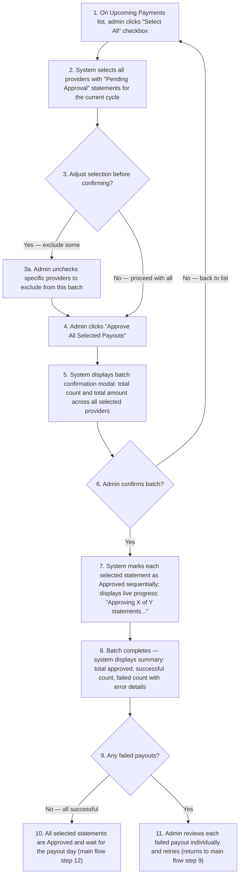
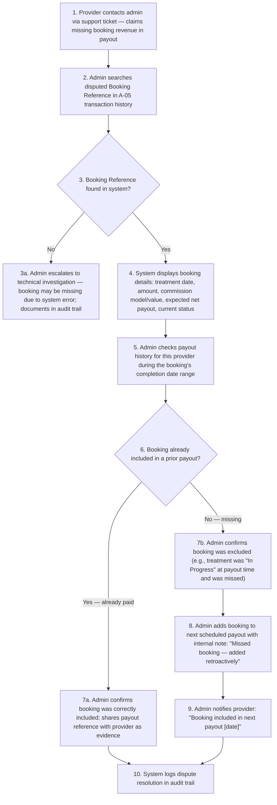
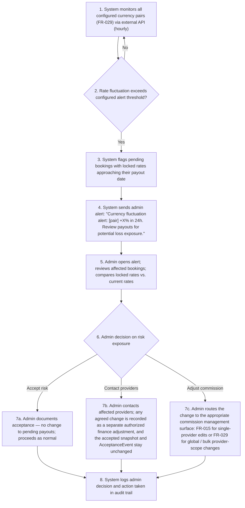
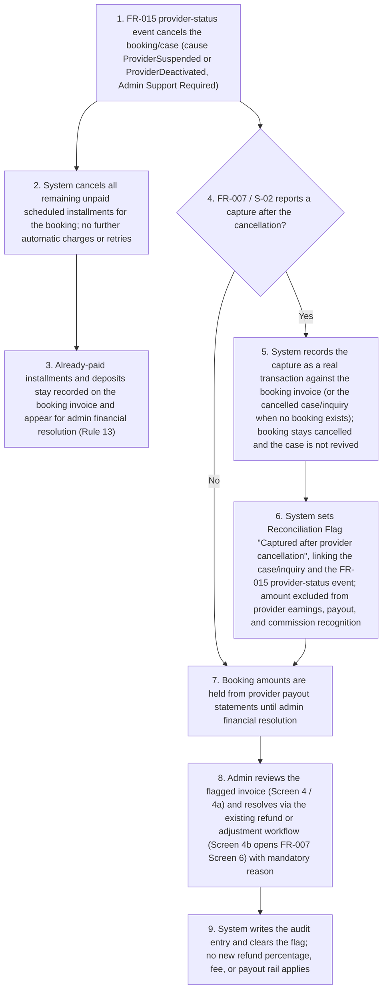
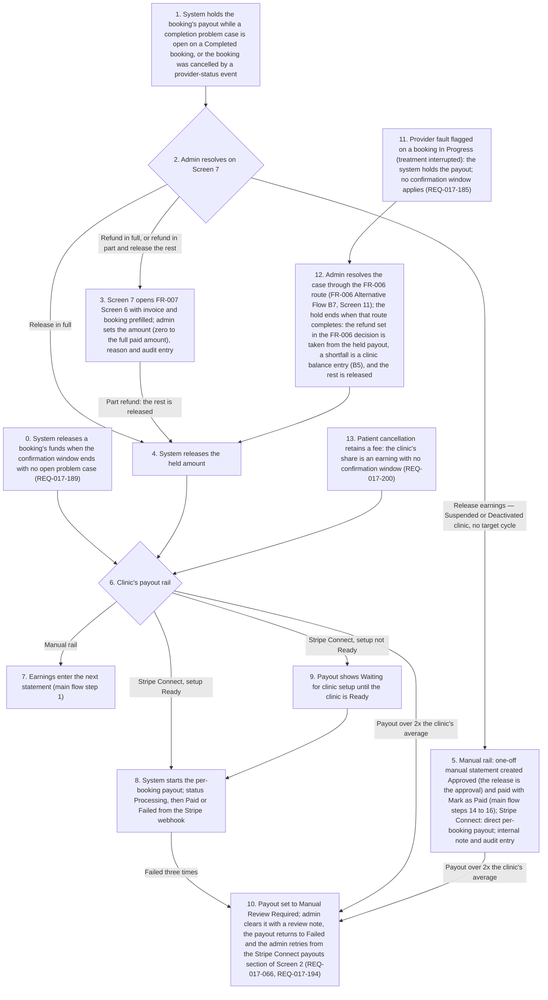
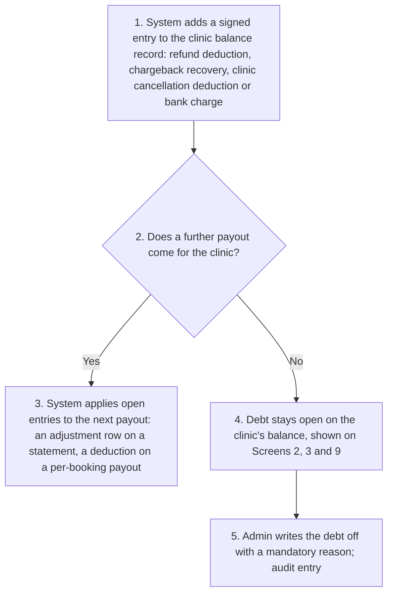
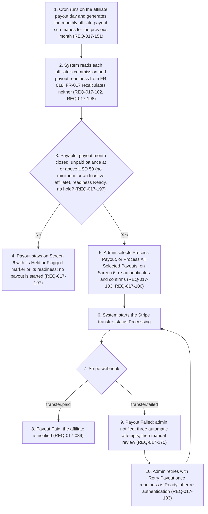
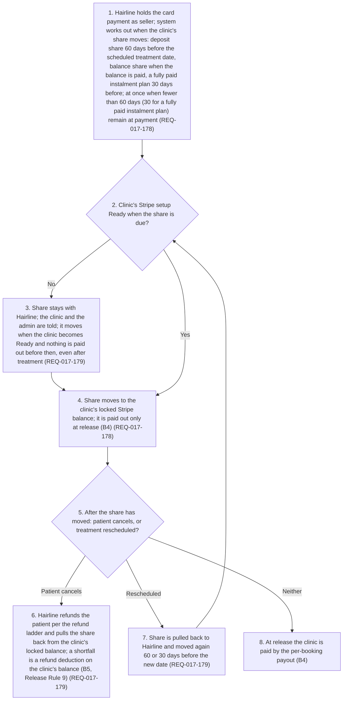

# FR-017 - Admin Billing & Financial Management

**Module**: A-05: Billing & Financial Reconciliation | PR-05: Financial Management & Reporting
**Feature Branch**: `fr017-admin-billing-finance`
**Created**: 2025-11-12
**Status**: ✅ Documentation Approved (baseline 2026-11-25); implementation reconciliation pending
**Source**: FR-017 from `system-prd.md`; [SRC-MTG-002](../../sources/meetings/meeting-02-launch-quote-options-fund-release-and-payments.md#mtg-002-o01-quote-option-contract), approved FR-005/FR-006 accepted-subquote handoff, and [FR-007 payment context](../fr007-payment-processing/prd.md#payment--billing-rules). This revision clarifies existing booking-based billing; no new payment policy.

---

## Executive Summary

The Admin Billing & Financial Management module provides Hairline administrators with comprehensive tools to manage the platform's financial operations across all stakeholders (patients, providers, and affiliates). This module centralizes transaction monitoring, provider payout processing, discount code management, multi-currency revenue reporting, and financial reconciliation across the three-tenant architecture.

This module serves as the financial control center for the platform, ensuring timely payments, accurate commission calculations, transparent billing, and complete audit trails for all financial transactions. It enables Hairline to scale its medical tourism operations while maintaining financial integrity and regulatory compliance.

Financial records remain booking-based: one patient invoice resolves through its FR-006 Booking to one accepted FR-005 subquote and immutable AcceptanceEvent. The accepted package/services, date/appointment, offered price, promotion and price after promotion, and currency/exchange-rate snapshot (rate and its timestamp) provide the commercial base. The promotion is frozen at acceptance; its FR-019 application record is linked to the same AcceptanceEvent and is never recalculated by billing. Authorized financial adjustments remain separate recorded events. Parent quote alternatives are not additional billable cases or invoice lines.

**Key Capabilities**:

- View and manage all patient billing and payment transactions
- Process provider payouts with automated commission calculations
- Process affiliate billing and commission payouts using commission outputs from FR-018/A-07
- Track discount code usage and financial impact across bookings (creation owned by FR-019/A-06)
- Generate multi-currency financial reports and analytics
- Reconcile payments across multiple Stripe accounts (account configuration owned by FR-029/A-09)
- Monitor outstanding balances and payment schedules
- Audit all financial transactions with complete traceability

---

## Module Scope

### Multi-Tenant Architecture

- **Patient Platform (P-03)**: Patients initiate payments through booking flow; invoices and receipts generated
- **Provider Platform (PR-05)**: Providers view upcoming payouts, earnings history, and commission structure
- **Admin Platform (A-05)**: Admins manage all financial operations, billing, and reconciliation
- **Shared Services (S-02)**: Payment Processing Service handles Stripe integration and transaction processing

### Multi-Tenant Breakdown

**Patient Platform (P-03: Booking & Payment)**:

- Patients make payments (deposit, installments, final payment) through integrated Stripe checkout
- Patients may apply one promotion code to one named subquote before acceptance (FR-005 / FR-019); no code can be entered, removed, or replaced at checkout or after acceptance (REQ-017-031)
- Payment data flows to admin platform for processing and reconciliation
- **[BACKLOG — Future Phase]** In-app invoice history and receipt viewing for patients: not included in the MVP mobile flow. Patients receive invoices via email (PDF) at payment confirmation; in-app access deferred to a future release. (REQ-017-032)

**Provider Platform (PR-05: Financial Management & Reporting)**:

*Stage 1 — Treatment Earnings Tracking (Provider-visible, per case)*:

- Providers view earnings per completed treatment case (booking-level income visibility) (REQ-017-033)
- Providers view commission structure and breakdown per booking (REQ-017-033)
- Providers can see running total of pending earnings yet to be paid out (REQ-017-033)
- All earnings data is read-only (providers cannot modify financial records) (REQ-017-033)

*Stage 2 — Payout Consolidation & Processing (Admin-initiated, Provider-visible summary)*:

- Payouts follow the clinic's payout rail (see Business Rules, Fund Release and Payout Rails): a Stripe Connect clinic is paid one payout per released booking, at release; a manual-rail clinic has its eligible earnings consolidated by admin into a payout statement on the one platform-wide settlement period (REQ-017-034)
- Providers view their upcoming payout schedule and expected payout amounts (REQ-017-034)
- Providers view payout history (completed payouts with itemised breakdown) (REQ-017-034)
- Providers download invoices for completed payouts (PDF, generated after admin processes payout) (REQ-017-034)

**Admin Platform (A-05: Billing & Financial Reconciliation)**:

- **Patient Billing**: View all patient invoices, payment status, process refunds, manage installment plans
- **Provider Billing**: View provider payment schedules, approve/process payouts, reconcile payments, generate invoices
- **Affiliate Billing**: View affiliate commissions, process monthly payouts, track referral revenue
- **Discount Usage & ROI Tracking**: View discount code usage, financial impact, and ROI across bookings — creation and approval managed in FR-019 / A-06: Discount & Promotion Management
- **Financial Reporting**: Generate revenue analytics, commission breakdowns, outstanding balance reports
- **[Not in scope — see FR-029]** Stripe Account Management: Stripe account configuration, regional account mapping, and currency conversion rate setup are owned by FR-029 / A-09: Payment System Configuration. A-05 consumes the configured Stripe accounts for payout execution.
- **Audit & Compliance**: Complete transaction logs, payment reconciliation, dispute resolution

**Shared Services (S-02: Payment Processing Service)**:

- Stripe API integration for payment processing (charges, refunds, transfers)
- Multi-currency payment support with locked exchange rates
- Installment payment scheduling and automated charging
- Commission calculation engine
- Payment retry logic for failed transactions
- Webhook handling for Stripe events (successful payments, failed charges, disputes)

### Communication Structure

**Billing/payout notification events required by FR-017** (FR-017 is the authoritative source for billing events; FR-020 / S-03 handles delivery, channels, and user preferences): (REQ-017-035)

| Event | Recipients | Channel (MVP) | Notes |
|---|---|---|---|
| Payment received / receipt | Patient, Provider (optional), Admin (optional) | Email + Push | Triggered on successful Stripe payment |
| Payment failed | Patient, Admin (optional) | Email + Push | Triggered on failed charge or webhook |
| Payment due reminder (installment / balance) | Patient | Email + Push | Sent 3 days before due date |
| Provider payout processed | Provider, Admin (optional) | Email + Push | Sent when a Stripe Connect payout is paid, or when the admin marks a settlement statement as paid |
| Affiliate payout processed | Affiliate, Admin (optional) | Email + Push | Sent after monthly affiliate payout |
| Payout failed | Admin (primary), Provider (optional), Affiliate (optional) | Email + Push | Triggered on a failed Stripe transfer of a per-booking payout or an affiliate payout |
| Outstanding invoice alert | Admin | Email + Push | Internal alert for overdue patient invoices once an invoice has been overdue for the alert threshold (admin setting, expressed in days overdue, default 7) (REQ-017-182) |
| Overdue payout alert | Admin | Email + Push | Triggered on payout day when a statement was not approved between the cutoff day and the payout day and became Overdue |

**Channels**: Email and in-app push (notification dropdown) for both admin and provider platforms. SMS is deferred to a future phase. (REQ-017-035)

**Admin & Provider notification access**: Both admin and provider have an in-app **notification dropdown** (infinite scroll) in their respective dashboards for push notifications. Admin notification preferences are configurable via FR-030; provider preferences are managed in FR-032 / PR-06.

**Out of Scope**:

- SMS notifications for payment events — **not available in MVP**
- In-app chat for payment disputes (handled by FR-034 / A-10: Support Center & Ticketing) (REQ-017-035)
- Provider-patient direct communication about payments (routed through admin support) (REQ-017-035)
- **In-app invoice history for patients** — **BACKLOG (Future Phase)**: Patient invoice and receipt access within the mobile app is not in MVP scope. Patients receive invoices via email only at this stage. (REQ-017-032)

### Entry Points

**Admin Access**:

- Admin logs into Admin Platform → navigates to "Billing & Finance" section (REQ-017-036)
- Dashboard displays: upcoming payouts, outstanding patient invoices, pending provider payments, affiliate commissions due (REQ-017-036)

**Automated Triggers**:

- Treatment completion triggers provider payout eligibility calculation; eligible earnings are added to the provider's running earnings total as Pending release, and become Released when the booking's funds are released: the confirmation window ends with no open problem case, or an admin resolves the case (REQ-017-037, REQ-017-189); the clinic's share of a retained patient cancellation fee is a Released earning at once (REQ-017-200)
- Scheduled cron job runs on the platform-wide cutoff day (Sunday by default) for manual-rail clinics: for each active clinic with eligible earnings, the system generates a payout statement with status "Pending Approval"; admin notified to review and approve newly generated statements. The review time is the gap between the cutoff day and the payout day (REQ-017-038)
- Scheduled cron job on payout day (Wednesday by default, admin-editable) makes the statements with status "Approved" due for payment by the admin, who pays each by bank transfer and marks it as paid; statements still in "Pending Approval" are marked "Overdue" and admin is notified (REQ-017-153, REQ-017-188)
- One scheduled job runs hourly and acts on each installment plan whose due day has started in the clinic's timezone; payment reminders use the same day boundary at 9 AM clinic time, 3 days before the due date (REQ-017-183)
- Scheduled cron jobs generate monthly affiliate payout summaries on the affiliate payout day each month (a platform setting owned by FR-018, default the 7th)
- Stripe webhook events (`transfer.created`, `transfer.paid`, `transfer.failed`) trigger real-time status updates of Stripe Connect per-booking payouts and affiliate payouts, never of a settlement statement (REQ-017-039, REQ-017-186)
- Failed payment events trigger admin alerts and retry mechanisms

**Provider Access**:

- Provider logs into Provider Platform → navigates to "Financial Management" section (REQ-017-036)
- Stage 1 (earnings tracking): Provider sees per-treatment earnings accumulate in real time as treatments complete — this is always visible (REQ-017-040)
- Stage 2 (payout visibility): Provider sees a confirmed payout entry ONLY after the payout is confirmed: a Stripe Connect payout once its transfer is initiated, a manual-rail statement once the admin marks it as paid — providers do NOT see draft statements during the review window between the cutoff day and the payout day (REQ-017-040)
- Providers download invoice PDFs after a payout is fully confirmed (Stripe transfer complete, or statement marked as paid)

---

## Business Workflows

### Main Flow: Provider Payout Processing

**Actors**: Admin, Provider, System (Payment Processing Service), Stripe
**Trigger**: System auto-generates payout statement on the platform-wide cutoff day; admin reviews and approves between the cutoff day and the payout day; on payout day the admin pays the approved statements and marks them as paid
**Outcome**: Provider is paid; invoice generated and sent; transaction logged (REQ-017-041, REQ-017-042, REQ-017-043)

> **Rail scope**: this flow is the manual settlement rail's cycle (statement, review, payout day). A settlement statement exists only for a manual-rail clinic and has five states: Pending Approval, Approved, Overdue, Paid (set when the admin marks it paid) and Voided (REQ-017-186). A Stripe Connect clinic is not paid through this cycle: it is paid one payout per released booking, at release, and Processing, Failed, the `transfer.*` webhooks and Retry Payout belong to that payout (see Business Rules, Fund Release and Payout Rules, and the Stripe Connect payouts section of Screen 2; REQ-017-187).
>
> On the manual settlement rail the clinic is paid by bank transfer after the statement is generated on the cutoff day and approved by the admin; the admin records the payment with Mark as Paid on Screen 3 (steps 14 to 16, REQ-017-188; Release Rules 2 to 4). An Overdue statement that is approved is payable at once: it does not wait for the next payout day (REQ-017-076).
>
> This diagram incorporates the optional note flow and the overdue payout path as decision branches. The Stripe Connect per-booking payout path is described under Alternative Flow B4 — see Alternative Flows for Bulk Approval (A1), Dispute Resolution (B1), Currency Alert (B2) and held-money resolution (B4).

**Flow Diagram**:

```mermaid
flowchart TD
  S1["1. Cron runs on the platform-wide cutoff day for manual-rail clinics"] --> S2["2. System calculates eligible earnings per provider: completed/aftercare treatments whose funds are released (REQ-017-189), commission from each booking's confirmation-time snapshot (Percentage or Flat Rate per completed procedure), net payout amount"]
  S2 --> S3["3. Payout statement created per provider — status &quot;Pending Approval&quot;; dashboard view only, no PDF generated; a payout over 2x the clinic's average is flagged Manual Review Required (REQ-017-194)"]
  S3 --> S4["4. System notifies admin via push + email: &quot;X statements ready for review. Payout date: [date]&quot;"]
  S4 --> S5["5. Provider does NOT see the statement — internal to admin review workflow only"]
  S5 --> S6["6. Admin opens Provider Billing → Upcoming Payments list; selects a provider statement"]
  S6 --> S7["7. Admin reviews payout detail: treatment revenue, commission model/value, net payout, treatment breakdown, bank details"]
  S7 --> S8{"8. Admin needs to add an internal note?"}
  S8 -->|"Yes"| S8A["8a. Admin enters note (max 500 chars) and saves — attached to payout record, not visible to provider"]
  S8 -->|"No"| S9
  S8A --> S9["9. Admin clicks &quot;Approve Payout&quot; — system prompts confirmation: amount, destination (last 4 digits), Yes / No"]
  S9 --> S10{"10. Admin confirms approval?"}
  S10 -->|"No — cancel"| S6
  S10 -->|"Yes"| S11["11. Statement status → &quot;Approved&quot;; admin repeats for remaining providers (or uses Bulk Approval — see A1)"]
  S11 -->|"Approved in the review time"| S12["12. Payout day arrives — Approved statements are due for payment; no payout is started automatically"]
  S12 -->|"Approved statement cannot be paid"| S12A["12a. Admin voids it with a mandatory reason and an audit entry; its bookings enter the next cycle's statement (REQ-017-068)"]
  S12 --> S13{"13. Any statements still in &quot;Pending Approval&quot; on payout day?"}
  S13 -->|"Yes — admin missed the review time"| S13A["13a. Skipped statements → status &quot;Overdue&quot;; admin notified via push + email"]
  S13A --> S13B["13b. Overdue section surfaces at top of Provider Billing list — admin approves; an approved Overdue statement is payable at once"]
  S13B --> S9
  S13 -->|"No — all approved"| S14["14. Admin pays the clinic by bank transfer outside the platform"]
  S11 -->|"Overdue statement just approved"| S14
  S14 --> S15["15. Admin clicks &quot;Mark as Paid&quot; on the payout detail: re-authentication, bank reference, payment date, optional bank charge (carried to the clinic's next payout)"]
  S15 --> S16["16. Statement status → &quot;Paid&quot; at its approved amount; a bank charge becomes a clinic balance entry for the next payout; audit entry &quot;Payout Marked Paid&quot;"]
  S16 --> S17["17. System generates the invoice document with itemised treatment breakdown"]
  S17 --> S18["18. System sends email + push notification to provider with invoice attachment"]
  S18 --> S19["19. Provider Financial Management dashboard updates — confirmed payout and invoice download available"]
  S19 --> S20["20. Full transaction logged in audit trail (timestamp, payout amount, provider ID, statement ID)"]
```

### Alternative Flows

**A1: Bulk Payout Processing (Multiple Providers)**

- **Trigger**: Admin wants to approve all pending statements at once rather than one by one
- **Outcome**: Batch of statements approved; failed approvals flagged individually for retry
- **Flow Diagram**:

**A2: Provider Payment Schedule Change** — **Retired.** Manual-rail clinics share one platform-wide settlement period (weekly by default; Sunday cutoff, Wednesday payout; admin-editable), and Stripe Connect clinics are paid at each booking's release, so no per-provider payout frequency exists to change. See Business Rules, Fund Release and Payout Rails.

**B1: Provider Disputes Payout Amount**

- **Trigger**: Provider claims missing booking revenue in their payout calculation
- **Outcome**: Dispute resolved — either booking is confirmed as paid or added to next payout; provider notified; audit trail updated (REQ-017-045)
- **Flow Diagram**:

**B2: Currency Conversion Rate Protection Triggers Alert**

- **Trigger**: System detects exchange rate fluctuation on any monitored currency pair (configured in FR-029 / A-09) exceeding the configured alert threshold
- **Outcome**: Admin alerted to currency risk; decision documented in audit trail; affected payouts reviewed (REQ-017-046)
- **Flow Diagram**:

**B3: Payment Captured or Scheduled After Provider-Status Cancellation**

- **Trigger**: FR-015 cancels a booking or selected case with cause `ProviderSuspended` / `ProviderDeactivated`, and either (a) FR-007 / S-02 reports a payment captured against it after the cancellation (for example, a delayed Stripe webhook), or (b) the booking still has unpaid scheduled installments
- **Outcome**: Remaining installments are cancelled; any late capture is recorded as a real transaction and flagged for admin reconciliation without confirming a booking, reviving the case, or counting toward provider earnings, payout, or commission; admin resolves through the existing refund/adjustment workflow with reason and audit trail
- **Flow Diagram**:

**B4: Per-Booking Payout, Held Money and Release of Earnings**

- **Trigger**: A booking's funds are released; or a booking's payout is held (open problem case on a Completed booking, interrupted treatment, provider-status cancellation) and an admin resolves it, on Screen 7 for a problem case or a provider-status cancellation, through the FR-006 route for an interrupted treatment; or a patient cancellation retains a fee and the clinic has a share of it
- **Outcome**: The held money ends as a release (statement or per-booking payout) or a refund started in FR-007 Screen 6 or set in the FR-006 decision; the clinic's share of a retained cancellation fee is released into the next payout; for a Stripe Connect clinic the per-booking payout is paid, waits for clinic setup, or goes to manual review (REQ-017-185, REQ-017-187, REQ-017-189, REQ-017-190, REQ-017-193, REQ-017-200)
- **Flow Diagram**:

**B5: Clinic Balance Entry and Write-Off**

- **Trigger**: A refund after payout, a chargeback, a clinic cancellation deduction or a manual-transfer bank charge leaves money owed by the clinic. A bank charge is entered when the admin marks a statement as paid; it is applied to the clinic's next payout and never deducted from the statement being marked as paid
- **Outcome**: One signed entry on the clinic's balance record, applied to the clinic's next payout on either rail; a debt with no further payout stays open until an admin writes it off with a reason (REQ-017-191, REQ-017-192)
- **Flow Diagram**:

**B6: Monthly Affiliate Payout**

- **Trigger**: The affiliate payout day arrives (a platform setting owned by FR-018, default the 7th); FR-018 hands the monthly commission and payout readiness to this flow (FR-018 Alternative Flow B2)
- **Outcome**: Each payable affiliate payout is paid by a Stripe transfer on Screen 6; a failed transfer is retried and stays visible until it is paid (REQ-017-101, REQ-017-102, REQ-017-103, REQ-017-170, REQ-017-197)
- **Flow Diagram**:

**B7: Clinic Share Moves to the Clinic's Locked Stripe Balance**

- **Trigger**: A card payment is received through Stripe Connect for a booking of a Stripe Connect clinic
- **Outcome**: The clinic's share moves to its locked Stripe balance at the time Release Rule 5 sets, is pulled back and moved again when the patient cancels or the treatment is rescheduled, and is paid out only at release (REQ-017-178, REQ-017-179)
- **Flow Diagram**:

---

## Screen Specifications

> **Tenant scope**:
>
> - **Admin Platform (A-05)**: Screens 1–8 below. Core billing management for providers, patients, affiliates, financial reporting, investigation, and audit workflows.
> - **Provider Platform (PR-05)**: Screens 9–10 below. Provider-facing read-only views for earnings tracking (Stage 1) and confirmed payout history (Stage 2). FR-017 defines the screen specs since it owns the financial data model; FR-032 provides the provider dashboard navigation shell.
> - **Patient Platform**: No patient-facing billing screens in this FR. Patient payment initiation (deposit, installments, final payment) is owned by FR-007: Payment Processing. Patient-facing invoice history is **[BACKLOG — Future Phase]**.
> - **Affiliate Platform**: No affiliate-facing screens in this FR. Affiliates view their commission earnings via a read-only dashboard in FR-018 (A-07: Affiliate Program Management). FR-017 Screen 6 is the admin-side view for processing affiliate payouts only.

---

### Admin Platform Screens (A-05)

**Role-Based Action Visibility**:

- Admin access follows the FR-031 permissions: Process Payouts covers the money-moving payout actions (payout approvals, retries, overrides and bulk actions) and View Transactions is the read-only finance permission that opens every admin financial screen; Super Admin and Billing Admin hold both by default. A refund needs Issue Refunds, which Super Admin holds by default and Billing Admin does not (REQ-017-047)
- Read-only finance access is the View Transactions permission, not a named role. An admin who holds only View Transactions can access the same screens in read-only mode, but selection checkboxes, money-moving buttons, retry buttons, override buttons, and confirmation modals are hidden (REQ-017-047)
- Any action that moves money or changes a financial status MUST invoke the financial re-authentication step before the final confirm action is enabled (REQ-017-047)

#### Screen 1: Financial Reporting - Revenue Dashboard

**Purpose**: Executive overview of platform financial performance with filterable analytics

**Data Fields**:

| Field Name | Type | Required | Description | Validation Rules | Graph field |
|------------|------|----------|-------------|------------------|---------|
| Date Range Selector | daterange | Yes | Filter reports by date range | Default: Last 30 days | ENT-financial-report.date_range |
| Currency Selector | select | Yes | View amounts in selected currency | Default: system default currency from FR-029 Screen 6 (USD in MVP seed) | ENT-financial-report.report_currency |
| Total Revenue | currency (large) | Yes | Sum of all patient payments | Auto-calculated | ENT-financial-report.total_revenue |
| Platform Commission | currency | Yes | Total Hairline commission earned | Auto-calculated | ENT-financial-report.platform_commission |
| Provider Payouts | currency | Yes | Total paid to providers | Auto-calculated | ENT-financial-report.provider_payouts |
| Affiliate Payouts | currency | Yes | Total paid to affiliates | Auto-calculated | ENT-financial-report.affiliate_payouts |
| At Risk Invoice Count | number | Yes | Count of invoices currently carrying the "At Risk" flag (a flag, not a payment status, REQ-017-051) | Auto-calculated | ENT-financial-report.at_risk_invoice_count |
| Failed Payout Count | number | Yes | Count of provider + affiliate payouts currently in "Failed" status | Auto-calculated | ENT-financial-report.failed_payout_count |
| Active Currency Alerts | number | Yes | Count of unacknowledged currency fluctuation alerts. Clicking opens the notification list filtered to unresolved currency alerts; each alert links to Screen 8. Displays "0" when no active alerts (badge hidden at zero) | Auto-calculated from alert state in FR-029 (REQ-017-164) | ENT-financial-report.active_currency_alerts |
| Refund Trend | chart | Yes | Time-series view of refund amount and refund count across the selected period | Interactive line/bar chart | ENT-financial-report.refund_trend |
| Outstanding Patient Invoices | currency | Yes | Unpaid balance of bookings with an open final payment (total). Clicking this KPI opens an aging breakdown panel: 0–30 days overdue, 31–60 days overdue, 60+ days overdue — each showing count and total amount | Auto-calculated | ENT-financial-report.outstanding_patient_invoices |
| Overdue Aging Breakdown | panel | Yes | Drill-down from Outstanding Patient Invoices KPI: three buckets (0–30 days, 31–60 days, 60+ days) each showing invoice count and total outstanding amount. "At Risk" invoices shown as a separate row | Visible on click of KPI | ENT-financial-report.overdue_aging_breakdown |
| Pending Provider Payouts | currency | Yes | Provider earnings awaiting payout, shown in two parts: "Pending release" (confirmation window still open or a problem case open) and "Released" (funds released, not yet paid) (REQ-017-052) | Auto-calculated | ENT-financial-report.pending_provider_payouts |
| Affiliate Payout Status Summary | table | Yes | Summary counts and totals grouped by affiliate payout status: Pending, Processing, Paid, Failed | Sortable table | ENT-financial-report.affiliate_payout_status_summary |
| Revenue by Country | chart | Yes | Geographic breakdown of patient bookings | Interactive pie/bar chart | ENT-financial-report.revenue_by_country |
| Revenue by Treatment Type | chart | Yes | Breakdown by FUE, FUT, DHI, etc. | Interactive bar chart | ENT-financial-report.revenue_by_treatment_type |
| Revenue Trend | chart | Yes | Line chart showing revenue over time | Interactive time series | ENT-financial-report.revenue_trend |
| Top Providers by Revenue | table | Yes | Highest-earning providers | Sortable table | ENT-financial-report.top_providers |
| Discount Usage | table | Yes | Most-used discount codes with ROI | Sortable table | ENT-financial-report.discount_usage |
| Conversion Rate | percentage | Yes | (Bookings / Inquiries) × 100. Inquiries count sourced from FR-003 / P-02: Quote Request & Management. | Display: X.X% (REQ-017-059) | ENT-financial-report.conversion_rate |

**Business Rules**:

- All currency amounts displayed in selected currency (with real-time conversion if multi-currency) (REQ-017-048)
- Currency selector initializes to the system default currency configured in FR-029 / A-09 Currency Management; MVP environments seed this default to USD unless an admin changes it later (REQ-017-048)
- "Active Currency Alerts" count reflects alerts triggered by FR-029 / A-09 rate monitoring that have not yet had a decision recorded via Screen 8; count resets to 0 once all active alerts have a confirmed admin decision (REQ-017-049)
- "Outstanding Patient Invoices" includes ONLY invoices of bookings whose FR-007 Payment Status is "Unpaid", "Deposit only" or "Installments active" (an unpaid balance remains); "Overdue" is read from the booking's Final Payment Status and "At Risk" is a separate flag, neither is a Payment Status (REQ-017-050)
- Overdue aging buckets count from the day after the invoice Due Date (the day the Final Payment Status becomes Overdue, FR-007) to today: 0–30 days, 31–60 days, 60+ days; the "At Risk" flag (all installment retries exhausted) is shown as a separate row regardless of age (REQ-017-051)
- "Pending Provider Payouts" includes treatments with status "Completed" or "Aftercare" not yet paid, split into "Pending release" and "Released"; only released funds can enter a statement or a per-booking payout (REQ-017-052, REQ-017-189)
- "Failed Payout Count" includes failed Stripe Connect per-booking payouts and failed affiliate payouts currently awaiting retry or manual resolution; a statement has no Failed state (REQ-017-053, REQ-017-186)
- Revenue by Country based on patient location (not provider location) (REQ-017-054)
- Revenue by Treatment Type excludes refunded bookings (REQ-017-055)
- Refund Trend includes full and partial refunds and supports drill-down into Screen 4a (REQ-017-056)
- Top Providers table sortable by: revenue, booking count, average booking value (REQ-017-057)
- Discount Usage table shows: code name, times used, total discount amount, estimated ROI (bookings generated vs. discount cost) (REQ-017-058)
- Charts interactive: clicking segment filters dashboard to that subset (e.g., click "Turkey" → filters to Turkey bookings) (REQ-017-060)

**Notes**:

- Provide "Export Full Report" button to download PDF/CSV with all dashboard data (REQ-017-060)
- Support comparison mode: "Compare to previous period" (e.g., last 30 days vs. previous 30 days) (REQ-017-060)
- Display warning icons for anomalies: sudden revenue drop, high refund rate, unusual currency fluctuations (REQ-017-060)

---

#### Screen 2: Provider Billing - Upcoming Payments List

**Purpose**: Display all providers with earnings awaiting payout, grouped by payment schedule

**Data Fields**:

| Field Name | Type | Required | Description | Validation Rules | Graph field |
|------------|------|----------|-------------|------------------|---------|
| Select | checkbox | Conditional | Row selection for batch payout approval | Enabled ONLY for an admin holding Process Payouts when Status = "Pending Approval" or "Overdue" and Payout Readiness = "Ready" | no graph field (control) |
| Provider Name | text | Yes | Clinic/provider name | Display only | ENT-provider.name |
| Provider ID | text | Yes | Unique provider identifier (e.g., "HP-PRV-00123") | Display only | ENT-provider.id |
| Payout Reference | text | Yes | Unique payout statement reference (e.g., "PST-HP-PRV-00123-2026-04-W1") | Display only | ENT-provider-payout.payout_reference |
| Payment Schedule | badge | Yes | The platform-wide settlement period that applies to manual-rail clinics (weekly by default; set in admin payment settings) | Display only | no graph field (display) |
| Next Payout Date | date | Yes | Scheduled payout date for this statement: the platform-wide payout day (Wednesday by default; admin-editable); for a Stripe Connect payout, the release date of the booking's funds, because that payout is made at release (REQ-017-187) | Format: DD-MM-YYYY | ENT-provider-payout.payout_date |
| Outstanding Earnings | currency | Yes | Total revenue pending payout | Format: £X,XXX.XX | ENT-provider-payout.total_revenue |
| Commission | text | Yes | Effective commission snapshot for the bookings in this statement. Source: provider-specific commission configuration managed in FR-015 / A-02 or FR-029 / A-09 when defined; otherwise the FR-029 / A-09 global default captured at booking confirmation | Display: 15% or £150 Flat (REQ-017-063) | ENT-provider-payout.commission_value |
| Net Payout | currency | Yes | Provider payout after commission | Auto-calculated | ENT-provider-payout.net_payout |
| Bank Account | text | Yes | Bank account last 4 digits (masked) | Display: ****1234 | ENT-provider-payout.bank_account_id |
| Payout Readiness | badge | Yes | Statement (manual rail): "Ready", "Missing Bank Details", "Invalid Bank Details", "Manual Review Required". Stripe Connect payout: "Not onboarded", "Restricted", "Ready", "Manual Review Required" (REQ-017-194, REQ-017-196) | Color-coded | ENT-provider-payout.payout_readiness_status |
| Status | badge | Yes | Statement: "Pending Approval", "Approved", "Overdue", "Paid", "Voided" (REQ-017-186). Stripe Connect payout: "Waiting for clinic setup", "Processing", "Paid", "Failed" (REQ-017-187) | Color-coded | ENT-provider-payout.payout_status |
| Open Clinic Balance | currency | Conditional | Signed sum of the clinic's open balance entries (refund deduction, chargeback recovery, clinic cancellation deduction, bank charge, handover fee credit); a negative amount is money the clinic owes Hairline (REQ-017-191, REQ-017-203) | Visible when not zero; display only | ENT-clinic-balance-entry.amount |
| Blocked Reason | text | Conditional | Explanation shown when payout approval is unavailable | Visible when Payout Readiness is not "Ready" | ENT-provider-payout.blocked_reason |
| Actions | buttons | Yes | "View Details", "Approve Payout", "Unapprove", "Void Statement", "Add Note" on a statement; "Retry Payout" on a Stripe Connect payout; "Clear Manual Review" on a statement or a Stripe Connect payout; "Write Off Balance" on an open clinic balance | Conditional visibility | no graph field (control) |

**Batch Approval Toolbar** (shown when one or more rows are selected):

| Element | Description | Graph field |
|---------|-------------|---------|
| Selected Statements | Count of currently selected payout statements | no graph field (display) |
| Selected Net Total | Sum of Net Payout across selected rows | no graph field (display) |
| Approve All Selected Payouts | Opens batch confirmation modal | no graph field (control) |
| Clear Selection | Removes all current row selections | no graph field (control) |

**Business Rules**:

- Providers appear in list ONLY if a payout statement has been auto-generated for them (i.e., the platform-wide cutoff day has passed)
- All manual-rail clinics share one platform-wide settlement period (weekly by default: Sunday cutoff, Wednesday payout; all admin-editable). There is no per-clinic payout frequency for manual-rail clinics; Stripe Connect clinics are paid per released booking and do not appear on a settlement cycle, so they have no statement and are listed in the Stripe Connect payouts section below (REQ-017-074, REQ-017-186)
- Payout statement is auto-generated on the cutoff day; only then does the provider appear in this list. The review time is the gap between the cutoff day and the payout day
- Payout amount MUST include all treatments with status "Completed" or "Aftercare" completed since the last payout cycle whose funds are released: the confirmation window has ended with no open problem case, or an admin has resolved the case (REQ-017-061, REQ-017-189)
- Treatments with status "Scheduled", "In Progress", or "Cancelled" are NOT included; the clinic's share of a retained patient cancellation fee is the one exception, an earning of its own that enters the next statement (REQ-017-061, REQ-017-200)
- Providers with status "Suspended" or "Deactivated" do NOT have statements generated; an admin releases their earnings with the Release earnings resolution on Screen 7 (REQ-017-062, REQ-017-193)
- Commission shown in this list comes from the commission snapshot captured at booking confirmation (FR-006): provider-specific commission configuration managed in FR-015 / A-02 or FR-029 / A-09 when defined, otherwise the FR-029 / A-09 global default; supported models are Percentage and Flat Rate where applicable (REQ-017-063)
- Bank account details shown ONLY if provider has a valid bank account on file in FR-032 Billing Settings (REQ-017-064)
- A manually paid clinic is "Ready" once the admin has set its payout method to manual bank transfer and saved valid bank details; for such a clinic the admin records the bank details
- Nothing is forfeited: the earnings of a clinic removed from the platform are always settled by an admin through General Module Rule 16 and the Release earnings resolution on Screen 7 (REQ-017-193)
- Statements with missing or invalid bank details remain visible in the list for operational follow-up, but Payout Readiness is not "Ready" and approval controls remain disabled until the provider updates payout details in FR-032 / PR-06 (REQ-017-064)
- A Suspended clinic's Owner can still update the bank details in FR-032 (REQ-032-067); a Deactivated clinic has no portal access, so an admin collects the corrected bank details outside the platform and records them as for a manually paid clinic, after which Payout Readiness follows the stored details as usual (REQ-017-064)
- "Approve Payout" button enabled ONLY for statements with status "Pending Approval" or "Overdue", and not while Payout Readiness is "Manual Review Required" (REQ-017-065, REQ-017-194). Approving an Overdue statement never waits for the next payout day: it is payable at once and the admin pays it and marks it as paid (REQ-017-076)
- "Retry Payout" button is shown only in the Stripe Connect payouts section and is enabled ONLY for a Failed per-booking payout that is not in "Manual Review Required"; clicking it re-initiates the Stripe transfer; retry is logged in audit trail with admin ID, timestamp, and failure reason from prior attempt. A failed Stripe Connect payout first gets 3 automatic attempts with exponential backoff and then goes to Manual Review Required; once an admin clears it with a review note, this button is available for the manual retry. A statement has no retry: an admin marks it as paid (REQ-017-066, REQ-017-194)
- The Stripe Connect payouts section lists each per-booking payout with the states "Waiting for clinic setup" (the clinic's Stripe setup is not Ready), "Processing", "Paid" and "Failed", and the readiness values "Not onboarded", "Restricted" and "Ready"; Stripe webhooks move these payouts and never a statement; when Stripe reports an invalid bank account, the clinic corrects its payout details through the "Complete Stripe sign-up" link in the status panel of its FR-032 Billing Settings (FR-032 REQ-032-146) and the admin then retries the payout (REQ-017-187, REQ-017-196)
- "Manual Review Required" is set on either rail by the payout flag of REQ-017-161 (a payout over 2x the clinic's average payout amount; the discount code and refund rate flags do not set it), and on a Stripe Connect payout also by three failed payout attempts; approval and retry are disabled while it is set; "Clear Manual Review" is offered on a statement and on a Stripe Connect payout, requires a review note and is recorded in the audit trail with action type "Manual Review Cleared". After clearing, a statement returns to the state it had before the flag (Pending Approval or Approved) and a Stripe Connect payout returns to Failed, so Retry Payout applies (REQ-017-066, REQ-017-194)
- Open balance entries of a clinic are applied to its next payout on either rail; a debt with no further payout coming stays open and is listed in the Open clinic balances section, where an admin may "Write Off Balance" with a mandatory reason and an audit entry (REQ-017-191, REQ-017-192)
- "Unapprove" button enabled ONLY for statements with status "Approved" and ONLY before the payout day (it is not offered once the payout day has passed); on click, admin must enter a mandatory reason (max 500 chars); statement reverts to "Pending Approval"; action logged in audit trail with action_type "Payout Unapproved" (REQ-017-067)
- "Void Statement" button enabled ONLY for statements with status "Pending Approval" or "Overdue", and for an "Approved" statement that has passed its payout day unpaid (for example the bank details turned invalid or the clinic was suspended after approval); on click, admin must enter a mandatory reason (max 500 chars); statement is marked "Voided" and permanently removed from auto-processing; action logged with action_type "Payout Voided"; a new statement can be re-generated on the next payout cycle, and the bookings of a voided statement return to the next cycle's statement; voided statements remain visible in list with "Voided" status badge for audit history (REQ-017-068)
- "Add Note" button available for all statements at any status (for audit documentation) (REQ-017-069)
- Batch selection is allowed ONLY for statements with Status = "Pending Approval" or "Overdue" and Payout Readiness = "Ready" (REQ-017-070)
- Clicking "Approve All Selected Payouts" opens a batch confirmation modal showing selected count, total net payout amount, and a financial re-authentication challenge; confirm remains disabled until re-authentication succeeds (REQ-017-070)
- After batch approval, the UI MUST show a batch result summary with: total selected, total approved, total failed, and error details per failed statement (REQ-017-071)
- Statements with status "Overdue" are surfaced at the top of the list in a dedicated "Overdue" section (REQ-017-072)
- Failed Stripe Connect payouts are surfaced in a dedicated "Failed" part of the Stripe Connect payouts section, which sits below "Upcoming / Pending Approval" (REQ-017-072)

**Notes**:

- List is divided into four sections: **Overdue** (top, highlighted), **Upcoming / Pending Approval**, **Stripe Connect payouts** (Failed rows highlighted in red) and **Open clinic balances**
- List should support filtering by: status, payment schedule, date range, provider name/ID (REQ-017-073)
- List should support sorting by: payout date, net payout amount (ascending/descending) (REQ-017-073)
- Export to CSV functionality for batch processing and accounting reconciliation (REQ-017-073)

---

#### Screen 3: Provider Payout Detail Modal

**Purpose**: Display itemized breakdown of provider payout with treatment-level details. The modal opens for a settlement statement (manual rail) and for a Stripe Connect per-booking payout (from the Stripe Connect payouts section of Screen 2); the Stripe fields below are shown only for the second kind (REQ-017-186, REQ-017-187)

**Data Fields**:

| Field Name | Type | Required | Description | Validation Rules | Graph field |
|------------|------|----------|-------------|------------------|---------|
| Provider Name | text | Yes | Clinic name | Display only | ENT-provider.name |
| Provider ID | text | Yes | Unique provider identifier | Display only | ENT-provider.id |
| Payout Reference | text | Yes | Unique payout statement reference | Display only | ENT-provider-payout.payout_reference |
| Statement Status | badge | Yes | Statement: "Pending Approval", "Approved", "Overdue", "Paid", "Voided". Stripe Connect payout: "Waiting for clinic setup", "Processing", "Paid", "Failed" | Color-coded | ENT-provider-payout.payout_status |
| Payout Period | daterange | Conditional | Date range covered by a statement; a Stripe Connect payout is one booking paid at release, so it has a release date instead of a period (REQ-017-187) | Format: DD-MM-YYYY to DD-MM-YYYY | ENT-provider-payout.payout_period |
| Release Date | date | Conditional | Stripe Connect payout only: the date the booking's funds were released and the payout made (REQ-017-187) | Format: DD-MM-YYYY | ENT-provider-payout.payout_date |
| Payout Readiness | badge | Yes | Indicates whether approval or payment can proceed. Statement: "Ready", "Missing Bank Details", "Invalid Bank Details", "Manual Review Required". Stripe Connect payout: "Not onboarded", "Restricted", "Ready", "Manual Review Required" | Color-coded | ENT-provider-payout.payout_readiness_status |
| Blocked Reason | text | Conditional | Reason the statement cannot currently be approved, or the payout cannot be retried or is waiting for clinic setup | Visible when Payout Readiness is not "Ready" or the status is "Failed" or "Waiting for clinic setup" | ENT-provider-payout.blocked_reason |
| Bank Account | text | Conditional | Destination bank account (masked) of a manual-rail statement | Display: ****1234 | ENT-provider-payout.bank_account_id |
| Treatment List | table | Yes | Itemized list of included bookings | See sub-table below | no graph field (list of treatment rows below) |
| Payout Adjustments | table | Conditional | Non-treatment deductions or credits applied to this payout, including refund deductions carried from previously paid bookings | See adjustment sub-table below; visible only when adjustments exist | no graph field (list of adjustment rows below) |
| Total Revenue | currency | Yes | Sum of treatment amounts | Auto-calculated | ENT-provider-payout.total_revenue |
| Hairline Discount Reimbursement | currency | Conditional | The Hairline share of the discount reimbursed to the clinic on top of the commission effect, summed from the included bookings; each booking's amount is read from the frozen booking snapshot (REQ-017-195, REQ-019-017) | Visible when not zero; display only | ENT-provider-payout.hairline_discount_reimbursement |
| Commission Configuration | text | Yes | Platform commission model/value applied to this payout | Display: 15% or £150 Flat | ENT-provider-payout.commission_model, ENT-provider-payout.commission_value |
| Commission Amount | currency | Yes | Commission deducted | Auto-calculated | ENT-provider-payout.commission_amount |
| Net Payout | currency | Yes | Provider receives this amount: revenue less commission, plus the discount reimbursement, adjusted by the balance entries applied to this payout | Auto-calculated | ENT-provider-payout.net_payout |
| Approved By | text | Conditional | Admin who approved the statement | Visible once a statement is "Approved" or "Paid" | ENT-provider-payout.approved_by_admin_id |
| Approved At | datetime | Conditional | Date/time the statement was approved | Format: DD-MM-YYYY HH:MM:SS UTC | ENT-provider-payout.approved_at |
| Processed At | datetime | Conditional | Date/time the Stripe transfer was initiated (Stripe Connect payout only) | Visible once the payout is "Processing", "Paid", or "Failed" | ENT-provider-payout.processed_at |
| Stripe Transfer ID | text | Conditional | Stripe transfer reference for reconciliation (Stripe Connect payout only) | Visible once Stripe transfer has been created | ENT-provider-payout.stripe_transfer_id |
| Failure Reason | text | Conditional | Human-readable reason for transfer failure or manual review block (Stripe Connect payout only) | Visible when status is "Failed" or retry is blocked | ENT-provider-payout.failure_reason |
| Bank Reference | text | Conditional | The bank transfer reference the admin entered when marking the statement as paid | Required in the Mark as Paid modal; display only afterwards | ENT-provider-payout.bank_reference |
| Payment Date | date | Conditional | Date the admin paid the clinic by bank transfer | Required in the Mark as Paid modal; not in the future; format DD-MM-YYYY | ENT-provider-payout.payment_date |
| Marked Paid By | text | Conditional | Admin who marked the statement as paid | Visible once the statement is "Paid" | ENT-provider-payout.paid_by_admin_id |
| Manual Review Note | textarea | Conditional | Review note an admin entered when clearing "Manual Review Required" (REQ-017-194) | Required to clear; visible after clearing | ENT-provider-payout.manual_review_note |
| Internal Notes | textarea | No | Admin notes (not visible to provider) | Max 500 characters | ENT-provider-payout.internal_notes |

**Treatment List Sub-Table** (nested within payout detail):

| Field Name | Type | Required | Description | Validation Rules | Graph field |
|------------|------|----------|-------------|------------------|---------|
| Booking Reference | text | Yes | Unique booking reference (e.g., "HPID2511234") | Clickable link | ENT-booking.booking_reference |
| Patient Name | text | Yes | Full patient name (revealed post-payment) | Display only | ENT-patient.name |
| Treatment Date | date | Yes | Date treatment was performed | Format: DD-MM-YYYY | ENT-booking.appointment_at |
| Treatment Type | text | Yes | FUE, FUT, DHI, etc. | Display only | ENT-treatment.name |
| Treatment Amount | currency | Yes | Total booking amount (inc. packages) | Display only | ENT-provider-earning.gross_amount |
| Hairline Discount Reimbursement | currency | Conditional | The reimbursement row for this booking: the Hairline share of the discount, read from the frozen booking snapshot (REQ-017-195) | Visible when not zero; display only | ENT-provider-earning.hairline_discount_reimbursement |
| Commission Deducted | currency | Yes | Commission withheld for this treatment | Auto-calculated | ENT-provider-earning.commission_deducted |
| Net Contribution | currency | Yes | Net payout contribution from this treatment | Auto-calculated | ENT-provider-earning.net_earning |
| Currency | text | Yes | Original booking currency | Display: GBP, EUR, USD, etc. | ENT-provider-earning.currency |
| Exchange Rate | number | No | Rate locked at subquote acceptance, read from the FR-005 acceptance snapshot (if multi-currency) | Display: 1 GBP = 1.17 EUR | ENT-provider-earning.exchange_rate |
| Status | badge | Yes | "Completed", "Aftercare" | Color-coded | ENT-booking.status |

**Payout Adjustments Sub-Table** (nested within payout detail, shown only when adjustments exist):

| Field Name | Type | Required | Description | Validation Rules | Graph field |
|------------|------|----------|-------------|------------------|---------|
| Adjustment Type | badge | Yes | "Refund Deduction", "Chargeback Recovery", "Clinic Cancellation Deduction", "Carry-Forward Adjustment", "Bank Charge" (a bank charge of an earlier manual transfer, borne by the clinic and applied to this payout) or "Handover Fee" (a credit, REQ-017-203). Each except Carry-Forward Adjustment is an entry of the clinic balance record applied to this payout (REQ-017-191) | Color-coded | ENT-payout-adjustment.adjustment_type |
| Booking Reference | text | Yes | Original booking tied to the adjustment | Clickable link | ENT-booking.booking_reference |
| Effective Date | date | Yes | Date the adjustment first applied to a payout statement | Format: DD-MM-YYYY | ENT-payout-adjustment.effective_date |
| Description | text | Yes | Provider-visible label shown on the payout statement | Display only; format example: "Adjustment: Refund deducted — [Booking Reference] — [Date]" | ENT-payout-adjustment.description |
| Adjustment Amount | currency | Yes | Deduction or credit applied in the current payout cycle | Display only; negative values allowed | ENT-payout-adjustment.adjustment_amount |
| Remaining Balance | currency | Conditional | Outstanding adjustment balance that will carry into a later payout cycle | Visible only when current payout does not fully absorb the adjustment | ENT-payout-adjustment.remaining_balance |
| Status | badge | Yes | "Applied" or "Carried Forward" | Color-coded | ENT-payout-adjustment.status |

**Business Rules**:

- Payout MUST include ALL treatments with status "Completed" or "Aftercare" within the payout period whose funds are released (the confirmation window has ended with no open problem case, or an admin has resolved it); the running total of a statement counts released earnings only (REQ-017-189)
- Payout period determined by the one platform-wide settlement period for manual-rail clinics (weekly by default, ending on the Sunday cutoff day; set in admin payment settings). Per-clinic payout frequency no longer applies (REQ-017-074)
- The commission model/value (and Flat Rate currency) for each included booking is fixed at booking confirmation (FR-006) from the effective commission configuration at that moment: provider-specific commission configuration managed in FR-015 / A-02 or FR-029 / A-09 when defined, otherwise the FR-029 / A-09 global default. Nothing is fixed at quote creation
- If provider commission model is Percentage, the base is the accepted price after promotion, in the quote currency, read from the acceptance snapshot; the result is converted to the payout currency at the rate locked at subquote acceptance (if applicable)
- If provider commission model is Flat Rate, the snapshotted fixed amount (in its snapshotted currency) is deducted once per FR-010 completed procedure included in the payout, regardless of procedure price; later changes to the provider's commission configuration do not alter existing snapshots
- Exchange rates are locked at subquote acceptance (FR-005 AcceptanceEvent) and read from the acceptance snapshot (no fluctuation risk to provider during payout)
- If a patient refund is processed AFTER the provider has already been paid, the next provider payout statement MUST include a row in `Payout Adjustments` labelled `Adjustment: Refund deducted — [Booking Reference] — [Date]` (REQ-017-075)
- If a refund deduction exceeds the provider's current payout amount, the unapplied balance remains visible in `Remaining Balance` and carries forward to the next payout cycle until fully recovered; the same applies to every entry of the clinic balance record, on either rail. A debt with no further payout coming stays open on the clinic's balance until an admin writes it off (REQ-017-075, REQ-017-191, REQ-017-192)
- Internal notes visible ONLY to admins (never exposed to provider) (REQ-017-069)
- "Approve Payout" is enabled ONLY when Payout Readiness = "Ready", the admin holds Process Payouts, and financial re-authentication succeeds (REQ-017-065)
- "Approve Payout" button marks the statement as "Approved"; no payment is started by the review action. An approved statement is paid by the admin by bank transfer outside the platform and marked as paid. An Overdue statement that is approved is payable at once and does not wait for the next payout day (REQ-017-076)
- "Mark as Paid" is offered for a statement in "Approved" status, and for an "Overdue" one that has just been approved. The admin enters the bank reference and the payment date, may enter a bank charge, and re-authenticates; the statement becomes "Paid", a "Payout Marked Paid" entry is written to the audit trail, the clinic is notified, and the payout invoice document is generated on that event. The statement keeps its approved amount: a bank charge is recorded as a Bank Charge entry of the clinic balance record and applied to the clinic's next payout, never deducted from the statement being marked as paid (REQ-017-188, REQ-017-191)
- For a Stripe Connect payout, the Stripe Transfer ID remains blank until Stripe confirms `transfer.created`; failure reason remains blank unless Stripe or validation returns a blocking error (REQ-017-077, REQ-017-187)
- A booking's Hairline discount reimbursement is shown as its own row and in the payout total; it is read from the frozen booking snapshot and never recomputed (REQ-017-195)
- A handover fee that Hairline owes a provider after an aftercare handover (FR-011) is a credit entry of type Handover Fee on the clinic's balance record, created only when the admin-set fee is above zero; it is paid by Hairline, never taken from a patient price or from the provider's earnings, carries no commission, and is added to the clinic's next payout on either rail (REQ-017-203, REQ-011-057)

**Batch Approval Confirmation Modal** (appears when admin clicks "Approve All Selected Payouts" in Screen 2):

| Element | Description | Graph field |
|---------|-------------|---------|
| Summary line | "Approve payouts for [count] providers totalling [total net payout]?" | no graph field (display) |
| Selected count | Number of payout statements included in this batch | no graph field (display) |
| Selected net total | Combined net payout amount across all selected statements | no graph field (display) |
| Warning | "Each provider's payout destination was last validated in FR-032 Billing Settings. Confirm all details are correct before proceeding." | no graph field (display) |
| Re-authentication | Password re-entry in MVP; MFA challenge after FR-026 / FR-031. Confirm remains disabled until re-authentication succeeds | no graph field (control) |
| Confirm button | "Yes, Approve All" — marks all selected statements as "Approved" sequentially; displays live progress: "Approving X of Y statements..." | no graph field (control) |
| Cancel button | "No, Cancel" — returns to list with no changes | no graph field (control) |
| Result Summary | Displayed after processing completes: "Approved: X / Failed: Y". Failed entries show provider name and error reason. Failed statements remain in "Pending Approval" for individual retry (REQ-017-071) | no graph field (display) |

**Approve Confirmation Modal** (appears when admin clicks "Approve Payout"):

| Element | Description | Graph field |
|---------|-------------|---------|
| Summary line | "Approve payout of [Net Payout amount] to [Provider Name]?" (REQ-017-078) | no graph field (display) |
| Destination | "Bank account ending in [last 4 digits]" (REQ-017-078) | ENT-provider-payout.bank_account_id |
| Re-authentication | Password re-entry field in MVP. After FR-026 / FR-031 shared MFA rollout, this is replaced by MFA challenge verification | no graph field (control) |
| Confirm button | "Yes, Approve" — marks statement "Approved". Enabled ONLY after successful re-authentication (REQ-017-078) | no graph field (control) |
| Cancel button | "No, Cancel" — returns to payout detail without change | no graph field (control) |

**Mark as Paid Modal** (appears when admin clicks "Mark as Paid" on an Approved statement; REQ-017-188):

| Element | Description | Graph field |
|---------|-------------|---------|
| Summary line | "Mark payout of [Net Payout amount] to [Provider Name] as paid?" | no graph field (display) |
| Bank reference | Reference of the bank transfer the admin made; required | ENT-provider-payout.bank_reference |
| Payment date | Date the transfer was made; required, not in the future | ENT-provider-payout.payment_date |
| Bank charge | Optional amount; when entered it is recorded as a Bank Charge entry of the clinic balance record for the clinic's next payout; this statement's amount does not change | ENT-clinic-balance-entry.amount |
| Re-authentication | Password re-entry in MVP; MFA challenge after shared MFA rollout. Confirm remains disabled until re-authentication succeeds | no graph field (control) |
| Confirm button | "Yes, Mark as Paid" — statement becomes "Paid" | no graph field (control) |
| Cancel button | "No, Cancel" — closes modal with no change | no graph field (control) |

**Retry Payout Confirmation Modal** (appears when admin retries a failed Stripe Connect payout):

| Element | Description | Graph field |
|---------|-------------|---------|
| Summary line | "Retry payout of [Net Payout amount] to [Provider Name]?" | no graph field (display) |
| Failure context | Shows prior failure reason and the current payout readiness state (REQ-017-165) | ENT-provider-payout.failure_reason, ENT-provider-payout.payout_readiness_status |
| Destination | "Bank account ending in [last 4 digits]" | ENT-provider-payout.bank_account_id |
| Re-authentication | Password re-entry field in MVP; MFA challenge after shared MFA rollout | no graph field (control) |
| Confirm button | "Yes, Retry Payout" — re-initiates Stripe transfer after successful re-authentication | no graph field (control) |
| Cancel button | "No, Cancel" — closes modal with no action | no graph field (control) |

**Notes**:

- Clicking on "Booking Reference" opens booking detail view in A-01: Patient Management & Oversight (REQ-017-079)
- Provide "Download Detailed Report" button to export payout breakdown as PDF for provider records (REQ-017-079)
- Highlight any bookings with special conditions (refunds, partial payments) with warning icon (REQ-017-079)

---

#### Screen 4: Patient Billing - Invoice Management

**Purpose**: Admin view of all patient invoices with filtering, search, and bulk actions

**Data Fields**:

| Field Name | Type | Required | Description | Validation Rules | Graph field |
|------------|------|----------|-------------|------------------|---------|
| Invoice Number | text | Yes | Unique invoice ID (e.g., "INV-2511-00456") | Clickable link | ENT-patient-invoice.invoice_id |
| Patient Name | text | Yes | Full patient name | Searchable | ENT-patient.name |
| Patient ID | text | Yes | Unique patient identifier (e.g., "HP-PAT-00789") | Clickable link | ENT-patient-invoice.patient_id |
| Booking Reference | text | Yes | Associated booking and its accepted-subquote context | Clickable link to FR-006; preserve acceptance provenance | ENT-booking.booking_reference |
| Invoice Date | date | Yes | Date invoice generated | Format: DD-MM-YYYY | ENT-patient-invoice.invoice_date |
| Due Date | date | Yes | Payment due date. Derived from FR-007B installment schedule (if installment plan) or booking confirmation terms (if full/deposit payment — the FR-029 balance-due days before the treatment date, launch default 7, per Payment Rule 2) | Format: DD-MM-YYYY | ENT-patient-invoice.due_date |
| Total Amount | currency | Yes | Accepted price after promotion for the booking's accepted subquote, read from the acceptance snapshot | Display: £X,XXX.XX; not a parent price range or sum of sibling alternatives | ENT-patient-invoice.total_amount |
| Amount Paid | currency | Yes | Amount paid so far (for installment plans) | Display: £X,XXX.XX | ENT-patient-invoice.amount_paid |
| Outstanding Balance | currency | Yes | Remaining amount due | Auto-calculated | ENT-patient-invoice.outstanding_balance |
| Currency | text | Yes | Accepted payment currency retained by the booking | Display: GBP, EUR, USD, etc.; read-only locked snapshot | ENT-patient-invoice.currency |
| Payment Status | badge | Yes | The FR-007 Payment Status list: "Unpaid", "Deposit only", "Installments active", "Full paid", "Refunded". A part refund keeps the previous status and shows as a row in the refund history (REQ-017-086) | Color-coded | ENT-patient-invoice.payment_status |
| Final Payment Status | badge | Yes | Read from FR-007: "Not Due", "Due", "Overdue". "Overdue" starts the day after the due date (REQ-017-083) | Color-coded; read-only | ENT-patient-invoice.final_payment_status |
| At Risk | flag | No | Shown when all installment retries are exhausted and the booking requires admin intervention. It is a separate flag, not a payment status (REQ-017-084) | Admin-only; read-only | ENT-patient-invoice.at_risk_flag |
| Payment Method | text | Yes | Masked Stripe payment method | Display: "Visa ending in 1234", "Mastercard ending in 5678", or masked bank transfer reference | ENT-patient-invoice.payment_method |
| Reconciliation Flag | badge | No | "Captured after provider cancellation" when a payment was captured after an FR-015 `ProviderSuspended` / `ProviderDeactivated` cancellation (Rule 14). Links to the case/inquiry and the FR-015 provider-status event | Admin-only; cleared when admin resolution is saved with reason and audit entry | ENT-patient-invoice.reconciliation_flag |
| Installment Plan | badge | No | Installment progress with retry indicator (if applicable): "2/5 installments paid" or "2/5 — Retry 2/3 in progress" if a payment is currently in retry | Display format | ENT-patient-invoice.installment_progress |
| Actions | buttons | Yes | "View Details", "Send Reminder", "Process Refund", "Download Invoice", "Override Status" | Conditional | no graph field (control) |

**Send Reminder Confirmation Modal** (appears when admin clicks "Send Reminder" on Screen 4 or Screen 4a):

| Element | Description | Graph field |
|---------|-------------|---------|
| Summary line | "Send payment reminder to [Patient Name]?" | no graph field (display) |
| Invoice reference | Invoice Number and Outstanding Balance shown for context | no graph field (display) |
| Reminder Type | Auto-selected based on invoice status: "Upcoming Due Reminder" (Final Payment Status Not Due or Due), "Overdue Reminder" (Final Payment Status Overdue), "At Risk — Final Notice" (At Risk flag). The four reminder types are Upcoming Due, Overdue, At Risk - Final Notice, and Manual Reminder. Display-only; not editable by admin (REQ-017-080) | ENT-invoice-reminder.reminder_type |
| Channel | "Via: Email + Push Notification" — display only (REQ-017-080) | no graph field (display) |
| Confirm button | "Yes, Send Reminder" — triggers FR-020 notification event; creates entry in Reminder History | no graph field (control) |
| Cancel button | "No, Cancel" — dismisses modal with no action | no graph field (control) |

**Business Rules** (Send Reminder):

- Reminder content and template are determined by FR-020 / S-03 based on the reminder type; admin cannot customize the message text (REQ-017-081)
- On confirm: FR-020 notification event is triggered; Reminder History table on Screen 4a is updated with: type, channel, sent timestamp, delivery status (REQ-017-081)
- Admin sees a success toast: "Reminder sent to [Patient Name]" (or an error toast if FR-020 returns a failure) (REQ-017-081)
- Sending a manual reminder does NOT reset or interfere with any automated reminder schedule (REQ-017-081)

**Business Rules**:

- Invoice generated automatically when patient completes booking payment (deposit or full)
- An eligible first installment also confirms booking and generates its invoice. Retain one invoice record per booking; later successful payments update that invoice/payment history and issue payment documents, not new invoices for unaccepted sibling options.
- Invoices with installment plans display: "X of Y installments paid" (REQ-017-082)
- "Overdue" is read from the booking's Final Payment Status in FR-007 and shows from the day after the due date while a balance is unpaid; FR-017 does not compute it. The 7 days named in reminders and alerts is only their cadence (REQ-017-083)
- **"At Risk" flag** (not a payment status) raised when all 3 retry attempts for any installment have failed; booking is flagged for admin review. Admin MUST manually follow up with patient (contact via support, update payment method, or cancel booking) (REQ-017-084)
- "Send Reminder" button available ONLY for invoices with an unpaid balance (Payment Status "Unpaid", "Deposit only" or "Installments active"), including those whose Final Payment Status is "Overdue" or that carry the "At Risk" flag (REQ-017-085)
- "Process Refund" button available ONLY for invoices with Payment Status "Deposit only", "Installments active" or "Full paid" (money has been paid and not all of it returned) (REQ-017-086)
- "Process Refund" opens FR-007 Screen 6 (Refund Processing) through the launcher on Screen 4b; the refund amount, reason and approval belong to FR-007 (REQ-017-086, REQ-017-199)
- Clicking "Download Invoice" generates PDF with Hairline branding, itemized breakdown, and payment instructions (REQ-017-087)
- Clicking "View Details" opens Screen 4a: Patient Invoice Detail
- **Manual Payment Status Override**: Admin can manually override a payment status when the Stripe webhook fails, is delayed, or when an off-system payment adjustment is needed (REQ-017-088)
  - "Override Status" button available for ANY invoice (all statuses) (REQ-017-088)
  - On click: admin selects the new Payment Status from the dropdown (the FR-007 list: "Unpaid", "Deposit only", "Installments active", "Full paid", "Refunded"), enters mandatory reason (free text, max 500 characters), and confirms (REQ-017-088)
  - Override is logged to audit trail with: admin ID, timestamp, previous status, new status, reason entered (REQ-017-088)
  - Overridden invoices display a warning badge: "Status manually adjusted — [date]" visible to admins only (REQ-017-088)
  - Override does NOT automatically trigger Stripe refund or charge — admin is responsible for ensuring any off-system action is completed separately (REQ-017-089)
  - "Override Status" REQUIRES financial re-authentication (password re-entry in MVP; MFA challenge after FR-026 / FR-031) before the Confirm button is enabled — consistent with the module-level RBAC rule that all actions changing a financial status require re-authentication (REQ-017-089)

**Notes**:

- Implement advanced filtering: date range, payment status, currency, installment vs. full payment, patient name/ID, and Reconciliation Flag ("Captured after provider cancellation") (REQ-017-091)
- Invoices with a Reconciliation Flag are surfaced in a dedicated exceptions section alongside "At Risk" until resolved (REQ-017-090)
- Support bulk actions: "Send reminders to all overdue invoices", "Export selected invoices to CSV" (REQ-017-091)
- Display warning icon for installments with upcoming payment dates (within 7 days) (REQ-017-090)
- "At Risk" invoices surfaced at top of list in a dedicated section, similar to Overdue pattern in Screen 2 (REQ-017-090)

---

#### Screen 4a: Patient Invoice Detail

**Purpose**: Full detail view of a single patient invoice, opened when admin clicks "View Details" on Screen 4. Shows complete payment history, installment schedule with retry state, refund history, and applied discount.

**Invoice Header** (read-only summary):

| Field Name | Type | Description | Graph field |
|------------|------|-------------|---------|
| Invoice Number | text | Unique invoice ID | ENT-patient-invoice.invoice_id |
| Patient Name | text | Full name (post-payment reveal) | ENT-patient.name |
| Patient ID | text | Clickable link to patient record in A-01 | ENT-patient-invoice.patient_id |
| Booking Reference | text | Clickable link to FR-006 booking record and its immutable accepted subquote, parent revision, and AcceptanceEvent context | ENT-booking.booking_reference |
| Invoice Date | date | Date invoice was generated | ENT-patient-invoice.invoice_date |
| Currency | text | Accepted payment currency from the booking's locked snapshot | ENT-patient-invoice.currency |
| Total Amount | currency | Accepted price after promotion for the one accepted subquote, read from the acceptance snapshot in the accepted currency; no live quote, library, or promotion re-pricing | ENT-patient-invoice.total_amount |
| Adjusted Total After Refund | currency | Updated invoice total after any completed partial refund. Hidden if no refund adjustment exists | ENT-patient-invoice.adjusted_total_after_refund |
| Outstanding Balance | currency | Remaining unpaid amount (auto-calculated) | ENT-patient-invoice.outstanding_balance |
| Payment Status | badge | Current FR-007 Payment Status: "Unpaid", "Deposit only", "Installments active", "Full paid" or "Refunded" | ENT-patient-invoice.payment_status |
| Final Payment Status | badge | Read from FR-007: "Not Due", "Due", "Overdue" (Overdue from the day after the due date) | ENT-patient-invoice.final_payment_status |
| At Risk | flag | Shown when all installment retries are exhausted; a flag, not a payment status | ENT-patient-invoice.at_risk_flag |
| Discount Code Applied | text | Promotion frozen in the acceptance snapshot (if any): code or program, source (provider-selected, auto-attached, or patient code), type, and discount amount in the quote currency, read from the snapshot and linked to the FR-019 application record for the same AcceptanceEvent. Never recalculated from current program settings. Link to FR-019 detail; "None" if no discount applied | ENT-patient-invoice.discount_code_applied |

**Payment History Table**:

| Field Name | Type | Description | Graph field |
|------------|------|-------------|---------|
| Payment # | number | Sequential payment number (e.g., 1 = deposit, 2 = installment 1, etc.) | ENT-installment-payment.installment_number |
| Payment Type | badge | "Deposit", "Installment", "Final Payment" | ENT-booking.payment_history |
| Scheduled Date | date | Date payment was due | ENT-installment-payment.due_date |
| Paid Date | date | Date payment was actually received (blank if unpaid) | ENT-installment-payment.payment_date |
| Amount | currency | Payment amount | ENT-installment-payment.amount |
| Method | text | Stripe payment method (masked, e.g., "Visa ending in 1234") | ENT-booking.payment_history |
| Stripe Payment Intent ID | text | Stripe payment or charge reference for reconciliation. Hidden until created | ENT-installment-payment.stripe_payment_intent_id |
| Status | badge | "Paid", "Pending", "Failed", "Scheduled" | ENT-installment-payment.status |

**Installment Schedule Table** (shown only if invoice has an installment plan):

| Field Name | Type | Description | Graph field |
|------------|------|-------------|---------|
| Installment # | number | e.g., "1 of 5" | ENT-installment-payment.installment_number |
| Scheduled Date | date | Date installment is due | ENT-installment-payment.due_date |
| Amount | currency | Installment amount | ENT-installment-payment.amount |
| Status | badge | "Scheduled", "Retrying", "Paid", "Failed", "Overdue", "Cancelled" | ENT-installment-payment.status |
| Retry Count | text | Number of retry attempts made (e.g., "2 of 3 retries used"). Hidden if status is "Paid" | ENT-installment-payment.retry_count |
| Next Retry Date | date | Date of next automatic retry attempt (shown only while retries remain, i.e., status "Retrying") | ENT-installment-payment.next_retry_date |
| Paid Date | date | Date payment succeeded (shown only if status is "Paid") | ENT-installment-payment.payment_date |

**Refund History Table** (shown only if any refunds exist on this invoice):

| Field Name | Type | Description | Graph field |
|------------|------|-------------|---------|
| Refund Date | date | Date refund was processed | ENT-refund.refund_date |
| Refund Amount | currency | Amount refunded | ENT-refund.refund_amount |
| Refund Type | badge | "Full Refund" or "Partial Refund". A part refund is one row here; it does not change the Payment Status | ENT-refund.refund_type |
| Reason | text | Mandatory reason entered by admin at time of refund | ENT-refund.reason |
| Processed By | text | Admin ID who processed the refund | ENT-refund.processed_by_admin_id |
| Stripe Refund ID | text | Stripe reference ID for the refund | ENT-refund.stripe_refund_id |
| Status | badge | "Processing" or "Completed" | ENT-refund.status |

**Reminder History Table** (shown only if at least one reminder has been sent):

| Field Name | Type | Description | Graph field |
|------------|------|-------------|---------|
| Reminder Type | badge | "Upcoming Due", "Overdue", "At Risk - Final Notice", or "Manual Reminder" | ENT-invoice-reminder.reminder_type |
| Channel | text | Email / Push | ENT-invoice-reminder.channel |
| Sent At | datetime | Date/time reminder was sent | ENT-invoice-reminder.sent_at |
| Delivery Status | badge | "Sent", "Failed", or "Pending" | ENT-invoice-reminder.delivery_status |

**Status Override History Table** (shown only if the invoice has been manually overridden):

| Field Name | Type | Description | Graph field |
|------------|------|-------------|---------|
| Override Date | datetime | Date/time the override was applied | ENT-patient-invoice.status_override_at |
| Previous Status | badge | Invoice status before override | ENT-transaction-audit-log.before_value |
| New Status | badge | Invoice status after override | ENT-transaction-audit-log.after_value |
| Reason | text | Mandatory reason entered by admin | ENT-patient-invoice.status_override_reason |
| Admin | text | Admin ID who applied the override | ENT-patient-invoice.status_override_by_admin_id |

**Actions** (same as Screen 4, available from this detail view):

- Send Reminder (if an unpaid balance remains)
- Process Refund → opens Screen 4b, which opens FR-007 Screen 6 (if Payment Status is "Deposit only", "Installments active" or "Full paid")
- Download Invoice
- Override Status
- Close (returns to Screen 4 list)

**Business Rules**:

- All data on this screen is read-only except via action buttons (REQ-017-092)
- Itemized invoice/PDF content uses the accepted package/service, price, promotion, and price after promotion from the acceptance snapshot via FR-006; the FR-019 application record is provenance only and never re-prices the invoice; historical adjustments stay separate. Booking Reference supplies acceptance provenance without adding a quote/package selector to billing.
- Installment Schedule Table visible ONLY if `installment_plan_id` is set on the invoice (REQ-017-092)
- Refund History Table visible ONLY if at least one refund exists for this invoice (REQ-017-092)
- Reminder History Table visible ONLY if at least one automated or manual reminder event exists for this invoice (REQ-017-092)
- Status Override History Table visible ONLY if at least one manual override has been applied (REQ-017-092)
- Invoices with the "At Risk" flag display a prominent warning banner at the top of the detail view: "All payment retries have been exhausted. Please contact the patient to resolve." (REQ-017-093)
- Discount Code Applied: if no discount was used, display "None — no discount applied" (REQ-017-092)

---

#### Screen 4b: Refund Launcher

**Purpose**: Presented when admin clicks "Process Refund" on Screen 4 or Screen 4a. It carries the invoice and booking into FR-007 Screen 6 (Refund Processing), which owns the refund amount, reason, re-authentication, Stripe refund and any approval (REQ-017-199). FR-017 keeps only the effect of a refund on the invoice and on the clinic's payout.

**Data Fields**:

| Field Name | Type | Description | Graph field |
|------------|------|-------------|---------|
| Invoice Number | text | Read-only. Invoice being refunded, prefilled into FR-007 Screen 6 | ENT-patient-invoice.invoice_id |
| Patient Name | text | Read-only | ENT-patient.name |
| Booking Reference | text | Read-only. Prefilled into FR-007 Screen 6 | ENT-booking.booking_reference |
| Treatment Date | date | Read-only. Date of scheduled/completed treatment | ENT-booking.appointment_at |
| Open Refund Processing button | button | Opens FR-007 Screen 6 with the invoice and booking prefilled. Label: "Open Refund Processing" | no graph field (control) |
| Cancel button | button | Dismisses the launcher; no action taken | no graph field (control) |

**Business Rules**:

- The launcher calculates, validates and approves nothing: the refund amount (the FR-029 refund ladder, or the admin-set amount of a provider-fault refund under Rules 13 and 19), the mandatory reason, re-authentication and the Stripe refund are all handled in FR-007 Screen 6 (REQ-017-199)
- A refund for a booking that is Completed with an open problem case is opened from Screen 7 with the admin-set amount, as described under Screen 7 (REQ-017-190)
- Invoice effect owned by FR-017: when FR-007 completes a refund, the invoice shows it as a row in the refund history on Screen 4a and its adjusted total updates; a full refund moves the Payment Status to "Refunded" and a part refund leaves it unchanged (REQ-017-199, REQ-017-086)
- Payout effect owned by FR-017: a refund of a booking not yet paid out removes it from, or reduces it in, the clinic's next statement or per-booking payout; a refund of a booking already paid out creates a refund deduction entry on the clinic's balance record (REQ-017-075, REQ-017-191)
- Commission reversal: a refund reverses the commission on the refunded money in the same proportion, so the clinic's matching amount is the refunded money less the reversed commission; this holds for a part refund, a patient cancellation refund and the pro-rata refund of the unused full months of an aftercare plan paid in full, and the payout effect follows REQ-017-075 and REQ-017-191 (REQ-017-202, REQ-011-097)
- The closure refund of Rule 13 is started by the system through FR-007; no admin action is needed on this screen (REQ-017-199)

---

#### Screen 5: Discount Usage Overview

> **Note — Ownership Boundary**: Discount code *creation, editing, approval workflow, and lifecycle management* are fully defined in **FR-019 / A-06: Discount & Promotion Management** (Screen 1). This screen is not reproduced here to avoid duplication. A-05 is a consumer of discount data, not its owner.

**Purpose**: Admin view of discount code usage and financial impact, surfaced within the Billing & Finance context for reconciliation purposes. Read-only; no discount creation or editing from this screen.

**Data Fields**:

| Field Name | Type | Required | Description | Validation Rules | Graph field |
|------------|------|----------|-------------|------------------|---------|
| Discount Code | text | Yes | Code identifier (e.g., "SUMMER25") | Display only; links to FR-019 detail | ENT-promotion-code.code |
| Discount Name | text | Yes | Internal campaign name | Display only | ENT-promotion-program.name |
| Type | badge | Yes | Program type as FR-019 defines it: Admin-via-Provider / Provider Self-Created / Hairline-Funded and Direct-Issued (an affiliate code belongs to a Hairline-Funded and Direct-Issued program) | Display only | ENT-promotion-program.program_type |
| Times Used | number | Yes | Total bookings where discount applied | Display only | ENT-discount-usage-summary.times_used |
| Total Discount Amount | currency | Yes | Cumulative discount value granted | Display only | ENT-discount-usage-summary.total_discount_amount |
| Hairline Cost | currency | Yes | Portion borne by Hairline: the commission effect, plus, for a Both Fees discount, the Hairline share % of the discount defined in FR-019 that Hairline reimburses to the provider at payout | Display only | ENT-discount-usage-summary.hairline_cost |
| Provider Cost | currency | Yes | Portion borne by the provider. Commission is always calculated on the price after promotion, so the provider bears part of every discount, including Hairline Only discounts. For a Both Fees discount, the FR-019 Hairline share % reimbursed by Hairline reduces Provider Cost | Display only | ENT-discount-usage-summary.provider_cost |
| Revenue Generated | currency | Yes | Total booking revenue attributed to this code | Display only | ENT-discount-usage-summary.revenue_generated |
| Active Window | daterange | Yes | Valid From — Valid Until | Display only | ENT-promotion-program.start_at, ENT-promotion-program.end_at |
| Status | badge | Yes | Program lifecycle state as FR-019 defines it: Draft / Active / Paused / Expired / Archived | Display only | ENT-promotion-program.lifecycle_state |

**Business Rules**:

- This screen is **read-only**; all discount management actions route to FR-019 / A-06 (REQ-017-098)
- Data here is derived from booking and invoice records; no source-of-truth discount records are stored in A-05 (REQ-017-098)
- "Hairline Cost" and "Provider Cost" splits reflect the commission effect plus, for Both Fees discounts only, the Hairline share % that FR-019 defines on the program (fixed at send and frozen at acceptance). FR-019 owns that definition; FR-017 applies it in payout settlement and defines no split of its own. Because commission is calculated on the price after promotion for every discount type, Provider Cost is non-zero for Hairline Only discounts as well as Both Fees discounts. Payout mechanics for the reimbursement belong to the payment work (REQ-017-099)

**Notes**:

- "View in A-06" deep-link on each row opens the discount's management page in FR-019 (REQ-017-100)
- Used primarily for financial reconciliation: confirming discount costs align with commission calculations
- Implement filtering by: Status (the program lifecycle state), Program Type (Admin-via-Provider / Provider Self-Created / Hairline-Funded and Direct-Issued), and Active Window date range (codes valid within a given period) (REQ-017-100)
- Support free-text search by discount code or campaign name (REQ-017-100)
- Export to CSV button for finance reconciliation (includes all visible columns for the filtered result set) (REQ-017-100)

---

#### Screen 6: Affiliate Billing - Commission Payouts

> **Ownership Boundary**: Affiliate onboarding, affiliate profile management, referral tracking, discount code assignment, and commission calculation are owned by **FR-018 (A-07: Affiliate Program Management)**. Affiliate billing and payout execution remain owned by **FR-017 / A-05**. This screen processes the monthly affiliate payouts using commission amounts calculated in FR-018.

**Purpose**: Process monthly affiliate billing and commission payouts based on referral earnings calculated in FR-018

**Data Fields**:

| Field Name | Type | Required | Description | Validation Rules | Graph field |
|------------|------|----------|-------------|------------------|---------|
| Select | checkbox | Conditional | Row selection for bulk payout processing | Enabled ONLY when the payout is payable (see Business Rules; REQ-017-197) | no graph field (control) |
| Affiliate Name | text | Yes | Affiliate partner name (individual or company) | Display only | ENT-affiliate.name |
| Affiliate ID | text | Yes | Unique affiliate identifier (e.g., "HP-AFF-00012") | Display only | ENT-affiliate-commission.affiliate_id |
| Payout Reference | text | Yes | Unique affiliate payout reference | Display only | ENT-affiliate-commission.payout_reference |
| Discount Code(s) | text | Yes | Assigned discount codes (comma-separated if multiple) | Display only | ENT-promotion-code.code |
| Payout Period | daterange | Yes | Date range for commission calculation | Format: DD-MM-YYYY to DD-MM-YYYY | ENT-affiliate-commission.payout_period |
| Total Referrals | number | Yes | Number of bookings via affiliate code | Display only | ENT-affiliate-commission.total_referrals |
| Total Referral Revenue | currency | Yes | Sum of booking amounts from affiliate referrals | Auto-calculated | ENT-affiliate-commission.total_referral_revenue |
| Commission Rate | number | Yes | Percentage or fixed amount per booking | Display: X% or a fixed USD amount | ENT-affiliate-commission.commission_rate |
| Commission Earned | currency | Yes | Total affiliate commission | Auto-calculated | ENT-affiliate-commission.commission_earned |
| Payment Status | badge | Yes | "Pending", "Processing", "Paid", "Failed" | Color-coded | ENT-affiliate-commission.payout_status |
| Payout Readiness | badge | Yes | Indicates whether a transfer can be initiated: "Ready", "Missing Destination", "Invalid Destination", "Manual Review Required". Shown as set by FR-018 for the affiliate's payout (ENT-affiliate-payout.payout_readiness); FR-017 does not recompute it (REQ-017-198) | Color-coded | ENT-affiliate-commission.payout_readiness_status |
| Held or Flagged | badge | Conditional | "Held" for the unpaid commission of a Suspended affiliate (held in the monthly run until reinstatement, FR-018); "Flagged" for a payout that includes a booking whose commission still breaches the margin check and was flagged for admin review (FR-018 margin guard) (REQ-017-197) | Display only; visible when set | ENT-affiliate-commission.held_or_flagged |
| Payment Date | date | Conditional | Date payout processed (if paid) | Format: DD-MM-YYYY | ENT-affiliate-commission.payout_date |
| Processed At | datetime | Conditional | Date/time transfer was initiated | Format: DD-MM-YYYY HH:MM:SS UTC | ENT-affiliate-commission.processed_at |
| Payment Method | text | Yes | Affiliate's payout method; a single value, Stripe bank transfer. Source: FR-018 (A-07: Affiliate Program Management) onboarding; A-05 reads this value for payout execution | Display only | ENT-affiliate.payout_method |
| Payment Destination | text | Conditional | Masked destination or payout descriptor used for transfer execution | Display only | ENT-affiliate-commission.payment_destination |
| Stripe Transfer ID | text | Conditional | Stripe transfer reference for reconciliation | Visible once transfer is created | ENT-affiliate-commission.stripe_transfer_id |
| Failure Reason | text | Conditional | Reason the payout failed or is blocked from processing | Visible when status is "Failed" or readiness is not "Ready" | ENT-affiliate-commission.failure_reason |
| Processed By | text | Conditional | Admin who initiated or retried the payout | Visible once a payout attempt exists | ENT-affiliate-commission.processed_by_admin_id |
| Actions | buttons | Yes | "View Details", "Process Payout", "Retry Payout", "Add Note", "Download Report" | Conditional | no graph field (control) |

**Business Rules**:

- Affiliate payouts processed MONTHLY (default: 7th of each month for previous month's earnings) (REQ-017-101)
- Commission amounts displayed here are calculated by FR-018 (A-07: Affiliate Program Management) — A-05 reads these values for affiliate billing and payout execution; it does not recalculate them (REQ-017-102)
- Commission rate and referral attribution are managed in FR-018; any disputes on commission amounts must be resolved in FR-018 before admin processes payout here (REQ-017-102)
- A payout is payable on this screen only when all four hold: the payout month is closed (the scheduled payout date has arrived), the unpaid balance is at or above the USD 50 minimum (an Inactive affiliate has no minimum), Payout Readiness is "Ready", and no hold applies. A flagged payout stays visible with its flag for admin review (REQ-017-197)
- All affiliate amounts are in USD (FR-018); the USD 50 floor is checked in USD after any conversion at the locked rate, with one threshold for all affiliates, not each affiliate's own currency (REQ-017-198)
- An Inactive affiliate without a ban flag stays in the monthly run for any month with unpaid commission: the whole unpaid balance, including commission confirmed after the offboarding, is paid in the next run with no USD 50 minimum, a normal offboarding clears any hold, and there is no admin-initiated final payout on this screen (REQ-017-197; FR-018 REQ-018-313, REQ-018-318)
- "Process Payout" button enabled ONLY for payouts that are payable (status "Pending" and the payable condition above) and after successful financial re-authentication (REQ-017-103, REQ-017-197)
- "Retry Payout" button enabled ONLY for payouts with status "Failed", Payout Readiness = "Ready", and successful financial re-authentication (REQ-017-103)
- "Add Note" button available for all affiliate payouts at any status (admin-only internal notes, max 500 characters, not visible to affiliate); note saved and logged in audit trail with action_type "Note Added" (REQ-017-104)
- Affiliates track their own earnings via the Affiliate Platform (read-only dashboard, managed in FR-018) (REQ-017-105)
- Each row is one affiliate's monthly payout record. Total Referrals, Total Referral Revenue, and Commission Earned are totals held on that monthly record only; the per-booking commission record holds the booking-level figures shown in the Referral Booking Sub-Table
- A failed affiliate Stripe payout is retried under the same rule as other Stripe transfers (3 attempts, then manual review); FR-017 owns this retry and FR-018 refers to it (REQ-017-170)

**Bulk Payout Toolbar** (shown when one or more affiliate payout rows are selected via checkbox):

| Element | Description | Graph field |
|---------|-------------|---------|
| Selected Payouts | Count of currently selected affiliate payout records | no graph field (display) |
| Selected Total | Sum of Commission Earned across selected rows | no graph field (display) |
| Process All Selected Payouts | Opens Bulk Affiliate Payout Confirmation Modal | no graph field (control) |
| Clear Selection | Removes all current row selections | no graph field (control) |

**Bulk Affiliate Payout Confirmation Modal** (appears when admin clicks "Process All Selected Payouts"):

| Element | Description | Graph field |
|---------|-------------|---------|
| Summary line | "Process payouts for [count] affiliates totalling [total amount]?" | no graph field (display) |
| Payout Period | "For payout period: [period]" | ENT-affiliate-commission.payout_period |
| Warning | "Confirm all payment destinations are correct before proceeding" | no graph field (display) |
| Re-authentication | Password re-entry in MVP; MFA challenge after FR-026 / FR-031 | no graph field (control) |
| Confirm button | "Yes, Process All" — initiates Stripe transfers sequentially; status → "Processing" for each. Enabled ONLY after successful re-authentication | no graph field (control) |
| Cancel button | "No, Cancel" — returns to affiliate list without action | no graph field (control) |
| Result Summary | After processing: "X payouts initiated. Y failed. See failed rows for details." | no graph field (display) |

**Business Rules** (bulk affiliate payout):

- Batch selection is allowed ONLY for affiliate payouts that are payable under the same condition as "Process Payout" (REQ-017-106, REQ-017-197)
- Processing is sequential; failures for individual affiliates do not block processing of others (REQ-017-106)
- After batch completes, failed rows are pinned in the Failed / Requires Retry section for individual follow-up (REQ-017-106)

**Process Payout Confirmation Modal** (appears when admin clicks "Process Payout"):

| Element | Description | Graph field |
|---------|-------------|---------|
| Summary line | "Process payout of [Commission Earned] to [Affiliate Name]?" | no graph field (display) |
| Payout Period | "For period: [Payout Period date range]" | ENT-affiliate-commission.payout_period |
| Payment Method | "Via: [Payment Method] — confirm this is correct before proceeding" | ENT-affiliate.payout_method |
| Payment Destination | Masked destination details used for the transfer | ENT-affiliate-commission.payment_destination |
| Re-authentication | Password re-entry in MVP; MFA challenge after FR-026 / FR-031 | no graph field (control) |
| Confirm button | "Yes, Process Payout" — initiates Stripe transfer; status → "Processing". Enabled ONLY after successful re-authentication | no graph field (control) |
| Cancel button | "No, Cancel" — returns to affiliate list without action | no graph field (control) |

**Retry Payout Confirmation Modal** (appears when admin clicks "Retry Payout"):

| Element | Description | Graph field |
|---------|-------------|---------|
| Summary line | "Retry affiliate payout of [Commission Earned] to [Affiliate Name]?" | no graph field (display) |
| Failure context | Shows the prior failure reason and current payout readiness state (REQ-017-184) | ENT-affiliate-commission.failure_reason, ENT-affiliate-commission.payout_readiness_status |
| Payment Destination | Masked destination details used for the retry | ENT-affiliate-commission.payment_destination |
| Re-authentication | Password re-entry in MVP; MFA challenge after FR-026 / FR-031 | no graph field (control) |
| Confirm button | "Yes, Retry Payout" — re-initiates transfer after successful re-authentication | no graph field (control) |
| Cancel button | "No, Cancel" — closes modal with no action | no graph field (control) |

**Referral Booking Sub-Table** (shown when admin clicks "View Details"):

| Field Name | Type | Required | Description | Validation Rules | Graph field |
|------------|------|----------|-------------|------------------|---------|
| Booking Reference | text | Yes | Unique booking reference — links directly to the treatment case | Clickable link to booking record in A-01 | ENT-booking.booking_reference |
| Patient Name | text | Yes | Full patient name (revealed post-payment confirmation) | Display only | ENT-patient.name |
| Treatment Date | date | Yes | Date treatment was performed | Format: DD-MM-YYYY | ENT-booking.appointment_at |
| Treatment Type | text | Yes | FUE, FUT, DHI, etc. | Display only | ENT-treatment.name |
| Booking Amount | currency | Yes | Total booking value (net of discounts, before commission) | Display only | ENT-affiliate-commission.booking_amount |
| Commission Rate | number | Yes | Affiliate commission rate applied to this booking | Display: X% or a fixed USD amount | ENT-affiliate-commission.commission_rate |
| Commission Earned | currency | Yes | Commission earned from this specific booking | Auto-calculated | ENT-affiliate-commission.commission_earned |
| Currency | text | Yes | Booking currency | Display: GBP, USD, TRY | ENT-patient-invoice.currency |
| Referral Code | text | Yes | Discount/referral code captured for the booking | Display only | ENT-promotion-code.code |

**Notes**:

- **Two-tab layout required**: Screen 6 MUST display affiliates in two separate tabs: **"Pending Payouts"** (status: Pending plus Failed rows pinned in a dedicated Failed / Requires Retry section) and **"Paid Payouts"** (status: Processing or Paid). Default view opens on "Pending Payouts". Client explicitly requested this separation so paid affiliates do not appear on the same list as pending ones (client transcription: "it should really be split into two... once this is paid, it should be a paid section") (REQ-017-107)
- Clicking "View Details" opens the Referral Booking Sub-Table above
- "Download Report" generates PDF summary for affiliate records (includes per-booking breakdown) (REQ-017-108)
- Support bulk payout processing for all affiliates due on the same date (REQ-017-108)
- Support filtering by payout month/period and affiliate name/ID within each tab (REQ-017-108)

---

### Admin Platform Investigation & Audit Screens (A-05)

> Screens 7–8 are admin-only operational tools for investigation, audit, and currency-risk response. They are not part of the provider read-only payout experience.

---

#### Screen 7: Transaction Search & Audit Log

**Purpose**: Unified admin screen for cross-financial record search and audit log review. Supports Workflow B1 (dispute resolution by booking reference) and REQ-017-011/REQ-017-018 (searchable transaction history and audit trail).

**Accessible from**: Admin Platform main navigation under "Billing & Finance" → "Transaction Search & Audit Log"

---

##### Tab 1: Transaction Search

**Purpose**: Search across all financial records (invoices, payouts, installments, refunds) by booking reference, patient, or provider. Primary tool for dispute resolution.

**Search Controls**:

| Field | Type | Description | Graph field |
|-------|------|-------------|---------|
| Search By | select | "Booking Reference", "Invoice Number", "Patient Name/ID", "Provider Name/ID", "Affiliate Name/ID" | no graph field (control) |
| Search Input | text | Free-text search input | no graph field (control) |
| Record Type | multi-select | Filter by: Invoice, Provider Payout, Installment, Refund, Affiliate Commission | no graph field (control) |
| Date Range | daterange | Optional; filter by transaction date | no graph field (control) |
| Status | multi-select | Optional; filter by record status | no graph field (control) |

**Search Results Table**:

| Field Name | Type | Description | Graph field |
|------------|------|-------------|---------|
| Record Type | badge | "Invoice", "Payout", "Installment", "Refund", "Affiliate Commission" | no graph field (display) |
| Reference / ID | text | Invoice Number, Payout Reference, or Installment ID — clickable link to detail view | ENT-patient-invoice.invoice_id, ENT-provider-payout.payout_reference, ENT-installment-payment.installment_id |
| Booking Reference | text | Associated booking (if applicable) — clickable | ENT-booking.booking_reference |
| Patient / Provider / Affiliate | text | Associated party name and ID | ENT-patient.name, ENT-provider.name, ENT-affiliate.name |
| Date | date | Transaction or creation date | ENT-patient-invoice.invoice_date, ENT-installment-payment.due_date, ENT-provider-payout.payout_date, ENT-refund.refund_date, ENT-affiliate-commission.payout_date |
| Amount | currency | Transaction amount | ENT-patient-invoice.total_amount, ENT-installment-payment.amount, ENT-refund.refund_amount, ENT-provider-payout.net_payout, ENT-affiliate-commission.commission_amount |
| Currency | text | Transaction currency | ENT-patient-invoice.currency |
| Status | badge | Current record status | ENT-patient-invoice.payment_status, ENT-installment-payment.status, ENT-refund.status, ENT-provider-payout.payout_status, ENT-affiliate-commission.payout_status |

**Dispute Resolution Panel** (opened from an eligible booking-linked result):

| Field | Type | Description | Graph field |
|-------|------|-------------|---------|
| Booking Reference | text | Booking under review | ENT-booking.booking_reference |
| Provider | text | Provider name and ID | ENT-provider.name |
| Treatment Status at Prior Payout Cutoff | text | Status the booking held during the relevant payout cycle | ENT-payout-dispute-resolution.treatment_status_at_cutoff |
| Expected Net Payout | currency | Expected provider earning if the booking is eligible | ENT-payout-dispute-resolution.expected_net_payout |
| Last Evaluated Payout Cycle | text | Most recent payout cycle in which the booking was checked | ENT-payout-dispute-resolution.last_evaluated_payout_cycle |
| Prior Inclusion Status | badge | "Already Paid", "Eligible but Missed", "Not Yet Eligible", or "Needs Investigation" | ENT-payout-dispute-resolution.prior_inclusion_status |
| Resolution Action | select | "Confirm Already Paid", "Add to Next Payout" (manual-rail clinic) or "Pay Now" (Stripe Connect clinic), and "Escalate Technical Investigation"; for a Completed booking with an open problem case also "Release in Full", "Refund in Full" or "Refund in Part and Release the Rest"; for a Suspended or Deactivated clinic also "Release Earnings" (REQ-017-110, REQ-017-190, REQ-017-193, REQ-017-201) | ENT-payout-dispute-resolution.resolution_action |
| Refund Amount | currency | Required for "Refund in Part and Release the Rest"; set by the admin from zero to the full amount paid; for "Refund in Full" it is the full amount paid. The amount, a reason and an audit entry are carried into FR-007 Screen 6, which opens with the booking and this amount prefilled (REQ-017-190) | ENT-payout-dispute-resolution.refund_amount |
| Target Payout Cycle | select | Required only when Resolution Action = "Add to Next Payout"; hidden for a Stripe Connect clinic, which has no payout cycle; not used by "Pay Now", the release outcomes or "Release Earnings". Dropdown of the affected provider's upcoming payout cycles, displayed as "[Provider Name] — [Payout Date]" (e.g., "TurkeyClinic — 02-05-2026"). Only cycles in "Pending Approval" or future-scheduled state are selectable | ENT-payout-dispute-resolution.target_payout_id |
| Internal Note | textarea | Mandatory when Resolution Action is selected. Max 500 chars | ENT-payout-dispute-resolution.internal_note |
| Notify Provider | checkbox | Visible for all resolution actions. Auto-selected and disabled when Resolution Action = "Add to Next Payout" or "Pay Now"; optional for other actions | ENT-payout-dispute-resolution.notify_provider |
| Save Resolution | button | Persists decision and writes audit log entry | no graph field (control) |

**Business Rules**:

- Search triggers on minimum 3 characters or on pressing Enter/clicking Search
- Booking Reference search returns ALL financial records linked to that booking (invoice, installments, any refunds, payout inclusion) (REQ-017-109)
- Each record carries its own processor fee: payment and refund fees are recorded in FR-007, transfer and payout fees are recorded in FR-017 on the transfer or payout record. The per-booking reconciliation view shows both (REQ-017-109)
- Results sorted by date descending by default (REQ-017-109)
- Clicking any row opens the relevant detail screen (Screen 3 for provider payouts, Screen 4a for invoices, etc.) (REQ-017-109)
- "Add to Next Payout" is available ONLY when the booking was not already paid, is now eligible for payout, and the admin has provided an Internal Note and target payout cycle (REQ-017-110)
- For a Stripe Connect clinic "Pay Now" replaces "Add to Next Payout": it is available ONLY when the booking was not already paid, its funds are released and the admin has provided an Internal Note; no target payout cycle is asked; it starts a direct per-booking payout, which shows Waiting for clinic setup until the clinic's Stripe setup is Ready, asks for financial re-authentication before it is confirmed (REQ-017-047) and is checked against the payout flag (REQ-017-194). "Confirm Already Paid" and "Escalate Technical Investigation" stay for both rails (REQ-017-201)
- The three outcomes of a completion problem case are carried here: "Release in Full" releases the held amount; "Refund in Full" and "Refund in Part and Release the Rest" open FR-007 Screen 6 with the admin-set refund amount, and the rest is released. Each needs an Internal Note and writes an audit entry; a release makes the booking's funds Released so they enter the next statement (manual rail) or are paid as a per-booking payout (Stripe Connect) (REQ-017-190)
- "Release Earnings" is offered for a Suspended or Deactivated clinic and needs no target payout cycle: a manual-rail clinic gets a one-off manual statement and a Stripe Connect clinic a direct per-booking payout, with an Internal Note and an audit entry. The one-off statement is created "Approved" (the admin's release is the approval), sits outside the weekly cycle and is paid with Mark as Paid like any other statement. The release asks for financial re-authentication before it is confirmed (REQ-017-047) and the payout is checked against the payout flag (REQ-017-194). It covers bookings completed normally and bookings held under Rule 16 once the admin has resolved them (REQ-017-193)
- Saving a dispute resolution writes an audit log entry; when Resolution Action = "Add to Next Payout" or "Pay Now", provider notification is mandatory and sent automatically. For other resolution actions, notification is sent only when selected (REQ-017-111)
- If no results found: display "No financial records found for '[search term]'. Check the reference and try again." (REQ-017-109)

---

##### Tab 2: Audit Log

**Purpose**: View, filter, and search the complete transaction audit log (Entity 5) for compliance, investigation, and dispute resolution.

**Filter Controls**:

| Field | Type | Description | Graph field |
|-------|------|-------------|---------|
| Date Range | daterange | Filter by log entry timestamp | ENT-transaction-audit-log.timestamp |
| Admin User | select | Filter by which admin performed the action | ENT-transaction-audit-log.admin_user_id |
| Action Type | multi-select | Filter by: "Payout Approved", "Payout Unapproved", "Payout Voided", "Payout Retried", "Bulk Approval", "Refund Processed", "Invoice Generated", "Status Overridden", "Note Added", "Installment Retry", "Affiliate Payout Processed", "Affiliate Payout Retried", "Payout Added to Next Cycle", "Payout Marked Paid", "Manual Review Cleared", "Balance Written Off", "Earnings Released", "Reminder Sent", "Currency Alert Decision", "Re-authentication Verified" | ENT-transaction-audit-log.action_type |
| Affected Entity | multi-select | Filter by: Invoice, Provider Payout, Installment, Affiliate Commission, Booking, Currency Alert, Clinic Balance | ENT-transaction-audit-log.affected_entity_type |
| Entity ID | text | Optional; filter to a specific entity ID (e.g., specific invoice or payout) | ENT-transaction-audit-log.affected_entity_id |

**Audit Log Table**:

| Field Name | Type | Description | Graph field |
|------------|------|-------------|---------|
| Timestamp | datetime | Exact date and time of action (format: DD-MM-YYYY HH:MM:SS UTC) | ENT-transaction-audit-log.timestamp |
| Admin | text | Admin ID and display name who performed the action | ENT-transaction-audit-log.admin_user_id |
| Action Type | badge | Action performed (see Action Types above) | ENT-transaction-audit-log.action_type |
| Affected Entity | text | Type + ID (e.g., "Invoice INV-2511-00456") — clickable to open record | ENT-transaction-audit-log.affected_entity_type, ENT-transaction-audit-log.affected_entity_id |
| Before Value | text | State before action (e.g., "Status: Pending") | ENT-transaction-audit-log.before_value |
| After Value | text | State after action (e.g., "Status: Paid") | ENT-transaction-audit-log.after_value |
| IP Address | text | Admin's IP address at time of action | ENT-transaction-audit-log.ip_address |
| Notes | text | Reason or notes entered by admin (truncated to 80 chars; expandable) | ENT-transaction-audit-log.notes |

**Business Rules**:

- Audit log is read-only; no editing or deletion of log entries is permitted
- Audit-log retention follows the system PRD, Platform-Wide Rules: One 10-year retention period, enforced at storage level; UI displays entries for the full retention period (REQ-017-112)
- Export to CSV button available for compliance reporting
- Log entries link back to the affected entity's detail screen

---

#### Screen 8: Currency Alert Detail Modal

**Purpose**: Presented when admin clicks a currency fluctuation alert notification. Allows admin to review affected bookings, compare locked vs. current rates, and document their decision. Supports Workflow B2.

**Accessible from**: Notification dropdown (push alert) or email alert link

**Modal Header**:

| Field | Description | Graph field |
|-------|-------------|---------|
| Alert Title | "Currency Fluctuation Alert" | no graph field (display) |
| Currency Pair | e.g., "GBP / EUR" | ENT-currency-alert.currency_pair |
| Fluctuation | e.g., "+4.2% in the last 24 hours" | ENT-currency-alert.fluctuation_percent |
| Alert Threshold | "Threshold: 3% (configured in FR-029 / A-09)" | ENT-currency-alert.alert_threshold |
| Alert Generated | Date and time of alert | ENT-currency-alert.generated_at |

**Affected Bookings Table**:

| Field Name | Type | Description | Graph field |
|------------|------|-------------|---------|
| Booking Reference | text | Clickable link to booking record in A-01 | ENT-booking.booking_reference |
| Provider | text | Provider name | ENT-provider.name |
| Treatment Date | date | Scheduled treatment date | ENT-booking.appointment_at |
| Booking Amount | currency | Original booking amount in patient currency | ENT-patient-invoice.total_amount |
| Patient Currency | text | e.g., GBP | ENT-currency-rate-lock.source_currency |
| Provider Currency | text | e.g., EUR | ENT-currency-rate-lock.target_currency |
| Locked Rate | number | Exchange rate locked at subquote acceptance (FR-005 AcceptanceEvent) | ENT-currency-rate-lock.locked_rate |
| Current Rate | number | Live exchange rate at time of alert | ENT-currency-alert.current_rate |
| Rate Difference | text | Difference in % (e.g., "+4.2%") — highlighted red if unfavourable | ENT-currency-rate-lock.rate_difference_percent |
| Estimated Exposure | currency | Potential gain/loss to Hairline from rate movement (auto-calculated) | ENT-currency-rate-lock.estimated_exposure |
| Payout Date | date | Provider's upcoming payout date | ENT-provider-payout.payout_date |

**Admin Decision Panel**:

| Element | Description | Graph field |
|---------|-------------|---------|
| Decision | Radio: "Accept risk — proceed with payouts at locked rates" / "Contact providers (any agreed change is a separate finance adjustment)" / "Adjust commission configuration (FR-015 single-provider / FR-029 global-or-bulk)" (REQ-017-114) | ENT-currency-alert-decision.decision |
| Notes | textarea — mandatory if any decision is selected. Max 500 chars. Documents rationale (REQ-017-114) | ENT-currency-alert-decision.notes |
| Confirm Decision button | Saves decision and notes to audit trail; dismisses modal | no graph field (control) |
| Close button | Dismisses without saving (admin can return via notification history) | no graph field (control) |

**Business Rules**:

- Affected bookings table shows ONLY bookings with a payout date within the next 14 days (i.e., at risk of being affected by the current rate movement) (REQ-017-113)
- "Adjust commission configuration (FR-015 single-provider / FR-029 global-or-bulk)" routes admin to the appropriate management surface: FR-015 / A-02 for single-provider profile edits, or FR-029 / A-09 for the central global / provider-scope commission settings screen. This screen does not initiate the edit directly. Commission configuration changes never alter bookings already confirmed, whose commission was fixed at booking confirmation (REQ-017-115)
- No decision changes the accepted snapshot, the AcceptanceEvent, or a locked rate (REQ-017-116)
- Decision and notes logged in Transaction Audit Log (Entity 5) with action_type = "Currency Alert Decision"
- Alert dismissed from notification dropdown once admin confirms a decision; re-surfaces if the rate continues to diverge and a new alert fires

---

### Provider Platform Screens (PR-05)

> Provider access follows the two-stage model: **Stage 1** (per-treatment earnings, always visible as treatments complete) and **Stage 2** (confirmed payout history, visible only after admin approves and Stripe transfer is confirmed). All screens in this section are **read-only** for providers.

---

#### Screen 9: Provider Earnings Tracker (Stage 1 — Treatment Income)

**Purpose**: Provider view of all per-treatment earnings as treatments complete. Shows each treatment case as an individual income record with a running total of pending earnings awaiting the next payout.

**Data Fields**:

| Field Name | Type | Required | Description | Validation Rules | Graph field |
|------------|------|----------|-------------|------------------|---------|
| Booking Reference | text | Yes | Unique booking reference — links to the treatment case | Clickable link to booking detail in provider portal | ENT-booking.booking_reference |
| Patient Name | text | Yes | Full patient name (revealed post-payment) | Display only | ENT-patient.name |
| Treatment Date | date | Yes | Date treatment was performed | Format: DD-MM-YYYY | ENT-booking.appointment_at |
| Treatment Type | text | Yes | Treatment category (FUE, FUT, DHI, etc.) | Display only | ENT-treatment.name |
| Gross Amount | currency | Yes | Full treatment fee paid by patient | Display: £X,XXX.XX | ENT-provider-earning.gross_amount |
| Commission | text | Yes | Platform commission snapshot applied to this booking. Source: provider-specific commission configuration managed in FR-015 / A-02 or FR-029 / A-09 when defined; otherwise the FR-029 / A-09 global default captured at booking confirmation. Displays contextually: percentage (e.g., "15%") for Percentage model, or fixed amount (e.g., "£150 Flat") for Flat Rate model. | Display: "15%" or "£150 Flat" | ENT-provider-earning.commission_snapshot |
| Commission Deducted | currency | Yes | Commission amount withheld | Auto-calculated | ENT-provider-earning.commission_deducted |
| Net Earning | currency | Yes | Provider's net income from this treatment | Auto-calculated; may be negative when a post-payout refund is deducted from a future cycle | ENT-provider-earning.net_earning |
| Adjustment Marker | badge | Conditional | "Refunded", "Partial Refund", "Refunded — Deducted from Next Payout", or "Manual Adjustment" | Visible only when the net earning has changed after initial calculation | ENT-provider-earning.adjustment_marker |
| Currency | text | Yes | Treatment currency | Display: GBP, USD, TRY | ENT-provider-earning.currency |
| Treatment Status | badge | Yes | "Completed" or "Aftercare" | Color-coded | ENT-booking.status |
| Payout Status | badge | Yes | "Pending Release" (confirmation window open or a problem case open), "Pending Next Payout" (released, not yet paid), "Included in Payout — [Date]", or "Payout Failed — [Date]" (REQ-017-189) | Display only | ENT-provider-earning.payout_status |

**Summary Bar** (above the treatment list):

| Field | Description | Graph field |
|-------|-------------|---------|
| Pending Release | Sum of net earnings for treatments with Payout Status "Pending Release": the confirmation window is open or a problem case is open (REQ-017-189) | ENT-provider-earnings-summary.pending_release_earnings |
| Released | Sum of net earnings for treatments with Payout Status "Pending Next Payout": funds released, not yet paid (REQ-017-189) | ENT-provider-earnings-summary.released_earnings |
| Total Pending Earnings | Pending Release plus Released | ENT-provider-earnings-summary.total_pending_earnings |
| Open Balance | The clinic's open balance owed to Hairline (refund deduction, chargeback recovery, cancellation deduction, bank charge), applied to the next payout; hidden when zero (REQ-017-191) | ENT-clinic-balance-entry.amount |
| Next Payout Date | Provider's next scheduled payout date: the platform-wide payout day for a manual-rail clinic; for a Stripe Connect clinic, the payout is made at each booking's release | ENT-provider-earnings-summary.next_payout_date |
| Treatments This Period | Count of eligible treatments in current payout cycle | ENT-provider-earnings-summary.treatments_this_period |

**Business Rules**:

- Only treatments with status "Completed" or "Aftercare" appear in this list
- Each row is directly linked to its treatment case via Booking Reference (→ FR-001 booking record / A-01 Patient Management) (REQ-017-117)
- Earnings update in real time as treatment status changes
- Provider cannot see the payout statement, its review status, or admin approval action
- Manual rail: once the admin has marked the statement as paid, affected treatments update to Payout Status "Included in Payout — [Date]". Stripe Connect: once the per-booking payout is initiated at release, the booking updates to "Included in Payout — [Date]" (REQ-017-118, REQ-017-188)
- If a Stripe Connect transfer fails (`transfer.failed` webhook), the booking updates to Payout Status "Payout Failed — [Date]" and displays a warning icon. It reverts once the admin retries and the transfer succeeds. A statement never fails (REQ-017-118, REQ-017-187)
- **Refunded treatments**: If a patient refund is processed on a booking that had not yet been paid out, the treatment row is updated to show Net Earning as £0.00 with a "Refunded" label and a strikethrough on the original amount. The treatment is excluded from the Total Pending Earnings calculation. If the refund is partial (e.g., only add-on packages refunded), Net Earning is recalculated based on the adjusted booking amount (REQ-017-119)
- If a patient refund is processed AFTER the provider has already been paid, the original treatment row remains visible with Adjustment Marker "Refunded — Deducted from Next Payout" and Net Earning showing the negative deduction amount clearly; if the deduction spans multiple cycles, the tooltip explains the remaining carry-forward balance (REQ-017-120)
- Adjustment Marker opens a provider-friendly explanation tooltip (e.g., "Adjusted due to partial refund on 12-04-2026"); no internal admin notes are exposed
- Treatments are never removed from this list; older entries remain visible for historical reference (REQ-017-117)

**Notes**:

- Support filtering by: treatment status, payout status, date range (REQ-017-121)
- Support sorting by: treatment date, net earning (ascending/descending) (REQ-017-121)
- "Export" button to download earnings history as CSV

---

#### Screen 10: Provider Payout History (Stage 2 — Confirmed Payouts)

**Purpose**: Provider view of all confirmed payouts after Stripe transfer is complete. Each payout is traceable to the treatment cases it covers. Invoice PDF is available for download after transfer confirmation.

**Data Fields**:

| Field Name | Type | Required | Description | Validation Rules | Graph field |
|------------|------|----------|-------------|------------------|---------|
| Payout Reference | text | Yes | Unique payout identifier (e.g., "PAY-HP-PRV-00123-2026-04") | Display only | ENT-provider-payout.payout_reference |
| Copy Reference | button | Yes | Copies the payout reference to clipboard | Available for all statuses | no graph field (control) |
| Payout Date | date | Yes | Date the payout was confirmed: Stripe transfer confirmation, or the date an admin marked a manual payout as paid | Format: DD-MM-YYYY | ENT-provider-payout.payout_date |
| Transfer Confirmation Date | datetime | Conditional | Exact Stripe confirmation timestamp for successful payouts | Visible when Status = "Paid" | ENT-provider-payout.transfer_confirmed_at |
| Payout Period | daterange | Yes | Date range of treatments included in this payout | Format: DD-MM-YYYY to DD-MM-YYYY | ENT-provider-payout.payout_period |
| Treatment Count | number | Yes | Number of treatment cases included | Display only | ENT-provider-payout.treatment_count |
| Gross Total | currency | Yes | Sum of all treatment amounts in this payout | Display: £X,XXX.XX | ENT-provider-payout.total_revenue |
| Commission Deducted | currency | Yes | Total platform commission withheld | Display: £X,XXX.XX | ENT-provider-payout.commission_amount |
| Net Payout | currency | Yes | Amount transferred to provider bank account | Display: £X,XXX.XX | ENT-provider-payout.net_payout |
| Payout Method | badge | Yes | How this payout was made: "Stripe Connect" (one payout per released booking) or "Manual bank transfer" (weekly cycle) | Display only | ENT-provider-payout.payout_method |
| Status | badge | Yes | A Stripe Connect payout shows "Processing", "Paid" or "Failed"; a manual-rail statement appears as "Paid" (REQ-017-186, REQ-017-187) | Color-coded. "Failed" = Stripe transfer failed; admin has been notified and will retry | ENT-provider-payout.payout_status |
| Invoice | button | Conditional | Download invoice PDF | Available only when Status = "Paid" | no graph field (control) |
| Failure Reason | text | Conditional | Brief description of why payout failed (e.g., "Bank account issue — admin has been notified") | Shown only when Status = "Failed" | ENT-provider-payout.failure_reason |
| Retry Resolution History | timeline | Conditional | Timeline of prior failure and recovery attempts | Shown when the payout ever entered "Failed" status | ENT-provider-payout.retry_history |

**Treatment Breakdown Sub-Table** (shown when provider clicks a payout row):

| Field Name | Type | Required | Description | Validation Rules | Graph field |
|------------|------|----------|-------------|------------------|---------|
| Booking Reference | text | Yes | Unique booking reference — links to the treatment case | Clickable link to booking detail | ENT-booking.booking_reference |
| Patient Name | text | Yes | Full patient name | Display only | ENT-patient.name |
| Treatment Date | date | Yes | Date treatment was performed | Format: DD-MM-YYYY | ENT-booking.appointment_at |
| Treatment Type | text | Yes | FUE, FUT, DHI, etc. | Display only | ENT-treatment.name |
| Treatment Amount | currency | Yes | Full booking fee paid by patient | Display only | ENT-provider-earning.gross_amount |
| Commission | text | Yes | Platform commission snapshot applied to this treatment. Source: provider-specific commission configuration managed in FR-015 / A-02 or FR-029 / A-09 when defined; otherwise the FR-029 / A-09 global default captured at booking confirmation. Displays contextually: percentage (e.g., "15%") for Percentage model, or fixed amount (e.g., "£150 Flat") for Flat Rate model. | Display: "15%" or "£150 Flat" | ENT-provider-earning.commission_snapshot |
| Commission Deducted | currency | Yes | Commission withheld for this treatment | Auto-calculated | ENT-provider-earning.commission_deducted |
| Net Contribution | currency | Yes | Provider's net income from this treatment in this payout | Auto-calculated | ENT-provider-earning.net_earning |
| Currency | text | Yes | Booking currency | Display: GBP, USD, TRY | ENT-provider-earning.currency |

**Business Rules**:

- Payout entries appear in this list as soon as the Stripe transfer is initiated (status: "Processing"); they remain visible through "Paid" and "Failed" states. A manual-rail payout appears once an admin has marked it as paid (REQ-017-123)
- "Failed" entries appear with a warning icon and a message: "Your payout of [amount] for [period] could not be processed. Hairline is investigating. You will be notified once resolved." (REQ-017-123, REQ-017-124)
- Each payout entry links to all treatment cases included in that payout period (Booking Reference → FR-001 / A-01) (REQ-017-123)
- Invoice PDF is generated only after Stripe `transfer.paid` confirmation for a Stripe Connect payout, and when the admin marks a manual-rail statement as paid; the Download button is disabled during "Processing" status (REQ-017-123, REQ-017-125, REQ-017-188)
- Retry Resolution History remains visible even after a failed payout later resolves to "Paid", so providers can understand why timing changed (REQ-017-123)
- Provider has read-only access to all data on this screen; no approval or editing actions are available
- All amounts displayed in the provider's configured payout currency; exchange rate used is the rate locked at subquote acceptance (FR-005 AcceptanceEvent) (REQ-017-126)

**Notes**:

- Support filtering by: status, date range
- Support sorting by: payout date, net payout amount (ascending/descending) (REQ-017-122)
- "Export History" button to download full payout history as CSV (REQ-017-122)

## Business Rules

### General Module Rules

- **Rule 1**: All financial transactions MUST be logged with timestamp, admin user ID, transaction amount, and affected parties (patient/provider/affiliate) (REQ-017-127)
- **Rule 2**: Every payment record (patient invoice, provider payout, affiliate commission) MUST maintain a traceable link to the treatment case(s) that generated it via Booking Reference and, through FR-006, the accepted subquote/parent IDs, equal accepted aggregate versions, and AcceptanceEvent snapshot. Patient invoices link 1:1 to a booking; payout/commission periods aggregate their existing booking-linked records, never unaccepted quote alternatives. This provenance supports audit, dispute resolution, and commission verification without duplicating the quote aggregate in billing. (REQ-017-128)
- **Rule 3**: All payment processing MUST use Stripe API (PCI-DSS compliant); NO direct credit card storage (REQ-017-129)
- **Rule 4**: Currency exchange rates are locked at subquote acceptance (FR-005 AcceptanceEvent) and read from the acceptance snapshot; NO rate changes during payout cycle. USD is the base currency — all conversions route through USD (e.g., GBP→USD→TRY; no direct non-USD pair rates). The list of supported currency pairs is dynamic and admin-configurable in FR-029 / A-09: Payment System Configuration. FR-017 supports any currency pair that is enabled in FR-029; it does not restrict or define which pairs are available. (REQ-017-130, REQ-017-171)
- **Rule 5**: Provider payouts processed ONLY after treatment status changes to "Completed" or "Aftercare" and the booking's funds have been released (see Fund Release and Payout Rules) (REQ-017-131)
- **Rule 6**: Installment payments MUST complete by the cutoff date before scheduled treatment (cutoff days configured in FR-029 / A-09; default: 30 days). See FR-007B: Split Payment / Installment Plans. (REQ-017-132)
- **Rule 7**: Refunds follow the refund ladder, a platform-wide setting owned by FR-029 / A-09: Payment System Configuration (default: >30 days = 90%, 15-30 days = 50%, <15 days = 0%). The data model allows a per-clinic ladder later. Provider-status cancellations follow Rule 13, and an interrupted treatment follows Rule 19 (REQ-017-133)
- **Rule 8**: **[Not in scope — see FR-019]** Discount code expiration and lifecycle rules (including the requirement for expiration dates) are defined and enforced in FR-019 / A-06: Discount & Promotion Management
- **Rule 9**: **[Not in scope — see FR-019]** Provider approval workflow for both-fees discounts is defined in FR-019 / A-06: Discount & Promotion Management
- **Rule 10**: Affiliate commissions calculated ONLY on net revenue (after discounts and refunds) (REQ-017-134)
- **Rule 11**: Multi-currency bookings display amounts in patient's selected currency; providers receive payouts in their configured currency (REQ-017-135)
- **Rule 12**: Billing reads one accepted subquote's immutable commercial base through FR-006, not a parent range, sibling option/date rows, the live quote, or live library/promotion prices. The promotion and price after promotion are frozen at acceptance; billing never adds, removes, replaces, or recalculates a promotion after acceptance. The only exception is the FR-006 provider-fault transfer, which creates a new linked acceptance record that billing reads in place of the superseded one. The FR-019 application record is linked to the AcceptanceEvent; authorized finance interventions remain separate records; attribution, refund, installment, and payout policies are unchanged. (REQ-017-136)
- **Rule 13**: Bookings cancelled by an FR-015 provider suspension or deactivation (cause `ProviderSuspended` / `ProviderDeactivated`) are excluded from provider payout calculation like other cancelled bookings. The Rule 7 refund ladder is not applied. As when the clinic withdraws or drops out, the patient is always refunded in full everything paid and pays no cancellation fee, so no fee share arises for the clinic (REQ-017-200); the system starts the full refund through the FR-007 refund flow without waiting for an admin (REQ-017-199). A replacement booking through the FR-006 provider-fault transfer takes a new payment. The fixed clinic cancellation charge applies to a clinic withdrawal or drop-out only, not to a provider suspension or deactivation (FR-006 Alternative Flow B4). Captured patient payments on these bookings, including payments captured while the cancellation cascade was running, remain recorded against the booking invoice and are routed to admin financial resolution through the refund launcher (Screen 4b, which opens FR-007 Screen 6) and the existing adjustment controls (mandatory reason, audit trail). Provider reactivation does not restore cancelled bookings or their payout eligibility (REQ-017-137)
- **Rule 14** (REQ-017-028): A payment captured after the booking or selected case was cancelled with cause `ProviderSuspended` / `ProviderDeactivated` (for example, a delayed processor webhook from FR-007 / S-02) MUST be recorded as a real transaction. It MUST NOT confirm a booking, revive the cancelled case, or count toward provider earnings, payout, or platform/affiliate commission recognition. The invoice is flagged "Captured after provider cancellation" with links to the case/inquiry and the FR-015 provider-status event, and admin resolves it through the existing refund/adjustment workflow (Screen 4b opens FR-007 Screen 6; mandatory reason, audit trail). No new refund percentage, fee, or payout rail is introduced
- **Rule 15** (REQ-017-029): When a booking is cancelled by provider suspension or deactivation, all its remaining unpaid scheduled installments are cancelled; no further automatic charges or retries run (Payment Rule 3 does not apply). Already-paid installments stay recorded and go to admin financial resolution under Rule 13
- **Rule 16**: Amounts on bookings cancelled by provider suspension or deactivation, including any procedure already recorded as completed under FR-010 and any Rule 14 late capture, are held from provider payout statements until admin financial resolution is recorded. Release to a payout uses the existing "Add to Next Payout" resolution (Screen 7) while the clinic is active, and the "Release earnings" resolution (REQ-017-193) when the clinic is Suspended or Deactivated; payout timing is otherwise unchanged. The earnings of a removed clinic are never forfeited: an admin always settles them through this rule and the Release earnings route (REQ-017-138, REQ-017-193)
- **Rule 17**: Hairline admins can view reconciliation dashboards, export payment and commission reports, and monitor financial reconciliation data and payment operations. FR-017 owns financial reconciliation; FR-007 points here for it (REQ-017-172)
- **Rule 19**: When a treatment already started is interrupted by the provider's fault (FR-006 Alternative Flow B7, booking `In Progress`), the Rule 7 refund ladder is not applied. An admin reviews each case and sets the patient refund amount in the FR-006 decision (FR-006 Screen 11), from zero up to the full amount paid, with a mandatory reason and an audit entry; the refund is executed through the refund launcher (Screen 4b), which opens FR-007 Screen 6 with that amount. The provider's payout for that booking is held, and stays off the unpaid statement and the per-booking payout, from the fault until the FR-006 route the admin chose completes (FR-006 REQ-006-019); no confirmation window applies and the Screen 7 outcomes, which are for Completed bookings only, are not used. The refund is taken from the held payout, a shortfall becomes a clinic balance entry (Release Rule 9), and the rest is released (REQ-017-185, REQ-017-190)

### Data & Privacy Rules

- **Privacy Rule 1**: Patient full names and contact details visible in financial records ONLY after booking payment confirmation (REQ-017-139)
- **Privacy Rule 2**: Provider bank account details masked in UI (show last 4 digits only); full details stored encrypted at rest (REQ-017-012, REQ-017-021)
- **Privacy Rule 3**: Financial transaction logs MUST include masked payment method (e.g., "Visa ending in 1234") NOT full card numbers (REQ-017-140)
- **Audit Rule**: All admin actions in financial module MUST be logged with admin ID, timestamp, action type, and affected records
- **Data Retention**: retention follows the system PRD, Platform-Wide Rules: One 10-year retention period (REQ-017-020)
- **GDPR/Compliance**: Patient data deletion requests MUST result in PII anonymization while preserving financial records for audit (replace name with "Patient #ID") (REQ-017-141)

### Admin Editability Rules

**Editable by Admin**:

- Platform-wide settlement settings for manual-rail clinics: the cutoff day (Sunday by default) and the payout day (Wednesday by default). They replace the per-provider payout frequency, which no longer exists; the provider's commission start date is still the FR-029 commission Effective Date for newly confirmed bookings, not a payout-cycle anchor
- **[Not in scope — see FR-019]** Discount code creation, activation, deactivation, and expiration dates: managed in FR-019 / A-06
- **[Not in scope — see FR-019]** Discount maximum usage limits: managed in FR-019 / A-06
- **[Not in scope — see FR-015/A-02 and FR-029]** Provider commission configuration (Percentage or Flat Rate): managed through the provider profile in FR-015 and surfaced centrally in FR-029 for global / provider-scope commission administration; A-05 reads the commission model, value, and Flat Rate currency snapshotted at booking confirmation (FR-006) for payout calculations
- **[Not in scope — see FR-029]** Installment cutoff days (default: 30 days before treatment date): configured in FR-029 / A-09: Payment System Configuration; FR-017 reads this value at runtime to determine installment eligibility
- **[Not in scope — see FR-029]** Currency conversion markup percentage: configured in FR-029 / A-09: Payment System Configuration
- Patient confirmation window after a clinic marks a procedure complete (default 7 days), the fixed amount deducted from a clinic's next payout when the clinic cancels, the percentage by which a patient cancellation fee is split between Hairline and the clinic, and the number of days overdue after which an outstanding patient invoice raises an alert (default 7 days)
- **[Not in scope — see FR-030]** Payment reminder schedule: notification timing configured in FR-030 (Notification Rules & Configuration); A-05 triggers the events that S-03 dispatches
- Payout statement approval during the review time between the cutoff day and the payout day, and during overdue review; an approved statement is payable on the payout day and an Overdue statement is payable at once when approved, and the admin pays it and marks it paid (REQ-017-142, REQ-017-188)
- Manual payment status override (with mandatory reason and audit trail — see Screen 4)
- Internal notes on payouts and invoices (admin-only visibility)
- Refund initiation and approval (subject to the refund ladder set in FR-029 / A-09)

**Fixed in Codebase (Not Editable)**:

- Commission calculation formulas (Percentage and Flat Rate) are fixed in business logic; the active model/value comes from the effective provider commission configuration resolved from FR-015 / A-02 and FR-029 / A-09 (REQ-017-167)
- Currency exchange API source (xe.com or equivalent — configured in environment variables); USD is the fixed base currency (REQ-017-168)
- Supported currency pairs are dynamically configurable in FR-029 / A-09; they are not fixed in FR-017 (REQ-017-171)
- Stripe account connection parameters (API keys managed via secrets vault) (REQ-017-169)
- Invoice PDF template structure (branding and layout fixed) (REQ-017-166)
- Audit log retention period (system PRD, Platform-Wide Rules: One 10-year retention period) (REQ-017-020)
- Payout retry logic for Stripe Connect payouts (3 attempts with exponential backoff - hardcoded) (REQ-017-143)

**Configurable with Restrictions**:

- Admin can manually adjust payout amounts ONLY with documented justification (audit trail required) (REQ-017-144)
- **[Not in scope — see FR-019]** The admin override of discount approval for "Hairline Only" discounts is a FR-019 Rule; FR-017 only points to it
- Admin can process refunds ONLY with a mandatory reason entered (free text, max 500 characters) and full audit trail logged; no secondary approver required (REQ-017-146)

### Payment & Billing Rules

- **Payment Rule 1**: Initial payment is REQUIRED for booking confirmation: deposit (20-30% of total under existing configuration), eligible first installment per FR-007B, or the existing full-payment alternative. Existing treatment-completion fund-holding policy is unchanged. (REQ-017-147)
- **Payment Rule 2**: Final payment due 7 days before treatment date OR last installment 30 days before treatment (whichever is configured) (REQ-017-148)
- **Payment Rule 3**: Failed installment payments trigger 3 automatic retry attempts after waits of 1, 3 and 7 days (see FR-007B); if all fail, booking flagged for admin review (REQ-017-149)
- **Billing Rule 1**: Initial successful payment creates the booking's patient invoice; subsequent successful installment/final payments update that same invoice and generate the corresponding payment PDF/receipt. One invoice record per booking is retained; mere subquote acceptance or unpaid options do not create additional patient invoices (REQ-017-004).
- **Billing Rule 2**: Provider payout statements (dashboard view) for manual-rail clinics are auto-generated on the platform-wide cutoff day. Provider invoice PDFs are generated separately only after the payout is confirmed (post-payout): when the admin marks a statement as paid, or on `transfer.paid` for a Stripe Connect payout. Statements and invoices are two distinct artefacts. (REQ-017-150)
- **Billing Rule 3**: Affiliate invoices are generated on the monthly affiliate payout day (a platform setting owned by FR-018, default the 7th); no payout buffer window applies (see Billing Rule 4) (REQ-017-151)
- **Billing Rule 4**: The platform-wide cutoff day replaces the payout buffer window; the FR-029 buffer setting no longer exists. The review time is the gap between the cutoff day and the payout day. For example, with a Sunday cutoff and a Wednesday payout, the statement is generated on Sunday and the admin has until Wednesday to review it. (REQ-017-152)
- **Billing Rule 5**: Admin must approve payout statements during the review time between the cutoff day and the payout day. On payout day only "Approved" statements are payable: the admin pays them and marks them paid (REQ-017-188). Any statement still in "Pending Approval" at that point moves to "Overdue" and is NOT payable. An Overdue statement can be approved at any time outside the normal cycle; on approval it is payable at once, the admin pays it and marks it paid, and it never waits for the next payout day. Unapprove is not offered after the payout day. Delay is recorded in the audit trail. (REQ-017-153, REQ-017-076)
- **Currency Rule 1**: Patients charged in their selected currency; providers paid in their configured currency; Hairline absorbs currency conversion costs (REQ-017-154)
- **Currency Rule 2**: Exchange rates are locked at subquote acceptance (FR-005 AcceptanceEvent), recorded with the rate's timestamp in the acceptance snapshot, and never relocked; NO fluctuation risk to patient or provider during booking lifecycle (REQ-017-007, REQ-017-014)
- **Commission Rule 1**: Platform commission calculated BEFORE provider payout. Lock points: the exchange rate is locked at subquote acceptance; the commission model and value, with the deposit and installment settings, are fixed at booking confirmation; nothing is fixed at quote creation. The Percentage commission base is the accepted price after promotion, in the quote currency, read from the acceptance snapshot, for every discount type, including Hairline Only discounts; Flat Rate commission is a fixed deduction once per FR-010 completed procedure, independent of procedure price (REQ-017-155)
- **Commission Rule 2**: Affiliate commissions deducted from Hairline's commission (does not reduce provider payout). The single Rule is owned by FR-018; FR-017 refers to it

### Fund Release and Payout Rules

These rules record the product owner's decisions on how a clinic's money is released and paid. The four Stripe Connect money-movement decisions (Release Rules 5 and 6) replace the missing Payment Routing Spec.

- **Release Rule 1**: Funds are released per booking at Treatment, then paid out per provider. The provider marks the procedure complete; the patient confirms or disputes within a confirmation window (default 7 days, an editable admin setting); no answer means automatic release; a dispute pauses release until an admin resolves it. A booking's funds count as released when the window ends with no open case, or when an admin resolves the case; until then its earnings show as Pending release (REQ-017-189). Any admin with support access can resolve a completion problem case and choose the money outcome; there is no time limit. A completion problem case ends in one of three outcomes: release in full, refund in full, or refund in part and release the rest (REQ-017-174)
- **Release Rule 2**: There are two payout rails: Stripe Connect, and a manual rail (manual first, Revolut later). The admin chooses the rail when creating the clinic (FR-015); the clinic sees the method and its readiness read-only and completes Stripe's own sign-up itself (REQ-017-175)
- **Release Rule 3**: The manual rail runs one platform-wide weekly cycle: Sunday cutoff, Wednesday payout (both admin-editable). The admin records each payment by marking the statement as paid. A manually paid clinic is "Ready" once the admin has set its payout method to manual bank transfer and saved valid bank details. A booking with an open problem case leaves the unpaid settlement statement until the admin decides. A bank charge on a manual transfer is borne by the clinic and entered when the admin marks the statement as paid; it is recorded as a Bank Charge entry of the clinic balance record and applied to the clinic's next payout, and the statement being marked as paid keeps its approved amount (REQ-017-176, REQ-017-188, REQ-017-191)
- **Release Rule 4**: A Stripe Connect clinic is paid one payout per released booking, at release, recorded on the booking ledger; the weekly cycle does not apply to it. A failed Stripe Connect payout gets 3 automatic attempts with exponential backoff, then goes to manual review, and the Retry Payout button on the Stripe Connect payouts list (Screen 2) stays available. Manual Review Required is also set, on either rail, by the payout flag of REQ-017-161 (a payout over 2x the clinic's average); while it is set, approval and retry are disabled until an admin clears it with a review note, which is audited; a cleared statement returns to the state it had before the flag and a cleared Stripe Connect payout returns to Failed, so Retry Payout applies (REQ-017-066, REQ-017-177, REQ-017-194)
- **Release Rule 5**: On a card payment through Stripe Connect the seller is Hairline: its balance pays refunds, chargebacks and Stripe fees first and recovers the clinic's part afterwards. Hairline holds the payment; the clinic's share moves to the clinic's locked Stripe balance 60 days before treatment (30 days for instalments once fully paid) and is paid out at release. The deposit's share moves 60 days before the scheduled treatment date, the balance share moves when the balance is paid, and a fully paid instalment plan moves 30 days before; payout happens only at release. If fewer than 60 days remain at payment (30 for a fully paid instalment plan), the clinic share moves at once to the clinic's locked Stripe balance and is paid out only at release after completion (REQ-017-178)
- **Release Rule 6**: When a clinic's Stripe payout setup is not Ready at the time its share is due to move, the share stays with Hairline, the clinic and the admin are told, it moves when the clinic becomes Ready, and nothing is paid out before then, even after treatment. If the patient cancels after the share has moved, Hairline refunds the patient per the refund ladder, pulls the share back from the clinic's locked balance, and records any shortfall as a refund deduction on the clinic's balance (Release Rule 9). If the treatment is rescheduled after the share has moved, the share is always pulled back and moved again 60 or 30 days before the new date; this also keeps the share inside Stripe's 90-day limit. The share can be pulled back to Hairline before Stripe's 90-day limit and moved again later; there is no deadline for moving it again (REQ-017-179)
- **Release Rule 7**: When a clinic cancels, the fixed amount set in FR-029 Screen 7 is deducted from the clinic's next payout, only while it is set, in its Fee Currency converted to the payout currency, as an entry on the clinic balance (Release Rule 9). A patient cancellation fee is split between Hairline and the clinic by a percentage set in admin settings; the clinic's share of a retained fee is an earning of its own, with no confirmation window, and is released into the clinic's next payout (next statement on the manual rail, a direct per-booking payout on Stripe Connect), while the treatment amount of a cancelled booking stays excluded from payout calculation; the Hairline share is not an earning, and a provider-fault cancellation carries no fee and so no share (REQ-017-200). The refund ladder is one global ladder now (General Module Rule 7) (REQ-017-180)
- **Release Rule 8**: Bookings that are Completed or Aftercare at go-live follow the old payout rule and are payable as they are (REQ-017-181)
- **Release Rule 9**: Each clinic has one balance record of signed entries: refund deduction, chargeback recovery, clinic cancellation deduction and bank charge. It is applied to the clinic's next payout on either rail and shown on Screens 2, 3 and 9. A debt with no further payout coming stays open on the clinic's balance; an admin may write it off with a mandatory reason and an audit entry (REQ-017-191, REQ-017-192)
- **Release Rule 10**: A Hairline-funded discount is reimbursed to the clinic as its own row on the statement and on the per-booking payout, read from the frozen booking snapshot (FR-019 REQ-019-017) and shown on Screen 3 (REQ-017-195)
- **Release Rule 11**: A Stripe Connect clinic's payout setup shows as Not onboarded, Restricted or Ready; a booking whose clinic is not Ready shows "Waiting for clinic setup" on the per-booking payout list until it is Ready (REQ-017-196)

### Integration Boundaries with Other FRs

- **FR-001 / Module P-01: Auth & Profile Management**
  - **Why needed**: Patient account required for billing; payment methods linked to patient profiles
  - **Integration point**: Patient billing records linked to patient accounts; in MVP, invoice delivery is via email/PDF while any future in-app dashboard access remains backlog

- **FR-003 / Module P-02: Quote Request & Management**
  - **Integration point**: Preserve the booking's inquiry reference; inquiry submission is not quote acceptance or an invoice-generation trigger.

- **FR-004 / Module PR-02: Inquiry & Quote Management**
  - **Integration point**: Parent context and one accepted Quote Option/date-price record flow through FR-005's snapshot and FR-006 Booking; invoice itemization excludes unaccepted alternatives and later library edits.

- **FR-005 / Module P-02: Subquote Comparison & Acceptance**
  - **Why needed**: Atomic acceptance identifies one complete commercial selection and locks its price/currency context.
  - **Integration point**: Resolve AcceptanceEvent and accepted parent/subquote IDs/aggregate versions through FR-006; acceptance alone collects no funds and does not generate the patient invoice.

- **FR-006 / Module P-03: Booking & Scheduling**
  - **Why needed**: Booking confirmation (triggered by successful deposit or first installment) initiates invoice generation and payout eligibility tracking; cancellation policy defined here governs refund amounts; booking status transitions drive billing workflows
  - **Integration point**: Initial successful payment/confirmation creates the booking-linked invoice; subsequent payments/status changes update its financial state without changing acceptance history. Consume the FR-006 acceptance snapshot and provenance; refund amounts follow its existing cancellation policy, and provider deductions from post-payout refunds retain existing subsequent-cycle reconciliation.

- **FR-007 / Module S-02: Payment Processing Service**
  - **Integration point**: S-02 handles Stripe API calls, webhook processing, and payment retry logic; A-05 consumes transaction events. S-02 still executes captures and charges; A-05 classifies captures that arrive after an FR-015 provider-status cancellation (Rule 14) and stops scheduling remaining installments on such bookings (Rule 15). A-05 shows the FR-007 Payment Status list and Final Payment Status as FR-007 defines them; refunds are made on FR-007 Screen 6, which Screen 4b opens (REQ-017-199)

- **FR-010 / Module PR-03: Treatment Execution & Documentation**
  - **Integration point**: Status change "In Progress" → "Aftercare" signals completed treatment; triggers payout calculation in A-05

- **FR-015 / Module A-02: Provider Management & Onboarding**
  - **Why needed**: Provider-specific commission settings and the clinic's payout method (Stripe Connect or manual bank transfer, chosen by the admin at clinic creation) are configurable in the admin-managed provider profile
  - **Integration point**: A-02 provides the single-provider commission-management surface plus the payout method; A-05 reads those values as part of the effective commission configuration resolved for a provider
  - **Provider-status cancellations**: FR-015 Rule 9 requires payments captured after suspension/deactivation to stay recorded and reach admin financial reconciliation. A-05 owns that reconciliation (Rules 13 to 16, Workflow B3): late captures are flagged and excluded from earnings, payout, and commission; remaining installments are cancelled; amounts are held from payout statements until admin resolution

- **FR-019 / Module A-06: Discount & Promotion Management**
  - **Integration point**: A-06 manages discount code creation and approval and owns the Both Fees Hairline share %; A-05 tracks discount usage and financial impact and applies that share in payout settlement, including the Hairline discount reimbursement row (FR-019 REQ-019-017, REQ-017-195)

- **FR-020 / Module S-03: Notification Service**
  - **Integration point**: A-05 triggers notification events (payment success, payout processed, installment due); S-03 sends emails

- **FR-018 / Module A-07: Affiliate Program Management**
  - **Why needed**: Affiliate commission calculation, referral tracking, and commission rate agreements are owned by FR-018; A-05 owns affiliate billing and payout execution based on these values
  - **Integration point**: A-05 reads affiliate commission amounts calculated in FR-018 for billing and payout execution (Screen 6); commission disputes resolved in FR-018 before payout processing in A-05; payout readiness, holds and the margin flag come from FR-018 (REQ-017-197, REQ-017-198)

- **FR-029 / Module A-09: Payment System Configuration**
  - **Why needed**: Stripe account configuration, currency conversion pair setup, markup percentages, the refund ladder, deposit rates, the global commission default, and the central provider-scope commission screen are all owned by FR-029
  - **Integration point**: A-05 consumes configured Stripe accounts for payout execution, reads currency pairs and rates for multi-currency calculations, reads the FR-029 system default currency to initialize Screen 1 reporting filters, reads the refund ladder, reads the clinic cancellation deduction from FR-029 Screen 7, and consumes the effective commission snapshot resolved from FR-029 global/provider-scope settings plus any single-provider edits made in FR-015

- **FR-030 / Module A-09: Notification Rules & Configuration**
  - **Integration point**: A-05 triggers billing notification events; FR-030 configures timing, channels, and admin preferences for those events

- **FR-032 / Module PR-06: Provider Dashboard Settings & Profile Management**
  - **Why needed**: Provider dashboard navigation shell hosts FR-017 provider-facing screens; provider payout destination details are managed in FR-032
  - **Integration point**: Screens 9–10 are rendered within the FR-032 provider dashboard shell; bank account details entered and validated in FR-032 Billing Settings are consumed by A-05 for payout execution

### External Service and Data Boundaries

- **External Service 1: Stripe Payment API**
  - **Failure handling**: Retry failed transactions with exponential backoff (exact gaps left to the dev team); flag as Manual Review Required after 3 failures (REQ-017-194)

- **External Service 2: Currency Exchange API (xe.com or equivalent)**
  - **Integration**: RESTful API calls (hourly) to retrieve exchange rates; cache rates for 1 hour (REQ-017-024)
  - **Failure handling**: If API unavailable, use last cached rate; flag admin if cache >24 hours stale (alert only; acceptance is never paused and locked snapshot rates are never changed) (REQ-017-158)

- **External Service 3: PDF Generation Library (e.g., wkhtmltopdf, LaTeX, or SaaS like PDFShift)**
  - **Failure handling**: If PDF generation fails, provide HTML invoice via email; retry PDF generation asynchronously (REQ-017-157)

- **Entity 3: Provider Commission Structure (from A-02: Provider Management & Onboarding)**
  - **Source**: Configured during provider onboarding and stored in provider profile: commission model (Percentage 0-100% or Flat Rate amount + currency per completed procedure), payout method, and commission start date; model, value, and currency are snapshotted per booking at confirmation (FR-006)

- **Entity 4: Discount record (owned by FR-019 / A-06: Discount & Promotion Management)**
  - **Source**: See FR-019, which owns the discount record, code/program validation and the promotion application record linked to the AcceptanceEvent. FR-017 keeps no discount entity: the promotion and price after promotion are frozen in the FR-005 acceptance snapshot and retained via FR-006, billing reads them from the snapshot and never reapplies current program settings, and captured affiliate attribution remains independent under FR-018.

- **Entity 5: Payment Method Tokens (from Stripe)**
  - **Why needed**: Installment payments require stored payment methods for recurring charges
  - **Source**: Payment methods tokenized during initial payment; tokens stored in Stripe (not in Hairline database)

### Additional Rules Carried From Removed Sections

**Technology**

- **Assumption 3**: Admin platform accessed via modern browsers (Chrome, Firefox, Safari, Edge - latest 2 versions); no IE11 support

**Business Process**

- **Assumption 1**: Provider bank account validation is completed in FR-032 Billing Settings before payout processing; no additional per-payout re-verification is required beyond readiness checks (REQ-017-159)
- **Assumption 2**: **[Not in scope — see FR-019]** Discount code approval workflow timing: defined as an assumption in FR-019 / A-06
- **Assumption 3**: Affiliate commission rates remain constant for 12-month contract periods; no mid-cycle rate changes
- **Assumption 4**: Refund requests reviewed manually by admin; no automated refund approvals (fraud prevention)
- **Assumption 5**: Currency conversion costs absorbed by platform; no pass-through to patients or providers
- **Assumption 7**: MVP uses database transaction logs for financial audit requirements; the centralized Audit Log Service (S-06) defined in the constitution will be integrated when available, at which point A-05 audit events will be routed through S-06 for immutable, centralized storage

**Technical Considerations**

- **Architecture**: Financial module requires high data integrity; use database transactions (BEGIN/COMMIT/ROLLBACK) for all payment processing (REQ-017-160)
- **Concurrency**: Prevent race conditions in payout processing; use row-level locking when calculating provider earnings (REQ-017-160)
- **Idempotency**: All Stripe API calls MUST be idempotent (unique idempotency keys per transaction to prevent duplicate charges/transfers) (REQ-017-025)
- **Async Processing**: Use job queues (Redis Queue, AWS SQS) for background tasks: invoice PDF generation, payment retries, payout processing (REQ-017-026)
- **Caching**: Cache currency exchange rates for 1 hour; cache financial dashboard data for 5 minutes (balance between freshness and performance)
- **Error Handling**: Implement comprehensive error logging for Stripe API failures; categorize errors (retryable vs. permanent) for appropriate handling
- **Decimal Precision**: Use DECIMAL(19,4) for currency amounts to prevent floating-point rounding errors (critical for financial calculations)

**Integration Points**

- **[Not in scope — see FR-007]** Stripe Payment Intents API (patient charges, deposits, installments): integration is owned by FR-007 / Payment Processing. A-05 consumes payment completion events but does not initiate payment intents.

- **Integration 1: Stripe Transfers API (Stripe Connect Clinic Payouts & Affiliate Payouts)**
  - **Purpose**: Initiate one payout per released booking to a Stripe Connect clinic account, and affiliate payouts after admin approval. A manual-rail clinic is not paid through this API: the admin pays the settlement statement by bank transfer and marks it paid (REQ-017-186, REQ-017-187, REQ-017-188)
  - **Data format**: JSON payload with destination (provider/affiliate connected account ID), amount, currency, metadata (booking IDs, payout period)
  - **Authentication**: Stripe secret API key with `transfer_funds` permission (stored in secrets vault)
  - **Error handling**: Retry failed transfers up to 3 times; set Manual Review Required and trigger `payout.failed` event if all retries fail (REQ-017-170, REQ-017-194)

- **[Not in scope — see FR-007]** Stripe Webhooks for payment events (`payment_intent.succeeded`, `payment_intent.failed`, `charge.refunded`): owned by FR-007. A-05 consumes payout-specific webhooks only, for Stripe Connect payouts and affiliate payouts (a manual-rail statement never receives them):
  - `transfer.created` — confirms payout initiated; update status "Pending" → "Processing" (REQ-017-039)
  - `transfer.paid` — confirms provider/affiliate received funds; update status "Processing" → "Paid" (REQ-017-039)
  - `transfer.failed` — trigger retry logic and `payout.failed` notification event (REQ-017-039)

- **Integration 2: Currency Exchange API**
  - **Authentication**: API key (if required)
  - **Error handling**: Use cached rates if API unavailable; alert admin if cache >24 hours stale

- **Integration 3: Provider Platform Read-Only API (REQ-017-027)**
  - **Data format**: Provider platform queries payout history and earnings analytics via authenticated REST API exposed by A-05 (see REQ-017-027). No direct database access across tenant boundaries per Constitution Principle I.
  - **Authentication**: Provider session tokens validated against shared auth service; API endpoints enforce RBAC (read-only for providers)
  - **Error handling**: Graceful degradation if API temporarily unavailable; display cached data with staleness warning

**Scalability Considerations**

  - Batch processing: Process provider payouts in batches of 50 to prevent API rate limiting

**Security Considerations**

- **Authentication**: In MVP, require admin password re-authentication for financial operations (payout approvals, refunds). Once the shared MFA stack from FR-026 / FR-031 is delivered, these actions MUST require MFA-based re-authentication. (REQ-017-016)
- **Authorization**: Role-based access control (RBAC) with granular permissions: (REQ-017-017)
  - **Process Payouts**: approve, retry, override and bulk payout actions; held by Super Admin and Billing Admin by default
  - **View Transactions**: read-only finance access, a permission and not a named role; an admin holding only this permission cannot approve payouts or refunds
  - **Issue Refunds**: process refunds with a mandatory reason; held by Super Admin by default and not by Billing Admin
- **Encryption**: Encrypt provider bank account details at rest using AES-256; decrypt only during payout processing (REQ-017-021)
- **Audit trail**: Log ALL financial actions with admin ID, timestamp, IP address, action type, before/after values (REQ-017-018)
- **Fraud prevention**:
  - Flag sudden high-value discount codes for review (>50% off or >£500) (REQ-017-161)
  - Flag provider payouts exceeding 2x average payout amount for manual review; this payout flag is the only one of the three that sets a statement or a Stripe Connect payout to Manual Review Required (REQ-017-161, REQ-017-194)
  - Implement rate limiting on refund API endpoints (max 10 refunds per admin per hour) (REQ-017-161)
- **PCI-DSS Compliance**: NO credit card data stored in Hairline database; all payment data handled by Stripe (PCI-compliant processor) (REQ-017-129)
- **Data retention**: retention follows the system PRD, Platform-Wide Rules: One 10-year retention period; soft-delete only (no hard deletes) (REQ-017-020)
- **Sensitive data masking**: Mask payment methods in UI (show "Visa ending in 1234" not full card number) (REQ-017-019)

**Clinic Balance**

- **Entity 9 - Clinic Balance Entry**
  - **Relationships**: One clinic has many signed balance entries (refund deduction, chargeback recovery, clinic cancellation deduction, bank charge), each linked to the booking or payout that caused it; open entries are applied to the clinic's next payout (REQ-017-191)
  - **Key Attributes**: entry type (refund deduction, chargeback recovery, clinic cancellation deduction, bank charge, handover fee credit), clinic, source reference (the booking or payout that caused it), signed amount, state (open, applied, written off), the payout it was applied to, write-off reason, created at (REQ-017-191, REQ-017-192)

**Currency Alert (from the removed entity list)**

- **Entity 8 - Currency Alert**
  - **Relationships**: One alert concerns one currency pair and many bookings; one decision per alert is logged in Transaction Audit Log (Entity 5). The currency alert record moved to FR-017 from FR-029; FR-029 keeps the rate-protection alert event
- **Source**: [FR-006 Booking](../fr006-booking-scheduling/prd.md#data-requirements) carries the accepted FR-005 snapshot/provenance. Initial successful payment confirms the pending booking and creates its invoice; financial aggregation uses existing eligible booking/transaction records, not sibling subquotes.

**Carried from dropped sections (original wording)**:

- **Entity 4 - Discount Code**: Merged into the Promotion Program owned by FR-019. FR-017 reads the program through the FR-006 acceptance snapshot and keeps no discount entity of its own; one accepted subquote, and therefore one booking, has at most one promotion, frozen at acceptance
- **Entity 5 - Transaction Audit Log**
- **Relationships**: One admin action generates one log entry; one entity (invoice/payout) can have many log entries over time
- **Entity 6 - Affiliate Commission**
- **Relationships**: One booking generates one affiliate commission (if booked via affiliate code); one affiliate has many commissions over time
- **Entity 7 - Currency Exchange Rate Lock**
- **Relationships**: One booking has one currency rate lock (if multi-currency); rate used for all calculations related to that booking
- **Lock origin**: Read-only projection of the FR-005 acceptance snapshot, retained by FR-006; never written independently, edited, or relocked at payment, invoice, or payout.

---

## Dependencies

- FR-001: Auth & Profile Management
- FR-003: Quote Request & Management
- FR-004: Inquiry & Quote Management
- FR-005: Subquote Comparison & Acceptance
- FR-006: Booking & Scheduling
- FR-007: Payment Processing Service
- FR-010: Treatment Execution & Documentation
- FR-015: Provider Management & Onboarding
- FR-019: Discount & Promotion Management
- FR-020: Notification Service
- FR-018: Affiliate Program Management
- FR-029: Payment System Configuration
- FR-030: Notification Rules & Configuration
- FR-032: Provider Dashboard Settings & Profile Management

---

## User Scenarios & Testing

### User Story 1 - Weekly Provider Payout Processing (Priority: P1)

An admin reviews and pays the weekly settlement statements of manual-rail providers (statement generated on the Sunday cutoff, paid on the Wednesday payout; both days admin-editable), ensuring timely payments and accurate commission calculations.

**Why this priority**: Core financial operation; providers depend on regular payouts for cash flow; delays damage provider relationships and platform reputation.

**Independent Test**: Can be fully tested by creating completed bookings for multiple providers, navigating to "Provider Billing" → "Upcoming Payments", selecting providers, approving statements and marking them paid. Verify the statement becomes Paid, provider notified, and invoice generated.

**Acceptance Scenarios**:

1. **Given** admin is logged into Admin Platform AND navigates to "Provider Billing" → "Upcoming Payments"
   **When** admin views the list of manual-rail providers with earnings in the weekly settlement period
   **Then** system displays all providers with released earnings in the weekly settlement period (REQ-017-189), showing: provider name, outstanding earnings, commission model/value, net payout, bank account last 4 digits

2. **Given** admin selects a provider from "Upcoming Payments" list AND clicks "View Details"
   **When** payout detail modal opens
   **Then** system displays itemized breakdown: treatment list (booking IDs, patient names, treatment dates, amounts), total revenue, commission amount, net payout, bank account details

3. **Given** admin reviews payout details AND clicks "Approve Payout" AND confirms payout amount during the review time between the cutoff day and the payout day
   **When** system records the approval
   **Then** payout status changes to "Approved", no payment is made yet, and the statement is payable on the payout day

4. **Given** payout day arrives AND the statement status is "Approved" (or "Overdue" and just approved, which is payable at once)
   **When** admin pays the clinic by bank transfer and clicks "Mark as Paid" with re-authentication, bank reference and payment date
   **Then** payout status updates to "Paid", invoice PDF generated, email sent to provider with invoice attachment, audit entry "Payout Marked Paid" logged (REQ-017-188)

5. **Given** multiple providers (10+) have payouts due on same date
   **When** admin uses "Select All" AND clicks "Approve All Selected Payouts"
   **Then** system approves statements in batch, displays progress indicator, marks all successful approvals payable on the payout day, and flags any failures for manual review

---

### User Story 2 - Patient Installment Payment Management (Priority: P1)

Patients book treatments with split payment plans (2-9 monthly installments), and the system automatically charges installments on schedule, sends reminders, and handles failed payments.

**Why this priority**: Installment plans increase booking conversion by 40%; critical for affordability and patient acquisition; automated processing reduces admin workload.

**Independent Test**: Create booking with 5-month installment plan, advance system date to trigger installment charges, verify automatic charging, reminders sent, and failed payment retries.

**Acceptance Scenarios**:

1. **Given** patient accepts one subquote AND selects an eligible "Split Payment: 5 months" plan at checkout
   **When** patient completes first installment payment
   **Then** system calculates remaining 4 installments (equal amounts), schedules charges for days 30, 60, 90, 120, generates invoice with installment schedule, confirms booking

2. **Given** installment payment due in 3 days
   **When** the hourly job reaches 9 AM in the clinic's timezone (REQ-017-183)
   **Then** system sends email reminder to patient: "Your next payment of £XXX is due on [date]. Your card ending in 1234 will be charged automatically."

3. **Given** installment payment due date arrives
   **When** the hourly job runs after the due day has started in the clinic's timezone (REQ-017-183)
   **Then** system charges patient's stored payment method via Stripe, generates receipt, sends confirmation email, updates invoice "2 of 5 installments paid"

4. **Given** installment payment fails (insufficient funds)
   **When** Stripe webhook notifies payment failure
   **Then** system logs failure, schedules retry attempt #1 (in 24 hours), sends email to patient: "Payment failed. We'll retry in 24 hours. Please ensure sufficient funds."

5. **Given** all 3 retry attempts fail
   **When** final retry fails
   **Then** system flags booking as "Payment Failed", sends admin alert, sends email to patient: "Payment unsuccessful after 3 attempts. Please update payment method or contact support.", booking carries the "At Risk" flag

6. **Given** multiple parent quotes/options/date-price rows but only one accepted subquote and confirmed booking,
   **When** invoice detail/PDF is produced and subsequent installments succeed,
   **Then** the same booking has one invoice record using its accepted package/date/price and promotion context from the acceptance snapshot; payment history grows without invoices or revenue for unaccepted alternatives.

7. **Given** package-library, live quote, or current promotion settings change after acceptance,
   **When** historical billing is viewed,
   **Then** accepted commercial facts and recorded discount applications remain unchanged and traceable through Booking Reference; any authorized adjustment is recorded separately.

---

### User Story 3 - Discount Usage & ROI Tracking (Priority: P2)

An admin reviews discount performance and financial impact inside Billing & Finance using discount data created and governed in FR-019 / A-06.

**Why this priority**: Finance and operations need reconciliation visibility into discount cost, fee split, and attributed revenue without duplicating discount management ownership from FR-019.

**Independent Test**: Seed active discounts in FR-019, apply them to subquotes before acceptance, then verify FR-017 Screen 5 displays usage counts, cost split, attributed revenue, and deep-link access to the canonical FR-019 management record.

**Acceptance Scenarios**:

1. **Given** discount codes already exist in FR-019 / A-06 AND have been applied to bookings
   **When** admin opens "Billing & Finance" → "Discount Usage Overview"
   **Then** system displays each code with: code, name, type, times used, total discount amount, Hairline cost, provider cost (including the commission effect for every discount type), revenue generated, ROI, and status

2. **Given** admin clicks a discount row in Screen 5
   **When** the row action executes
   **Then** system opens the canonical discount detail in FR-019 / A-06 using a deep link; FR-017 remains read-only

3. **Given** a discount affects "Both Fees"
   **When** admin reviews the code in Screen 5
   **Then** system displays separate Hairline Cost and Provider Cost values derived from the commission effect and the FR-019 Hairline share % of the discount that Hairline reimburses to the provider at payout

4. **Given** a Hairline Only discount of $100 on a $1,000 accepted subquote and a 20% Percentage commission
   **When** admin reviews the code in Screen 5
   **Then** commission is $180 (20% of the $900 price after promotion), so Hairline Cost shows $20 and Provider Cost shows $80, and Provider Cost is not zero

5. **Given** finance wants to reconcile a campaign's impact
   **When** admin filters the discount usage list by status/date range and sorts by ROI
   **Then** system shows the highest and lowest performing campaigns based on booking revenue attributed versus discount cost

6. **Given** a discount is expired or disabled in FR-019
   **When** admin views Screen 5
   **Then** the same status appears in FR-017, but no creation, edit, activation, or approval actions are available from A-05

---

### User Story 4 - Multi-Currency Booking with Locked Exchange Rates (Priority: P1)

A patient from the UK books a treatment in Turkey, pays in GBP, while the provider receives payout in EUR, with exchange rates locked at subquote acceptance and retained by the booking to protect both parties from currency fluctuations.

**Why this priority**: Multi-currency support essential for international medical tourism platform; locked rates prevent disputes and financial losses from rate fluctuations.

**Independent Test**: Accept a subquote with patient currency GBP and provider currency EUR; verify FR-005 locks the applicable rate, FR-006 retains it, and payment/invoice/payout use that rate regardless of later market changes.

**Acceptance Scenarios**:

1. **Given** patient (UK) accepts one subquote from provider (Turkey) with treatment price £2,000 GBP and a locked applicable rate (e.g., 1 GBP = 1.17 EUR)
   **When** patient confirms booking and completes payment
   **Then** billing uses the already-locked FR-005 rate retained by FR-006, rather than fetching/relocking a rate at payment, and displays on invoice: "Exchange rate locked: 1 GBP = 1.17 EUR"

2. **Given** booking completed and treatment marked "Aftercare" (ready for payout)
   **When** admin processes provider payout (2 weeks after booking)
   **Then** system uses LOCKED exchange rate (1 GBP = 1.17 EUR) for payout calculation, provider receives £2,000 × 1.17 = €2,340 (minus commission), NOT current market rate

3. **Given** current market exchange rate has changed (1 GBP = 1.22 EUR) after booking
   **When** admin views payout detail modal
   **Then** system displays: "Booking Amount: £2,000 GBP", "Exchange Rate (Locked): 1.17 EUR", "Provider Payout: €2,340 EUR", "Note: Exchange rate locked at subquote acceptance"

4. **Given** provider views payout history in Provider Platform
   **When** provider clicks on payout record
   **Then** provider sees itemized breakdown with locked exchange rate details, confirming payout amount matches booking expectations

---

### User Story 5 - Financial Dashboard for Executive Reporting (Priority: P2)

Hairline executives and finance team view real-time financial dashboard to monitor platform revenue, provider payouts, outstanding invoices, and key metrics for business decision-making.

**Why this priority**: Executive visibility into financial health critical for strategic planning; real-time data enables rapid response to revenue trends.

**Independent Test**: Generate test data (100 bookings, 20 providers, 5 affiliates) across 90 days, navigate to financial dashboard, verify all charts and metrics display correctly, test filtering by date range and currency.

**Acceptance Scenarios**:

1. **Given** admin navigates to "Financial Reporting" → "Revenue Dashboard"
   **When** dashboard loads with default date range (last 30 days) and default currency (USD)
   **Then** system displays: Total Revenue ($XXX,XXX), Platform Commission ($XX,XXX), Provider Payouts ($XX,XXX), Outstanding Patient Invoices ($X,XXX), Pending Provider Payouts ($XX,XXX)

2. **Given** admin changes date range to "Last 90 days" AND currency to "EUR"
   **When** system recalculates metrics
   **Then** all currency amounts converted to EUR, charts update to show 90-day data, dashboard loads within 3 seconds

3. **Given** admin views "Revenue by Country" pie chart
   **When** admin clicks on "Turkey" segment (40% of revenue)
   **Then** dashboard filters to show only Turkey bookings, all metrics recalculate for Turkey subset, breadcrumb displays "Filtered: Turkey"

4. **Given** admin views "Top Providers by Revenue" table
   **When** admin sorts by "Booking Count" (descending)
   **Then** table reorders to show providers with most bookings at top, displaying: provider name, booking count, total revenue, average booking value

5. **Given** admin clicks "Export Full Report" button
   **When** system generates PDF report
   **Then** PDF includes all dashboard data (charts as images, tables, metrics), downloads within 10 seconds, filename: "Hairline_Financial_Report_[date_range].pdf"

---

### User Story 6 - Refund Processing with Approval Workflow (Priority: P2)

A patient requests refund due to cancellation, admin reviews request against cancellation policy, processes partial or full refund, and system updates all financial records.

**Why this priority**: Refund handling impacts customer satisfaction and platform reputation; automated workflow ensures policy compliance and audit trail.

**Independent Test**: Create confirmed booking, simulate cancellation request at different timeframes (>30 days, 15-30 days, <15 days), process refund, verify correct amount calculated per policy, Stripe refund initiated, invoice updated.

**Acceptance Scenarios**:

1. **Given** patient cancels booking 45 days before treatment date
   **When** admin navigates to "Patient Billing" → searches for patient invoice → clicks "Process Refund"
   **Then** the launcher on Screen 4b opens FR-007 Screen 6 (Refund Processing) with the invoice and booking prefilled, and FR-007 shows the refund amount per cancellation policy (90% of total = £1,800 for £2,000 booking) (REQ-017-199)

2. **Given** admin reviews refund details on FR-007 Screen 6 AND clicks "Approve Refund"
   **When** system prompts admin to enter a mandatory reason (free text, max 500 characters) and confirm
   **Then** admin enters reason (e.g., "Patient cancelled >30 days before treatment — 90% refund per policy") and confirms

3. **Given** admin confirms refund
   **When** system initiates Stripe refund and logs the action
   **Then** Stripe refund API call succeeds, refund status "Processing", admin sees confirmation "Refund initiated. Funds will return to patient card within 5-7 business days", audit trail entry created with admin ID, timestamp, reason, before/after status

4. **Given** Stripe refund completes (webhook received)
   **When** system processes webhook event
   **Then** invoice updated: a refund-history row is added ("Refund Amount: £1,800", "Refund Date: [date]"), and a full refund sets Payment Status "Refunded" while a part refund only adds the row and leaves Payment Status as it was (REQ-017-086), patient receives email: "Your refund of £1,800 has been processed", provider payout adjusted (if not yet processed)

5. **Given** provider payout not yet processed (treatment was upcoming)
   **When** refund completes
   **Then** system removes booking from provider's upcoming payout calculation, provider does NOT receive payment for cancelled booking

---

### Edge Cases

- **What happens when** patient's card expires before installment payment due?
  - System attempts charge, receives "expired card" error from Stripe
  - System sends email to patient: "Payment method expired. Please update card to continue installment plan." (REQ-017-162)
  - Patient updates card via P-01: Auth & Profile Management → Payment Methods
  - System retries charge with updated card on next scheduled attempt

- **How does system handle** provider payout when provider's bank account is closed?
  - Stripe transfer fails with "invalid bank account" error
  - System flags payout as "Failed", sends admin alert
  - Admin contacts provider via support system to request updated bank account
  - Provider updates bank account in PR-06: Profile & Settings Management
  - Admin's "verifies" means the payout readiness check on the new account has passed (no extra manual check), then the admin manually retries the payout
  - A Deactivated clinic has no portal access, so the admin collects the corrected bank details outside the platform and records them (REQ-017-064)

- **What occurs if** a promotion code reaches its usage limit while two patients accept?
  - Two patients have applied code "SUMMER25" (usage: 499/500) to a named subquote before acceptance
  - FR-019 reserves the use at acceptance under row locking: the first acceptance reserves the last use; the second acceptance fails the code check and the patient is told "Discount code no longer available (maximum uses reached)" before any acceptance is recorded
  - The reserved use is consumed at first successful payment and released on `Payment Window Expired` or cancellation (FR-019)
  - Billing only reads the promotion frozen in the acceptance snapshot; no code is entered or revalidated at checkout

- **How to manage** currency exchange rate API downtime around subquote acceptance?
  - Patient accepts a subquote requiring EUR → GBP conversion while the exchange rate API is unavailable
  - FR-005 owns the acceptance-time rule: acceptance proceeds on the cached rate, even when it is older than 24 hours, and the acceptance snapshot records the rate and its timestamp. There is no manual-review or pending acceptance state
  - Admin receives the existing cached-rate warning (and the stale-cache alert when the cache is older than 24 hours) for after-the-fact operational review only; the review never changes the locked rate
  - FR-017 consumes the snapshot rate and timestamp; it never fetches or relocks a rate at payment, invoice, or payout, even during a later API outage

- **What happens when** affiliate discount code and provider discount code both applied?
  - Patient enters or arrives through "AFFILIATE10" (affiliate-bound code/link), and a provider-side promotion "PROVIDER15" is also eligible for the same subquote before acceptance
  - FR-019 applies the single-discount priority rule to the patient's final price before acceptance (Patient code > Provider code > Affiliate code); the result is frozen in the acceptance snapshot and billing never reapplies it
  - If the provider promotion wins the price discount, the patient-facing price breakdown uses "PROVIDER15"; the affiliate discount line is not double-applied
  - System preserves the valid "AFFILIATE10" affiliate referral attribution separately because the provider-side promotion is outside the patient's knowledge
  - When the booking completes with payment confirmation, FR-017 processes affiliate payout execution using the FR-018 commission output for the preserved affiliate attribution

- **What happens when** a patient is refunded, or a chargeback arrives, after the clinic has already been paid?
  - This happens only after release, for example a refund decided on FR-007 Screen 6 or a chargeback that arrives after the clinic was paid. A cancellation before treatment never meets it, because nothing is paid out before release
  - Refund is returned to patient through FR-007; the clinic payout is NOT clawed back immediately — the equivalent clinic amount (commission-adjusted) is recorded as a refund deduction (or chargeback recovery) entry on the clinic's balance and applied to the clinic's NEXT payout on either rail (Release Rule 9, REQ-017-191)
  - Screen 9 (Provider Earnings Tracker): the refunded treatment row is updated with Adjustment Marker "Refunded — Deducted from Next Payout" and Net Earning shows the negative adjustment amount clearly
  - The deduction is included as a separate line item in the provider's next payout statement (Screen 3 — Provider Payout Detail Modal), labelled "Adjustment: Refund deducted — [Booking Reference] — [Date]", reducing the net payout for that cycle
  - If the deduction exceeds the provider's next payout amount (e.g., provider has no other completed treatments that cycle), the deduction carries forward to the subsequent payout. If no further payout is coming, the debt stays open on the clinic's balance and an admin may write it off with a mandatory reason and an audit entry (REQ-017-192); it is never silently absorbed by Hairline
  - The audit trail records: refund event, deduction amount, affected payout statement ID, and admin ID

- **What happens when** a provider is suspended or deactivated while the patient has a paid booking?
  - FR-006 Alternative Flow B4 cancels the provider's non-terminal Accepted and Confirmed bookings with cause `ProviderSuspended` / `ProviderDeactivated` and marks them Admin Support Required (FR-016); admin then rehomes each patient through the FR-006 provider-fault transfer, under the Rule 13 payment terms: the patient is refunded in full everything paid, pays no cancellation fee, and the replacement booking takes a new payment. A booking already In Progress stays In Progress and follows Rule 19; one in Aftercare stays in Aftercare (FR-006 Alternative Flow B6)
  - FR-017 does not start the refund; the system starts it through FR-007 (Rule 13). Captured deposits, installments, or payments captured while the cascade was running stay recorded on the booking invoice and appear for admin financial resolution
  - The full refund of everything paid is started by the system through FR-007; any payment still open goes through the Screen 4b launcher with mandatory reason and audit trail. The cancelled booking is excluded from provider payout calculation, and statements are not generated while the provider is Suspended or Deactivated
  - A procedure already recorded as completed under FR-010 is not erased by the cancellation; resolution of its payout stays with admin financial resolution
  - For a booking In Progress when the provider is suspended, deactivated, withdraws, or drops out, the admin sets the patient refund amount (zero up to the full amount paid) with mandatory reason and audit entry in the FR-006 decision, executed on FR-007 Screen 6 opened through Screen 4b, and the provider's payout for that booking is held until the chosen FR-006 route completes (Rule 19, REQ-017-185)
  - Remaining unpaid scheduled installments are cancelled; no further automatic charges or retries run (Rule 15)
  - If a payment is captured after the cancellation (e.g., delayed webhook), it is recorded, flagged "Captured after provider cancellation", does not confirm a booking or revive the case, and is excluded from provider earnings, payout, and commission until admin resolves it (Rule 14, Workflow B3)

- **How does system handle** partial refund (patient cancels add-on packages but keeps base treatment)?
  - Patient booked treatment (£2,000) + hotel package (£500) + PRP add-on (£200), total £2,700
  - Patient cancels hotel and PRP, keeps base treatment
  - Admin processes partial refund: £500 + £200 = £700
  - System initiates Stripe refund for £700, updates invoice: "Partial Refund: £700", "New Total: £2,000"
  - Provider payout adjusted: under the Percentage model, original commission calculated on £2,700, recalculated on £2,000; under the Flat Rate model, the per-procedure deduction is unchanged because the base procedure is still completed (REQ-017-163)

---

## Functional Requirements Summary

### Core Requirements

- **REQ-017-001**: System MUST allow admins to view all patient invoices with filtering by Payment Status (Unpaid, Deposit only, Installments active, Full paid, Refunded), Final Payment Status (Not Due, Due, Overdue) and the At Risk flag
- **REQ-017-002**: System MUST allow admins to view the manual-rail provider payment schedule (the one platform-wide weekly settlement period) and process payouts with itemized treatment breakdowns
- **REQ-017-003**: System MUST allow admins to view discount code usage, fee split, attributed revenue, and ROI for discounts created and managed in FR-019 / A-06
- **REQ-017-004**: System MUST automatically generate invoice/payment PDFs upon successful patient payment, retaining one invoice record per booking and updating its payment history for later installments/final payments. Invoice amounts and itemization use the accepted subquote snapshot via FR-006, including the promotion and price after promotion frozen at acceptance; billing never recalculates the promotion, and unaccepted alternatives are not billed.
- **REQ-017-005**: System MUST automatically schedule and charge installment payments on configured dates, with 3 retry attempts for failed charges
- **REQ-017-006**: System MUST calculate provider payouts based on completed treatments (status "Completed" or "Aftercare"), deducting platform commission
- **REQ-017-007**: System MUST consume the currency/exchange-rate snapshot locked at FR-005 subquote acceptance and retained by FR-006 for all applicable multi-currency billing transactions; payment must not relock it.
- **REQ-017-008**: System MUST generate financial dashboard with real-time metrics: total revenue, platform commission, provider payouts, outstanding invoices
- **REQ-017-009**: System MUST track affiliate commissions based on discount code usage and process monthly payouts with failure and retry visibility
- **REQ-017-010**: System MUST send payment reminder emails 3 days before installment due date and 7 days if overdue

### Data Requirements

- **REQ-017-011**: System MUST maintain complete transaction history for all payments, refunds, and payouts with timestamp, amount, currency, and affected parties, resolving acceptance provenance through the associated FR-006 booking without duplicating/mutating the accepted quote aggregate.
- **REQ-017-012**: System MUST store provider bank account details encrypted at rest (AES-256) and display masked (last 4 digits only) in UI
- **REQ-017-013**: System MUST track discount code usage with metrics: times used, total discount amount, bookings generated, ROI
- **REQ-017-014**: System MUST keep, per booking, a read-only projection of the exchange rate and its timestamp from the FR-005 acceptance snapshot, linked to the AcceptanceEvent, for multi-currency transactions (rate never changes after subquote acceptance)
- **REQ-017-015**: System MUST maintain separate payout records for providers and affiliates with status tracking: a settlement statement and a Stripe Connect per-booking payout carry the states of REQ-017-186 and REQ-017-187, and an affiliate payout is Pending, Processing, Paid or Failed

### Security & Privacy Requirements

- **REQ-017-016**: In MVP, system MUST require admin password re-authentication for financial operations (payout approval, refund processing). Once FR-026 / FR-031 shared MFA is delivered, these actions MUST require MFA-based re-authentication
- **REQ-017-017**: System MUST implement role-based access control (RBAC) with the FR-031 permissions: Process Payouts and View Transactions (the read-only finance permission) are held by Super Admin and Billing Admin by default, and Issue Refunds by Super Admin by default; read-only finance access is granted by permission, not by a named role
- **REQ-017-018**: System MUST log ALL financial actions with audit trail: admin ID, timestamp, IP address, action type, before/after values
- **REQ-017-019**: System MUST mask patient payment methods in UI (display "Visa ending in 1234" NOT full card number)
- **REQ-017-020**: System MUST soft-delete financial records (no hard deletion); retention follows the system PRD, Platform-Wide Rules: One 10-year retention period
- **REQ-017-021**: System MUST encrypt provider bank account details at rest using AES-256; decrypt ONLY during payout processing
- **REQ-017-022**: **Retired.** See system PRD, Platform-Wide Rules: No card numbers stored (verification of every payment webhook signature)

### Integration Requirements

- **REQ-017-023**: System MUST integrate with Stripe Payment API for payment intents, transfers, refunds, and webhook event processing
- **REQ-017-024**: System MUST integrate with Currency Exchange API (xe.com or equivalent) with hourly rate updates and 1-hour caching
- **REQ-017-025**: System MUST use idempotent Stripe API calls (unique idempotency keys per transaction) to prevent duplicate charges/transfers
- **REQ-017-026**: System MUST process Stripe webhook events asynchronously via job queue (Redis Queue or AWS SQS)
- **REQ-017-027**: System MUST provide read-only API for Provider Platform to query payout history and earnings analytics
- **REQ-017-028**: System MUST record a payment captured after an FR-015 `ProviderSuspended` / `ProviderDeactivated` cancellation as a real transaction, MUST NOT confirm a booking or revive the case from it, MUST exclude it from provider earnings, payout, and commission recognition, and MUST flag it "Captured after provider cancellation" with links to the case/inquiry and the provider-status event until admin resolves it through the existing refund/adjustment workflow with reason and audit entry
- **REQ-017-029**: System MUST cancel all remaining unpaid scheduled installments when a booking is cancelled by provider suspension or deactivation, keep already-paid installments recorded for admin financial resolution, and hold the booking's amounts from provider payout statements until that resolution is recorded
- **REQ-017-030**: System MUST calculate Percentage platform commission on the accepted price after promotion, in the quote currency, read from the acceptance snapshot, for every discount type including Hairline Only discounts, using the commission model and value fixed at booking confirmation; the exchange rate used is the one locked at subquote acceptance

---

## Appendix: Change Log

| Date | Version | Changes | Author |
|------|---------|---------|--------|
| 2026-11-22 | 2.17 | Requirements graph programme baseline: PRD compressed to the checklist structure (each rule stated once, field rows tagged with graph field ids, dropped classes removed). No rule changes. Earlier history (v1.0 to v2.16) and the change requests (CR-FR017-20261015-01, file change-request-2026-10-15-post-suspension-payment-reconciliation.md; CR-FR017-20261016-01, file change-request-2026-10-16-mtg002-quote-model-alignment.md) are in `archived/prd-baseline-2026-11-08/` and in git history. | Product Owner / Documentation |
| 2026-11-23 | 2.18 | Independent compression review: 8 clause(s) from dropped sections restored in original wording under Business Rules. No rule changes. | Product Owner / Documentation |
| 2026-11-24 | 2.19 | Logic review: a settlement statement is manual-rail only (Mark as Paid on Screen 3, Overdue payable at once), Stripe Connect per-booking payouts listed on Screen 2; funds-released gate with Pending release and Released; Screen 7 outcomes and Release earnings; Screen 4b is a launcher into FR-007 Screen 6; FR-007 Payment Status list read as defined there; one hourly job for installments; clinic balance record with write-off; no forfeiture (earlier ban rule removed); Stripe readiness and Manual Review Required; Hairline discount reimbursement row; affiliate payable condition and readiness from FR-018. | Product Owner / Documentation |
| 2026-11-24 | 2.20 | Logic review pass 2: an interrupted-treatment payout hold ends when the FR-006 route completes and Screen 7 outcomes stay for Completed bookings (REQ-017-185, REQ-017-190); a bank charge is carried to the clinic's next payout as a clinic balance entry and never deducted from the statement being marked as paid (REQ-017-176, REQ-017-188); the clinic's share of a retained patient cancellation fee is an earning released into the next payout (REQ-017-200); Manual Review Required named by the payout flag, cleared on a statement or a Stripe Connect payout and returned to its prior state or to Failed (REQ-017-161, REQ-017-194); the one-off statement of Release Earnings is created Approved and paid with Mark as Paid (REQ-017-193); an Approved statement past its payout day may be voided (REQ-017-068); clinic balance entry fields and the Clinic Balance audit entity type; Screen 7 Pay Now for a Stripe Connect clinic (REQ-017-201). | Product Owner / Documentation |
| 2026-11-25 | 2.21 | Cross-FR alignment: admin access named by the FR-031 permissions Process Payouts, View Transactions and Issue Refunds instead of roles (REQ-017-047, REQ-017-065, REQ-017-017); a Stripe Connect payout shows a release date instead of a period (REQ-017-187); commission reversed with every refund, including the pro-rata refund of an aftercare plan (REQ-017-202); handover fee credit on the clinic balance record (REQ-017-203); Screen 5 and Screen 6 read the FR-019 promotion program and code fields; an Inactive affiliate is paid in the next run with no minimum (REQ-017-197); a Deactivated clinic's bank details are collected by an admin (REQ-017-064). | Product Owner / Documentation |
| 2026-11-25 | 2.22 | Backlog points settled: payout statuses of REQ-017-015 follow REQ-017-186 and REQ-017-187; affiliate payout flow (B6) and clinic share move flow (B7) added from existing rules; Pay Now and Release Earnings ask for re-authentication and are checked against the payout flag (REQ-017-047, REQ-017-194); an invalid Stripe bank account is corrected through the Stripe sign-up link (REQ-017-187); citations added to Rules 14 and 15, Privacy Rule 2, Billing Rule 1 and Currency Rule 2; diagram step ids and one broken link corrected. | Claude (AI Assistant) |

---

## Appendix: Approvals

Approved by the Product Owner as part of the requirements baseline of 2026-11-25. Record: `project-requirements/baseline-sign-off.md`. Changes after that date are listed in the Change Log above.

---

**Template Version**: 2.0.0 (Constitution-Compliant)
**Constitution Reference**: Hairline Platform Constitution v1.0.0, Section III.B (Lines 799-883)
**Based on**: FR-017 Admin Billing & Financial Management (system-prd.md), with FR-005/FR-006 accepted-subquote context
**Last Updated**: 2026-11-25
