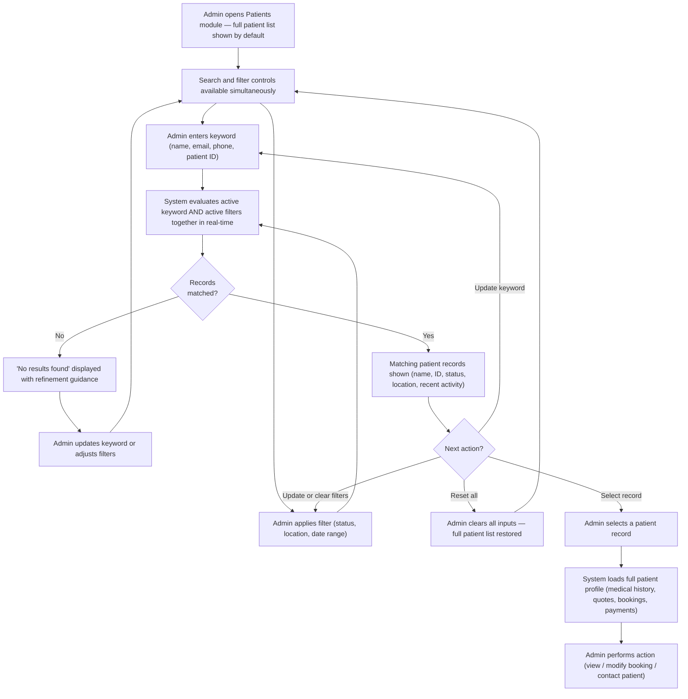
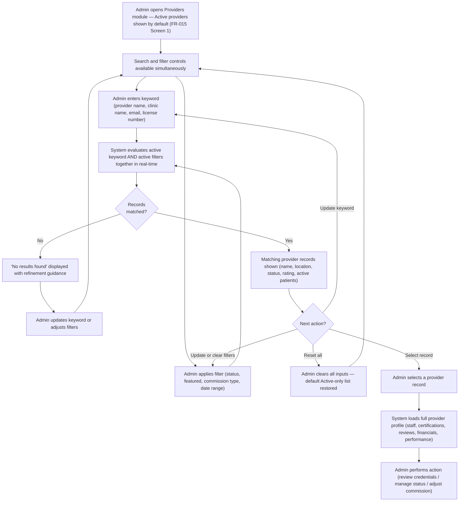
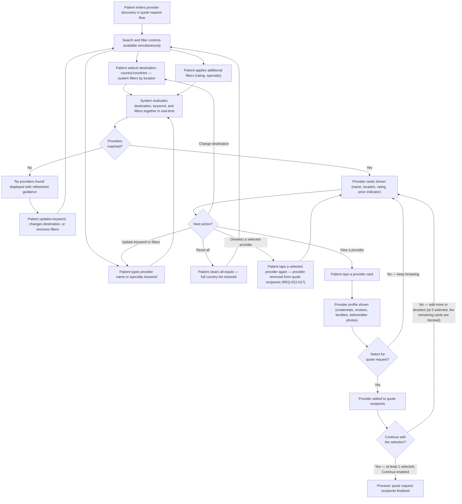
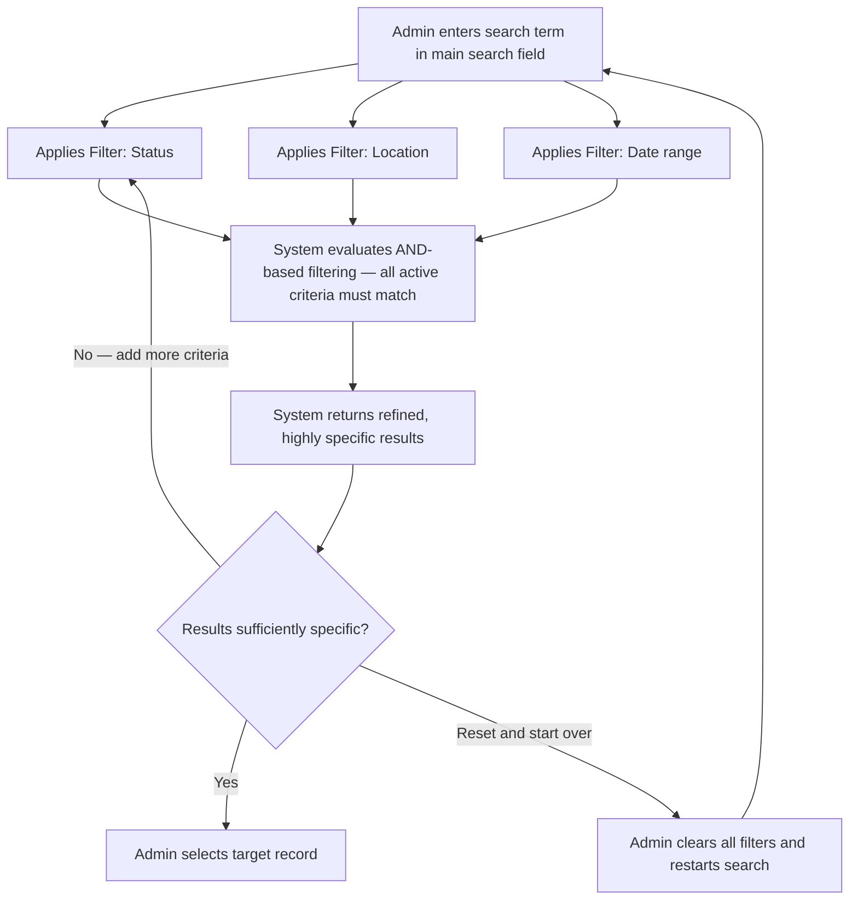
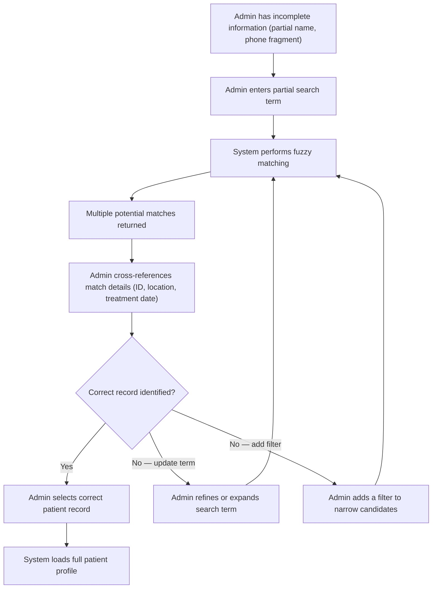
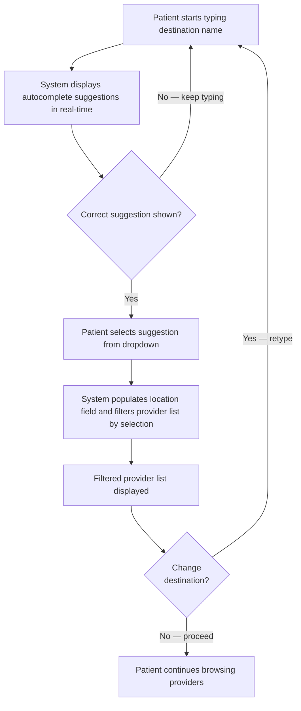
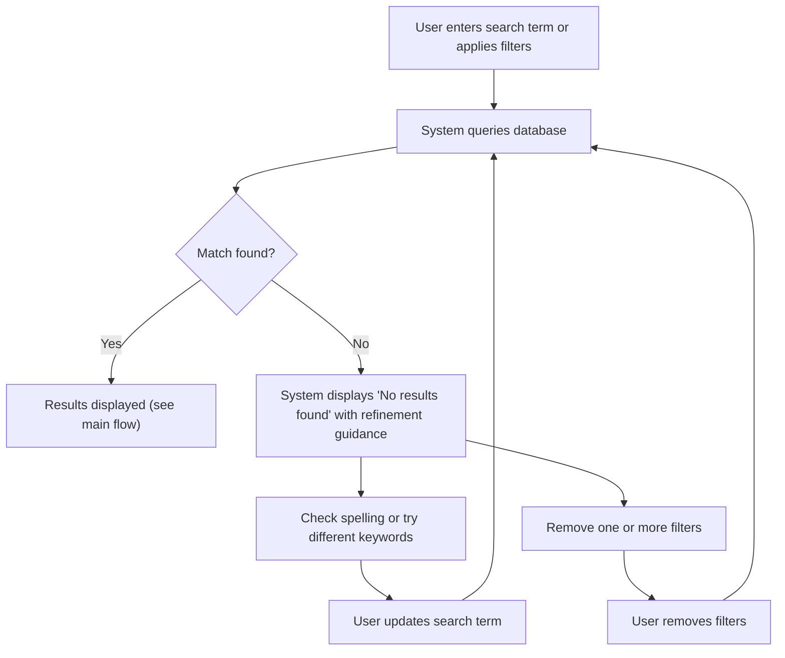
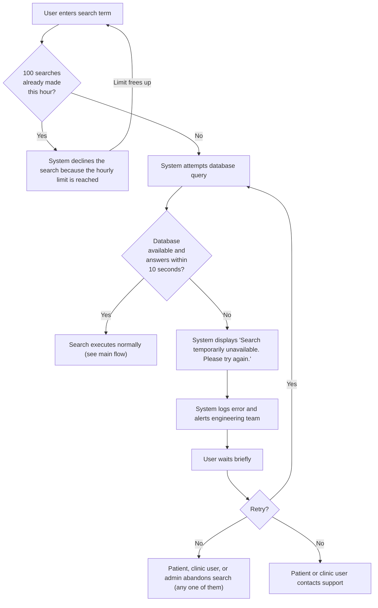

# FR-022 - Search & Filtering

**Module**: P-02: Quote Request & Management | P-06: Communication | P-08: Help & Support | PR-01: Provider Team | PR-02: Inquiry & Quote Management | PR-03: Treatment Execution & Documentation | PR-04: Aftercare Participation | PR-05: Financial Management & Reporting | PR-06: Profile & Settings Management | PR-07: Communication & Messaging | A-01: Patient Management & Oversight | A-02: Provider Management & Onboarding | A-03: Aftercare Team Management | A-05: Billing & Financial Reconciliation | A-06: Discount & Promotion Management | A-07: Affiliate Program Management | A-09: System Settings & Configuration | A-10: Communication Monitoring & Support
**Feature Branch**: `fr022-search-filtering`
**Created**: 2025-11-12
**Status**: 🟡 Revised — Pending Consolidated Verification
**Source**: FR-022 from system-prd.md

---

## Executive Summary

Search and filtering capabilities are critical for enabling users to efficiently navigate large datasets across the Hairline platform. This feature provides context-specific search and filter implementations across all three tenants.

The feature spans all three tenants:

- **Patient Platform**: Provider discovery during quote request flow; help center content browsing; support ticket filtering; messaging inbox search/filtering
- **Provider Platform**: Inquiry and quote list management; treatment and aftercare case navigation; analytics filtering; package/settings catalog management; support case tracking; messaging list search/filtering
- **Admin Platform**: Comprehensive patient, provider, and transaction search with advanced filtering across all operational modules

**Priority breakdown**:

- **P1 (MVP)**: Provider Platform operational modules (PR-01 through PR-07, including FR-012 messaging search and filtering), the patient messaging inbox (P-06) and Admin Platform (A-01, A-02, A-03, A-05, A-06, A-07, A-09, A-10) — these are essential for platform operations and day-to-day provider and admin workflows
- **P2 (Post-MVP)**: Patient-facing provider search (P-02 provider selection) — deferred until its source FR scope is scheduled.

> **Maintenance Convention**: This FR is the single source of truth for all search and filter criteria across the platform. When any source FR updates its filter or search field list, this document must be updated accordingly. See the Master Reference Table in the Screen Specifications section for the full inventory.

---

## Module Scope

### Multi-Tenant Architecture

- **Patient Platform (P-02, P-06, P-08)**: Provider search for quote request (P2); help center and support ticket filtering (P1 - MVP); messaging inbox search/filtering (P1 - MVP). _(Patient booking list search/filter is pending FR-006 update — see deferred items below.)_
- **Provider Platform (PR-01, PR-02, PR-03, PR-04, PR-05, PR-06, PR-07)**: Search and filtering across provider workflows — team directory, inquiries, quotes, treatment cases, aftercare cases, analytics, packages, reviews, and support cases (P1 - MVP); provider messaging list search/filtering (PR-07, P1 - MVP)
- **Admin Platform (A-01, A-02, A-03, A-05, A-06, A-07, A-09, A-10)**: Comprehensive search and filtering across all admin operations — patient management, provider management, aftercare oversight, billing, affiliates, discount codes, system settings, help centre, and communication monitoring (P1 - MVP)
- **Shared Services**: None (search logic implemented within each tenant's backend)

### Multi-Tenant Breakdown

**Patient Platform** [Mixed Priority]:

- **P2 — Post-MVP**: Search providers by name and specialty; filter by country and rating (P-02 quote request flow, per FR-003 Screen 7a) (REQ-022-013, REQ-022-014)
- **P1 — MVP**: Search and filter messages inbox by provider/content and read status (P-06, per FR-012) (REQ-022-070)
- **P1 — MVP**: Search help center content; filter support tickets by status (P-08) (REQ-022-051, REQ-022-052)

**Provider Platform** [Mixed Priority]:

- **P1 — MVP / Team Management (PR-01)**: Search and filter team directory by name, role, status. _(Activity log and work queue filter specs are defined in FR-009 Screen 6; see FR-009 as source of truth for those.)_ (REQ-022-044)
- **P1 — MVP / Inquiry & Quote Management (PR-02)**: Search and filter inquiries by patient ID, concern, date, alerts, location (patient name excluded from search pre-payment confirmation); search and filter quotes by status, concern, location, alerts (REQ-022-033, REQ-022-034, REQ-022-035, REQ-022-036)
- **P1 — MVP / Treatment Execution (PR-03)**: Search and filter treatment cases by patient ID, name, booking reference; filter by date and clinician (REQ-022-037, REQ-022-038)
- **P1 — MVP / Aftercare Participation (PR-04)**: Search and filter aftercare cases by patient; filter by milestone, status, and date (REQ-022-039)
- **P1 — MVP / Financial Management (PR-05)**: Filter analytics dashboard by date range and treatment type (REQ-022-040)
- **P1 — MVP / Profile & Settings (PR-06)**: Search Help Centre content globally; filter provider FAQs by topic; filter Resource Library content by category and file type; filter reviews by rating; search and filter support cases by case ID, title, description, message content, status, type, and creation date range (REQ-022-042, REQ-022-043)
- **P1 — MVP / Communication & Messaging (PR-07)**: Search and filter provider message threads via FR-012 secure messaging

**Admin Platform (A-01, A-02, A-03, A-05, A-06, A-07, A-09, A-10)** [P1 - MVP]:

- **Patient Search & Filtering (A-01)**: Search patients by name, email, phone, patient ID (HPID format); filter by status, location, registration date (REQ-022-001, REQ-022-002)
- **Provider Search & Filtering (A-02)**: Search providers by provider name, clinic name, email, and license number; filter by status, featured designation, commission type, and creation/last activity date (REQ-022-003, REQ-022-004)
- **Aftercare Team Management (A-03)**: Search aftercare cases by case ID; filter by provider, milestone, case status, date range, risk level, specialist assignment, completion rate (FR-011 / Screen 13)
- **Billing & Financial Reconciliation (A-05)**: Search and filter invoices, transactions, the billing audit log, installment plans and affiliate payouts as set out on their owning screens (FR-017 / Screens 4 and 7, FR-007b / Screen 5, FR-018 / Screen 7)
- **Discount & Promotion Management (A-06)**: Search and filter discount codes by code, provider participation, status, usage, date range, ROI
- **Affiliate Program Management (A-07)**: Search affiliates by name and email; filter by status, country/region, affiliate type, language, performance tier, campaign eligibility, payout setup (FR-018 / Screen 1); affiliate payout history has its own search and filters (FR-018 / Screen 7)
- **System Settings & Configuration (A-09)**: Search and filter settings by category, version, admin user; filter configurations by module, status, effective date. Change history is read in the admin audit trail (FR-031 / Screen 5, User Detail & Audit Trail)
- **Communication Monitoring & Support (A-10)**: Search and filter conversations (FR-012 / Screen 5) and support cases (FR-034 / Screen 1) as set out on those screens

**Shared Services**:

- Search functionality implemented within each tenant's backend
- No shared search service required for MVP

### Communication Structure

**In Scope**:

- None - this feature is data query and display only

**Out of Scope**:

- Notifications for saved searches or alerts (future enhancement)
- Real-time search suggestions via messaging (future enhancement)

### Entry Points

**Patient Platform** [Mixed Priority]: (REQ-022-059)

- **P2 / Provider Search**: Accessed when patient begins quote request flow and needs to select destination/providers
- **P2 / Provider Search**: Triggered from "Choose Destination" or "Select Providers" screens
- **P2 / Provider Search**: Available throughout quote request journey for comparison
- **P1 / Messaging**: Accessed from the patient communications inbox
- **P1 / Help & Support**: Accessed from the Help & Support hub, Help Center, and My Support Tickets screens

**Provider Platform** [Mixed Priority]: (REQ-022-059)

- **PR-01 (Team)**: Accessed from Provider Dashboard → Team tab → Team Directory (FR-009/Screen 10)
- **PR-02 (Inquiries/Quotes)**: Accessed from Provider Dashboard → Inquiries tab → Inquiry List (FR-003/Screen 9) and Quotes List (FR-004/Screen 2)
- **PR-03 (Treatment)**: Accessed from Provider Dashboard → Treatments tab → In Progress Cases (FR-010/Screen 3)
- **PR-04 (Aftercare)**: Accessed from Provider Dashboard → Aftercare tab → Aftercare Cases List (FR-011/Screen 8)
- **PR-05 (Analytics)**: Accessed from Provider Dashboard → Analytics tab → Analytics Dashboard (FR-014/Screen 1)
- **PR-06 (Profile/Settings)**: Accessed from Provider Dashboard → Profile/Settings section — Packages (FR-024/Screen 4), Help Centre (FR-032/Screen 5), Reviews (FR-032/Screen 1 Tab 5), Support Cases (FR-032/Screen 5.7)
- **PR-07 (Messaging) [P1 - MVP]**: Accessed from the provider secure messaging inbox

**Admin Platform** [P1 - MVP]: (REQ-022-059)

- **Module-Specific Search**: Each admin module (A-01 through A-10) provides context-specific search and filtering within its own interface

---

## Business Workflows

### Main Flow 1: Admin Patient Search & Filter (P1 - MVP)

**Actors**: Admin, System
**Trigger**: Admin needs to find patient record(s) for support, inquiry status check, or booking modification — using keyword search, filters, or both
**Outcome**: Admin finds relevant patient(s) and views details (REQ-022-060, REQ-022-061)

**Flow Diagram**:

### Main Flow 2: Admin Provider Search & Filter (P1 - MVP)

**Actors**: Admin, System
**Trigger**: Admin needs to find provider(s) for onboarding verification, performance review, or billing — using keyword search, filters, or both
**Outcome**: Admin finds relevant provider(s) and views details (REQ-022-060, REQ-022-061)

**Flow Diagram**:

### Main Flow 3: Patient Provider Search & Filter [P2 - Post-MVP]

**Actors**: Patient, System
**Trigger**: Patient begins quote request and needs to discover and select providers — using destination selection, keyword search, filters, or any combination
**Outcome**: Patient discovers and selects 1 to 5 providers for a quote request and continues with at least 1 selected (REQ-022-060, REQ-022-061, REQ-022-017)

**Flow Diagram**:

### Alternative Flows

**A1: Admin uses multiple search criteria simultaneously**

- **Trigger**: Admin needs a highly specific patient or provider match and a single search term returns too many unrelated results
- **Outcome**: Admin finds exact record efficiently by stacking filters
- **Flow Diagram**:

**A2: Admin searches by partial information**

- **Trigger**: Admin has incomplete patient information (partial name, phone fragment)
- **Outcome**: Admin finds patient despite incomplete information
- **Flow Diagram**:

**A3: Patient uses autocomplete for location search** [P2 - Post-MVP]

- **Trigger**: Patient begins typing a country name in the Destination field of Screen 7a (REQ-022-015)
- **Outcome**: Faster input with reduced typos and immediate provider filtering
- **Flow Diagram**:

**B1: Search returns no results**

- **Actors**: Patient, clinic user, or admin (any one of them; each searches on their own and none depends on another), System
- **Trigger**: Search term or filter combination matches no records
- **Outcome**: Clear feedback guides user to refine or reset criteria (REQ-022-062)
- **Flow Diagram**:

**B2: Search system unavailable (database connection failure)**

- **Actors**: Patient, clinic user, or admin (any one of them; each searches on their own and none depends on another), System
- **Trigger**: Backend database connection fails during a search query, the query runs longer than 10 seconds (REQ-022-136), or the user has already made 100 searches in the past hour (REQ-022-025)
- **Outcome**: Graceful error handling with retry capability and engineering alert (REQ-022-063)
- **Flow Diagram**:

---

## Screen Specifications

> **Maintenance Convention**: This section is the **single source of truth** for all search and filter criteria across the Hairline platform. Whenever a source FR is updated — adding, removing, or renaming search fields or filter criteria — the relevant screen entry below **must** be updated to reflect the change. This ensures FR-022 remains the definitive reference for all search and filtering behavior platform-wide. The same living-document protocol applies to FR-020 for notification events: when that catalog changes, FR-020 is updated; when any list screen's filters change, FR-022 is updated.

---

### Master Reference Table

The table below maps every platform screen that requires search and/or filter functionality, organized by tenant, module, and FR. Screen codes use the format `FR-XXX / Screen N` (or `FR-XXX / Screen N / Tab M` for tab-level screens), matching the screen numbering defined in each source FR. Use the screen code to locate the detailed spec below.

| Tenant | Module | FR | Screen Name | Screen Code | Search | Filter | Priority |
|--------|--------|----|-------------|-------------|--------|--------|----------|
| Patient | P-02 | FR-003 | Provider Selection | `FR-003 / Screen 7a` | ✓ | ✓ | P2 |
| Patient | P-02 | FR-005 | Quote Comparison List | `FR-005 / Screen 1` | — | ✓ | P1 |
| Patient | P-06 | FR-012 | Patient Messages Inbox | `FR-012 / Screen 1` | ✓ | ✓ | P1 |
| Patient | P-08 | FR-035 | Help & Support Hub | `FR-035 / Screen 1` | ✓ | — | P1 |
| Patient | P-08 | FR-035 | Help Center | `FR-035 / Screen 2` | ✓ | ✓ | P1 |
| Patient | P-08 | FR-035 | My Support Tickets | `FR-035 / Screen 3` | — | ✓ | P1 |
| Provider | PR-01 | FR-009 | Team Directory | `FR-009 / Screen 10` | ✓ | ✓ | P1 |
| Provider | PR-02 | FR-003 | Provider Inquiry List | `FR-003 / Screen 9` | ✓ | ✓ | P1 |
| Provider | PR-02 | FR-004 | Provider Quote List | `FR-004 / Screen 2` | ✓ | ✓ | P1 |
| Provider | PR-03 | FR-010 | In Progress Cases | `FR-010 / Screen 3` | ✓ | ✓ | P1 |
| Provider | PR-04 | FR-011 | Aftercare Cases List | `FR-011 / Screen 8` | ✓ | ✓ | P1 |
| Provider | PR-05 | FR-014 | Provider Analytics Dashboard | `FR-014 / Screen 1` | — | ✓ | P1 |
| Provider | PR-06 | FR-024 | Provider Package List | `FR-024 / Screen 4` | ✓ | ✓ | P1 |
| Provider | PR-06 | FR-032 | Help Centre | `FR-032 / Screen 5` | ✓ | — | P1 |
| Provider | PR-06 | FR-032 | FAQs | `FR-032 / Screen 5.1` | — | ✓ | P1 |
| Provider | PR-06 | FR-032 | Resource Library | `FR-032 / Screen 5.3` | — | ✓ | P1 |
| Provider | PR-06 | FR-032 | Reviews Tab | `FR-032 / Screen 1 / Tab 5` | — | ✓ | P1 |
| Provider | PR-07 | FR-012 | Provider Messages List | `FR-012 / Screen 3` | ✓ | ✓ | P1 |
| Provider | PR-06 | FR-032 | My Support Cases | `FR-032 / Screen 5.7` | ✓ | ✓ | P1 |
| Admin | A-01 | FR-003 | Hairline Overview Dashboard | `FR-003 / Screen 11` | ✓ | ✓ | P1 |
| Admin | A-01 | FR-004 | Global Quote Table | `FR-004 / Screen 5` | ✓ | ✓ | P1 |
| Admin | A-01 | FR-005 | Quote Acceptance Table | `FR-005 / Screen 5` | — | ✓ | P1 |
| Admin | A-01 | FR-006 | Admin Bookings Table | `FR-006 / Screen 5` | ✓ | ✓ | P1 |
| Admin | A-01 | FR-007 | Patient Payment Progress Dashboard | `FR-007 / Screen 5` | ✓ | ✓ | P1 |
| Provider | PR-06 | FR-013 | Provider Reviews List & Filters | `FR-013 / Screen 5` | ✓ | ✓ | P1 |
| Admin | A-01 | FR-013 | Review Management Dashboard | `FR-013 / Screen 7` | ✓ | ✓ | P1 |
| Admin | A-01 | FR-016 | Patient Management List | `FR-016 / Screen 1` | ✓ | ✓ | P1 |
| Admin | A-01 | FR-016 | Admin Actions Audit Log | `FR-016 / Screen 7` | — | ✓ | P1 |
| Admin | A-01 | FR-016 | Pending Data Requests | `FR-016 / Screen 8` | ✓ | ✓ | P1 |
| Admin | A-02 | FR-015 | Provider Management List | `FR-015 / Screen 1` | ✓ | ✓ | P1 |
| Admin | A-02 | FR-015 | Provider Reviews Tab | `FR-015 / Screen 3 / Tab 5` | ✓ | ✓ | P1 |
| Admin | A-02 | FR-015 | Provider Documents List | `FR-015 / Screen 3 / Tab 6` | — | ✓ | P1 |
| Admin | A-03 | FR-011 | Admin Aftercare Cases List | `FR-011 / Screen 13` | ✓ | ✓ | P1 |
| Admin | A-05 | FR-007b | Installment Plans List | `FR-007b / Screen 5` | — | ✓ | P1 |
| Admin | A-05 | FR-017 | Patient Billing Invoices | `FR-017 / Screen 4` | ✓ | ✓ | P1 |
| Admin | A-05 | FR-017 | Transaction Search | `FR-017 / Screen 7 / Tab 1` | ✓ | ✓ | P1 |
| Admin | A-05 | FR-017 | Billing Audit Log | `FR-017 / Screen 7 / Tab 2` | — | ✓ | P1 |
| Admin | A-05 | FR-018 | Affiliate Payout Status & History | `FR-018 / Screen 7` | ✓ | ✓ | P1 |
| Admin | A-06 | FR-019 | Promotion Program Hub | `FR-019 / Screen 1` | ✓ | ✓ | P1 |
| Admin | A-07 | FR-018 | Affiliate Management List | `FR-018 / Screen 1` | ✓ | ✓ | P1 |
| Admin | A-09 | FR-024 | Admin Treatment Catalog | `FR-024 / Screen 1` | ✓ | ✓ | P1 |
| Admin | A-09 | FR-025 | Questionnaire Catalog | `FR-025 / Screen 1` | ✓ | ✓ | P1 |
| Admin | A-09 | FR-027 | Legal Documents List | `FR-027 / Screen 1` | — | ✓ | P1 |
| Admin | A-09 | FR-027 | User Acceptance List | `FR-027 / Screen 4A` | ✓ | ✓ | P1 |
| Admin | A-09 | FR-029 | Provider Commission Search | `FR-029 / Screen 5` | ✓ | — | P1 |
| Admin | A-09 | FR-029 | Currency Configuration | `FR-029 / Screen 6` | ✓ | — | P1 |
| Admin | A-09 | FR-030 | Notification Rules Dashboard | `FR-030 / Screen 1` | ✓ | ✓ | P1 |
| Admin | A-09 | FR-031 | Admin Users List | `FR-031 / Screen 1 / Tab 2` | ✓ | ✓ | P1 |
| Admin | A-09 | FR-031 | Permission Matrix | `FR-031 / Screen 4 / Matrix Comparison View` | ✓ | ✓ | P1 |
| Admin | A-09 | FR-031 | User Detail & Audit Trail | `FR-031 / Screen 5` | — | ✓ | P1 |
| Admin | A-09 | FR-033 | FAQ Management | `FR-033 / Screen 2` | ✓ | ✓ | P1 |
| Admin | A-09 | FR-033 | Article Management | `FR-033 / Screen 3` | ✓ | ✓ | P1 |
| Admin | A-09 | FR-033 | Resource Management | `FR-033 / Screen 4` | ✓ | ✓ | P1 |
| Admin | A-09 | FR-033 | Video Management | `FR-033 / Screen 5` | ✓ | ✓ | P1 |
| Admin | A-10 | FR-012 | Communication Monitoring Center | `FR-012 / Screen 5` | ✓ | ✓ | P1 |
| Admin | A-10 | FR-034 | Support Center Dashboard | `FR-034 / Screen 1` | ✓ | ✓ | P1 |

---

### Control Behavior Standards

The states below apply uniformly to every screen in this document. Individual screen entries list only the field/filter tables. Any screen-specific deviation is noted inline under that screen.

| State | View | Trigger | UI Behavior | System Behavior | Visual Indicator |
|-------|------|---------|-------------|-----------------|------------------|
| Search Inactive | Search | Default; no input in search field | Placeholder text shown; full default list visible | No query fired; list displays default results | Dimmed placeholder text; neutral input border [REQ-022-064] |
| Search Active | Search | User types in search field | Typed text visible; clear (×) button appears | Debounced query fires (300–500ms per screen spec); list filters to matching results | Active input border; clear (×) button visible [REQ-022-064] |
| Filter Inactive | Filter | Default; no filters applied | Filter button in neutral state; no filter chips visible | Default query runs; full result set shown | Neutral filter icon; no chips [REQ-022-065] |
| Filter Active | Filter | One or more filter controls changed from default | Active filter chips shown below filter bar; filter button highlighted | AND-logic applied across all active filters; list narrows; result count updates | Highlighted filter icon; active chips visible [REQ-022-065] |
| Reset Filter | Filter | User taps "Clear Filters" / "Reset" / selects default option | All filter controls return to their default values; chips cleared | All filter parameters cleared; default result set restored | Chips removed; filter icon returns to neutral [REQ-022-065] |

**Filter Logic Note**: AND logic applies _across_ different active filter types simultaneously — a result must satisfy all active filter conditions at once. Within a single multi-select filter field, selected values are combined with OR logic — a result matches if it satisfies _any_ of the selected values for that field. The "OR (within field)" label in the Logic column of multi-select filter tables reflects this within-field OR behavior. (REQ-022-066)

---

### 1. Patient Platform Screens

---

#### Module P-02 — Quote Request & Management

##### FR-003 Inquiry Submission

---

###### FR-003 / Screen 7a: Provider Selection [P2 — Post-MVP]

**Purpose**: Patient searches for and selects providers during the quote request flow. (REQ-022-067)

_For UI state behaviors (inactive, active, reset), see [Control Behavior Standards](#control-behavior-standards) above. Document any screen-specific exceptions inline._

**Search View**

| Field | Type | Placeholder | Debounce | Max Length | Notes | Graph field |
|-------|------|-------------|----------|------------|-------|---------------|
| Provider name / keyword | text | "Search providers…" | 500ms | 50 chars | Case-insensitive; matches provider name and specialty tags | no graph field (control) |
| Destination | text with autocomplete | "Search destination…" | 500ms | 50 chars | Suggests destination countries as the patient types (maximum 10 suggestions, cached 5 minutes); picking a suggestion adds the country to Country / Destination below (REQ-022-015, REQ-022-126, REQ-022-029) | no graph field (control) |

**Filter View**

| Filter | Type | Options | Default | Logic | Graph field |
|--------|------|---------|---------|-------|---------------|
| Country / Destination | Multi-select chips | Patient's previously selected destination countries | All selected countries | OR (within field) | no graph field (control) |
| Rating | Star selector | All, 4+ stars, 4.5+ stars | All | Min threshold | no graph field (control) |
| Specialty | Dropdown | Hair Transplant, Beard Transplant, Both | All | Exact match | no graph field (control) |
| Sort By | Dropdown | Recommended, Rating, Price, Experience | The default provider sort order set by an admin (Recommended until an admin changes it) | Single selection; Recommended order follows the featured providers list (REQ-022-130) | no graph field (control) |

> Only Active providers are listed, so the screen has no Active Status control (REQ-022-131). There is no Available Capacity filter or sort at launch because no screen or record holds provider capacity.

---

##### FR-005 Quote Comparison & Acceptance

---

###### FR-005 / Screen 1: Quote Comparison List [P1 — MVP]

**Purpose**: Patient sorts and filters complete subquotes across received parent quotes before accepting one subquote.

_For UI state behaviors (inactive, active, reset), see [Control Behavior Standards](#control-behavior-standards) above. Document any screen-specific exceptions inline._

> No search input on this screen — filtering and sorting only.

**Filter View**

| Filter | Type | Options | Default | Logic | Graph field |
|--------|------|---------|---------|-------|---------------|
| Sort By | Dropdown | Price (Low–High), Price (High–Low), Graft Count, Rating, Appointment Date, Quote Date | Quote Date (most recent) | Single selection; evaluates subquote-owned values and inherited parent/provider values | no graph field (control) |
| Date Range | Filter chips | Patient's submitted date ranges | All | Narrows to subquotes whose selected Option/Date-Price Record uses that range | no graph field (control) |

**Sort basis**: Price sorts use each subquote's price after promotion where a promotion applies, otherwise its offered price, both as shown on FR-005 / Screen 1 (the offered price is the price before any promotion, REQ-005-050); the price per graft is not used for price sorting. For ordering only, each price is converted to the patient's display currency at the current rate; each card still shows its own quote currency, and when the listed subquotes use more than one currency the price order is labelled approximate. Subquotes with the same sort value are ordered by parent quote send date (most recent first), then by option order within the parent quote, then by date range start. Subquotes that cannot currently be accepted (Not Selected, Expired, Withdrawn or Cancelled) stay in the list, shown disabled as in FR-005, and sort after all eligible subquotes. Each list row and each counted result is one subquote. (REQ-022-069)

---

#### Module P-06 — Communication

##### FR-012 Secure Messaging

---

###### FR-012 / Screen 1: Patient Messages Inbox [P1 — MVP]

**Purpose**: Patient searches and filters their conversation inbox to find specific messages or providers. (REQ-022-070)

_For UI state behaviors (inactive, active, reset), see [Control Behavior Standards](#control-behavior-standards) above. Document any screen-specific exceptions inline._

**Search View**

| Field | Type | Placeholder | Debounce | Min Length | Notes | Graph field |
|-------|------|-------------|----------|------------|-------|---------------|
| Provider name / message content | text | "Search messages…" | 300ms | 2 chars | Searches across provider name and message body | no graph field (control) |

**Filter View**

| Filter | Type | Options | Default | Logic | Graph field |
|--------|------|---------|---------|-------|---------------|
| Read Status | Segmented control / tabs | All, Unread, Read | All | Single selection | no graph field (control) |

---

#### Module P-08 — Help & Support

##### FR-035 Patient Help & Support

---

###### FR-035 / Screen 1: Help & Support Hub [P1 — MVP]

**Purpose**: Patient searches help content from the support entry hub before deciding whether to browse content or open a support request. (REQ-022-071)

_For UI state behaviors (inactive, active, reset), see [Control Behavior Standards](#control-behavior-standards) above. Document any screen-specific exceptions inline._

**Search View**

| Field | Type | Placeholder | Debounce | Notes | Graph field |
|-------|------|-------------|----------|-------|---------------|
| Search Bar | text | "Search help articles..." | 500ms | Full-text server search across all published patient-audience content (FAQs, Articles, Resources, Videos); results are relevance-ranked, open on the Help Center Browser (Screen 2) and must surface a Contact Support path when no match is found (REQ-035-036) | no graph field (control) |

> No filter controls on this screen — search-only entry point into the patient help system.

---

###### FR-035 / Screen 2: Help Center [P1 — MVP]

**Purpose**: Patient searches for help articles and browses content by type. (REQ-022-072)

_For UI state behaviors (inactive, active, reset), see [Control Behavior Standards](#control-behavior-standards) above. Document any screen-specific exceptions inline._

**Search View**

| Field | Type | Placeholder | Debounce | Notes | Graph field |
|-------|------|-------------|----------|-------|---------------|
| Help content search | text | "Search help articles…" | 500ms | Full-text server search across all patient-audience FAQs, articles, resources, and videos; auto-suggests results while typing (REQ-022-132) | no graph field (control) |

**Filter View**

| Filter | Type | Options | Default | Logic | Graph field |
|--------|------|---------|---------|-------|---------------|
| Content Type | Segmented chips / cards | All, FAQs, Articles, Resources, Videos | All | Single selection | no graph field (control) |
| Article Subtype | Filter chips (conditional) | All, Tutorial Guides, Troubleshooting Tips | All | Shown only when "Articles" type is selected | no graph field (control) |

---

###### FR-035 / Screen 3: My Support Tickets [P1 — MVP]

**Purpose**: Patient filters their support ticket list by status. (REQ-022-073)

_For UI state behaviors (inactive, active, reset), see [Control Behavior Standards](#control-behavior-standards) above. Document any screen-specific exceptions inline._

> No search input on this screen — filtering only.

**Filter View**

| Filter | Type | Options | Default | Logic | Graph field |
|--------|------|---------|---------|-------|---------------|
| Status | Segmented chips | All, Open, In Progress, Resolved, Closed | All | Single selection | no graph field (control) |

---

### 2. Provider Platform Screens

---

#### Module PR-01 — Provider Team

##### FR-009 Provider Team Roles

---

###### FR-009 / Screen 10: Team Directory [P1 — MVP]

**Purpose**: Provider searches for and filters team members within the clinic. (REQ-022-074)

_For UI state behaviors (inactive, active, reset), see [Control Behavior Standards](#control-behavior-standards) above. Document any screen-specific exceptions inline._

**Search View**

| Field | Type | Placeholder | Debounce | Notes | Graph field |
|-------|------|-------------|----------|-------|---------------|
| Name / email / status | text | "Search team members…" | 500ms | Supports wildcard; case-insensitive | no graph field (control) |

**Filter View**

| Filter | Type | Options | Default | Logic | Graph field |
|--------|------|---------|---------|-------|---------------|
| Role | Multi-select | All roles defined in clinic (e.g., Surgeon, Coordinator, Aftercare Specialist) | All | OR (within field) | no graph field (control) |
| Status | Multi-select | Active, Inactive, Pending Invitation | All | OR (within field) | no graph field (control) |
| Region | Dropdown | All; admin-defined region list | All | Exact match | no graph field (control) |
| Role Compatibility | Context filter (conditional) | Shown during reassignment workflows only | — | Filters members eligible for role reassignment | no graph field (control) |

---

#### Module PR-02 — Inquiry & Quote Management

##### FR-003 Inquiry Submission

---

###### FR-003 / Screen 9: Provider Inquiry List [P1 — MVP]

**Purpose**: Provider searches for and filters incoming patient inquiries. (REQ-022-075)

_For UI state behaviors (inactive, active, reset), see [Control Behavior Standards](#control-behavior-standards) above. Document any screen-specific exceptions inline._

**Search View**

| Field | Type | Placeholder | Debounce | Notes | Graph field |
|-------|------|-------------|----------|-------|---------------|
| Patient ID | text | "Search by patient ID…" | 500ms | Case-insensitive; fuzzy match; patient name excluded from search field until booking payment confirmed | no graph field (control) |

**Filter View**

| Filter | Type | Options | Default | Logic | Graph field |
|--------|------|---------|---------|-------|---------------|
| Patient Age Range | Range slider | 18–100 | All ages | Min–Max range | no graph field (control) |
| Concern | Multi-select | Hair Transplant, Beard Transplant, Both | All | OR (within field) | no graph field (control) |
| Requested Date Range | Date range picker | Custom | All dates | Overlaps with inquiry dates | no graph field (control) |
| Medical Alerts | Multi-select chips | None, Standard, Critical | All | OR (within field) | no graph field (control) |
| Patient Location | Dropdown | All; country list from DB | All | Exact match | no graph field (control) |

---

##### FR-004 Quote Submission

---

###### FR-004 / Screen 2: Provider Quote List [P1 — MVP]

**Purpose**: Provider searches for and filters their submitted quotes across all patient inquiries. Each list row and each counted result is one parent quote; its options and date ranges are shown as row attributes and are not counted as separate results. (REQ-022-076)

_For UI state behaviors (inactive, active, reset), see [Control Behavior Standards](#control-behavior-standards) above. Document any screen-specific exceptions inline._

**Search View**

| Field | Type | Placeholder | Debounce | Notes | Graph field |
|-------|------|-------------|----------|-------|---------------|
| Patient ID / inquiry / treatment / date / status / location | text | "Search quotes…" | 500ms | Case-insensitive; fuzzy match across all indexed fields; patient name field excluded until booking payment confirmed | no graph field (control) |

**Filter View**

| Filter | Type | Options | Default | Logic | Graph field |
|--------|------|---------|---------|-------|---------------|
| Quote Status | Multi-select | Draft, Sent, Expired, Withdrawn, Archived, Accepted, Cancelled (Other Accepted), Cancelled (Inquiry Cancelled), Cancelled (Provider Status) | All | OR (within field) | no graph field (control) |
| Date Range | Date range picker | Custom | All dates | Filters by quote creation date | no graph field (control) |
| Concern | Multi-select | Hair Transplant, Beard Transplant, Both | All | OR (within field) | no graph field (control) |
| Patient Location | Dropdown | All; country list from DB | All | Exact match | no graph field (control) |
| Medical Alerts | Multi-select chips | None, Standard, Critical | All | OR (within field) | no graph field (control) |

---

#### Module PR-03 — Treatment Execution

##### FR-010 Treatment Execution

---

###### FR-010 / Screen 3: In Progress Cases [P1 — MVP]

**Purpose**: Provider searches for and filters active treatment cases by patient or clinician. (REQ-022-077)

_For UI state behaviors (inactive, active, reset), see [Control Behavior Standards](#control-behavior-standards) above. Document any screen-specific exceptions inline._

**Search View**

| Field | Type | Placeholder | Debounce | Notes | Graph field |
|-------|------|-------------|----------|-------|---------------|
| Patient ID / name / booking reference | text | "Search cases…" | 500ms | Real-time filter; case-insensitive | no graph field (control) |

**Filter View**

| Filter | Type | Options | Default | Logic | Graph field |
|--------|------|---------|---------|-------|---------------|
| Procedure Date Range | Date range picker | Custom | Current month | Filters by treatment procedure date | no graph field (control) |
| Clinician | Dropdown | All; clinic's active clinicians | All | Exact match | no graph field (control) |

---

#### Module PR-04 — Aftercare Participation

##### FR-011 Aftercare Recovery Management

---

###### FR-011 / Screen 8: Aftercare Cases List [P1 — MVP]

**Purpose**: Provider searches for and filters patient aftercare cases managed by their clinic. (REQ-022-078)

_For UI state behaviors (inactive, active, reset), see [Control Behavior Standards](#control-behavior-standards) above. Document any screen-specific exceptions inline._

**Search View**

| Field | Type | Placeholder | Debounce | Notes | Graph field |
|-------|------|-------------|----------|-------|---------------|
| Patient name / ID | text | "Search aftercare cases…" | 500ms | Debounced; case-insensitive | no graph field (control) |

**Filter View**

| Filter | Type | Options | Default | Logic | Graph field |
|--------|------|---------|---------|-------|---------------|
| Milestone | Dropdown | All; aftercare plan milestone names | All | Exact match | no graph field (control) |
| Case Status | Multi-select | Active, Overdue, Completed | All | OR (within field) | no graph field (control) |
| Date Range | Date range picker | Custom | All dates | Filters by aftercare start date | no graph field (control) |

---

#### Module PR-05 — Financial Management & Reporting

##### FR-014 Provider Analytics & Reporting

---

###### FR-014 / Screen 1: Provider Analytics Dashboard [P1 — MVP]

**Purpose**: Provider filters analytics reports by date range and treatment type. (REQ-022-079)

_For UI state behaviors (inactive, active, reset), see [Control Behavior Standards](#control-behavior-standards) above. Document any screen-specific exceptions inline._

> No search input on this screen — filtering only.

**Filter View**

| Filter | Type | Options | Default | Logic | Graph field |
|--------|------|---------|---------|-------|---------------|
| Date Range | Segmented + custom picker | Today, This week, Last 4 weeks, Last 12 weeks, Custom | Last 4 weeks | Single selection | no graph field (control) |
| Treatment Type | Multi-select | All, FUE, FUT, DHI, Sapphire FUE, and other admin-defined types | All | OR (within field) | no graph field (control) |
| Benchmarks Toggle | Toggle | Show industry benchmarks overlay | Off | Single flag | no graph field (control) |

---

#### Module PR-06 — Profile & Settings

##### FR-024 Treatment Package Management

---

###### FR-024 / Screen 4: Provider Package List [P1 — MVP]

**Purpose**: Provider searches for and filters their published treatment packages. (REQ-022-080)

_For UI state behaviors (inactive, active, reset), see [Control Behavior Standards](#control-behavior-standards) above. Document any screen-specific exceptions inline._

**Search View**

| Field | Type | Placeholder | Debounce | Notes | Graph field |
|-------|------|-------------|----------|-------|---------------|
| Package name | text | "Search packages…" | 300ms | Real-time filter; case-insensitive | no graph field (control) |

**Filter View**

| Filter | Type | Options | Default | Logic | Graph field |
|--------|------|---------|---------|-------|---------------|
| Status | Dropdown | All, Active, Draft, Inactive | All | Exact match | no graph field (control) |

---

##### FR-032 Provider Dashboard Settings

---

###### FR-032 / Screen 5: Help Centre [P1 — MVP]

**Purpose**: Provider searches across Help Centre content from the main support landing page. (REQ-022-081)

_For UI state behaviors (inactive, active, reset), see [Control Behavior Standards](#control-behavior-standards) above. Document any screen-specific exceptions inline._

**Search View**

| Field | Type | Placeholder | Max Length | Notes | Graph field |
|-------|------|-------------|------------|-------|---------------|
| Search Bar | text | Global Help Centre search | 200 chars | Global search across all provider Help Centre content types (FAQs, articles, resources, and videos) with autocomplete suggestions | no graph field (control) |

> No additional filter controls on this landing screen — topic and content-specific filtering occurs in the relevant Help Centre sub-screens.

---

###### FR-032 / Screen 5.1: FAQs [P1 — MVP]

**Purpose**: Provider filters FAQ content by topic within the Help Centre. (REQ-022-082)

_For UI state behaviors (inactive, active, reset), see [Control Behavior Standards](#control-behavior-standards) above. Document any screen-specific exceptions inline._

> No dedicated search input on this screen — FAQ discovery is driven by the global Help Centre search on `FR-032 / Screen 5`, plus the topic filter below.

**Filter View**

| Filter | Type | Options | Default | Logic | Graph field |
|--------|------|---------|---------|-------|---------------|
| FAQ Topic | Category filter | Admin-defined FAQ topics (for example Quote Management, Payment Settings, Aftercare) | All topics | Exact topic filter; updates list instantly | no graph field (control) |

---

###### FR-032 / Screen 5.3: Resource Library [P1 — MVP]

**Purpose**: Provider narrows downloadable Help Centre resources by category and file type. (REQ-022-083)

_For UI state behaviors (inactive, active, reset), see [Control Behavior Standards](#control-behavior-standards) above. Document any screen-specific exceptions inline._

> No dedicated search input is specified on this screen. Resource discovery uses the global Help Centre search on `FR-032 / Screen 5`, while this screen provides category/file-type filtering for the visible resource list.

**Filter View**

| Filter | Type | Options | Default | Logic | Graph field |
|--------|------|---------|---------|-------|---------------|
| Resource Category | Filter | Admin-defined resource categories (for example Templates, Documents, Forms) | All | Exact category filter | no graph field (control) |
| File Type | Filter | Admin-defined file types (for example PDF, DOCX, XLSX) | All | Exact file-type filter | no graph field (control) |

---

###### FR-032 / Screen 1 / Tab 5: Reviews Tab [P1 — MVP]

**Purpose**: Provider reads their patient reviews on this tab, which shows the FR-013 / Screen 5 review list. (REQ-022-084)

_For UI state behaviors (inactive, active, reset), see [Control Behavior Standards](#control-behavior-standards) above. Document any screen-specific exceptions inline._

> The search and filter criteria of this list are those of `FR-013 / Screen 5` (REQ-022-092) and are not repeated here; this tab adds only the sort. Filter and sort selections on this screen persist for the session.

**Filter View**

| Filter | Type | Options | Default | Logic | Graph field |
|--------|------|---------|---------|-------|---------------|
| Sort | Dropdown | Most recent, Highest rated, Lowest rated, Oldest first | Most recent | Single selection | no graph field (control) |

---

###### FR-032 / Screen 5.7: My Support Cases [P1 — MVP]

**Purpose**: Provider searches for and filters support cases they have submitted.

The search and filter criteria for this screen are owned by FR-032 (REQ-032-107), and its default view by FR-034 (REQ-034-114), not by FR-022.

---

##### FR-013 Reviews & Ratings

---

###### FR-013 / Screen 5: Provider Reviews List & Filters [P1 — MVP]

**Purpose**: Provider searches their reviews by reviewer alias and filters them by treatment, rating, date, response status, and source type. (REQ-022-092)

_For UI state behaviors (inactive, active, reset), see [Control Behavior Standards](#control-behavior-standards) above. Document any screen-specific exceptions inline._

**Search View**

| Field | Type | Placeholder | Debounce | Notes | Graph field |
|-------|------|-------------|----------|-------|---------------|
| Reviewer alias | text | "Search by reviewer alias…" | 500ms | Case-insensitive; the list has no patient or case search (REQ-013-009, REQ-013-058) | no graph field (control) |

**Filter View**

| Filter | Type | Options | Default | Logic | Graph field |
|--------|------|---------|---------|-------|---------------|
| Treatment | Dropdown | All; treatments in this provider's reviews | All | Exact match | no graph field (control) |
| Rating | Multi-select star chips | 5★, 4★, 3★, 2★, 1★ | All | OR (within field) | no graph field (control) |
| Date Range | Date range picker | Custom | All dates | Filters by review submission date | no graph field (control) |
| Response Status | Multi-select | No response, Responded | All | OR (within field) | no graph field (control) |
| Source Type | Multi-select | Patient-submitted, Verified Off-platform | All | OR (within field) | no graph field (control) |

---

#### Module PR-07 — Communication & Messaging

##### FR-012 Secure Messaging

---

###### FR-012 / Screen 3: Provider Messages List [P1 — MVP]

**Purpose**: Provider searches for and filters their patient conversations from the header messages list. (REQ-022-085)

_For UI state behaviors (inactive, active, reset), see [Control Behavior Standards](#control-behavior-standards) above. Document any screen-specific exceptions inline._

**Search View**

| Field | Type | Placeholder | Min Length | Debounce | Notes | Graph field |
|-------|------|-------------|-----------|----------|-------|---------------|
| Patient ID / inquiry or quote ID / message content | text | "Search messages…" | 2 chars | 300ms | Filters the conversation list in real time; case-insensitive fuzzy match across Patient ID, inquiry/quote ID, and message content; the patient name is searchable only once the patient has confirmed payment (REQ-022-026) | no graph field (control) |

**Filter View**

| Filter | Type | Options | Default | Logic | Graph field |
|--------|------|---------|---------|-------|---------------|
| Read Status | Toggle | All, Unread Only | All | Exact match | no graph field (control) |
| Date Range | Dropdown | Today, Last 7 days, Last 30 days, All | All | Filters by activity date | no graph field (control) |
| Service Type | Dropdown | All; options from service catalog | All | Exact match | no graph field (control) |

---

### 3. Admin Platform Screens

---

#### Module A-01 — Patient Management & Oversight

##### FR-003 Inquiry Submission

---

###### FR-003 / Screen 11: Hairline Overview Dashboard [P1 — MVP]

**Purpose**: Admin searches for and filters all patient inquiries across all providers. (REQ-022-087)

_For UI state behaviors (inactive, active, reset), see [Control Behavior Standards](#control-behavior-standards) above. Document any screen-specific exceptions inline._

**Search View**

| Field | Type | Placeholder | Debounce | Notes | Graph field |
|-------|------|-------------|----------|-------|---------------|
| Patient ID / name | text | "Search by patient ID or name…" | 500ms | Case-insensitive; fuzzy match | no graph field (control) |

**Filter View**

| Filter | Type | Options | Default | Logic | Graph field |
|--------|------|---------|---------|-------|---------------|
| Patient Location | Dropdown | All; country list from DB | All | Exact match | no graph field (control) |
| Provider Location | Dropdown | All; country list from DB | All | Exact match | no graph field (control) |
| Inquiry Stage | Multi-select | Inquiry, Quoted, Accepted, Confirmed, In Progress, Aftercare, Completed, Cancelled (the inquiry stage list owned by FR-003) | All | OR (within field) | no graph field (control) |
| Payment Status | Dropdown | Unpaid, Deposit Only, Installments Active, Full Paid, Refunded (the payment status list owned by FR-007) | No selection (all) | Exact match | no graph field (control) |
| Date Range | Date range picker | Custom | All dates | Filters by inquiry submission date | no graph field (control) |

---

##### FR-004 Quote Submission

---

###### FR-004 / Screen 5: Global Quote Table [P1 — MVP]

**Purpose**: Admin searches for and filters all quotes across all providers and patients. Each list row and each counted result is one parent quote; its options and date ranges are shown as row attributes and are not counted as separate results. (REQ-022-088)

_For UI state behaviors (inactive, active, reset), see [Control Behavior Standards](#control-behavior-standards) above. Document any screen-specific exceptions inline._

**Search View**

| Field | Type | Placeholder | Debounce | Notes | Graph field |
|-------|------|-------------|----------|-------|---------------|
| Patient ID / name / provider / inquiry | text | "Search quotes…" | 500ms | Case-insensitive; fuzzy match across all indexed fields | no graph field (control) |

**Filter View**

| Filter | Type | Options | Default | Logic | Graph field |
|--------|------|---------|---------|-------|---------------|
| Quote Status | Multi-select | Draft, Sent, Expired, Withdrawn, Archived, Accepted, Cancelled (Other Accepted), Cancelled (Inquiry Cancelled), Cancelled (Provider Status) | All | OR (within field) | no graph field (control) |
| Date Range | Date range picker | Custom | All dates | Filters by quote creation date | no graph field (control) |
| Concern | Multi-select | Hair Transplant, Beard Transplant, Both | All | OR (within field) | no graph field (control) |
| Patient Location | Dropdown | All; country list from DB | All | Exact match | no graph field (control) |
| Provider | Dropdown | All; provider list from DB | All | Exact match | no graph field (control) |
| Medical Alerts | Multi-select chips | None, Standard, Critical | All | OR (within field) | no graph field (control) |

---

##### FR-005 Quote Comparison & Acceptance

---

###### FR-005 / Screen 5: Quote Acceptance Table [P1 — MVP]

**Purpose**: Admin filters the quote acceptance overview by acceptance status. (REQ-022-089)

_For UI state behaviors (inactive, active, reset), see [Control Behavior Standards](#control-behavior-standards) above. Document any screen-specific exceptions inline._

> No search input on this screen — filtering only.

**Filter View**

| Filter | Type | Options | Default | Logic | Graph field |
|--------|------|---------|---------|-------|---------------|
| Acceptance Status | Multi-select | Active, Booking Cancelled, Superseded — Provider Fault | Active | OR (within field) | no graph field (control) |

---

##### FR-006 Booking & Scheduling

---

###### FR-006 / Screen 5: Admin Bookings Table [P1 — MVP]

**Purpose**: Admin searches for and filters all bookings across the platform. (REQ-022-090)

_For UI state behaviors (inactive, active, reset), see [Control Behavior Standards](#control-behavior-standards) above. Document any screen-specific exceptions inline._

**Search View**

| Field | Type | Placeholder | Debounce | Notes | Graph field |
|-------|------|-------------|----------|-------|---------------|
| Booking reference / patient name / patient email / provider name | text | "Search bookings…" | 500ms | Case-insensitive; fuzzy match | no graph field (control) |

**Filter View**

| Filter | Type | Options | Default | Logic | Graph field |
|--------|------|---------|---------|-------|---------------|
| Booking Status | Multi-select | Accepted, Payment Window Expired, Confirmed, In Progress, Aftercare, Completed, Cancelled | All | OR (within field) | no graph field (control) |
| Provider | Dropdown | All; provider list from DB | All | Exact match | no graph field (control) |
| Date Range | Date range picker | Custom | All dates | Filters by booking date | no graph field (control) |
| Treatment Type | Dropdown | All, Hair Transplant, Beard Transplant, Both | All | Exact match | no graph field (control) |
| Payment Status | Multi-select | Unpaid, Deposit Only, Installments Active, Full Paid, Refunded (the payment status list owned by FR-007) | All | OR (within field) | no graph field (control) |
| Deposit Status | Multi-select | Pending, Paid, Partial | All | OR (within field) | no graph field (control) |

---

##### FR-007 Payment Processing

---

###### FR-007 / Screen 5: Patient Payment Progress Dashboard [P1 — MVP]

**Purpose**: Admin searches for and filters payment records by booking, patient, and payment status. (REQ-022-091)

_For UI state behaviors (inactive, active, reset), see [Control Behavior Standards](#control-behavior-standards) above. Document any screen-specific exceptions inline._

**Search View**

| Field | Type | Placeholder | Debounce | Notes | Graph field |
|-------|------|-------------|----------|-------|---------------|
| Booking ID / patient name | text | "Search by booking ID or patient name…" | 500ms | Case-insensitive; fuzzy match | no graph field (control) |

**Filter View**

| Filter | Type | Options | Default | Logic | Graph field |
|--------|------|---------|---------|-------|---------------|
| Provider | Dropdown | All; provider list from DB | All | Exact match | no graph field (control) |
| Deposit Status | Multi-select | Pending, Paid, Partial | All | OR (within field) | no graph field (control) |
| Payment Status | Multi-select | Unpaid, Deposit Only, Installments Active, Full Paid, Refunded (the payment status list owned by FR-007; Overdue is the separate flag below) | All | OR (within field) | no graph field (control) |
| Final Payment Status | Multi-select | Not Due, Due, Paid, Overdue | All | OR (within field) | no graph field (control) |
| Overdue Flag | Toggle | Show overdue only | Off | Single flag | no graph field (control) |
| Date Range | Date range picker | Custom | All dates | Filters by booking date | no graph field (control) |

---

##### FR-013 Reviews & Ratings

---

###### FR-013 / Screen 7: Review Management Dashboard [P1 — MVP]

**Purpose**: Admin filters all platform reviews by date, provider, patient, treatment case, treatment, rating, status, source type, flagged status, and response status. (REQ-022-093)

_For UI state behaviors (inactive, active, reset), see [Control Behavior Standards](#control-behavior-standards) above. Document any screen-specific exceptions inline._

**Search View**

| Field | Type | Placeholder | Debounce | Min Length | Notes | Graph field |
|-------|------|-------------|----------|------------|-------|---------------|
| Patient / provider / case identifier | text | "Search reviews…" | 500ms | 2 chars | Case-insensitive | no graph field (control) |

**Filter View**

| Filter | Type | Options | Default | Logic | Graph field |
|--------|------|---------|---------|-------|---------------|
| Date Range | Date range picker | Custom | All dates | Filters by review submission date | no graph field (control) |
| Provider | Dropdown | All; provider list from DB | All | Exact match | no graph field (control) |
| Patient | Dropdown | All; patient list from DB | All | Exact match | no graph field (control) |
| Treatment Case | Dropdown | All; cases scoped by selected patient/provider | All | Exact match | no graph field (control) |
| Treatment | Dropdown | All; treatment list from DB | All | Exact match | no graph field (control) |
| Rating | Multi-select star chips | 5★, 4★, 3★, 2★, 1★ | All | OR (within field) | no graph field (control) |
| Review Status | Multi-select | Published, Removed | All | OR (within field) — updated per FR-013 v1.10 backend-aligned status vocabulary; `Pending Moderation` / `Rejected` removed | no graph field (control) |
| Source Type | Multi-select | Patient-submitted, Verified Off-platform | All | OR (within field) | no graph field (control) |
| Response Status | Multi-select | No response, Responded | All | OR (within field) | no graph field (control) |
| Flagged | Toggle | Show flagged only (admin-internal `Flagged` state) | Off | Single flag | no graph field (control) |

---

##### FR-016 Admin Patient Management

---

###### FR-016 / Screen 1: Patient Management List [P1 — MVP]

**Purpose**: Admin searches for and filters all registered patients across the platform. (REQ-022-094)

_For UI state behaviors (inactive, active, reset), see [Control Behavior Standards](#control-behavior-standards) above. Document any screen-specific exceptions inline._

**Search View**

| Field | Type | Placeholder | Debounce | Min Length | Notes | Graph field |
|-------|------|-------------|----------|------------|-------|---------------|
| Name / email / patient code (HPID) / phone | text | "Search patients…" | 500ms | 2 chars | Case-insensitive; fuzzy match | no graph field (control) |

**Filter View**

| Filter | Type | Options | Default | Logic | Graph field |
|--------|------|---------|---------|-------|---------------|
| Status | Multi-select | Inquiry, Quoted, Accepted, Confirmed, In Progress, Aftercare, Completed, Cancelled (the FR-003 stage list, per FR-016 Screen 1) | All | OR (within field) | no graph field (control) |
| Account Status | Multi-select | Active, Suspended, Locked (per FR-016 Screen 1) | All | OR (within field) | no graph field (control) |
| Date Range | Date range picker + type toggle | Custom; toggle: Registration Date / Last Activity | All dates — Registration Date | Filters by selected date type | no graph field (control) |
| Location | Dropdown | All; country list from DB | All | Exact match | no graph field (control) |
| Provider | Dropdown | All; provider list from DB | All | Exact match | no graph field (control) |

---

###### FR-016 / Screen 7: Admin Actions Audit Log [P1 — MVP]

**Purpose**: Admin searches for and filters the patient data access and modification audit log. (REQ-022-095)

_For UI state behaviors (inactive, active, reset), see [Control Behavior Standards](#control-behavior-standards) above. Document any screen-specific exceptions inline._

> No search input on this screen — filtering only.

**Filter View**

| Filter | Type | Options | Default | Logic | Graph field |
|--------|------|---------|---------|-------|---------------|
| Action Type | Multi-select | The action types listed on FR-016 / Screen 7 (the list is closed, REQ-016-160) | All | OR (within field) | no graph field (control) |
| Date Range | Date range picker | Custom | All dates | Filters by action timestamp | no graph field (control) |
| Admin User | Dropdown | All; admin user list | All | Exact match | no graph field (control) |
| Show Only My Actions | Toggle | On / Off | Off | Filters to current admin's actions only | no graph field (control) |

---

###### FR-016 / Screen 8: Pending Data Requests [P1 — MVP]

**Purpose**: Admin searches the patient data access and deletion request queue and filters it by request status. (REQ-022-096)

_For UI state behaviors (inactive, active, reset), see [Control Behavior Standards](#control-behavior-standards) above. Document any screen-specific exceptions inline._

**Search View**

| Field | Type | Placeholder | Debounce | Notes | Graph field |
|-------|------|-------------|----------|-------|---------------|
| Patient name / email / HPID | text | "Search requests…" | 500ms | Debounced; case-insensitive; searches the requests the Status filter shows | no graph field (control) |

**Filter View**

| Filter | Type | Options | Default | Logic | Graph field |
|--------|------|---------|---------|-------|---------------|
| Status | Multi-select | Pending Admin Review, Verification Required, In Progress, Fulfilled, Denied (REQ-016-186) | Pending Admin Review | OR (within field) | no graph field (control) |

---

#### Module A-02 — Provider Management & Onboarding

##### FR-015 Provider Management

---

###### FR-015 / Screen 1: Provider Management List [P1 — MVP]

**Purpose**: Admin searches for and filters all provider accounts. (REQ-022-097)

_For UI state behaviors (inactive, active, reset), see [Control Behavior Standards](#control-behavior-standards) above. Document any screen-specific exceptions inline._

**Search View**

| Field | Type | Placeholder | Debounce | Max Length | Notes | Graph field |
|-------|------|-------------|----------|------------|-------|---------------|
| Provider name / clinic name / email / license number | text | "Search providers…" | 500ms | 200 chars | Case-insensitive; fuzzy match | no graph field (control) |

**Filter View**

| Filter | Type | Options | Default | Logic | Graph field |
|--------|------|---------|---------|-------|---------------|
| Status | Multi-select | Active, Suspended, Deactivated | Active | OR (within field); matches FR-015 Screen 1 Default View. Clearing the Status filter shows all statuses | no graph field (control) |
| Featured | Checkbox | Featured only | Off | Single flag | no graph field (control) |
| Commission Type | Dropdown | All, Percentage, Flat Rate | All | Exact match | no graph field (control) |
| Closure Requested | Checkbox | Only providers with a pending FR-032 account-closure request (per FR-015 Screen 1) | Off | Single flag | no graph field (control) |
| Date Range | Date range picker + type toggle | Custom; toggle: Creation Date / Last Activity | All dates — Creation Date | Filters by selected date type | no graph field (control) |

---

###### FR-015 / Screen 3 / Tab 5: Provider Reviews Tab [P1 — MVP]

**Purpose**: Admin searches for and filters reviews within a provider's profile. (REQ-022-098)

_For UI state behaviors (inactive, active, reset), see [Control Behavior Standards](#control-behavior-standards) above. Document any screen-specific exceptions inline._

**Search View**

| Field | Type | Placeholder | Debounce | Notes | Graph field |
|-------|------|-------------|----------|-------|---------------|
| Review keyword | text | "Search reviews…" | 500ms | Fuzzy match on review content | no graph field (control) |

**Filter View**

| Filter | Type | Options | Default | Logic | Graph field |
|--------|------|---------|---------|-------|---------------|
| Rating | Multi-select star chips | 5★, 4★, 3★, 2★, 1★ | All ratings | OR (within field) | no graph field (control) |

---

###### FR-015 / Screen 3 / Tab 6: Provider Documents List [P1 — MVP]

**Purpose**: Admin filters provider-submitted documents by type and uploader. (REQ-022-099)

_For UI state behaviors (inactive, active, reset), see [Control Behavior Standards](#control-behavior-standards) above. Document any screen-specific exceptions inline._

> No search input on this screen — filtering only.

**Filter View**

| Filter | Type | Options | Default | Logic | Graph field |
|--------|------|---------|---------|-------|---------------|
| Document Type | Dropdown | All; admin-defined document types (e.g., Medical License, Insurance, Certification) | All | Exact match | no graph field (control) |
| Uploaded By | Dropdown | All, Provider, Admin | All | Exact match | no graph field (control) |

---

#### Module A-03 — Aftercare Team Management

##### FR-011 Aftercare Recovery Management

---

###### FR-011 / Screen 13: Admin Aftercare Cases List [P1 — MVP]

**Purpose**: Admin searches for and filters all aftercare cases across all providers. (REQ-022-100)

_For UI state behaviors (inactive, active, reset), see [Control Behavior Standards](#control-behavior-standards) above. Document any screen-specific exceptions inline._

**Search View**

| Field | Type | Placeholder | Debounce | Notes | Graph field |
|-------|------|-------------|----------|-------|---------------|
| Case ID | text | "Search by case ID…" | 500ms | Searchable; sortable | no graph field (control) |

**Filter View**

| Filter | Type | Options | Default | Logic | Graph field |
|--------|------|---------|---------|-------|---------------|
| Provider | Dropdown | All; provider list from DB | All | Exact match | no graph field (control) |
| Milestone | Dropdown | All; milestone names from aftercare plan templates | All | Exact match | no graph field (control) |
| Case Status | Multi-select | Active, Overdue, Completed | All | OR (within field) | no graph field (control) |
| Date Range | Date range picker | Custom | All dates | Filters by aftercare start date | no graph field (control) |
| Risk Level | Multi-select | High, Medium, Low | All | OR (within field) | no graph field (control) |
| Specialist Assignment | Dropdown | All; aftercare specialists from DB | All | Exact match | no graph field (control) |
| Completion Rate | Range slider | 0–100% | All | Min threshold | no graph field (control) |

---

#### Module A-05 — Billing & Financial Reconciliation

##### FR-007b Payment Installments

---

###### FR-007b / Screen 5: Installment Plans List [P1 — MVP]

**Purpose**: Admin filters installment plans by plan status and procedure date range. (REQ-022-101)

_For UI state behaviors (inactive, active, reset), see [Control Behavior Standards](#control-behavior-standards) above. Document any screen-specific exceptions inline._

> No search input on this screen — filtering only.

**Filter View**

| Filter | Type | Options | Default | Logic | Graph field |
|--------|------|---------|---------|-------|---------------|
| Plan Status | Multi-select | Active, Completed, Canceled, Defaulted | All | OR (within field) | no graph field (control) |
| Overdue | Toggle (yes/no) | Yes, No | Off (all plans) | AND with other filters; Overdue is a calculated flag (a due date has passed and the installment is unpaid), not a plan status | no graph field (control) |
| Procedure Date Range | Date range picker | Custom | All dates | Filters by procedure date; default sort is nearest upcoming first, overdue/defaulted at top | no graph field (control) |

---

##### FR-017 Admin Billing & Finance

---

###### FR-017 / Screen 4: Patient Billing Invoices [P1 — MVP]

**Purpose**: Admin searches for and filters patient invoices by status and date. (REQ-022-102)

_For UI state behaviors (inactive, active, reset), see [Control Behavior Standards](#control-behavior-standards) above. Document any screen-specific exceptions inline._

**Search View**

| Field | Type | Placeholder | Debounce | Notes | Graph field |
|-------|------|-------------|----------|-------|---------------|
| Patient name | text | "Search by patient name…" | 500ms | Case-insensitive; fuzzy match | no graph field (control) |

**Filter View**

| Filter | Type | Options | Default | Logic | Graph field |
|--------|------|---------|---------|-------|---------------|
| Payment Status | Multi-select | Pending, Partial, Paid, Overdue, Refunded, At Risk | All | OR (within field) | no graph field (control) |
| Date Range | Date range picker | Custom | Last 30 days | Filters by invoice date | no graph field (control) |
| Currency | Dropdown | All; configured currency list | All | Exact match | no graph field (control) |
| Payment Method | Dropdown | All, Full Payment, Installment | All | Exact match | no graph field (control) |

---

###### FR-017 / Screen 7 / Tab 1: Transaction Search [P1 — MVP]

**Purpose**: Admin searches for any financial transaction using multiple lookup fields and narrows results by type, date, and status. (REQ-022-103)

_For UI state behaviors (inactive, active, reset), see [Control Behavior Standards](#control-behavior-standards) above. Document any screen-specific exceptions inline._

**Search View**

| Field | Type | Placeholder | Debounce | Notes | Graph field |
|-------|------|-------------|----------|-------|---------------|
| Search By (type selector) | Dropdown | Booking Reference, Invoice Number, Patient Name/ID, Provider Name/ID, Affiliate Name/ID | Booking Reference | Determines search context | no graph field (control) |
| Search Input | text | Auto-updates per "Search By" selection | 500ms | Free-text; case-insensitive; scoped to selected type | no graph field (control) |

**Filter View**

| Filter | Type | Options | Default | Logic | Graph field |
|--------|------|---------|---------|-------|---------------|
| Record Type | Multi-select | Invoice, Provider Payout, Installment, Refund, Affiliate Commission | All | OR (within field) | no graph field (control) |
| Date Range | Date range picker | Custom | All dates | Filters by transaction date | no graph field (control) |
| Status | Multi-select | Dynamically scoped to selected Record Type(s) — see enumeration below | All | OR (within field) | no graph field (control) |

> **Status options by Record Type** (when multiple Record Types are selected, the union of all applicable statuses is shown):
>
> | Record Type | Status Options |
> |---|---|
> | Invoice | Pending, Partial, Paid, Overdue, Refunded, At Risk |
> | Provider Payout | Pending, Approved, Paid, Voided, Failed |
> | Installment | Active, Completed, Canceled, Defaulted (Overdue is a calculated flag with its own yes/no filter, not a status) |
> | Refund | Processing, Completed, Failed |
> | Affiliate Commission | Pending, Paid, Failed, Cancelled |

---

###### FR-017 / Screen 7 / Tab 2: Billing Audit Log [P1 — MVP]

**Purpose**: Admin filters the billing action audit log by date, admin user, action type, and entity. (REQ-022-104)

_For UI state behaviors (inactive, active, reset), see [Control Behavior Standards](#control-behavior-standards) above. Document any screen-specific exceptions inline._

> No search input on this screen — filtering only.

**Filter View**

| Filter | Type | Options | Default | Logic | Graph field |
|--------|------|---------|---------|-------|---------------|
| Date Range | Date range picker | Custom | Last 30 days | Filters by action timestamp | no graph field (control) |
| Admin User | Dropdown | All; admin user list | All | Exact match | no graph field (control) |
| Action Type | Multi-select | Payout Approved, Payout Unapproved, Payout Voided, Payout Retried, Bulk Approval, Refund Processed, Invoice Generated, Status Overridden, Note Added, Installment Retry, Affiliate Payout Processed, Affiliate Payout Retried, Payout Added to Next Cycle, Reminder Sent, Currency Alert Decision, Re-authentication Verified | All | OR (within field) | no graph field (control) |
| Affected Entity | Multi-select | Invoice, Provider Payout, Installment, Affiliate Commission, Booking, Currency Alert | All | OR (within field) | no graph field (control) |
| Entity ID | text (optional) | "Filter by entity ID…" | 500ms | Optional free-text lookup | no graph field (control) |

---

##### FR-018 Affiliate Management

---

###### FR-018 / Screen 7: Affiliate Payout Status & History [P1 — MVP]

**Purpose**: Admin searches for and filters affiliate payout records. (REQ-022-105)

_For UI state behaviors (inactive, active, reset), see [Control Behavior Standards](#control-behavior-standards) above. Document any screen-specific exceptions inline._

**Search View**

| Field | Type | Placeholder | Debounce | Notes | Graph field |
|-------|------|-------------|----------|-------|---------------|
| Affiliate name / transaction ID / payout month | text | "Search payout history…" | 500ms | Full-text search; case-insensitive | no graph field (control) |

**Filter View**

| Filter | Type | Options | Default | Logic | Graph field |
|--------|------|---------|---------|-------|---------------|
| Affiliate | Dropdown / autocomplete | All; affiliate list | All | Exact selection | no graph field (control) |
| Date Range | Date range picker | Custom | All dates | Filters by payout date | no graph field (control) |
| Payment Status | Multi-select | Pending, Paid, Failed, Cancelled | All | OR (within field) | no graph field (control) |

---

#### Module A-06 — Discount & Promotion Management

##### FR-019 Promotions & Discount Management

---

###### FR-019 / Screen 1: Promotion Program Hub [P1 — MVP]

**Purpose**: Admin searches for and filters all promotion programs across the platform, including Admin-via-Provider, Provider Self-Created, and Hairline-Funded & Direct-Issued programs. (REQ-022-106)

_For UI state behaviors (inactive, active, reset), see [Control Behavior Standards](#control-behavior-standards) above. Document any screen-specific exceptions inline._

See `fr019-promotions-discounts/prd.md → Screen 1` for the finalized result-table layout, row actions, and acceptance criteria. FR-022 remains the authoritative source for the search/filter contract below.

**Search View**

| Field | Type | Placeholder | Debounce | Notes | Graph field |
|-------|------|-------------|----------|-------|---------------|
| Code / keyword | text | "Search promotion programs…" | 500ms | Case-insensitive; fuzzy match on code text, program name, and keyword | no graph field (control) |

**Filter View**

| Filter | Type | Options | Default | Logic | Graph field |
|--------|------|---------|---------|-------|---------------|
| Program Type | Multi-select | Admin-via-Provider, Provider Self-Created, Hairline-Funded & Direct-Issued | All | OR (within field) | no graph field (control) |
| Scope | Multi-select | Reusable, Ad-Hoc Quote-Bound | All | OR (within field) | no graph field (control) |
| Status | Multi-select | Draft, Pending Approval, Active, Paused, Expired, Archived | All | OR (within field) | no graph field (control) |
| Funding Model | Multi-select | Both Fees, Hairline Only, Provider Only | All | OR (within field) | no graph field (control) |
| Provider Participation | Dropdown | All; provider list from DB | All | Exact match | no graph field (control) |
| Date Range | Date range picker | Custom | All dates | Filters by active window overlap | no graph field (control) |
| Usage | Range | 0–Max | All | Min–Max usage count | no graph field (control) |
| ROI | Dropdown | All; admin-defined ROI tiers | All | Exact match | no graph field (control) |

---

#### Module A-07 — Affiliate Program Management

##### FR-018 Affiliate Management

---

###### FR-018 / Screen 1: Affiliate Management List [P1 — MVP]

**Purpose**: Admin searches for and filters affiliate accounts. (REQ-022-107)

_For UI state behaviors (inactive, active, reset), see [Control Behavior Standards](#control-behavior-standards) above. Document any screen-specific exceptions inline._

**Search View**

| Field | Type | Placeholder | Debounce | Notes | Graph field |
|-------|------|-------------|----------|-------|---------------|
| Affiliate name / email | text | "Search affiliates…" | 500ms | Case-insensitive; fuzzy match | no graph field (control) |

**Filter View**

| Filter | Type | Options | Default | Logic | Graph field |
|--------|------|---------|---------|-------|---------------|
| Status | Multi-select | Active, Suspended, Inactive | All | OR (within field) | no graph field (control) |
| Country / Region | Multi-select | Supported affiliate countries/regions | All | OR (within field) | no graph field (control) |
| Affiliate Type | Multi-select | Influencer, Clinic Partner, Organization, Other | All | OR (within field) | no graph field (control) |
| Language | Multi-select | Supported affiliate communication languages | All | OR (within field) | no graph field (control) |
| Performance Tier | Multi-select | Admin-defined performance tiers | All | OR (within field) | no graph field (control) |
| Campaign Eligibility | Multi-select | Eligible, Ineligible | All | OR (within field) | no graph field (control) |
| Payout Setup | Multi-select | Complete, Incomplete | All | OR (within field) | no graph field (control) |

---

#### Module A-09 — System Settings & Configuration

##### FR-024 Treatment Package Management

---

###### FR-024 / Screen 1: Admin Treatment Catalog [P1 — MVP]

**Purpose**: Admin searches for and filters the global treatment catalog. (REQ-022-108)

_For UI state behaviors (inactive, active, reset), see [Control Behavior Standards](#control-behavior-standards) above. Document any screen-specific exceptions inline._

**Search View**

| Field | Type | Placeholder | Debounce | Notes | Graph field |
|-------|------|-------------|----------|-------|---------------|
| Treatment name | text | "Search treatments…" | 300ms | Real-time filter; case-insensitive | no graph field (control) |

**Filter View**

| Filter | Type | Options | Default | Logic | Graph field |
|--------|------|---------|---------|-------|---------------|
| Treatment Type | Dropdown | All; admin-defined treatment types | All | Exact match | no graph field (control) |

---

##### FR-025 Medical Questionnaire Management

---

###### FR-025 / Screen 1: Questionnaire Catalog [P1 — MVP]

**Purpose**: Admin searches for and filters the questionnaire set catalog. (REQ-022-109)

_For UI state behaviors (inactive, active, reset), see [Control Behavior Standards](#control-behavior-standards) above. Document any screen-specific exceptions inline._

**Search View**

| Field | Type | Placeholder | Debounce | Notes | Graph field |
|-------|------|-------------|----------|-------|---------------|
| Set name keyword | text | "Search questionnaire sets…" | 500ms | Fuzzy match on set name; case-insensitive | no graph field (control) |

**Filter View**

| Filter | Type | Options | Default | Logic | Graph field |
|--------|------|---------|---------|-------|---------------|
| Context Type | Dropdown | All, Inquiry, Aftercare, Multi-Context | All | Exact match | no graph field (control) |
| Status | Multi-select | Draft, Active, Archived | All | OR (within field) | no graph field (control) |
| Category | Dropdown | All; admin-defined categories (e.g., Allergies, Cardiovascular) | All | Exact match | no graph field (control) |

---

##### FR-027 Legal Content Management

---

###### FR-027 / Screen 1: Legal Documents List [P1 — MVP]

**Purpose**: Admin filters the legal document catalog by type, status, and locale. (REQ-022-110)

_For UI state behaviors (inactive, active, reset), see [Control Behavior Standards](#control-behavior-standards) above. Document any screen-specific exceptions inline._

> No search input on this screen — filtering only.

**Filter View**

| Filter | Type | Options | Default | Logic | Graph field |
|--------|------|---------|---------|-------|---------------|
| Document Type | Dropdown | All, Terms & Conditions, Privacy Policy, Consent, Cancellation Policy (the four fixed types) | All | Exact match | no graph field (control) |
| Status | Multi-select | Draft, Current, Scheduled, Archived | All | OR (within field) | no graph field (control) |
| Locale | Dropdown | All; configured locale list | All | Exact match | no graph field (control) |

---

###### FR-027 / Screen 4A: User Acceptance List [P1 — MVP]

**Purpose**: Admin searches for and filters user acceptance records for legal documents. (REQ-022-111)

_For UI state behaviors (inactive, active, reset), see [Control Behavior Standards](#control-behavior-standards) above. Document any screen-specific exceptions inline._

**Search View**

| Field | Type | Placeholder | Debounce | Notes | Graph field |
|-------|------|-------------|----------|-------|---------------|
| User name / email / user ID | text | "Search users…" | 500ms | Case-insensitive; fuzzy match | no graph field (control) |

**Filter View**

| Filter | Type | Options | Default | Logic | Graph field |
|--------|------|---------|---------|-------|---------------|
| Acceptance Status | Dropdown | Accepted, Pending | Pending (to focus on outstanding users, REQ-027-056) | Exact match | no graph field (control) |
| Locale | Dropdown | All; configured locale list | All | Exact match | no graph field (control) |

> Document Type (Terms & Conditions, Privacy Policy, Consent) and Version are inherited from the version selected on FR-027 / Screen 4. Acceptance time and last reminder are read-only columns, not filters.

---

##### FR-029 Payment System Config

---

###### FR-029 / Screen 5: Provider Commission Search [P1 — MVP]

**Purpose**: Admin searches for a specific provider when configuring provider-specific commission rates. (REQ-022-112)

_For UI state behaviors (inactive, active, reset), see [Control Behavior Standards](#control-behavior-standards) above. Document any screen-specific exceptions inline._

**Search View**

| Field | Type | Placeholder | Debounce | Notes | Graph field |
|-------|------|-------------|----------|-------|---------------|
| Provider name / ID | text | "Search provider by name or ID…" | 500ms | Returns provider record for commission configuration | no graph field (control) |

> No filter controls — search-only functionality for provider selection.

---

###### FR-029 / Screen 6: Currency Configuration [P1 — MVP]

**Purpose**: Admin searches for a currency by code or name when configuring platform currencies. (REQ-022-113)

_For UI state behaviors (inactive, active, reset), see [Control Behavior Standards](#control-behavior-standards) above. Document any screen-specific exceptions inline._

**Search View**

| Field | Type | Placeholder | Debounce | Max Length | Notes | Graph field |
|-------|------|-------------|----------|------------|-------|---------------|
| Currency code / name | text | "Filter currencies by code or name…" | 300ms | 100 chars | Real-time filter of currency list | no graph field (control) |

> No filter controls — search/filter input only for narrowing the currency list.

---

##### FR-030 Notification Rules Config

---

###### FR-030 / Screen 1: Notification Rules Dashboard [P1 — MVP]

**Purpose**: Admin searches for and filters notification rules by event category and rule status. (REQ-022-114)

_For UI state behaviors (inactive, active, reset), see [Control Behavior Standards](#control-behavior-standards) above. Document any screen-specific exceptions inline._

**Search View**

| Field | Type | Placeholder | Debounce | Max Length | Notes | Graph field |
|-------|------|-------------|----------|------------|-------|---------------|
| Event name / template name / recipient type | text | "Search rules…" | 500ms | 100 chars | Case-insensitive; fuzzy match | no graph field (control) |

**Filter View**

| Filter | Type | Options | Default | Logic | Graph field |
|--------|------|---------|---------|-------|---------------|
| Event Category | Dropdown | All, Account/Auth, Inquiry, Quote, Booking/Schedule, Treatment, Payment, Billing/Payouts, Messaging/Support, Aftercare, Reviews, Promotions/Discounts, Provider/Compliance, System/Operations | All | Exact match | no graph field (control) |
| Rule Status | Multi-select | Active, Paused, Draft | All | OR (within field) | no graph field (control) |

---

##### FR-031 Admin Access Control

---

###### FR-031 / Screen 1 / Tab 2: Admin Users List [P1 — MVP]

**Purpose**: Admin searches for and filters admin user accounts. (REQ-022-115)

_For UI state behaviors (inactive, active, reset), see [Control Behavior Standards](#control-behavior-standards) above. Document any screen-specific exceptions inline._

**Search View**

| Field | Type | Placeholder | Debounce | Notes | Graph field |
|-------|------|-------------|----------|-------|---------------|
| Name / email | text | "Search admin users…" | 300ms | Real-time filter; case-insensitive | no graph field (control) |

**Filter View**

| Filter | Type | Options | Default | Logic | Graph field |
|--------|------|---------|---------|-------|---------------|
| Role | Dropdown | All Roles, then every admin role including custom roles (predefined: Super Admin, Aftercare Coordinator, Billing Admin, Support Staff) | All Roles | Exact match | ENT-admin-user-account.assigned_role_id |
| Status | Dropdown | All, Active, Suspended, Invited, Deleted | All (a Deleted account stays hidden unless Deleted is chosen, REQ-031-126) | Exact match | ENT-admin-user-account.status, ENT-admin-user-account.invitation_status |

---

###### FR-031 / Screen 4 / Matrix Comparison View: Permission Matrix [P1 — MVP]

**Purpose**: Super Admin searches for permissions and filters them by category or module inside the Permission Matrix Modal (REQ-031-077). (REQ-022-116)

_For UI state behaviors (inactive, active, reset), see [Control Behavior Standards](#control-behavior-standards) above. Document any screen-specific exceptions inline._

**Search View**

| Field | Type | Placeholder | Debounce | Notes | Graph field |
|-------|------|-------------|----------|-------|---------------|
| Permission name | text | "Search permissions…" | 300ms | Real-time filter on permission name (Matrix Comparison View) | no graph field (control) |

**Filter View**

| Filter | Type | Options | Default | Logic | Graph field |
|--------|------|---------|---------|-------|---------------|
| Category / Module | Dropdown | All; the permission categories and module codes of the matrix (REQ-031-072) | All | Exact match | no graph field (control) |
| Show only differences between roles | Toggle | On, Off | Off | Keeps only permissions whose grant differs between the compared roles | no graph field (control) |

---

###### FR-031 / Screen 5: User Detail & Audit Trail [P1 — MVP]

**Purpose**: Admin filters one admin user's audit trail (access-control events only, REQ-031-132) by action type, date, and outcome (REQ-031-094). (REQ-022-117)

_For UI state behaviors (inactive, active, reset), see [Control Behavior Standards](#control-behavior-standards) above. Document any screen-specific exceptions inline._

> No search input on this screen — filtering only.

**Filter View**

| Filter | Type | Options | Default | Logic | Graph field |
|--------|------|---------|---------|-------|---------------|
| Action Type | Multi-select | Login, Role Change, Permission Grant, Access Denied, Password Reset, User Suspended, User Reactivated, User Deleted, Account Created, Role Created, Role Deleted, Role Permissions Edited, Invitation Sent, Invitation Resent, Invitation Cancelled, Invitation Delivery Failed, Sensitive Access | All | OR (within field) | ENT-admin-audit-trail-entry.action_type |
| Date Range | Date range picker | Custom | Last 30 days | Filters by action timestamp | ENT-admin-audit-trail-entry.timestamp |
| Outcome | Multi-select | Success, Failed, Denied | All | OR (within field) | ENT-admin-audit-trail-entry.outcome |

---

##### FR-033 Help Centre Management

---

###### FR-033 / Screen 2: FAQ Management [P1 — MVP]

**Purpose**: Admin searches for and filters FAQ entries in the Help Centre. (REQ-022-118)

_For UI state behaviors (inactive, active, reset), see [Control Behavior Standards](#control-behavior-standards) above. Document any screen-specific exceptions inline._

**Search View**

| Field | Type | Placeholder | Debounce | Notes | Graph field |
|-------|------|-------------|----------|-------|---------------|
| Question text | text | "Search FAQ questions…" | 500ms | Fuzzy match on question content | no graph field (control) |

**Filter View**

| Filter | Type | Options | Default | Logic | Graph field |
|--------|------|---------|---------|-------|---------------|
| Topic | Dropdown | All; admin-defined FAQ topics | All | Exact match | no graph field (control) |
| Status | Multi-select | Draft, Published, Archived | All | OR (within field) | no graph field (control) |
| Audience | Dropdown | All, Patient, Provider | All | Exact match | no graph field (control) |

---

###### FR-033 / Screen 3: Article Management [P1 — MVP]

**Purpose**: Admin searches for and filters help articles. (REQ-022-119)

_For UI state behaviors (inactive, active, reset), see [Control Behavior Standards](#control-behavior-standards) above. Document any screen-specific exceptions inline._

**Search View**

| Field | Type | Placeholder | Debounce | Notes | Graph field |
|-------|------|-------------|----------|-------|---------------|
| Article title | text | "Search articles…" | 500ms | Fuzzy match on title | no graph field (control) |

**Filter View**

| Filter | Type | Options | Default | Logic | Graph field |
|--------|------|---------|---------|-------|---------------|
| Article Type | Dropdown | All, Tutorial Guide, Troubleshooting Tip | All | Exact match | no graph field (control) |
| Category / Tags | Multi-select | Admin-defined article categories | All | OR (within field) | no graph field (control) |
| Status | Multi-select | Draft, Published, Archived | All | OR (within field) | no graph field (control) |
| Audience | Dropdown | All, Patient, Provider | All | Exact match | no graph field (control) |

---

###### FR-033 / Screen 4: Resource Management [P1 — MVP]

**Purpose**: Admin searches for and filters downloadable help resources. (REQ-022-120)

_For UI state behaviors (inactive, active, reset), see [Control Behavior Standards](#control-behavior-standards) above. Document any screen-specific exceptions inline._

**Search View**

| Field | Type | Placeholder | Debounce | Notes | Graph field |
|-------|------|-------------|----------|-------|---------------|
| Resource name | text | "Search resources…" | 500ms | Fuzzy match on name | no graph field (control) |

**Filter View**

| Filter | Type | Options | Default | Logic | Graph field |
|--------|------|---------|---------|-------|---------------|
| Category | Dropdown | All; admin-defined resource categories | All | Exact match | no graph field (control) |
| File Type | Multi-select | PDF, Video, Image, Link, and others as configured | All | OR (within field) | no graph field (control) |
| Status | Multi-select | Draft, Published, Archived | All | OR (within field) | no graph field (control) |
| Audience | Dropdown | All, Patient, Provider | All | Exact match | no graph field (control) |

---

###### FR-033 / Screen 5: Video Management [P1 — MVP]

**Purpose**: Admin searches for and filters help videos. (REQ-022-121)

_For UI state behaviors (inactive, active, reset), see [Control Behavior Standards](#control-behavior-standards) above. Document any screen-specific exceptions inline._

**Search View**

| Field | Type | Placeholder | Debounce | Notes | Graph field |
|-------|------|-------------|----------|-------|---------------|
| Video title | text | "Search videos…" | 500ms | Fuzzy match on title | no graph field (control) |

**Filter View**

| Filter | Type | Options | Default | Logic | Graph field |
|--------|------|---------|---------|-------|---------------|
| Category / Tags | Multi-select | Admin-defined video categories | All | OR (within field) | no graph field (control) |
| Status | Multi-select | Draft, Published, Archived | All | OR (within field) | no graph field (control) |
| Source Type | Dropdown | All, Uploaded, YouTube, Vimeo, and other configured sources | All | Exact match | no graph field (control) |
| Audience | Dropdown | All, Patient, Provider | All | Exact match | no graph field (control) |

---

#### Module A-10 — Communication Monitoring & Support

##### FR-012 Secure Messaging

---

###### FR-012 / Screen 5: Communication Monitoring Center [P1 — MVP]

**Purpose**: Admin searches for and filters all platform conversations for oversight and support. (REQ-022-122)

_For UI state behaviors (inactive, active, reset), see [Control Behavior Standards](#control-behavior-standards) above. Document any screen-specific exceptions inline._

**Search View**

| Field | Type | Placeholder | Min Length | Debounce | Notes | Graph field |
|-------|------|-------------|-----------|----------|-------|---------------|
| Patient / provider / keyword / inquiry ID | text | "Search conversations…" | 2 chars | 300ms | Searches across all four fields simultaneously | no graph field (control) |

**Filter View**

| Filter | Type | Options | Default | Logic | Graph field |
|--------|------|---------|---------|-------|---------------|
| Patient | Autocomplete | Matching patient names | None | Exact selection | no graph field (control) |
| Provider | Autocomplete | Matching provider names | None | Exact selection | no graph field (control) |
| Service Type | Multi-select | All; platform-defined service types | All | OR (within field) | no graph field (control) |
| Quote ID | text (optional) | "Filter by quote ID…" | — | Optional exact match | no graph field (control) |
| Inquiry ID | text (optional) | "Filter by inquiry ID…" | — | Optional exact match | no graph field (control) |
| Date Range | Date range picker + presets | Custom; Today, Last 7 days, Last 30 days, All | All | Filters by message date | no graph field (control) |
| Flag Type | Multi-select | Keyword Flagged, Manually Flagged, Intervened, No Flags | All | OR (within field) | no graph field (control) |
| Conversation Status | Multi-select | Active, Resolved, Escalated | All | OR (within field) | no graph field (control) |

Active filters combine, and the filters are remembered.

---

##### FR-034 Support Center Ticketing

---

###### FR-034 / Screen 1: Support Center Dashboard [P1 — MVP]

**Purpose**: Admin searches for and filters all support tickets from patients and providers. (REQ-022-123)

_For UI state behaviors (inactive, active, reset), see [Control Behavior Standards](#control-behavior-standards) above. Document any screen-specific exceptions inline._

**Search View**

| Field | Type | Placeholder | Min Length | Debounce | Notes | Graph field |
|-------|------|-------------|-----------|----------|-------|---------------|
| Case ID / patient name / provider name / email / title keywords | text | "Search support cases…" | 3 chars | 300ms | Real-time search across all listed fields | no graph field (control) |

**Filter View**

| Filter | Type | Options | Default | Logic | Graph field |
|--------|------|---------|---------|-------|---------------|
| Status | Multi-select | Open, In Progress, Resolved, Closed | Open + In Progress | OR (within field) | no graph field (control) |
| Priority | Multi-select | High, Medium, Low | All | OR (within field) | no graph field (control) |
| Category | Dropdown | All; admin-defined ticket categories | All | Exact match | no graph field (control) |
| Ticket Source | Dropdown | All, Patient App, Provider App, Admin Portal | All | Exact match | no graph field (control) |
| Submitter Type | Dropdown | All, Patient, Provider | All | Exact match | no graph field (control) |
| Date Range | Date range picker | Custom | Last 30 days | Filters by ticket creation date | no graph field (control) |
| Assigned Admin | Dropdown | All; admin user list | All | Exact match | no graph field (control) |

---

## Business Rules

### General Module Rules

- **Rule 1**: All search queries MUST be case-insensitive to improve match rate (REQ-022-007)
- **Rule 2**: Search functionality MUST support fuzzy matching (e.g., "Mark P" matches "Mark Patterson"; "Mehmet" matches "Mehmet Yilmaz"; accent-insensitive matching, e.g., "Jose" matches "José") (REQ-022-124)
- **Rule 3**: Search results MUST be paginated to prevent performance degradation with large datasets (REQ-022-006)
- **Rule 4**: Filter selections MUST persist during user session (cleared on logout) (REQ-022-125)
- **Rule 5**: Admin search results SHOULD display patient/provider status for quick context (a design hint only; REQ-022-010 and REQ-022-011 carry the requirement)
- **Rule 6**: Search input fields MUST have debounce (300–500ms depending on screen type — see REQ-022-012) to reduce server load from rapid typing
- **Rule 7**: Autocomplete suggestions MUST be limited to 10 results to avoid overwhelming user (REQ-022-126)
- **Rule 8**: No user-facing search history is offered (no recent-searches list or saved searches); the admin audit log of admin searches stays (see Audit Rule) (REQ-022-127)
- **Rule 9**: Any patient-facing price sort or price filter across items priced in different currencies MUST convert each price to the patient's display currency at the current rate for ordering and filtering only; each card carrying a quote MUST still show its own quote currency, and when the listed items use more than one currency the price order MUST be labelled approximate (REQ-022-058)
- **Rule 10**: A provider card that carries no quote MUST show its starting price converted to the patient's currency [P2 - Post-MVP] (REQ-022-143)

### Data & Privacy Rules

- **Privacy Rule 1**: At every stage until the patient has confirmed payment (inquiry, quote, acceptance and booking), provider-facing results show the Patient ID plus a masked patient name, never the full name, and patient names MUST be excluded from provider-facing search fields. Provider search for inquiries and quotes is restricted to Patient ID as the only patient identifier before payment confirmation (see FR-003/Screen 9 and FR-004/Screen 2); on the Provider Messages list the search also covers inquiry or quote ID and message content, and the patient name becomes searchable only after payment is confirmed (REQ-022-026)
- **Privacy Rule 2**: The search audit log MUST be kept for audit purposes (who searched for whom, when) for the same period as the FR-031 admin audit trail (REQ-031-015), and is read on that audit trail (REQ-022-140)
- **Privacy Rule 3**: Patient contact information MUST NOT be indexed for public search (admin only) (REQ-022-128)
- **Privacy Rule 4**: Provider financial data MUST NOT be searchable by other providers (admin only) (REQ-022-129)
- **Audit Rule**: All admin searches for patient/provider records MUST be logged with admin user ID, timestamp, search terms and result count; the log is written for admin searches only, not for patient or provider searches (REQ-022-023)

### Admin Editability Rules

**Editable by Admin**:

- Default search results per page for admin and provider lists (default: 25, range: 10-100); a screen whose owning FR states its own page size or selector keeps it (FR-015 Screen 1 at 50, FR-016 selectable 25, 50 or 100, FR-024 at 20) (REQ-022-006)
- Default sort order for provider search (Recommended, Rating, Price, Experience) [P2 - Post-MVP] (REQ-022-067)
- Both settings are edited on the FR-026 app settings screens, not on a screen of FR-022 (REQ-022-006, REQ-022-067)
- Featured provider designation (manually curated list) (REQ-022-130)
- Provider visibility status (active providers appear in patient provider search, suspended do not) (REQ-022-131)

**Fixed in Codebase (Not Editable)**:

- Search debounce timing (per REQ-022-012: 300ms for local filters, 500ms for server-query searches) (REQ-022-132)
- Autocomplete result limit (10 suggestions) (REQ-022-126)
- Maximum providers selectable per quote request (5 providers) (REQ-022-017)
- Search results per page in the patient app (10, not governed by the page-size setting) (REQ-022-006)
- Search query max length (200 chars for admin, 200 chars for provider, 50 chars for patient, unless the screen states less) (REQ-022-133)

**Configurable with Restrictions**:

- Admin can temporarily disable provider from patient provider search results (suspension) but cannot delete provider record (REQ-022-131)
- Admin can feature/unfeature providers in patient search, affecting "Recommended" sort order (REQ-022-130)

### Search Performance Rules

- **Performance Rule 1**: Search queries MUST complete within 300ms for p95 of requests (REQ-022-005)
- **Performance Rule 2**: Database indexes MUST exist on all searchable fields (name, email, phone, location, status) (REQ-022-028)
- **Performance Rule 3**: Search results MUST use pagination to prevent loading excessive data to client (REQ-022-006)
- **Performance Rule 4**: Autocomplete queries MUST be cached for 5 minutes to reduce database load (REQ-022-029)

### Rules Carried From Dropped Sections

- All search endpoints require a signed-in admin session before displaying patient or provider PII (REQ-022-021, REQ-022-138)
- Role-based access control enforced per FR-031 (REQ-022-022)
- Provider search queries provider profiles, credentials, and status
- Patient search queries patient profiles, medical history, and booking status
- Selected providers from search are added to quote request recipients
- FR-022 is the single source of truth for search/filter specifications across all source FRs listed below. Any screen-level change to a search field or filter criterion in a source FR **must** trigger an update to the FR-022 Master Reference Table and the corresponding screen spec entry here.
- Active patient records with complete profiles
  - **Why needed**: Cannot search patients if no patient data exists
  - **Source**: Patient registration module (P-01)
- Active provider records with complete profiles, credentials, and performance data
  - **Why needed**: Cannot search providers if no provider data exists
  - **Source**: Provider onboarding module (A-02)
- Patient and Provider Records (owned by FR-001 and FR-015; no separate search records)
- Admin search reads the Patient record (FR-001) and the Provider record (FR-015) directly
- Admin platform accessed via modern browsers (Chrome, Firefox, Safari - last 2 versions)
- Provider "Featured" status manually curated by admin based on performance, quality, and partnerships (REQ-022-130)
- Patient searches for providers occur during quote request flow, not as standalone exploration [P2] (REQ-022-013)
- Admins can locate a patient record in under 10 seconds for 90% of searches
- Patients can discover and select providers in under 2 minutes for 80% of quote requests [P2 - Post-MVP]

**Carried from dropped sections (original wording)**:

- **Assumption 2**: Provider data is kept up-to-date by providers and verified by admin (search reflects accurate info)
- **Entity 2 - Search Audit Log**:
- **Key attributes**: log_id, admin_user_id, search_type (patient/provider), search_term, filters_applied, result_count, timestamp

---

## Dependencies

- **FR-003**: Integrates with P-02: Quote Request & Management for provider selection [P2]; Source FR, Screens 7a, 9, 11
- **FR-004**: Source FR, Screens 2, 5
- **FR-005**: Source FR, Screens 1, 5
- **FR-006**: Source FR, Screen 5
- **FR-007**: Source FR, Screen 5
- **FR-007b**: Source FR, Screen 5
- **FR-009**: Source FR, Screen 10
- **FR-010**: Source FR, Screen 3
- **FR-011**: Source FR, Screens 8, 13
- **FR-012**: Source FR, Screens 1, 3, 5
- **FR-013**: Source FR, Screen 7
- **FR-014**: Source FR, Screen 1
- **FR-015**: Depends on A-02: Provider Management & Onboarding for provider data; Source FR, Screens 1, 3/Tab 5, 3/Tab 6
- **FR-016**: Depends on A-01: Patient Management & Oversight for patient data; Source FR, Screens 1, 7, 8
- **FR-017**: Source FR, Screens 4, 7/Tab 1, 7/Tab 2
- **FR-018**: Source FR, Screens 1, 7
- **FR-019**: Source FR, Screen 1
- **FR-024**: Source FR, Screens 1, 4
- **FR-025**: Source FR, Screen 1
- **FR-027**: Source FR, Screens 1, 4A
- **FR-029**: Source FR, Screens 5, 6
- **FR-030**: Source FR, Screen 1
- **FR-031**: Requires admin authentication from A-09: Admin Access Control; Source FR, Screens 1/Tab 2, 4, 5
- **FR-032**: Source FR, Screens 5, 5.1, 5.3, 1/Tab 5
- **FR-033**: Source FR, Screens 2, 3, 4, 5
- **FR-034**: Source FR, Screen 1
- **FR-035**: Source FR, Screens 1-3

---

## User Scenarios & Testing

### User Story 1 - Admin Patient Lookup for Support (Priority: P1)

An admin receives a patient support escalation/case (via Support Center; see FR-034) asking about quote status. The admin needs to quickly locate the patient's record to view their inquiry history and provide an update.

**Why this priority**: Critical for customer support operations and platform oversight. Admins must be able to find patient records quickly to resolve issues.

**Independent Test**: Can be fully tested by searching for a known patient by name/ID and verifying correct record returned with relevant details.

**Acceptance Scenarios**:

1. **Given** an admin is logged into the Admin Platform, **When** they enter a patient's full name in the search field, **Then** the system returns matching patient(s) with ID, status, location, and last activity date
2. **Given** an admin searches for a patient by patient ID (HPID format), **When** they enter the exact ID, **Then** the system returns the single matching patient record
3. **Given** an admin searches for a patient by partial email, **When** they enter "mark@", **Then** the system returns all patients with emails starting with "mark@"
4. **Given** an admin applies a status filter "Quoted", **When** they perform a search, **Then** the system returns only patients currently in "Quoted" status
5. **Given** search returns multiple results, **When** admin clicks on a patient row, **Then** the system displays full patient details (profile, medical history, quotes, bookings)

---

### User Story 2 - Admin Provider Verification (Priority: P1)

An admin needs to verify a new provider's credentials during onboarding. They search for the provider by clinic name to review submitted licenses, certifications, and insurance documents.

**Why this priority**: Essential for provider onboarding workflow. Admins must efficiently access provider records for verification and approval.

**Independent Test**: Can be tested by searching for a known provider by clinic name and verifying all credentials/documents are accessible from search results.

**Acceptance Scenarios**:

1. **Given** an admin is reviewing pending provider onboarding applications, **When** they search for a provider by clinic name, **Then** the system returns matching provider(s) with location, status, and onboarding progress
2. **Given** an admin needs to find all providers on a flat-rate commission, **When** they select "Flat Rate" from the Commission Type filter, **Then** the system returns only providers on a flat-rate commission
3. **Given** an admin applies a status filter "Suspended", **When** they perform a search, **Then** the system returns only providers whose accounts are Suspended. Providers are created Active per FR-015; there is no Draft status
4. **Given** search returns a provider, **When** admin clicks on the provider row, **Then** the system displays full provider details including credentials, certifications, staff, and documents
5. **Given** an admin opens a provider from search results, **When** the provider detail view loads, **Then** the admin can reach the FR-015 status actions (Suspend, Reactivate, Deactivate) from it; there is no separate Approve action

---

### User Story 3 - Admin Filters for Aftercare Patients in Specific Location (Priority: P2)

An admin needs to generate a report of all patients currently in aftercare in Turkey to assign additional aftercare specialists due to high volume.

**Why this priority**: Important for operational oversight and resource allocation, but not as urgent as basic search functionality.

**Independent Test**: Can be tested by applying filters (status: "Aftercare", location: "Turkey") and verifying results match expected criteria.

**Acceptance Scenarios**:

1. **Given** an admin needs to filter patients by status and location, **When** they select "Aftercare" status and "Turkey" location filters, **Then** the system returns only patients in aftercare stage located in Turkey
2. **Given** an admin applies multiple filters (status, location, date range), **When** filters are applied, **Then** the system uses AND logic to return only records matching all criteria
3. **Given** an admin wants to clear filters, **When** they click "Reset Filters" button, **Then** all filters are cleared and full unfiltered results are displayed

---

### User Story 4 - Patient Provider Discovery by Location [P2 - Post-MVP] (Priority: P2)

A patient from the UK wants to find providers in Turkey for a hair transplant. They select "Turkey" as the destination and want to view the highest-rated providers with before/after photos.

**Why this priority**: Enhances patient experience and quote request quality, but MVP can function with manual provider selection by admins.

**Independent Test**: Can be tested by selecting Turkey as destination, sorting by rating, and verifying providers are displayed with correct information.

**Acceptance Scenarios**:

1. **Given** a patient is submitting a quote request, **When** they select "Turkey" as the destination country, **Then** the system displays all active providers in Turkey with starting prices in patient's local currency
2. **Given** providers are displayed, **When** the patient sorts by "Rating", **Then** providers are ordered from highest to lowest rating
3. **Given** a patient wants to filter by minimum rating, **When** they select "4.5+ stars" filter, **Then** only providers with 4.5+ average rating are displayed
4. **Given** a patient views provider list, **When** they tap on a provider card, **Then** the system displays full provider profile with credentials, reviews, facility photos, and before/after gallery
5. **Given** a patient selects a provider, **When** they tap "Select Provider" button, **Then** the provider is added to quote request recipients (max 5 selections)

---

### User Story 5 - Patient Sorts and Filters Subquotes Before Acceptance (Priority: P1)

A patient has received two parent quotes from two providers. Each parent quote offers more than one option, priced for both of the patient's submitted date ranges. The patient wants to see the cheapest subquotes for their preferred date range before accepting one.

**Why this priority**: Subquote sorting and filtering on FR-005 / Screen 1 is part of the MVP acceptance journey and must be testable from FR-022.

**Independent Test**: Can be tested by creating two parent quotes from different providers with subquotes across two date ranges, then sorting by price and filtering by one date range on FR-005 / Screen 1.

**Acceptance Scenarios**:

1. **Given** subquotes from two parent quotes are listed, **When** the patient sorts by "Price (Low–High)", **Then** subquotes from both parent quotes are ordered together by their price after any promotion
2. **Given** the patient submitted two date ranges, **When** the patient selects one date range chip, **Then** only subquotes whose Option/Date-Price Record uses that range are listed and the result count shows the number of subquotes
3. **Given** two subquotes have the same sort value, **When** the list is sorted, **Then** they are ordered by parent quote send date (most recent first), then option order, then date range start
4. **Given** one parent quote has expired, **When** the patient views the sorted list, **Then** its subquotes stay listed, shown disabled, after all eligible subquotes
5. **Given** the listed subquotes are priced in two different currencies, **When** the patient sorts by price, **Then** the order uses each price converted to the patient's display currency at the current rate, each card still shows its own quote currency, and the order is labelled approximate

---

### Edge Cases

- **Edge Case 1**: What happens when a patient searches for providers in a country with no active providers?
  - **Handling**: Display "No providers available in [country]. Please try another location or contact support." with link to support chat. (REQ-022-134)

- **Edge Case 2**: How does the system handle an admin searching for a patient with a very common name (e.g., "John Smith")?
  - **Handling**: Display the first page of results (page size per REQ-022-006; 25 by default for admin lists) with total result count shown (e.g., "500+ results found"). System shows an informational banner: "Many results found. Use filters to narrow down by location, status, or patient ID." (REQ-022-135)

- **Edge Case 3**: What occurs if a patient's search query contains special characters or SQL syntax?
  - **Handling**: Input sanitization removes/escapes special characters; query runs safely without SQL injection risk; user sees results or "No results found." (REQ-022-024)

- **Edge Case 4**: How does search handle diacritics or accented characters (e.g., "José" vs "Jose")?
  - **Handling**: Search performs accent-insensitive matching (José matches Jose). (REQ-022-141)

- **Edge Case 5**: What happens if database index is missing on a searchable field, causing slow queries?
  - **Handling**: Search times out after 10 seconds; the user sees the same message as in Alternative Flow B2, "Search temporarily unavailable. Please try again."; error logged for engineering team to investigate. (REQ-022-136)

- **Edge Case 6**: What happens if a patient has multiple accounts with same name/email?
  - **Handling**: Search returns all matching accounts; admin reviews each record to identify correct patient using patient ID, location, or registration date; duplicate account detection flagged in results. (REQ-022-137)

---

## Functional Requirements Summary

### Core Requirements (P1 - MVP)

#### Admin Platform

- **REQ-022-001**: System MUST allow admins to search patients by name, email, phone number, and patient ID (HPID format)
- **REQ-022-002**: System MUST allow admins to filter patients by status, location, registration date range, and provider
- **REQ-022-003**: System MUST allow admins to search providers by provider name, clinic name, email, and license number
- **REQ-022-004**: System MUST allow admins to filter providers by status, featured flag, commission type, closure-requested flag, and date range
- **REQ-022-010**: System MUST display patient status, location, and last activity date in search results
- **REQ-022-011**: System MUST display provider status, location, rating, and active patient count in search results

#### Provider Platform

- **REQ-022-033**: System MUST allow providers to search their inquiry list by patient ID only (patient name excluded from provider-facing search until booking payment confirmation)
- **REQ-022-034**: System MUST allow providers to filter inquiries by concern, age range, date range, medical alerts, and patient location
- **REQ-022-035**: System MUST allow providers to search their quote list across patient ID, inquiry, treatment, date, status, and location fields (patient name excluded until booking payment confirmation)
- **REQ-022-036**: System MUST allow providers to filter quotes by status, date range, concern, patient location, and medical alerts
- **REQ-022-037**: System MUST allow providers to search treatment cases by patient ID, name, and booking reference
- **REQ-022-038**: System MUST allow providers to filter treatment cases by procedure date range and clinician
- **REQ-022-039**: System MUST allow providers to search and filter aftercare cases by patient name/ID, milestone, status, and date range
- **REQ-022-040**: System MUST allow providers to filter their analytics dashboard by date range and treatment type
- **REQ-022-041**: System MUST allow providers to search their package list by name and filter it by package status (Active, Draft or Inactive)
- **REQ-022-042**: System MUST allow providers to filter their reviews by star rating
- **REQ-022-043**: System MUST allow providers to search their support cases by case ID, title, description and message content and filter them by status (Open, In Progress, Resolved, Closed), type (Support Request, Feedback) and creation date range; the criteria are owned by FR-032 (REQ-032-107) and the default view by FR-034 (REQ-034-114)
- **REQ-022-044**: System MUST allow providers to search team members by name, email, role, and status

#### Patient Platform (P1 Screens)

- **REQ-022-051**: System MUST allow patients to search help center content with full-text search and auto-suggest
- **REQ-022-052**: System MUST allow patients to filter help center by content type (FAQs, Articles, Resources, Videos)
- **REQ-022-070**: System MUST allow patients to search their messages inbox by provider name and message content and to filter it by read status (All, Unread, Read); this is the one statement for the inbox search and filter
- **REQ-022-057**: System MUST allow patients to sort FR-005 subquotes by price, inherited graft count, inherited provider rating, appointment date, or parent quote date and to filter them by the patient-submitted date range selected by each subquote.
- **REQ-022-058**: System MUST order any patient-facing price sort or price filter by each price converted to the patient's display currency at the current rate, for ordering and filtering only; each card carrying a quote MUST keep showing its own quote currency, and the price order MUST be labelled approximate when the listed items use more than one currency.

#### Shared Behavior Rules

- **REQ-022-005**: System MUST return search results within 300ms for 95% of queries (p95 latency)
- **REQ-022-006**: System MUST paginate search results: admin and provider lists default to the page-size setting (default 25 per page, range 10 to 100), except where the owning screen states its own page size or selector, which wins (FR-015 Screen 1 at 50, FR-016 selectable 25, 50 or 100, FR-024 at 20); the patient app is fixed at 10 per page
- **REQ-022-007**: System MUST support case-insensitive fuzzy matching for all text search fields
- **REQ-022-008**: System MUST apply filters cumulatively using AND logic (all active criteria must match)
- **REQ-022-012**: System MUST implement search input debounce (300–500ms depending on screen) to reduce server load
- **REQ-022-054**: System MUST display a result count after every search or filter operation
- **REQ-022-055**: System MUST show active filter chips for every applied filter and allow individual chip removal
- **REQ-022-056**: System MUST provide a "Reset" or "Clear All" control to clear all active filters at once

### Enhanced Requirements (P2 - Post-MVP)

- **REQ-022-013**: System MUST allow patients to search providers by name and specialty [P2 - Post-MVP]
- **REQ-022-014**: System MUST allow patients to filter providers by country, rating, and specialty [P2 - Post-MVP]
- **REQ-022-015**: System MUST support autocomplete suggestions for location searches (max 10 suggestions) [P2 - Post-MVP]
- **REQ-022-017**: System MUST limit patient provider selection to maximum 5 providers per quote request; the patient continues with 1 to 5 selected, can deselect a selected provider, and at 5 selected the remaining cards cannot be selected [P2 - Post-MVP]
- **REQ-022-018**: System MUST display provider card with name, location, rating, starting price, before/after photo [P2 - Post-MVP]
- **REQ-022-019**: System MUST support infinite scroll pagination for patient mobile app (10 results per page) [P2 - Post-MVP]
- **REQ-022-143**: System MUST show the starting price on a provider card that carries no quote converted to the patient's currency [P2 - Post-MVP]

### Security & Privacy Requirements

- **REQ-022-021**: System MUST require valid JWT authentication for all search endpoints
- **REQ-022-022**: System MUST enforce role-based access control (admin-only for patient/provider search)
- **REQ-022-023**: System MUST log all admin searches with user ID, timestamp, search terms, and result count; the log is written for admin searches only
- **REQ-022-024**: System MUST sanitize all search inputs to prevent SQL injection and XSS attacks
- **REQ-022-025**: System MUST rate-limit search queries to 100 per hour per user; a search past the limit is declined (Alternative Flow B2)
- **REQ-022-026**: System MUST show providers only the Patient ID and a masked patient name in search results at every stage until the patient has confirmed payment; provider search stays by Patient ID, plus inquiry or quote ID and message content on the Messages list, and never by patient name
- **REQ-022-027**: System MUST encrypt the search audit log (the history of admin searches for patient and provider records)

### Performance Requirements

- **REQ-022-028**: System MUST create database indexes on all searchable fields for query optimization
- **REQ-022-029**: System MUST cache autocomplete results for 5 minutes to reduce database load
- **REQ-022-030**: System MUST handle 100 concurrent admin searches without performance degradation
- **REQ-022-031**: System MUST handle 500 concurrent patient searches without performance degradation [P2 - Post-MVP]
- **REQ-022-032**: System MUST complete database queries in under 100ms for indexed searches

---

## Appendix: Change Log

| Date | Version | Changes | Author |
|------|---------|---------|--------|
| 2026-11-22 | 2.22 | Requirements graph programme baseline: PRD compressed to the checklist structure (rules cited by REQ id, search and filter control rows tagged in the Graph field column, dropped classes removed). No rule changes. Earlier history (v1.0 to v2.21) and the change request CR-FR022-20261016-01 (change-request-2026-10-16-mtg002-quote-model-alignment.md) are in `archived/prd-baseline-2026-11-08/fr022-search-filtering/` and in git history. | AI Assistant |
| 2026-11-23 | 2.23 | Independent compression review: 3 clause(s) from dropped sections restored in original wording under Business Rules. No rule changes. | AI Assistant |
| 2026-11-23 | 2.24 | Owner ruling 2026-11-23: the aftercare specialist is clinic staff on the provider side; the Hairline admin role is renamed Aftercare Coordinator with unchanged permissions. Admin Users List role filter option renamed; the clinic team role option Aftercare Specialist is unchanged. | AI Assistant |
| 2026-11-24 | 2.25 | Logic review pass 1: filters and search fields now mirror the owning FRs (FR-003 provider selection with OR country logic, no Active Status or capacity control, sort and destination autocomplete; FR-005 price sort wording; FR-007 payment status list and FR-003 inquiry stages; FR-013 reviews list and Treatment filter; FR-016 account status, action type and request status; FR-024 package status; FR-027 document and acceptance filters; FR-031 roles, permission matrix and audit trail; FR-035 help search; provider Messages search by Patient ID). One page-size statement; search audit log written for admin searches only, read on the FR-031 audit trail and kept as long as it; rate-limit and timeout paths added to Alternative Flow B2; deselect step added to Main Flow 3; provider name protection applies at every stage until payment; both settings edited on FR-026 app settings screens; FR-013 Screen 5 and FR-032 Screen 5.7 moved under the provider platform headings. | AI Assistant |

---

## Appendix: Approvals

| Role | Name | Date | Signature/Approval |
|------|------|------|--------------------|
| Product Owner | — | 2026-04-13 | ✅ Approved |
| Technical Lead | — | 2026-04-13 | ✅ Approved |
| Stakeholder | — | 2026-04-13 | ✅ Approved |
| Product Owner | Joachim Trung Tuan | 2026-09-16 | Approved FR-005 subquote sort/filter alignment through v2.13 |
| Product Owner | Joachim Trung Tuan | 2026-10-16 | Documentation approved through v2.15 via the MTG-002 decision log (CR-FR022-20261016-01); v2.16 approvals refresh on 2026-10-18; implementation reconciliation required |
| Product Owner | Joachim Trung Tuan | 2026-10-18 | Approved via MTG-002 decision log (documentation only), v2.17 final audit corrections (CR-FR022-20261016-01); implementation reconciliation required |

---

**Template Version**: 2.0.0 (Constitution-Compliant)
**Constitution Reference**: Hairline Platform Constitution v1.0.0, Section III.B (Lines 799-883)
**Based on**: FR-022 from system-prd.md
**Last Updated**: 2026-11-24
