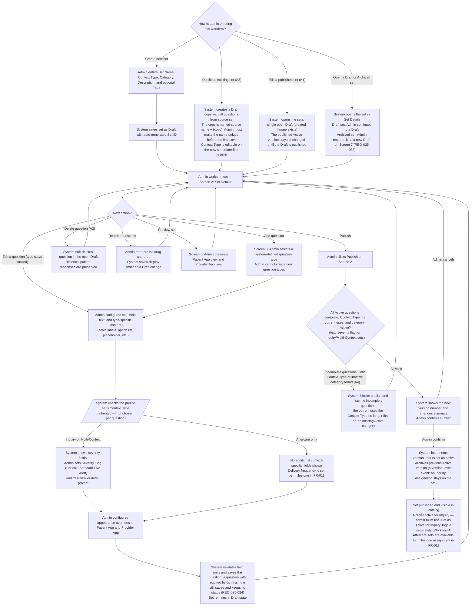
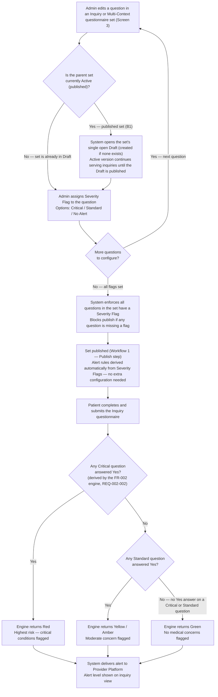
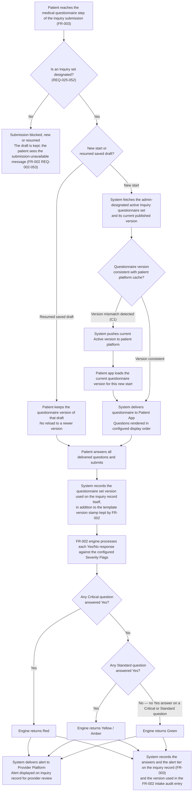
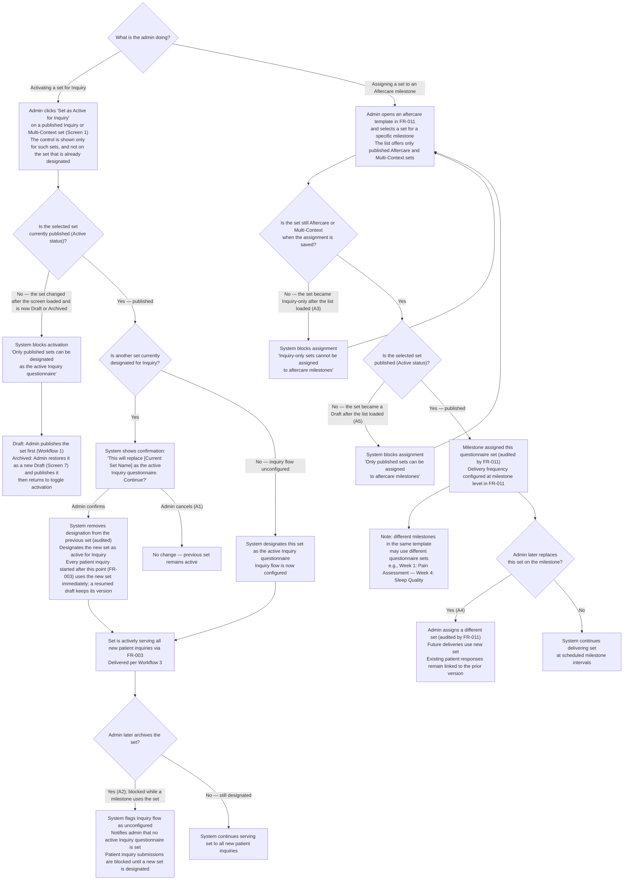

# FR-025 - Medical Questionnaire Management

**Module**: A-09: System Settings & Configuration  
**Feature Branch**: `fr025-medical-questionnaire-management`  
**Created**: 2025-10-23  
**Status**: ✅ Verified & Approved
**Source**: FR-025 from system-prd.md

## Executive Summary

The Medical Questionnaire Management module enables administrators to manage a central catalog of **questionnaire sets**, where each set is a named, versioned package of questions (e.g., "Medical Safety Screening", "Pain Assessment", "Sleep Quality Check"). Admins create and maintain questionnaire sets, add questions to them from system-defined question types, and configure how questions appear in the patient app and provider app. Published questionnaire sets are consumed by two downstream flows: (1) the inquiry submission flow uses the admin-designated active Inquiry-context set as the medical safety screening questionnaire (publishing does not activate a set; see REQ-025-049) and (2) aftercare milestone templates assign individual questionnaire sets per milestone from the Aftercare catalog.

## Module Scope

### Multi-Tenant Architecture

- **Admin Platform (A-09)**: System Settings & Configuration
- **Integration Points**: Patient Platform (inquiry submission), Provider Platform (alert display)

### Communication Structure

- **Admin → System**: Questionnaire set and question management via admin platform
- **System → Patient Platform**: Dynamic questionnaire delivery per context (inquiry / aftercare milestone)
- **System → Provider Platform**: Medical alert display (Inquiry context; the alert tier comes from the FR-002 engine, REQ-025-063) and aftercare response summaries (Aftercare context)
- **System → All Platforms**: Version-controlled questionnaire set updates

### Entry Points

1. **Admin-Initiated**: Primary flow through the Questionnaire Catalog (Screen 1)
2. **System-Triggered (Inquiry)**: The admin-designated active Inquiry-context questionnaire set is delivered automatically during patient inquiry submission (FR-003). The active set is selected explicitly by the admin (REQ-025-049)
3. **System-Triggered (Aftercare)**: Questionnaire set assigned to a milestone delivered according to the milestone schedule (FR-011)
4. **System-Triggered (Monitoring Advice)**: Owned by FR-037 (see REQ-037-005). FR-037 reuses the admin-designated active Inquiry-context set as-is when a patient activates provider-advice mode; FR-025 introduces no separate context type or admin toggle for it
5. **Provider-Viewed**: Inquiry alert summaries and aftercare response data displayed in provider platform

All entry points: REQ-025-054.

### Questionnaire Context Types

Context types are **system-defined** (fixed in source code). Admins cannot create or delete context types; they assign one to each questionnaire set they create. (REQ-025-001)

| Context Type | Where Used | Question-Level Constraints |
|---|---|---|
| **Inquiry** | Patient inquiry submission (FR-003) | **MVP**: Yes/No only (hard constraint). Severity flag required per question; Yes-answer detail prompt required. **Future**: additional question types allowed only after FR-003 supports typed answers (REQ-025-012, REQ-025-014, REQ-025-015) |
| **Aftercare** | Aftercare milestone templates (FR-011) | All system-defined types supported; no severity flags (REQ-025-016). Delivery frequency: see REQ-025-019 |
| **Multi-Context** | Both flows | **MVP**: Yes/No only (must be inquiry-compatible). Severity flag required per question; Yes-answer detail prompt required. Delivery frequency: see REQ-025-019. **Future**: may support additional question types once inquiry supports typed answers (REQ-025-012, REQ-025-014, REQ-025-015) |

Each questionnaire set carries a required Context Type and optional tags (e.g., "pain", "sleep", "compliance"). Downstream modules filter the catalog by compatible Context Type when presenting assignment options. (REQ-025-003)

## Business Workflows

### Workflow 1: Questionnaire Set Management (Primary Flow)

**Actors**: Admin, System
**Trigger**: Admin opens the Questionnaire Catalog to create, edit, or duplicate a questionnaire set
**Outcome**: A new version of a questionnaire set is published and available in the catalog. Publishing does not automatically designate a set as the active Inquiry questionnaire — that requires the separate "Set as Active for Inquiry" action (see Workflow 4)

**Flow Diagram** (includes alternative flows A1, A2, A3, A4):

Rule carried by this flow: REQ-025-004. Publishing does not designate the set for Inquiry (REQ-025-049).

Other Admin actions reached from this flow, one step each:

- Category management: from the catalog the Admin manages the global categories on Screen 4 (REQ-025-027 to REQ-025-030).
- Version history: from Set Details the Admin opens Screen 7 and may use Restore as New Draft on any version, also for an Archived set (REQ-025-038, REQ-025-039).
- Archive a set: from the catalog; blocked while an aftercare milestone uses the set; archiving discards the set's open Draft, and the confirmation warns of this (REQ-025-045, REQ-025-047, REQ-025-048).
- Delete a set: from the catalog; only for a set that was never published and has no usages (REQ-025-046).

### Workflow 2: Severity Management (Inquiry Context Only)

**Actors**: Admin, System, FR-002 alert engine
**Scope**: Severity flags and the provider alert system apply exclusively to Inquiry-context and Multi-Context questionnaire sets. Aftercare-only sets do not use severity flags.
**Trigger**: Admin configures a question inside an Inquiry or Multi-Context questionnaire set, or a patient submits the Inquiry questionnaire
**Outcome**: Provider receives a colour-coded alert (Red / Amber / Green) reflecting the medical risk level of the patient's responses

**Flow Diagram** (includes alternative flow B1):

### Workflow 3: Questionnaire Deployment (System Flow)

**Actors**: System, Patient Platform, Provider Platform
**Trigger**: Patient reaches the medical questionnaire step of the inquiry submission flow in the Patient App (FR-003), after picking the treatment date ranges
**Outcome**: Patient's questionnaire responses are processed by the FR-002 engine, which returns the alert tier; the provider platform shows the tier, and the answers, the tier and the questionnaire version used are recorded

**Flow Diagram** (includes alternative flow C1):

Rules carried by this flow: REQ-025-057, REQ-025-058, REQ-025-059, REQ-025-052.

### Workflow 4: Inquiry Activation & Downstream Assignment

**Actors**: Admin, System, FR-003 (Inquiry), FR-011 (Aftercare Milestones)
**Trigger**: (a) Admin clicks "Set as Active for Inquiry" on a published Inquiry or Multi-Context set in the Questionnaire Catalog, or (b) Admin assigns a published Aftercare or Multi-Context set to a milestone in FR-011
**Outcome**: The designated set is actively serving patients — either as the admin-designated active Inquiry questionnaire in FR-003, or as a milestone-assigned questionnaire in one or more FR-011 aftercare templates

**Flow Diagram** (includes alternative flows A1, A2, A3, A4, A5):

## Screen Specifications

### Admin Platform Screens

#### Screen 1: Questionnaire Catalog

**Purpose**: Main entry point for questionnaire management. Admin views all questionnaire sets, performs CRUD on sets, and sees where each set is currently in use across the platform.

**Data Fields**:

| Field Name | Type | Required | Description | Validation Rules | Graph field |
| --- | --- | --- | --- | --- | --- |
| Set Name | text (link) | Yes | Name of the questionnaire set; navigates to Screen 2 | Max 100 chars; unique | ENT-questionnaire-set.name |
| Context Type | enum | Yes | Inquiry / Aftercare / Multi-Context | System-defined values only | ENT-questionnaire-set.context_type |
| Question Count | derived | No | Total questions in this set | Auto-calculated | ENT-questionnaire-set.question_count |
| Status | enum | Yes | Draft / Active / Archived | System-managed | ENT-questionnaire-set.status |
| Version | derived | No | Current published version number | Auto-incremented on publish | ENT-questionnaire-set.version |
| Used In | derived | No | Where the set is currently assigned (e.g., "Inquiry Flow (active)", "Aftercare Template: Post-Op Recovery → Week 1 Milestone") | Auto-calculated | ENT-questionnaire-set.used_in |
| Last Modified | datetime | No | Timestamp of last change | ISO 8601 | ENT-questionnaire-set.last_modified |
| Created By | text | No | Admin who created the set | From admin session | ENT-questionnaire-set.created_by |
| Inquiry Active | indicator | No | Shows "Active for Inquiry" badge on the set currently designated as the active Inquiry questionnaire. Only one set can have this designation at a time. Visible only on Inquiry and Multi-Context sets | System-managed; updated via "Set as Active for Inquiry" action | ENT-questionnaire-set.inquiry_active |
| Search/Filters | control | No | Keyword search by Set Name. Filters: Context Type (Inquiry / Aftercare / Multi-Context / All), Status (Draft / Active / Archived / All), Category (from global category list / All) | Valid enums; filters applied with AND logic | no graph field (control) |
| Actions | action | — | View/Edit, Duplicate, Archive, Delete, **Set as Active for Inquiry** (shown only for published Inquiry / Multi-Context sets that are not already designated) | Delete is offered only for a set never published and without usages; Archive is blocked for a set assigned to a milestone, with the milestones listed, and its confirmation warns that the set's open Draft is discarded; "Set as Active for Inquiry" is refused with a message only if the set changed after the screen loaded | no graph field (control) |

**Notes**:

- "Create New Questionnaire Set" button opens a creation form (Set Name, Context Type, Category, Description, Tags)

**Business Rules**:

- Sets currently assigned to the inquiry flow or at least one milestone template display their usage locations in the "Used In" column (REQ-025-047)
- A set designated for Inquiry cannot be deleted, only archived; a set assigned to a milestone can be neither deleted nor archived until the Admin points those milestones to another set, and the Admin sees the milestones using it. Archived is terminal for the set; the way back is Restore as New Draft from Screen 7, then publish. Archiving a set discards its open Draft, and the archive confirmation warns of this; a restored set comes back as a new Draft built from the selected version, with no Inquiry designation and no earlier draft, and is Active again when published (REQ-025-045)
- Archiving a set that is currently designated as the active Inquiry questionnaire removes the designation and flags the inquiry flow as unconfigured; system notifies admin. This applies only to the Archive action on the set, not to the archiving of the previous Active version when a new version is published (REQ-025-048)
- **Publishing does not activate a set for the inquiry flow.** The admin must explicitly click "Set as Active for Inquiry" on a published Inquiry or Multi-Context set to designate it. This is a separate, deliberate action (REQ-025-049)
- At most one set may be designated as the active Inquiry questionnaire at a time. Clicking "Set as Active for Inquiry" on a second set shows a confirmation dialog and, upon confirmation, transfers the designation from the previous set to the new one (REQ-025-050)
- The "Set as Active for Inquiry" action is only available on sets with Status = Active (published) and Context Type = Inquiry or Multi-Context. It is hidden for Draft, Archived, and Aftercare-only sets and on the set that already carries the designation; the block message appears only when the set changed after the screen loaded (REQ-025-051)
- If no set is currently designated for the inquiry flow, the catalog displays a warning banner: "No active Inquiry questionnaire set — patient inquiry submissions will be blocked until one is designated" (REQ-025-052)
- Delete is available only for a set that was never published and has no usages; it permanently removes the set and its questions. The audit entries of a deleted set stay in storage and have no screen at launch (REQ-025-040). A set that has ever been published can only be archived (REQ-025-046)
- Duplicating a set creates a Draft copy with all questions, named `<source name> (copy)`; the Admin must make the name unique before the first save; the copy's Context Type is editable before first publish; the copy does not inherit the Inquiry designation (REQ-025-008)
- The Inquiry designation can only be replaced (by designating another set) or ended by archiving the set; there is no control to remove the designation on its own. The designation belongs to the set and carries over to a newly published version (REQ-025-048, REQ-025-031)
- Field limits on this screen: Set Name is at most 100 characters and unique (REQ-025-078)

---

#### Screen 2: Questionnaire Set Details

**Purpose**: Admin manages the full contents of one questionnaire set — metadata, ordered question list, and publish controls. Navigate here by clicking a set name on Screen 1.

**Set Metadata Fields**:

| Field Name | Type | Required | Description | Validation Rules | Graph field |
| --- | --- | --- | --- | --- | --- |
| Set Name | text | Yes | Name of the questionnaire set | Max 100 chars; unique | ENT-questionnaire-set.name |
| Context Type | select | Yes | Inquiry / Aftercare / Multi-Context | Read-only on the Active version; editable only in an open Draft | ENT-questionnaire-set.context_type |
| Description | text | No | Optional free-text description | Max 500 chars | ENT-questionnaire-set.description |
| Category | select | Yes | Category assignment from global category list (Screen 4) | Must exist and be Active | ENT-questionnaire-set.category_id |
| Tags | chips | No | Free-form labels for search and filtering (e.g., "pain", "sleep", "compliance") | Optional | ENT-questionnaire-set.tags |
| Status | enum | read-only | Draft / Active / Archived | System-managed badge | ENT-questionnaire-set.status |
| Version | number | read-only | Current published version number | Auto-incremented on publish | ENT-questionnaire-set.version |
| Used In | text | read-only | Usage locations (same as Screen 1) | Auto-calculated | ENT-questionnaire-set.used_in |

**Question List Fields** (one row per question; supports drag-and-drop reordering):

| Field Name | Type | Required | Description | Validation Rules | Graph field |
| --- | --- | --- | --- | --- | --- |
| # | number | Yes | Display order; drag handle for reordering | Integer ≥ 1; unique within set | ENT-questionnaire-question.display_order |
| Question Text | text | Yes | Truncated question preview; click to open Screen 3 | — | ENT-questionnaire-question.question_text |
| Question Type | label | Yes | System-defined type (e.g., Yes/No, Visual Scale 1–10) | Read-only after first save | ENT-questionnaire-question.question_type |
| Severity | badge | Conditional | Critical / Standard / No Alert | Required for Inquiry/Multi-Context sets; hidden for Aftercare-only sets | ENT-questionnaire-question.severity_flag |
| Status | badge | Yes | Active / Inactive; a soft-deleted question carries status Deleted and is not listed | Default Active | ENT-questionnaire-question.status |
| Actions | action | — | Edit (opens Screen 3), Delete | Delete is soft; historical responses preserved | no graph field (control) |

**Notes**:

- "Add Question" button opens Screen 3 (Question Editor) for a new question
- "Preview" button opens Screen 6 (Questionnaire Preview) scoped to this set
- "Publish" button validates completeness; when validation passes, the system shows the new version number and changes summary and the Admin confirms (REQ-025-034); it then publishes the current Draft as a new version. Publishing does not designate the set for Inquiry (REQ-025-049)
- "View Version History" link opens Screen 7 scoped to this set
- Breadcrumb navigation: Questionnaire Catalog → [Set Name]

**Business Rules**:

- Drag-and-drop reordering updates display order immediately and is saved as a Draft change (REQ-025-009)
- Context Type is read-only on the Active version and editable only in an open Draft; publishing a Draft whose Context Type no longer fits a current use (Inquiry designation or milestone assignment) is blocked with the list of those uses (REQ-025-033)
- Every change to an Active set (add, edit, delete or reorder a question, metadata, Context Type) goes to the set's single open Draft and the Active version serves until publish; a set has at most one open Draft (REQ-025-032)
- A save made from a screen whose Draft was changed by another Admin since it was loaded is refused with a message to reload (REQ-025-073)
- See REQ-025-025.
- All Active questions in Inquiry/Multi-Context sets must have a Severity flag before publishing (REQ-025-013)
- See REQ-025-014.
- Publishing increments the version number and archives the previous Active version; a designation of the set for Inquiry stays on the set and carries over to the new version (REQ-025-031)
- See REQ-025-019.
- Field limits on this screen: Set Name is at most 100 characters and unique; Description is at most 500 characters; a question's display number is a whole number of at least 1 and unique within the set (REQ-025-079)

---

#### Screen 3: Question Editor

**Purpose**: Admin creates or edits a single question within a questionnaire set. Question types are system-defined (REQ-025-010). Admin configures question content, context-specific settings, and how the question appears in the patient app and provider app.

**Data Fields**:

| Field Name | Type | Required | Description | Validation Rules | Graph field |
| --- | --- | --- | --- | --- | --- |
| Question Type | select | Yes | System-defined type: Yes/No, Visual Scale 1–10, Numeric Scale 1–10, Multi-select, Free Text | **MVP constraint**: if parent set Context Type is Inquiry or Multi-Context, only Yes/No is selectable. Locked after first save; delete and recreate to change type | ENT-questionnaire-question.question_type |
| Question Text | rich text | Yes | Main question content shown to patient | Min 10 chars | ENT-questionnaire-question.question_text |
| Help Text | text | No | Sub-label displayed below the question in both apps | Max 300 chars | ENT-questionnaire-question.help_text |
| Detail Prompt (Yes answer) | text | Conditional | Prompt shown to patient when they answer Yes | Required for Yes/No questions in Inquiry/Multi-Context sets | ENT-questionnaire-question.detail_prompt |
| Scale Point Labels | text ×10 | Conditional | Label for each point on the scale (e.g., 1 = None, 10 = Very Severe) | Required for Visual Scale 1–10 type | ENT-questionnaire-question.scale_point_labels |
| Scale Min / Max Labels | text ×2 | Conditional | Labels for minimum and maximum ends of the scale (e.g., 0 = No pain, 10 = Worst pain) | Required for Numeric Scale 1–10 type | ENT-questionnaire-question.scale_min_max_labels |
| Options | list | Conditional | Selectable answer options; admin adds/removes/reorders inline | Required for Multi-select type; min 2 options | ENT-questionnaire-question.options |
| Placeholder Text | text | Conditional | Input placeholder shown inside the text field | Optional for Free Text type | ENT-questionnaire-question.placeholder_text |
| Max Characters | number | Conditional | Character limit for the text answer | Optional for Free Text type; integer > 0 | ENT-questionnaire-question.max_characters |
| Severity Flag | select | Conditional | Critical / Standard / No Alert | Required for questions in Inquiry or Multi-Context sets; hidden for Aftercare-only sets | ENT-questionnaire-question.severity_flag |
| Alert Description | text | No | Admin-only note about why the question carries its severity; shown in this editor and in Preview, never to providers (providers see the question text) | Optional; may be pre-filled from the severity and edited | ENT-questionnaire-question.alert_description |
| Patient App — Display Label | text | No | Overrides Question Text as the label shown in patient app | Max 200 chars; defaults to Question Text if empty | ENT-questionnaire-question.patient_display_label |
| Patient App — Show Question Number | checkbox | No | Whether to prefix the question with its display number | Default: Yes | ENT-questionnaire-question.patient_show_number |
| Patient App — Visible to Patient | checkbox | No | Whether the question is shown to the patient | Default: Yes; not offered for questions in Inquiry or Multi-Context sets, where every question is shown | ENT-questionnaire-question.patient_visible |
| Provider App — Display Label | text | No | Label shown in provider summary view | Max 200 chars; defaults to Question Text if empty | ENT-questionnaire-question.provider_display_label |
| Provider App — Highlight Response | checkbox | No | Whether to visually highlight this question's answer in the provider view | Default: No | ENT-questionnaire-question.provider_highlight_response |
| Question ID | text | read-only | Auto-generated unique identifier | System-assigned | ENT-questionnaire-question.id |
| Created Date | datetime | read-only | Timestamp of question creation | ISO 8601 | ENT-questionnaire-question.created_date |
| Last Modified | datetime | read-only | Timestamp of last edit | ISO 8601 | ENT-questionnaire-question.last_modified |
| Modified By | text | read-only | Admin who last edited this question | From admin session | ENT-questionnaire-question.modified_by |
| Status | toggle | Yes | Active / Inactive; a soft-deleted question carries status Deleted and is not listed | Default Active | ENT-questionnaire-question.status |

**Notes**:

- Conditional fields (Detail Prompt, Scale Labels, Options, Placeholder, Max Characters) are shown or hidden dynamically based on the selected Question Type (REQ-025-020)
- See REQ-025-017.
- For Yes/No questions with a Severity Flag: response color-coding in the provider view is automatic based on the flag value; no additional configuration is needed (REQ-025-017)
- Question Type selection is presented as a list with a short description of each type to help admin choose correctly before locking in (REQ-025-082)
- See REQ-025-019.

**Business Rules**:

- Question Type is locked after first save (REQ-025-011); a confirmation dialog warns the admin before saving for the first time
- An incomplete question (required fields missing) blocks publishing of the parent set; the system lists the incomplete questions and the set cannot be published until they are complete. Saving accepts an incomplete question and keeps its status; the Admin completes it or sets it Inactive (REQ-025-024)
- Field limits on this screen: Help Text is at most 300 characters; Patient App Display Label and Provider App Display Label are each at most 200 characters; Max Characters is a whole number greater than 0 (REQ-025-080)
- Changes to a question in an Active (published) set are saved as a Draft change on the parent set; the Active version continues to serve downstream consumers until the set is re-published (REQ-025-032)
- Deleting a question performs a soft delete (status Deleted); historical patient responses referencing this question are preserved and remain accessible (REQ-025-044)
- An Inactive or deleted question is not delivered to patients, is excluded from the severity checks and from the overall tier; the Visible to Patient control is not offered in Inquiry or Multi-Context sets (REQ-025-084)
- A save made from a screen whose Draft was changed by another Admin since it was loaded is refused with a message to reload (REQ-025-073)

---

#### Screen 4: Category Management

**Purpose**: Admin manages the global list of questionnaire set categories. Each questionnaire set is assigned one category, used for organising and filtering the catalog.

**Data Fields**:

| Field Name | Type | Required | Description | Validation Rules | Graph field |
| --- | --- | --- | --- | --- | --- |
| Category Name | text | Yes | Display name of the category | Max 100 chars; unique | ENT-questionnaire-category.name |
| Description | text | No | Purpose or scope of this category | Max 300 chars | ENT-questionnaire-category.description |
| Total Sets | derived | No | Count of questionnaire sets assigned to this category | Auto-calculated | ENT-questionnaire-category.total_sets |
| Status | enum | Yes | Active / Inactive | Default Active | ENT-questionnaire-category.status |
| Actions | action | — | Edit, Deactivate, Delete | Delete is blocked while any set, of any status, is assigned to this category; deactivate it instead | no graph field (control) |

**Notes**:

- "Add Category" button opens an inline or modal creation form
- Example categories: Allergies, Cardiovascular, Medications, Previous Surgeries, Chronic Conditions, General Health

**Business Rules**:

- Category names must be unique (REQ-025-027)
- See REQ-025-026.
- A category can be deleted only when no set of any status (Draft, Active or Archived) is assigned to it; otherwise the Admin deactivates it, which hides it from the category picker for new sets (REQ-025-028)
- Deactivating a category hides it from the category picker in Screen 2 but does not remove existing assignments; affected sets are flagged as "Uncategorised" until reassigned (REQ-025-029)
- Field limits on this screen: Category Name is at most 100 characters and unique; Description is at most 300 characters (REQ-025-081)
- Category changes (create, edit, deactivate, delete) are recorded in the platform Admin audit log (FR-031, REQ-031-008), not in a set's audit trail

---

#### Screen 5: Context Type Reference

**Purpose**: Informational reference screen. Admin views the system-defined context types, their descriptions, which sets use each type, and which modules consume them. See REQ-025-001 and REQ-025-002 for the fixed context types and the read-only screen.

**Data Fields**:

| Field Name | Type | Required | Description | Validation Rules | Graph field |
| --- | --- | --- | --- | --- | --- |
| Context Type Name | text | read-only | System-defined label: Inquiry / Aftercare / Multi-Context | Fixed in source code | ENT-questionnaire-context-type.name |
| Description | text | read-only | What this context type means and where it is used in the platform | Fixed | ENT-questionnaire-context-type.description |
| Active Sets Count | derived | read-only | Number of Active questionnaire sets with this context type | Auto-calculated | ENT-questionnaire-context-type.active_sets_count |
| Questionnaire Sets | list | read-only | Linked list of all sets assigned to this context type | Auto-calculated | ENT-questionnaire-context-type.questionnaire_sets |
| Integration Points | text | read-only | Modules that consume this context type (e.g., FR-003: Inquiry, FR-011: Aftercare Milestones) | Fixed | ENT-questionnaire-context-type.integration_points |

**Notes**:

- Context types are displayed in a fixed order: Inquiry, Aftercare, Multi-Context
- This screen serves as a reference for admins creating or assigning questionnaire sets

**Business Rules**:

- This screen is entirely read-only; no fields are editable (REQ-025-002)
- Admins cannot create, rename, or delete context types; changes to context type definitions require a code deployment (REQ-025-001)

---

#### Screen 6: Questionnaire Preview

**Purpose**: Admin previews how a questionnaire set will appear to patients in the mobile app and how submitted responses will be presented to providers. Accessible from Screen 2 via the "Preview" button.

**Data Fields**:

| Field Name | Type | Required | Description | Validation Rules | Graph field |
| --- | --- | --- | --- | --- | --- |
| View | tab selector | Yes | Patient App (Mobile) / Provider Summary | — | no graph field (control) |
| Test Mode | toggle | No | Enable sample response filling to simulate a completed submission | Off by default | no graph field (control) |
| Questionnaire Render | display | read-only | Full rendered questionnaire with question types, help text, and display label overrides applied in configured display order | Reflects current Draft state, not last published version | ENT-questionnaire-question.question_text, ENT-questionnaire-question.question_type, ENT-questionnaire-question.help_text, ENT-questionnaire-question.patient_display_label |
| Sample Response Inputs | dynamic | Conditional | Input controls matching each question type; only active when Test Mode is on | Enabled only in Test Mode | no graph field (control) |
| Provider Summary Render | display | Conditional | Response summary as it would appear in the provider platform, with each answer coloured by its own question's severity flag, highlighted responses, and no overall tier | Only visible in Provider Summary tab with Test Mode on | ENT-questionnaire-question.provider_display_label, ENT-questionnaire-question.provider_highlight_response, ENT-questionnaire-question.severity_flag |
| Print Preview | action | No | Generate a printable version of the questionnaire | — | no graph field (control) |

**Notes**:

- Patient App (Mobile) tab renders questions in mobile-optimised layout with type-appropriate controls (scale sliders, checkbox groups, text inputs, etc.)
- Provider Summary tab shows the response format providers see: each answer is coloured by its own question's severity flag (Inquiry sets) and highlighted where configured; the preview shows no overall tier, which the engine computes only on a real inquiry (REQ-025-017)
- Preview shows each question's Alert Description as an Admin-only note

**Business Rules**:

- Preview reflects the current saved Draft state of the set (all pending changes included); it does not show the last published version (REQ-025-074)
- Test Mode submissions do not create any records; all inputs are discarded on exit (REQ-025-075)
- Preview is scoped to one questionnaire set at a time; opened from Screen 2 (REQ-025-076)

---

#### Screen 7: Version History & Audit Trail

**Purpose**: Admin views the complete change history and audit log for a specific questionnaire set. Accessible from Screen 2 via the "View Version History" link.

**Version History Fields** (one row per published version):

| Field Name | Type | Required | Description | Validation Rules | Graph field |
| --- | --- | --- | --- | --- | --- |
| Version Number | number | read-only | Auto-incremented version identifier | Integer; assigned on each publish | ENT-questionnaire-version.version_number |
| Published Date | datetime | read-only | When this version was activated | ISO 8601 | ENT-questionnaire-version.published_date |
| Published By | text | read-only | Admin who published this version | From admin session | ENT-questionnaire-version.published_by |
| Question Count | number | read-only | Number of questions at the time of this version | Auto-captured on publish | ENT-questionnaire-version.question_count |
| Changes Summary | text | read-only | System-generated description of what changed from the prior version | Auto-generated | ENT-questionnaire-version.changes_summary |
| Status | enum | read-only | Active / Archived | System-managed | ENT-questionnaire-version.status |
| Was Designated for Inquiry | boolean | read-only | Whether this version is or was the designated Inquiry version; set at designation and at publish of a designated set (REQ-025-057) | System-managed | ENT-questionnaire-version.was_inquiry_designated |
| Actions | action | — | View Snapshot (read-only view of that version), Restore as New Draft | Restore is refused while the set has an open Draft | no graph field (control) |

**Audit Trail Fields** (one row per admin action on this set):

| Field Name | Type | Required | Description | Validation Rules | Graph field |
| --- | --- | --- | --- | --- | --- |
| Change Date | datetime | read-only | When the action was performed | ISO 8601 | ENT-questionnaire-audit-entry.change_date |
| Admin Name | text | read-only | Who performed the action | From admin session | ENT-questionnaire-audit-entry.admin_name |
| Action Type | enum | read-only | Create Set / Edit Metadata / Add Question / Edit Question / Delete Question / Publish / Archive / Restore / **Set as Active for Inquiry** / Duplicate Set / Delete Set / Reorder Questions / Remove Inquiry Designation / Inquiry Flow Unconfigured | System-defined | ENT-questionnaire-audit-entry.action_type |
| Question ID | text | read-only | Affected question identifier (if action is question-level) | Populated only for question-level actions | ENT-questionnaire-audit-entry.question_id |
| Change Details | text | read-only | Before and after values for all modified fields | System-generated | ENT-questionnaire-audit-entry.change_details |
| IP Address | text | read-only | IP address of the admin session for security tracking | System-captured | ENT-questionnaire-audit-entry.ip_address |
| Session ID | text | read-only | Identifier of the admin session that performed the action | System-captured | ENT-questionnaire-audit-entry.session_id |

**Notes**:

- "Restore as New Draft" creates the set's single open Draft with the questions from the selected historical version, and is refused while an open Draft exists; on an Archived set the set shows status Draft from the restore until the restored Draft is published (REQ-025-038)
- This screen holds Admin actions only; the patient's answers, the severity tier and the version used belong to the inquiry record (FR-003) and the intake audit entry (FR-002), not to this trail (REQ-025-059)
- Milestone assignment and replacement are audited by FR-011, not here

**Business Rules**:

- Version history and audit trail are maintained indefinitely and are tamper-proof (REQ-025-040)
- All admin actions on the set — including metadata edits, question changes, duplicate, delete, reorder, designation changes, and publish/archive events — are captured in the audit trail, each with a timestamp and the identity of the admin (REQ-025-041)
- "View Snapshot" opens a read-only view of the questionnaire set at that version; no editing is possible from the snapshot view (REQ-025-039)

## Business Rules

### Questionnaire Set Rules

1. **Set Structure Rules**
   - Each questionnaire set is a named, versioned package of questions with a single Context Type (REQ-025-005)
   - A questionnaire set must contain at least one Active question before it can be published (REQ-025-006)
   - Questions within a set are ordered; order determines display sequence to patients (REQ-025-007)
   - A set may be duplicated to create a new Draft copy named `<source name> (copy)`; the Admin makes the name unique before the first save; the copy is independent of the source (REQ-025-008)
   - Delete is allowed only for a set that was never published and has no usages; a set that has been published can only be archived (REQ-025-046)
   - A set designated for Inquiry can only be archived; a set assigned to a milestone can be neither deleted nor archived until those milestones are reassigned; Archived is terminal, and the way back is Restore as New Draft then publish; archiving discards the set's open Draft (REQ-025-045)
   - Archiving a designated set removes the designation and flags the Inquiry flow unconfigured; the archiving of the previous Active version on publish is a version-level event and keeps the designation on the set (REQ-025-048)
   - Context Type is read-only on the Active version and editable only in an open Draft; publish is blocked with the list of uses if the type no longer fits (REQ-025-033)
   - Every change to an Active set goes to the set's single open Draft; a set has at most one open Draft (REQ-025-032)
   - Inactive and soft-deleted questions are not delivered to patients and are excluded from completeness checks, severity checks and the tier; Visible to Patient is not offered in Inquiry or Multi-Context sets (REQ-025-084)

2. **Question Type Rules**
   - Question types are system-defined (fixed in source code); admin selects from the available type list but cannot create, rename, or remove types (REQ-025-010)
   - Available system-defined types: Yes/No, Visual Scale 1–10, Numeric Scale 1–10, Multi-select, Free Text
   - Question Type is locked after first save; changing type requires deleting and recreating the question (REQ-025-011)
   - Type-specific fields follow the selected type: Visual Scale 1–10 requires a label for each scale point; Numeric Scale 1–10 requires minimum and maximum end labels; Multi-select requires at least 2 options; Free Text may have a placeholder text and an optional maximum character limit (REQ-025-020)

3. **Context-Specific Question Rules**
   - Questions in Inquiry or Multi-Context sets: Severity Flag is required; Yes-answer detail prompt is required for Yes/No questions (REQ-025-012)
   - Aftercare-only sets support all system-defined question types (REQ-025-016)
   - Questions in Aftercare or Multi-Context sets: no frequency setting at question level — delivery frequency is configured in FR-011 at the milestone assignment step (REQ-025-019)
   - **MVP**: Inquiry and Multi-Context sets MUST contain only Yes/No questions; the system blocks publishing if any non-Yes/No questions exist (REQ-025-014)
   - **Future (V2+)**: Once FR-003 supports typed answers, Inquiry/Multi-Context sets may allow additional question types (with a publish-time warning) (REQ-025-015)

4. **Severity Flagging Rules** (Inquiry and Multi-Context sets only)
   - Critical questions: High-risk conditions (HIV, hepatitis, blood disorders, heart conditions) (REQ-025-018)
   - Standard questions: Moderate concerns (allergies, medications, chronic conditions) (REQ-025-018)
   - No Alert questions: General health status, lifestyle factors (REQ-025-018)
   - Severity flags drive the automatic provider alert system for the inquiry flow only (REQ-025-017)
   - Alert tier for each submitted Inquiry questionnaire: Red if any Critical question is answered Yes; otherwise Amber if any Standard question is answered Yes; otherwise Green (no Yes answer on a Critical or Standard question). The tier is computed by the FR-002 engine (REQ-002-002); FR-025 owns only the mapping from Severity Flag to tier (REQ-025-064)
   - Severity Flag and Alert Description are shown only on questions in Inquiry or Multi-Context sets; Alert Description is optional and an Admin-only note shown in the editor and Preview, and providers see the question text; response colour-coding in the provider view follows each answer's own flag automatically with no extra configuration (REQ-025-017)
   - Aftercare-only questionnaire sets do not have severity flags and do not generate inquiry-style alerts (REQ-025-016)

5. **Category Rules**
   - Every questionnaire set must be assigned a category before it can be published; the category must exist and be Active (REQ-025-025)
   - Categories are global across all questionnaire sets (REQ-025-026)
   - Each questionnaire set belongs to exactly one category (REQ-025-026)
   - Categories are used for organising and filtering the Questionnaire Catalog (Screen 1)

### Version Control Rules

1. **Change Management**
   - All question changes must be version controlled (REQ-025-036)
   - Changes require admin authentication and authorization (REQ-025-035)
   - Strict admin-only access to questionnaire management
   - Previous versions must be archived, not deleted (REQ-025-037)
   - Version activation requires explicit admin confirmation, shown after validation with the new version number and changes summary (REQ-025-034)
   - Any earlier version must be restorable as a new Draft, which is then published; there is no one-step rollback, and the Active version is unaffected until the restored Draft is published; Restore is refused while the set has an open Draft (REQ-025-038)

2. **Audit Requirements**
   - All changes must be logged with timestamp and admin identification (REQ-025-041)
   - Audit trail must include before/after values for all modifications (REQ-025-042); the action types are listed on Screen 7
   - Security information (IP address, session ID) must be tracked (REQ-025-043)
   - Category changes are recorded in the platform Admin audit log (FR-031, REQ-031-008); milestone assignment and replacement are audited by FR-011
   - Audit logs must be retained for compliance requirements (REQ-025-040)
   - Audit trail must be tamper-proof and immutable (REQ-025-040)
   - Comprehensive change tracking and compliance reporting

### Integration Rules

1. **Patient Platform Integration**
   - A patient starting the inquiry questionnaire gets the current designated version; a resumed draft keeps its version; the version used is recorded at submit (REQ-025-053); publishing does not activate a set (REQ-025-049)
   - When the admin replaces the active Inquiry set, every patient inquiry started after the change uses the new set immediately; a resumed draft keeps its version (REQ-025-050)
   - If no set is designated as the active Inquiry questionnaire, the system must block all patient inquiry submissions, including resumed drafts; the draft is kept and the patient sees the submission-unavailable message (REQ-002-053); admins see a system-level warning (REQ-025-052). With no active Inquiry questionnaire, provider-advice mode in FR-037 cannot be chosen either, and the same admin warning applies; self-monitoring still works (REQ-037-086)
   - Version consistency must be maintained across all platforms (REQ-025-056)
   - Questionnaire changes must propagate immediately to the patient platform for a new start; a resumed draft keeps its version (REQ-025-056)
   - Questionnaire updates must deploy across all platform instances (REQ-025-056)
   - When the patient platform holds an older questionnaire version than the current Active version, the system pushes the current Active version for a new start; a patient with a resumed draft is not made to start over, and the submission is accepted on an older version that is or was designated for Inquiry; the version used is recorded against the inquiry (REQ-025-057)
   - Question formatting must be optimized for mobile devices (REQ-025-060)
   - Questionnaire loading must be optimized for mobile devices
   - Validation rules must be consistent between admin and patient platforms (REQ-025-061)
   - Error handling must provide clear user guidance (REQ-025-062)

2. **Provider Platform Integration**
   - Medical alerts are generated automatically from questionnaire responses by the FR-002 engine (REQ-002-002); FR-025 supplies the Severity Flags (REQ-025-063)
   - Alert severity must match question severity flags, as applied by the FR-002 engine (REQ-025-065)
   - Alert display must be consistent with color-coding standards (REQ-025-066)
   - Providers must be able to quickly scan alerts (red/amber/green) in-portal (REQ-025-066)
   - Alert history must be maintained for provider reference (REQ-025-067)
   - **MVP**: No additional email/push notification is emitted solely due to medical alert severity; providers learn via standard inquiry notifications and in-portal alert indicators (REQ-025-068)

3. **Aftercare Module Integration (FR-011)**

- Each aftercare milestone independently selects one questionnaire set from the catalog, filtered to Context Type = Aftercare or Multi-Context (REQ-025-069)
- Different milestones within the same aftercare template may be assigned different questionnaire sets (e.g., Week 1 milestone → "Pain Assessment", Week 4 milestone → "Sleep Quality Check") (REQ-025-070)
- Questionnaire sets with Context Type = Inquiry are not selectable in aftercare milestone assignments; every Multi-Context set may be assigned, with no extra flag (REQ-025-071)
- See REQ-025-019.
- Changing a milestone's assigned questionnaire set does not affect previously submitted patient responses; those remain linked to the version used at time of submission, and a draft response keeps the version it started on (REQ-025-072)
- Only a published set (Status = Active) can be assigned to an aftercare milestone; a Draft set cannot be assigned. The system blocks the assignment and tells the admin that only published sets can be assigned (REQ-025-077)

### Data Integrity Rules

1. **Question Validation**
   - See REQ-025-024.
   - Question text must be at least 10 characters (REQ-025-021)
   - See REQ-025-013.
   - See REQ-025-025.
   - Duplicate question text within the same set must be prevented (REQ-025-022)
   - Frequency is not a question-level field (REQ-025-019); it is not validated here

2. **System Consistency**
   - See REQ-025-056.
   - See REQ-025-065.
   - Category assignment must be consistent across catalog views (REQ-025-030)
   - Question order must be maintained during updates (REQ-025-073)
   - System must handle concurrent admin modifications gracefully: a save made from a stale screen is refused with a message to reload (REQ-025-073)
   - System must handle concurrent questionnaire versions gracefully
   - All changes must be atomic and consistent across platforms (REQ-025-083)
   - System must handle large numbers of questions efficiently
   - See system PRD, Platform-Wide Rules: Encryption in transit and at rest (REQ-SYS-004); GDPR and HIPAA-equivalent practices for personal and medical data (REQ-SYS-011).

## Dependencies

- **FR-003**: Inquiry Submission & Distribution (consumes active Inquiry-context questionnaire set)
- **FR-011**: Aftercare & Recovery Management (milestones assign individual Aftercare-context questionnaire sets per milestone)
- **FR-002**: Medical History & 3D Scanning (its alert engine computes the alert tier from the Severity Flags; owns the submission-unavailable message)
- **FR-031**: Admin Access Control & Permissions (admin access control; platform Admin audit log)
- **FR-037**: Monitor Your Hair Loss (owns the provider-advice gate on the active Inquiry-context questionnaire set, see REQ-037-005)

---

## Appendix: Change Log

| Date | Version | Changes | Author |
|------|---------|---------|--------|
| 2026-11-24 | 2.7 | Logic review pass 2: Draft and Archived sets can be opened and restored from the catalog; archiving discards the set's open Draft and a restored set returns as a new Draft without the designation; the publish confirmation, the question edit and the Set as Active for Inquiry actions are wired onto the workflow; publish blocks include the inactive category; an incomplete question can be saved and is caught at publish; a category is deleted only when no set at all is assigned (deactivate otherwise); audit entries of a deleted set stay in storage without a screen at launch; "immediately" applies to a new start, not to a resumed draft; Set as Active for Inquiry is hidden on the already designated set. | Product Team |
| 2026-11-24 | 2.6 | Logic review pass 1: Alert Engine ownership moved to FR-002 (FR-025 owns the Severity Flag to tier mapping); Context Type, archive, delete, restore and open Draft rules made consistent; resume and version recording rules for the inquiry questionnaire; audit action types and session id extended; admin screens placed in the configuration stage with workflow lines for category, history, archive and delete; publish confirmation, copy naming and Alert Description clarified. | Product Team |
| 2026-11-22 | 2.5 | Requirements graph programme baseline: PRD compressed to the checklist structure (each rule stated once, field rows tagged with graph field ids, dropped classes removed). No rule changes. Earlier history (v1.0 to v2.4) and the change request `change-request-2026-08-20-fr037-monitoring-advice-questionnaire.md` are in `archived/prd-baseline-2026-11-08/` and in git history. | Product Team |

---

## Appendix: Approvals

| Role | Name | Date | Signature/Approval |
|------|------|------|---------------------|
| Product Owner | TBD | 2026-02-25 | ✅ Verified & Approved |
| Technical Lead | TBD | 2026-02-25 | ✅ Verified & Approved |
| Stakeholder | TBD | 2026-02-25 | ✅ Verified & Approved |

---

**Template Version**: 2.0.0 (Constitution-Compliant)
**Constitution Reference**: Hairline Platform Constitution v1.0.0
**Last Updated**: 2026-02-25
