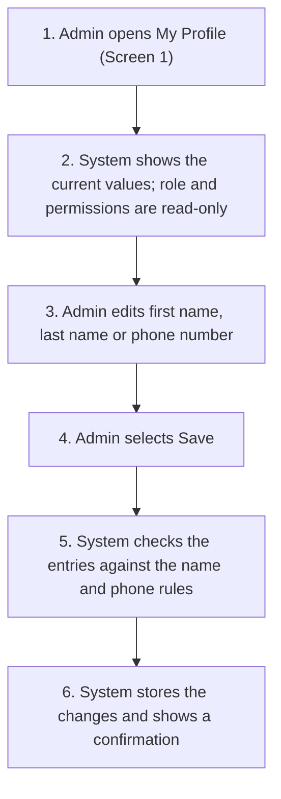

# FR-036 - Admin Profile & Settings Management

**Module**: A-09: System Settings & Configuration | Integrates with FR-031 (Admin Access Control & Permissions), FR-020 (Notifications & Alerts), FR-026 (App Settings & Security) and FR-021 (Multi-Language Support)
**Feature Branch**: `fr036-admin-profile-settings`
**Created**: 2026-11-25
**Status**: Draft (version 0.1), awaiting Product Owner approval. Nine questions are open (see "Open questions for the Product Owner"); every place they touch reads "Not yet decided (open question N)".
**Source**: FR-036 from system-prd.md (the only scope source); rules already settled elsewhere are cited by their ids and not restated

---

## Executive Summary

Admin Profile & Settings Management lets every admin user manage their own profile, account settings and notification preferences, independently of team management and access control (FR-031).

**Key Objectives**:

- Let an admin keep their own name, picture and contact details current
- Let an admin change their own password under the platform password policy
- Let an admin choose their own language and notification preferences
- Let an admin see their own activity, read-only

**Problem Solved**: Without a self-service area, an admin cannot correct their own details or password and must ask a Super Admin, even though none of this changes access rights.

---

## Module Scope

### Multi-Tenant Architecture

- **Patient Platform (P-XX)**: Not applicable
- **Provider Platform (PR-XX)**: Not applicable (provider account settings are FR-032)
- **Admin Platform (A-09)**: All screens of this module
- **Shared Services (S-03)**: Notification Service honours the admin's notification preferences (REQ-036-012)

### Communication Structure

**In Scope**:

- Own profile: name, picture, email, phone, assigned role and permissions (read-only)
- Own account settings: password, language, timezone (Not yet decided, open question 3)
- Own notification preferences
- Own activity log (read-only)

**Out of Scope**:

- Creating, inviting, suspending or deleting admin accounts, and changing roles or permissions (FR-031)
- Session length and sign-in security settings (FR-026)
- Editing another admin's profile
- Notification templates and the event catalogue (FR-020, FR-030)

### Entry Points

- The admin opens My Profile from the Admin Platform. The control that opens it is Not yet decided (open question 9).

---

## Open questions for the Product Owner

Each question lists the options and a recommendation. The PRD will be updated with the answers.

**1. Profile picture limits.** The system PRD says pictures must be JPEG or PNG with a size check, but gives no numbers.

- A. Use the same limits as the provider clinic logo: up to 5 MB, at least 200 x 200 pixels (REQ-032-001).
- B. Use a smaller limit (for example 2 MB), because an admin picture is shown small.
- C. Another limit you choose.
- Recommendation: A, so one rule is learned once.

**2. Changing the email address.** The system PRD says an admin can update their email. The email is also the sign-in name and the address that receives security notices, so a wrong address could lock the admin out.

- A. Send a one-time code to the new address; the change takes effect only after the code is entered.
- B. Change at once after the admin re-enters the current password.
- C. The email stays read-only on this screen and only a Super Admin changes it (this goes against the system PRD line, so it needs your explicit decision).
- Recommendation: A.

**3. Timezone setting.** The system PRD lists "configure timezone preferences" for admins. A live rule says the opposite: admin screens show the admin's browser time with the zone named, and the timezone list is offered to patients and providers only, never to admins (REQ-026-050).

- A. Keep the live rule and drop the timezone setting from this module.
- B. Add an admin timezone choice from the FR-026 list; REQ-026-050 would then be changed to match.
- C. Show the browser time by default and let the admin override it (also changes REQ-026-050).
- Recommendation: A, because the live rule was a deliberate decision and admins are staff working in their own browser time.

**4. Notification preferences.** The system PRD says an admin can switch email and in-app notices on or off "per event category", but does not name the categories.

- A. Switches per event category taken from the FR-020 catalogue (for example messaging and support, billing and payouts, provider compliance, account and sign-in, booking and schedule), all on at the start.
- B. One email switch and one in-app switch for everything.
- C. A switch for every single event.
- Also to decide in every option: notices that are locked (always sent by email, REQ-030-208) are shown as fixed and not switchable, and a preference may only reduce what an admin receives, never add recipients.
- Recommendation: A.

**5. What the activity log lists.** The system PRD says the log shows login history and "actions performed", with affected entities. The existing admin audit trail on the user detail page lists access-control events only (REQ-031-094).

- A. Only the access-control events about the admin (sign-ins, role changes, password resets and so on). Small, but "affected entities" would be almost always the admin's own account.
- B. All actions the admin performed across the platform (patients, providers, reviews, payouts and so on), which needs every feature to record its admin actions in one place.
- C. Start with A and extend to B later.
- Recommendation: B, because the system PRD asks for affected entities; if a full record is not ready at launch, choose C.

**6. What else happens when a password is changed.**

- A. The admin gets a security email only (as providers do, REQ-032-021).
- B. The security email and every other signed-in session of that admin is ended.
- C. Nothing beyond the password change.
- Recommendation: A.

**7. Where the admin changes language.** Admins can already pick a language from the top bar (REQ-021-004).

- A. Only the top bar.
- B. The top bar and also the Account Settings screen, both writing the same stored preference (REQ-021-117).
- Recommendation: B.

**8. Is the admin's own profile editing recorded in the audit trail?**

- A. Record security-relevant changes only (password, email, phone), with the old and new values hidden as for providers (REQ-032-020).
- B. Record every change.
- C. Record nothing.
- Consequence of A or B: the action-type list of the FR-031 audit trail must be extended.
- Recommendation: A.

**9. How the admin opens My Profile.**

- A. From a user menu in the dashboard top bar, next to the language choice.
- B. From an item in the side menu.
- C. Both.
- Recommendation: A.

---

## Business Workflows

### Main Flow: Admin Updates Their Own Profile

**Actors**: Admin, System
**Trigger**: The admin opens My Profile
**Outcome**: The admin's own details are saved

### Alternative Flows

**A1: Admin Changes the Profile Picture** (Screen 1)

1. Admin selects a JPEG or PNG file.
2. System checks the file type and size (REQ-036-003).
3. System shows the new picture on the profile. A file that fails the check goes to B2.

**A2: Admin Changes Their Password** (Screen 2)

1. Admin opens Account Settings.
2. Admin enters the current password and the new password.
3. System verifies the current password.
4. System checks the new password against the password policy (REQ-036-007).
5. System stores the new password and shows a confirmation. What else happens is Not yet decided (open question 6).

**A3: Admin Sets Notification Preferences** (Screen 3)

1. Admin opens Notification Preferences.
2. Admin switches email or in-app notices on or off. Which categories are offered is Not yet decided (open question 4).
3. System stores the preferences and applies them to later notices (REQ-036-012).

**A4: Admin Views Their Activity Log** (Screen 4)

1. Admin opens My Activity Log.
2. System shows the admin's own entries (REQ-036-013, REQ-036-014).
3. Admin sets a date range or action type.
4. System shows the matching entries (REQ-036-015).

**B1: Password Change Refused** (Screen 2)

1. At A2 step 3 the current password is wrong, or at step 4 the new password fails the policy.
2. System refuses the change, keeps the existing password and shows an error.
3. Admin corrects the entries and continues at A2 step 2.

**B2: Entry Refused on the Profile** (Screen 1)

1. At Main Flow step 5 a name or phone number breaks its rule, or at A1 step 2 the picture file fails the check.
2. System shows the error on the field and stores nothing for that entry.
3. Admin corrects the entry and continues at Main Flow step 3.

---

## Screen Specifications

### Screen 1: My Profile

**Purpose**: The admin views and edits their own profile details

**Data Fields**:

| Field Name | Type | Required | Description | Validation Rules | Graph field |
|------------|------|----------|-------------|------------------|-------------|
| Profile Picture | media | No | The admin's picture, with a change action | JPEG or PNG; size and dimension limits Not yet decided (open question 1) (REQ-036-003) | ENT-admin-user-account.profile_picture |
| First Name | text | Yes | The admin's first name | 2 to 50 characters (REQ-036-002) | ENT-admin-user-account.first_name |
| Last Name | text | Yes | The admin's last name | 2 to 50 characters (REQ-036-002) | ENT-admin-user-account.last_name |
| Email | text | Yes | The admin's email address | Confirmation of a change Not yet decided (open question 2) (REQ-036-006) | ENT-admin-user-account.email |
| Phone Number | text | No | The admin's phone number | E.164; invalid number shows the REQ-031-121 message (REQ-036-005) | ENT-admin-user-account.phone_number |
| Assigned Role | text | Yes | The admin's one role, read-only | Changed only in FR-031 (REQ-036-004) | ENT-admin-user-account.assigned_role_id |
| Role Permissions | group | Yes | The permissions of that role, read-only | Changed only in FR-031 (REQ-036-004) | no graph field (read-only view of the FR-031 permission matrix) |
| Save | action | Yes | Stores the edited values | Checks the entries first (Main Flow step 5) | no graph field (control) |

**Business Rules**:

- See REQ-036-001, REQ-036-002, REQ-036-003, REQ-036-004, REQ-036-005 and REQ-036-006.

---

### Screen 2: Account Settings

**Purpose**: The admin changes their own password and language

**Data Fields**:

| Field Name | Type | Required | Description | Validation Rules | Graph field |
|------------|------|----------|-------------|------------------|-------------|
| Current Password | password | Yes | The admin's present password | Must match the stored password (REQ-036-007) | no graph field (checked against the stored password, not stored) |
| New Password | password | Yes | The password the admin wants | Platform password policy (REQ-SYS-007) (REQ-036-007) | ENT-admin-user-account.password_hash |
| Language | select | Conditional | Admin Platform language | Active languages only; offered once multi-language support is implemented; entry point beyond this screen Not yet decided (open question 7) (REQ-036-008) | ENT-admin-user-account.preferred_language |
| Timezone | select | Not yet decided | Not yet decided (open question 3) | Until decided, times follow REQ-026-050 (REQ-036-009) | no graph field (Not yet decided, open question 3) |
| Change Password | action | Yes | Submits the password change | Needs both password fields | no graph field (control) |

**Business Rules**:

- See REQ-036-007, REQ-036-008 and REQ-036-009.

---

### Screen 3: Notification Preferences

**Purpose**: The admin chooses which notices reach them by email and in the app

**Data Fields**:

| Field Name | Type | Required | Description | Validation Rules | Graph field |
|------------|------|----------|-------------|------------------|-------------|
| Event Category | text | Not yet decided | One row per event category; the list is Not yet decided (open question 4) | Locked notices cannot be switched off (REQ-030-208) | no graph field (Not yet decided, open question 4) |
| Email Switch | toggle | Not yet decided | Email notices on or off for the category | Starting value Not yet decided (open question 4) (REQ-036-011) | no graph field (Not yet decided, open question 4) |
| In-App Switch | toggle | Not yet decided | In-app notices on or off for the category | Starting value Not yet decided (open question 4) (REQ-036-011) | no graph field (Not yet decided, open question 4) |
| Save | action | Yes | Stores the preferences | None | no graph field (control) |

**Business Rules**:

- See REQ-036-010, REQ-036-011 and REQ-036-012.

---

### Screen 4: My Activity Log

**Purpose**: The admin reads their own sign-ins and actions

**Data Fields**:

| Field Name | Type | Required | Description | Validation Rules | Graph field |
|------------|------|----------|-------------|------------------|-------------|
| Date Range | date range | No | Limits the entries by time | Behaves as REQ-022-117 (REQ-036-015) | no graph field (filter control) |
| Action Type | select | No | Limits the entries by action | Options follow the scope in open question 5 (REQ-036-015) | no graph field (filter control) |
| Timestamp | datetime | Yes | When the action happened | Read-only; shown in the time zone of REQ-026-050 (REQ-036-014) | ENT-admin-audit-trail-entry.timestamp |
| Action Type (column) | text | Yes | What the admin did, including sign-ins | Read-only; which actions are listed Not yet decided (open question 5) (REQ-036-014) | ENT-admin-audit-trail-entry.action_type |
| Affected Entities | text | Yes | What the action touched | Read-only; Not yet decided (open question 5) (REQ-036-014) | no graph field (Not yet decided, open question 5) |
| IP Address | text | Yes | Where the action came from | Read-only (REQ-036-014) | ENT-admin-audit-trail-entry.ip_address |

**Business Rules**:

- See REQ-036-013, REQ-036-014 and REQ-036-015.

---

## Business Rules

### Rules Settled Elsewhere and Used Here

- Names and phone: REQ-031-033, REQ-031-121. One role per admin: REQ-031-050.
- Password policy: REQ-SYS-007. Passwords are stored as bcrypt hashes: REQ-031-017.
- Time display: REQ-SYS-010 and REQ-026-050.
- Language: REQ-021-004, REQ-021-076, REQ-021-117, REQ-021-129.
- Audit entries are immutable: REQ-SYS-009. Audit logs are kept for the period in REQ-SYS-002.
- Locked notices: REQ-030-208. Activity log filters: REQ-022-117.

### Admin Editability

- Everything on Screens 1 to 3 is edited by the admin about themselves only; no other admin, including a Super Admin, edits it here (REQ-036-001).
- The password policy is fixed and not editable in the Admin Platform (REQ-SYS-007).
- The activity log has nothing to edit (REQ-036-013).

---

## Dependencies

- **FR-031**: Admin Access Control & Permissions; owns the admin account, the role and permissions shown read-only here, and the audit trail.
- **FR-020**: Notifications & Alerts; sends notices and honours the preferences set here.
- **FR-026**: App Settings & Security; owns the admin time display rule and the security settings around sign-in.
- **FR-021**: Multi-Language Support; owns the language list and the stored language preference.

---

## User Scenarios & Testing

### User Story 1 - Admin Updates Own Profile (Priority: P1)

An admin notices a typo in their last name and a changed phone number, opens My Profile, corrects both and saves.

**Why this priority**: It is the basic self-service need of the module.

**Independent Test**: Edit the three values on Screen 1, save, reopen the screen.

**Acceptance Scenarios**:

1. **Given** an admin on My Profile, **When** they change the last name and phone number and select Save, **Then** both values are stored and a confirmation shows (REQ-036-002, REQ-036-005).
2. **Given** an admin on My Profile, **When** they look at the role and permissions, **Then** these are shown and cannot be edited (REQ-036-004).
3. **Given** an admin enters a phone number that is not in E.164 format, **When** they select Save, **Then** the REQ-031-121 message shows and nothing is stored for that entry (REQ-036-005).

### User Story 2 - Admin Changes Own Password (Priority: P1)

An admin changes their password after sharing a screen by accident.

**Why this priority**: A password the admin cannot change themselves is a security gap.

**Independent Test**: Change the password once with the right current password and once with a wrong one.

**Acceptance Scenarios**:

1. **Given** an admin enters the correct current password and a new password that meets REQ-SYS-007, **When** they submit, **Then** the new password is stored (REQ-036-007).
2. **Given** an admin enters a wrong current password, **When** they submit, **Then** the change is refused and the old password stays (REQ-036-007).
3. **Given** an admin enters a new password that fails the policy, **When** they submit, **Then** the change is refused and the old password stays (REQ-036-007).

### User Story 3 - Admin Reviews Own Activity (Priority: P2)

An admin sees a sign-in alert they do not recognise and opens My Activity Log to check the sign-in history.

**Why this priority**: It lets an admin spot misuse of their own account without asking a Super Admin.

**Independent Test**: Open the log, filter by date range, confirm no entry can be changed.

**Acceptance Scenarios**:

1. **Given** an admin on My Activity Log, **When** the log opens, **Then** each row shows timestamp, action type, affected entities and IP address (REQ-036-014).
2. **Given** an admin sets a date range, **When** the filter applies, **Then** only matching entries show (REQ-036-015).
3. **Given** an admin looks at an entry, **When** they try to edit or delete it, **Then** no such action exists (REQ-036-013).

### User Story 4 - Admin Sets Notification Preferences (Priority: P2)

An admin who only handles billing switches off notice categories that do not concern them.

**Why this priority**: It reduces noise without changing what the platform sends to others.

**Independent Test**: Switch a category off, trigger a notice of that category, check the admin does not receive it, while another admin still does.

**Acceptance Scenarios**:

1. **Given** an admin switches a category off for email, **When** a notice of that category is sent, **Then** it is not sent to that admin by email (REQ-036-012).
2. **Given** a notice is locked, **When** it is sent, **Then** it still goes by email whatever the preference (REQ-036-012).
3. **Given** two admins with different preferences, **When** the same notice is sent, **Then** each receives it according to their own preferences (REQ-036-010).

### Edge Cases

- What happens when the admin's chosen language becomes inactive? The Admin Platform falls back as REQ-021-129 states.
- What happens when an admin's account is suspended? The admin cannot sign in (REQ-031-053), so none of these screens can be reached.
- What happens when a picture file is not JPEG or PNG? It is refused (REQ-036-003, Alternative Flow B2).

---

## Functional Requirements Summary

### Profile Requirements

- **REQ-036-001**: Every admin, whatever their role, MUST be able to view and change only their own profile, account settings and notification preferences; these screens do not depend on the team-management or access-control permissions of FR-031.
- **REQ-036-002**: The admin MUST be able to change their own first name and last name; both follow the name rules of REQ-031-033 (2 to 50 characters, letters, spaces and hyphens only).
- **REQ-036-003**: The admin MUST be able to upload a profile picture as a JPEG or PNG file, and the system MUST check the file size before accepting it; the size and dimension limits are Not yet decided (open question 1).
- **REQ-036-004**: The admin MUST see their assigned role and its permissions on the profile as read-only information; only FR-031 changes them (REQ-031-050).
- **REQ-036-005**: The admin MUST be able to change their own phone number, which is optional and in E.164 format (REQ-031-033); an invalid number shows the message of REQ-031-121.
- **REQ-036-006**: The admin MUST be able to change their own email address; how the change is confirmed before it takes effect is Not yet decided (open question 2).

### Account Settings Requirements

- **REQ-036-007**: The admin MUST be able to change their own password only after entering the current password correctly, and the new password MUST meet the platform password policy (REQ-SYS-007); a wrong current password or a new password that fails the policy leaves the password unchanged.
- **REQ-036-008**: The admin MUST be able to choose their own Admin Platform language from the Active languages (REQ-021-004, REQ-021-076), the choice is stored as their preference (REQ-021-117), and the setting is offered once multi-language support (FR-021) is implemented.
- **REQ-036-009**: Until the timezone setting is decided (open question 3), admin screens MUST show times as REQ-026-050 states.

### Notification Preference Requirements

- **REQ-036-010**: Each admin MUST have their own notification preferences, stored per admin and not per role.
- **REQ-036-011**: The admin MUST be able to switch email and in-app notices on or off for each event category; the categories and the starting values are Not yet decided (open question 4).
- **REQ-036-012**: The system MUST respect each admin's notification preferences when it sends notices (FR-020); a locked notice is still sent by email whatever the preference, as REQ-030-208 states.

### Activity Log Requirements

- **REQ-036-013**: The admin MUST be able to view their own activity log, which is read-only: no entry can be edited or deleted (REQ-SYS-009).
- **REQ-036-014**: Each activity log row MUST show the timestamp, the action type, the affected entities and the IP address; which actions are listed is Not yet decided (open question 5).
- **REQ-036-015**: The admin MUST be able to filter the activity log by date range and action type; both filters behave as stated in REQ-022-117.

---

## Appendix: Change Log

| Date | Version | Changes | Author |
|------|---------|---------|--------|
| 2026-11-25 | 0.1 | First draft from the FR-036 summary in the system PRD; nine open questions listed for the Product Owner. | Claude (AI Assistant) |

---

## Appendix: Approvals

Not approved. This PRD is a draft and is not covered by the baseline sign-off of 2026-11-25 (`project-requirements/baseline-sign-off.md`). It awaits Product Owner approval.

---

**Template Version**: 2.0.0 (Constitution-Compliant)
**Constitution Reference**: Hairline Platform Constitution v1.0.0, Section III.B (Lines 799-883)
**Based on**: FR-036 from system-prd.md; FR-031 Admin Access Control & Permissions
**Last Updated**: 2026-11-25
