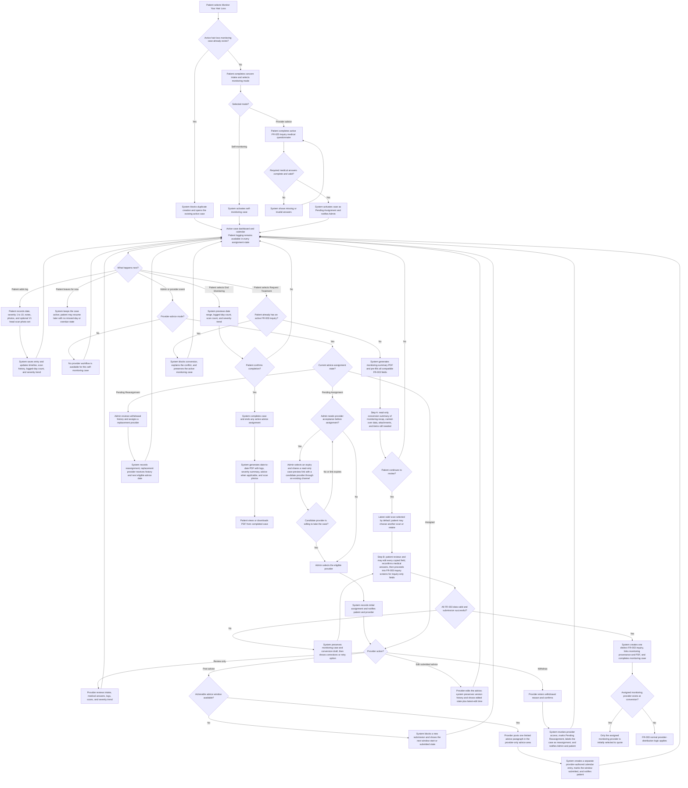

# FR-037 - Monitor Your Hair Loss

**Module**: P-05: Aftercare & Progress Monitoring | P-07: 3D Scan Capture & Viewing | PR-07: Communication & Messaging | A-01: Patient Management & Oversight | A-09: System Settings & Configuration | S-03: Notification Service | S-05: Media Storage Service
**Feature Branch**: `fr037-monitor-hair-loss`
**Created**: 2026-08-17
**Status**: ✅ Verified & Approved
**Source**: FR-037 from system-prd.md; product-owner requirements confirmed 2026-08-17 and clarified 2026-08-20; reuses compatible contracts from FR-002, FR-003, FR-020, and FR-025

---

## Executive Summary

Monitor Your Hair Loss gives a patient a structured, longitudinal record of their hair-loss condition before they decide whether to request treatment. A patient creates one active hair-loss monitoring case, records optional day-by-day entries, adds a severity score, notes, and standardized head scan photo sets, and can complete the case with a downloadable summary.

At case creation, the patient permanently chooses either self-monitoring or limited provider advice for that case. Advice-mode cases wait for Admin assignment while the patient continues logging. Admin may first share an expiring, read-only case preview with a candidate provider through an existing communication channel. An assigned provider sees the patient-parity monitoring calendar and can post one short, separate calendar advice entry from each configured window’s start date until it is submitted or superseded by the next window. Advice may be visibly edited with version history. The provider may withdraw, returning the case to Admin for clearly identified reassignment without interrupting patient logging.

The patient may convert an active case into a treatment inquiry under FR-003. Conversion completes the monitoring case, pre-fills all compatible inquiry information, permits the patient to review and edit every copied field, selects the latest scan by default while allowing another scan or a retake, and attaches a generated monitoring-summary PDF. The patient must not repeat information already supplied merely because they are changing services.

**V1 scan terminology**: In V1, all references to a “3D head scan” mean the standardized multi-view head scan photo set defined by FR-002. True 3D capture and viewing remain V2 scope. (REQ-037-045)

---

## Module Scope

### Service Boundary: Self-Service Monitoring vs Aftercare Package (NON-NEGOTIABLE)

FR-037 is a **standalone, patient-driven self-service utility**. It is not an aftercare package and must never inherit aftercare mechanics. Reviewers and implementers must apply this boundary before raising a gap against this FR: an aftercare capability absent here is correct scope, not a defect. (REQ-037-084)

| Capability | Aftercare package (FR-011 and related) | FR-037 self-service monitoring |
| --- | --- | --- |
| Cadence | Fixed clinical schedule with milestones | None; patient logs on any date, or not at all |
| Scan reminders / notifications to act | In scope — package drives the patient | **Out of scope** — no reminder feature belongs to this FR |
| Overdue, missed-day, compliance state | In scope | **Out of scope** — gaps are neutral forever |
| Care team relationship | Ongoing team, chat, prescriptions | One assigned provider, advice paragraphs only, advice mode only |
| Milestone-bound scan/task entities | In scope | **Out of scope** — monitoring uses its own flat entities |
| Progress presentation | Milestone-anchored progress views | Calendar, logged-day count, and severity trend derived from patient entries |

Notification scope for FR-037 is limited to the event list in Notification Events (assignment, advice, withdrawal, reassignment, completion, export-ready, conversion). FR-037 defines **no** patient-configurable logging or scan reminder. (REQ-037-079)

### Multi-Tenant Architecture

- **Patient Platform (P-05, P-07)**: Case creation, mode selection, calendar, daily entries, severity tracking, scans, completion, PDF export, and conversion to FR-003.
- **Provider Platform (PR-07)**: Searchable assigned advice-case queue, patient-parity longitudinal calendar view, cadence-gated paragraph advice, and withdrawal.
- **Admin Platform (A-01, A-09)**: Case oversight, full audited editing, expiring pre-assignment case previews, provider assignment/reassignment, and advice-cadence configuration.
- **Shared Services (S-03, S-05)**: Assignment/advice notifications, secure scan media processing, PDF generation, and conversion orchestration.

### Multi-Tenant Breakdown

**Patient Platform (P-05, P-07)**:

- Starts a hair-loss monitoring case from the service gateway.
- Selects self-monitoring or provider-advice mode before activation.
- Completes a lightweight concern intake; advice mode additionally requires the active FR-025 Inquiry medical questionnaire before provider access.
- Logs optional entries on any date with severity from 1 to 10, notes, and scan photo sets.
- Continues logging while advice assignment is pending or pending reassignment.
- Completes the case, exports its summary PDF, or converts it into an FR-003 treatment inquiry.

**Provider Platform (PR-07)**:

- Sees only advice-mode cases currently assigned to the provider. (REQ-037-038)
- Reviews intake, required medical answers, severity trend, entries, and scans.
- From each configured advice-window start date, may submit one concise advice paragraph. The window has no ordinary deadline and remains actionable until advice is submitted, except that an unsubmitted window expires when its next window opens.
- Each submitted advice creates its own provider-authored entry on the case tracking calendar; it is never attached to or stored as part of a patient log entry. Submitted advice remains editable with a visible edited state and latest-edit timestamp.
- Withdraws with a mandatory reason, after which access ends and Admin reassignment is required.
- Does not manage self-monitoring cases. (REQ-037-037)

**Admin Platform (A-01, A-09)**:

- Views and edits every monitoring case and its information with actor, timestamp, reason, before-value, and after-value audit history.
- Assigns an eligible provider (Active under FR-015 with setup complete) to a pending advice case and reassigns withdrawn cases.
- Generates a scoped case-preview link before assignment so a candidate provider can decide whether to accept the case; Admin selects the link expiry at share time.
- Distinguishes first assignment from reassignment in queues and case history.
- Configures the advice cadence as weekly or bi-weekly.
- Supports self-monitoring cases without adding a provider. (REQ-037-037)

**Shared Services (S-03, S-05)**:

- Stores monitoring media and entries securely and serves authorized tenant views.
- Generates date-to-date PDF summaries asynchronously and retains the generated artifact.
- Sends assignment, reassignment, advice, withdrawal, completion, export, and conversion notifications.
- Issues, validates, revokes, and audits expiring pre-assignment case-preview links.
- Performs idempotent transfer of compatible fields and attachments into FR-003.

### Communication Structure

**In Scope**:

- A short provider advice paragraph on an assigned advice-mode case.
- Patient notification when a provider is assigned, withdraws, is replaced, or posts advice. (REQ-037-078)
- Provider and Admin notifications for assignment and reassignment actions. (REQ-037-078)
- Advice history displayed chronologically within the monitoring case.
- An Admin-generated, read-only pre-assignment preview link shared through an existing external communication channel. Generating or viewing the preview does not assign the provider.

**Out of Scope**:

- An embedded or FR-037-specific chat screen, calls, diagnosis, prescriptions, or full medical consultation. Admin and a candidate provider may communicate through an existing channel before assignment, but that communication surface is not part of this FR. (REQ-037-019, REQ-037-075)
- FR-012 secure messaging, which starts only after its own eligibility conditions are met.
- Provider advice for self-monitoring cases.
- Patient switching from self-monitoring to advice mode during an active case.
- Patient-configurable logging or scan reminders, and any nudge, streak, or adherence notification. Reminders belong to the aftercare package, not to this self-service FR.

### Entry Points

- Patient selects **Monitor Your Hair Loss** from FR-003 Screen 1: Service Selection. (REQ-037-034)
- Patient opens the active case from the patient home/dashboard monitoring card. (REQ-037-034)
- Provider opens **Hair Loss Monitoring Advice** from the provider dashboard. (REQ-037-034)
- Admin opens **Monitoring Cases** or the pending assignment/reassignment queue. (REQ-037-034)
- Patient opens conversion from the active case actions or from the completion flow. (REQ-037-034)

---

## Business Workflows

### Unified Flow: Hair-Loss Monitoring Case Lifecycle

**Actors**: Patient, System, Admin, Provider when provider-advice mode is selected
**Trigger**: Patient selects Monitor Your Hair Loss or resumes an active monitoring case
**Outcome**: The patient continues monitoring, completes and exports the case, or converts it into a distinct FR-003 treatment inquiry

---

## Screen Specifications

> **Tenant screen ownership**:
>
> - **Patient App / Patient Platform (P-05, P-07)**: Screens 1-7 cover intake and mode selection, the active monitoring calendar, daily logs, scan capture/history, completion, PDF export, and conversion into FR-003.
> - **Provider Dashboard / Provider Platform (PR-07)**: Screens 8, 9, 10A, 10B, and 11 exist only for provider-advice cases and separate the assigned-case queue, single-case overview, daily-log detail, provider-advice detail, and withdrawal confirmation.
> - **Admin Dashboard / Admin Platform (A-01, A-09)**: Screens 12, 13, 14A, and 14B separate the system-wide case list, single-case overview, daily-log detail, and provider-advice detail, including assignment, audited correction, and advice-cadence controls.

### Patient Platform Screens

#### Screen 1: Hair-Loss Monitoring Intake and Mode Selection

**Purpose**: Creates a monitoring case and captures reusable concern information.

| Field Name | Type | Required | Description | Validation Rules | Graph field |
| --- | --- | --- | --- | --- | --- |
| Monitoring Mode | radio | Yes | Self-monitoring or Provider advice | Immutable after activation | ENT-monitoring-case.mode |
| Nature of Concern | textarea | Yes | Current hair-loss concern | 1 to 2000 characters (REQ-037-035) | ENT-monitoring-case.nature_of_concern |
| Duration | select | Yes | How long the condition has been noticed | FR-003 Duration enum; identical value set so conversion copies without remapping (REQ-037-035) | ENT-monitoring-case.duration |
| Previous Treatments | textarea | Yes | Previous treatment or “None” | Maximum 2000 characters (REQ-037-035) | ENT-monitoring-case.previous_treatments |
| Current Severity | slider | Yes | Starting condition rating | Integer 1 to 10 (REQ-037-035) | ENT-monitoring-case.starting_severity |
| Lifestyle Factors | textarea | No | Relevant context | Maximum 2000 characters (REQ-037-035) | ENT-monitoring-case.lifestyle_factors |
| Additional Notes | textarea | No | Other context | Maximum 2000 characters (REQ-037-035) | ENT-monitoring-case.additional_notes |
| Initial Photos | file list | No | Supporting current-condition images | FR-003 image limits (REQ-037-035) | ENT-monitoring-case.initial_photos |
| Initial Head Scan | capture | No | Initial V1 photo set | FR-002 quality contract (REQ-037-035) | ENT-monitoring-case.initial_scan_id |
| Medical Questionnaire | component | Conditional | Active Inquiry-context questionnaire | Required for provider advice mode | ENT-monitoring-case.medical_questionnaire_snapshot |

**Business Rules**:

- See REQ-037-001 and REQ-037-033.
- Mode cannot be changed after activation. A self-monitoring patient must complete the case before starting a new advice-mode case. (REQ-037-002)
- A new monitoring case starts with its own intake; previous monitoring-case history is not attached to it. (REQ-037-024)
- See REQ-037-086 and REQ-037-005.

#### Screen 2: Monitoring Dashboard and Calendar

**Purpose**: Provides the active case timeline, progress summary, and actions.

| Field Name | Type | Required | Description | Validation Rules | Graph field |
| --- | --- | --- | --- | --- | --- |
| Case Status | badge | Yes | Active or assignment state | Derived | ENT-monitoring-case.status |
| Calendar | calendar | Yes | Dates with patient logs, scans, and separate provider-advice entries | Patient-local timezone; event author/type distinguishable (REQ-037-042) | ENT-monitoring-entry.log_date, ENT-monitoring-scan.captured_at, ENT-monitoring-advice.submitted_at |
| Logged Days | number | Yes | Unique dates with at least one entry | Derived | ENT-monitoring-case.logged_days |
| Severity Trend | chart | Yes | Rating over time | Derived from valid entries | ENT-monitoring-case.severity_trend |
| Provider Advice Status | component | Conditional | Pending, assigned, or pending reassignment | Advice mode only | ENT-monitoring-case.advice_state |
| Advice Availability | status | Conditional | Future start date, available since date, submitted, or expired-unsubmitted | Advice mode and assigned only (REQ-037-081) | ENT-monitoring-advice-window.availability |
| Provider Advice Detail | detail panel | Conditional | Advice text, provider, original submission time, edited cue, and latest-edit time | Read-only to patient; separate from patient log detail | ENT-monitoring-advice.paragraph, ENT-monitoring-advice.author_id, ENT-monitoring-advice.submitted_at, ENT-monitoring-advice.is_edited, ENT-monitoring-advice.last_edited_at |
| Add Log | action | Yes | Opens Screen 3 | Active cases only (REQ-037-080) | no graph field (control) |
| Request Treatment | action | Yes | Opens Screen 7 Step A | Active cases only (REQ-037-080) | no graph field (control) |
| End Monitoring | action | Yes | Opens Screen 5 | Active cases only (REQ-037-080) | no graph field (control) |

**Business Rules**:

- No daily frequency is mandatory; missing dates are neutral and never overdue. (REQ-037-012)
- See REQ-037-004.
- Advice is shown chronologically as its own provider-authored calendar entry, never inside a patient log, and cannot be replied to as a chat thread. (REQ-037-043)
- Edited advice shows a clear edited cue and latest-edit timestamp without exposing prior versions to the patient. (REQ-037-043)

#### Screen 3: Daily Monitoring Log

**Purpose**: Records a dated observation using the same structure on every date.

| Field Name | Type | Required | Description | Validation Rules | Graph field |
| --- | --- | --- | --- | --- | --- |
| Log Date | date | Yes | Observation date | Not in future (REQ-037-039) | ENT-monitoring-entry.log_date |
| Severity | slider | Yes | Condition rating | Integer 1 to 10 (REQ-037-039) | ENT-monitoring-entry.severity |
| Notes | textarea | No | Daily observation | Maximum 3000 characters (REQ-037-039) | ENT-monitoring-entry.notes |
| Photos | file list | No | Supporting images | Secure image limits (REQ-037-039) | ENT-monitoring-entry.photos |
| Head Scan | capture/select | No | V1 head scan photo set | FR-002 quality contract (REQ-037-039) | ENT-monitoring-entry.scan_id |

**Business Rules**:

- The patient may create, edit, or delete their own entries while the case is active; all versions remain auditable. (REQ-037-040)
- Multiple entries on one date are allowed, but Logged Days counts the date once. (REQ-037-041)
- Every entry stores a submission timestamp. When one date holds several entries, the latest timestamp on that date supplies the date's severity for the trend, latest-severity, and summary calculations; earlier entries stay visible and auditable. (REQ-037-020)
- Scan capture opens Screen 4 and links the resulting scan to the log date. (REQ-037-044)

#### Screen 4: Head Scan Capture and History

**Purpose**: Captures or reviews standardized scan photo sets across the case.

| Field Name | Type | Required | Description | Validation Rules | Graph field |
| --- | --- | --- | --- | --- | --- |
| Capture Guidance | component | Yes | Front, top, left, right, and back guidance | FR-002 V1 contract; five views offered, at least one view required, no single view mandatory (REQ-037-044) | no graph field (guidance component) |
| Photo Set | capture/upload | Yes | Standardized multi-view head photos | Quality validation; at least one of the five views required | ENT-monitoring-scan.photo_set |
| Captured At | datetime | Yes | Scan timestamp | System generated | ENT-monitoring-scan.captured_at |
| Scan History | list | Yes | Previous scans and thumbnails | Current case only | ENT-monitoring-scan.id |

**Business Rules**:

- True 3D reconstruction is not required in V1. (REQ-037-045)
- Patients can retake a failed-quality scan before saving. (REQ-037-044)
- Providers can view scans only while assigned to the advice case. (REQ-037-046)

#### Screen 5: Complete or Convert Monitoring Case

**Purpose**: Lets the patient deliberately end the active case.

| Field Name | Type | Required | Description | Validation Rules | Graph field |
| --- | --- | --- | --- | --- | --- |
| Case Summary | component | Yes | Date range, logged days, scans, severity trend | Derived (REQ-037-052, REQ-037-057) | ENT-monitoring-case.monitoring_period, ENT-monitoring-case.logged_days, ENT-monitoring-case.scan_count, ENT-monitoring-case.severity_trend |
| Completion Choice | radio | Yes | Complete and export, or Request Treatment | Single selection (REQ-037-052) | no graph field (control) |
| Confirmation | checkbox | Yes | Acknowledges monitoring will end | Must be selected (REQ-037-052) | no graph field (control) |

**Business Rules**:

- Completing or successfully converting ends the active case and any advice assignment. (REQ-037-053)
- Conversion is not committed until the FR-003 inquiry is successfully submitted. (REQ-037-030, REQ-037-064)
- A completed or converted case is read-only except for Admin audited correction. (REQ-037-054)

#### Screen 6: Monitoring Summary and PDF Export

**Purpose**: Displays the completed case and its downloadable report.

| Field Name | Type | Required | Description | Validation Rules | Graph field |
| --- | --- | --- | --- | --- | --- |
| Monitoring Period | date range | Yes | First through final case date | Derived | ENT-monitoring-case.monitoring_period |
| Logged Days | number | Yes | Unique dates logged | Derived | ENT-monitoring-case.logged_days |
| Severity Summary | component | Yes | First, latest, minimum, maximum, average, and trend | Derived (REQ-037-057) | ENT-monitoring-case.severity_summary |
| Log Timeline | list | Yes | Date-to-date entries and notes | Chronological | ENT-monitoring-entry.log_date, ENT-monitoring-entry.notes |
| Head Scan Photos | gallery | Yes | Scans grouped by capture date | Authorized access only | ENT-monitoring-scan.photo_set |
| Provider Advice | list | Conditional | Advice with provider and date | Advice mode only | ENT-monitoring-advice.paragraph, ENT-monitoring-advice.author_id, ENT-monitoring-advice.submitted_at |
| PDF Status | status | Yes | Generating, ready, or failed | Derived | ENT-monitoring-export.generation_state |
| Download PDF | action | Conditional | Downloads ready report | Signed access link (REQ-037-092) | no graph field (control) |

**Business Rules**:

- The PDF contains the complete date-to-date log, scan photos, logged-day count, and severity summary, plus the provider advice for advice-mode cases. Provider advice appears in the completion PDF only. (REQ-037-009)
- Failed generation is retryable without altering the completed case. (REQ-037-055)

#### Screen 7: Convert to Treatment Inquiry

**Purpose**: Turns a completed monitoring decision into an FR-003 inquiry through an explicit two-step handoff — first a read-only summary of everything the monitoring case carries over, then an editable review — before the patient enters the standard FR-003 inquiry screens.

**Step structure**: Screen 5 asks the patient to end the case by terminating (complete and export) or converting. Choosing conversion opens **Screen 7 Step A**, then **Screen 7 Step B**, then hands off to the FR-003 inquiry flow. Steps A and B belong to FR-037; every screen after the handoff belongs to FR-003 and is not redefined here.

##### Screen 7 Step A: Conversion Summary

**Purpose**: Gives the patient one consolidated preview of the monitoring record and the data that will populate the inquiry, so the volume of carried-over data points is understood before any form is opened. This step is what distinguishes conversion from a plain FR-003 start — an FR-003 inquiry begun from scratch has nothing to summarize.

| Field Name | Type | Required | Description | Validation Rules | Graph field |
| --- | --- | --- | --- | --- | --- |
| Monitoring Recap | component | Yes | Date range, logged days, scan count, severity summary and trend, advice count when applicable | Derived; read-only (REQ-037-057) | ENT-monitoring-case.monitoring_period, ENT-monitoring-case.logged_days, ENT-monitoring-case.scan_count, ENT-monitoring-case.severity_summary, ENT-monitoring-case.advice_count |
| Carried-Over Data Preview | grouped list | Yes | Every field that will pre-fill the inquiry, grouped as concern information, medical answers, selected scan, and attachments | Derived; read-only at this step | ENT-monitoring-conversion.carried_over_preview |
| Items Still Needed | list | Yes | Inquiry-only information the patient must still supply, such as destinations, dates, and terms | Derived from FR-003 required set | ENT-monitoring-conversion.items_still_needed |
| Monitoring Summary PDF | attachment | Yes | Generated case summary that will attach to the inquiry | PDF; system generated | ENT-monitoring-export.pdf_media |
| Provider Routing Notice | component | Conditional | States that the assigned advice provider will be the only initial quote recipient | Advice mode with active assignment only (REQ-037-060) | ENT-monitoring-conversion.provider_routing |
| Continue to Review | action | Yes | Opens Step B | Summary and PDF must be generated | no graph field (control) |
| Back | action | Yes | Returns to the active case with no state change | Monitoring stays active | no graph field (control) |

**Business Rules**:

- Step A is read-only. No field is edited and no inquiry record exists yet; the monitoring case is untouched until Step B submission succeeds. (REQ-037-011)
- If PDF generation has not finished, Step A shows generation status and allows the patient to continue once it is ready or retry on failure. (REQ-037-059)
- Leaving Step A never completes, converts, or alters the monitoring case. (REQ-037-011)

##### Screen 7 Step B: Review and Edit Carried-Over Data

**Purpose**: Reviews and edits pre-filled FR-003 data before entering the remaining inquiry screens.

| Field Name | Type | Required | Description | Validation Rules | Graph field |
| --- | --- | --- | --- | --- | --- |
| Concern Information | editable component | Yes | Copied FR-003 Screen 3-compatible fields | FR-003 validation | ENT-inquiry.problem_concern, ENT-inquiry.problem_duration, ENT-inquiry.previous_treatments, ENT-inquiry.symptom_severity, ENT-inquiry.lifestyle_factors, ENT-inquiry.additional_notes |
| Selected Head Scan | select/capture | Yes | Latest by default, another prior scan, or retake | FR-002 quality contract | ENT-monitoring-conversion.selected_scan_id |
| Medical Answers | editable component | Yes | Previously answered items plus current active questions | Patient must review and reconfirm | ENT-medical-questionnaire-response.answer, ENT-medical-questionnaire-response.details |
| Monitoring Summary PDF | attachment | Yes | Generated case summary | PDF; system generated | ENT-monitoring-export.pdf_media |
| Inquiry-Only Handoff Target | reference | Yes | Names the inquiry-only information (destinations, dates, provider selection rules, terms) collected on the FR-003 screens opened after Step B | Not collected or validated on Step B; FR-003 owns the fields and their validation | no graph field (reference to FR-003 fields) |

**Business Rules**:

- Every copied field remains editable by the patient before submission. (REQ-037-021)
- The patient answers only missing or newly required information and reconfirms existing medical answers. (REQ-037-061)
- The monitoring case and inquiry remain distinct records linked by immutable conversion provenance. (REQ-037-062)
- If an assigned advice provider exists at conversion, that provider is the only initial quote recipient. If none exists, or the assigned provider has withdrawn or is not eligible at conversion, conversion continues and FR-003 normal distribution applies. Exclusive routing bypasses only FR-003 country and provider-selection matching and the 10-provider cap; anonymization, notification timing, and provider dashboard behavior are unchanged. (REQ-037-029, REQ-037-069)
- Completing Step B hands the patient into the standard FR-003 inquiry screens for the inquiry-only information. FR-037 does not duplicate those screens; it supplies pre-filled values and the summary PDF to them. (REQ-037-063)
- If the exclusive provider declines after conversion and before creating a quote, FR-003 automatically removes the exclusive-provider restriction and runs its normal distribution workflow. This transition occurs on the resulting inquiry, not on Steps A or B. Expiry continues to follow FR-003/FR-004's existing configured rules. (REQ-037-029)

### Provider Platform Screens

#### Screen 8: Provider Monitoring Advice Queue

**Purpose**: Shows and helps the provider find cases currently assigned to them.

| Field Name | Type | Required | Description | Validation Rules | Graph field |
| --- | --- | --- | --- | --- | --- |
| Assigned Cases | list | Yes | Active advice-mode cases | Assigned provider only | ENT-monitoring-case.id, ENT-patient.anonymized_id |
| Search | text input | No | Finds cases by anonymized patient ID or case ID | Debounced; scoped to assigned cases | no graph field (control) |
| Status Filter | multi-select | No | Filters by active assignment and case status | Valid values only | no graph field (control) |
| Advice Filter | select | No | All, advice available, awaiting future window, or submitted for current window | Derived from window state | no graph field (control) |
| Assignment Filter | select | No | All, initial assignment, or reassignment | Valid values only | no graph field (control) |
| Sort | select | No | Last patient log, advice availability, assignment date, or anonymized patient ID | Valid values only | no graph field (control) |
| Last Patient Log | datetime | Yes | Most recent entry | Derived | ENT-monitoring-case.last_patient_log_at |
| Advice Availability | status | Yes | Available now or next date | Config-derived | ENT-monitoring-advice-window.availability |
| Assignment Type | badge | Yes | Initial or reassignment | Derived | ENT-monitoring-provider-assignment.assignment_type |

**Business Rules**:

- Self-monitoring and unassigned cases never appear. (REQ-037-038)
- The provider can search by anonymized patient ID or case ID; filter by status, advice availability, and assignment type; and sort by last patient log, advice availability, assignment date, or anonymized patient ID. (REQ-037-087, REQ-037-016)
- Search, filters, sorting, and pagination compose without exposing cases assigned to another provider. (REQ-037-016)
- Withdrawing removes the case from this queue immediately after confirmation. (REQ-037-093)

#### Screen 9: Provider Monitoring Case Overview

**Purpose**: Gives the assigned provider the overall view of one monitoring case and routes each calendar record into its dedicated detail screen.

| Field Name | Type | Required | Description | Validation Rules | Graph field |
| --- | --- | --- | --- | --- | --- |
| Case Header | component | Yes | Anonymized patient ID, case ID, mode, status, start date, assignment type, and assignment date | Read-only; anonymized patient identifier only for the entire case lifetime | ENT-patient.anonymized_id, ENT-monitoring-case.id, ENT-monitoring-case.mode, ENT-monitoring-case.status, ENT-monitoring-case.started_on, ENT-monitoring-provider-assignment.assignment_type, ENT-monitoring-provider-assignment.assigned_at |
| Monitoring Dashboard | component | Yes | Same summary, trend, logged-day count, scan history, and status information visible to the patient | Read-only provider parity | ENT-monitoring-case.severity_trend, ENT-monitoring-case.logged_days, ENT-monitoring-scan.id, ENT-monitoring-case.status |
| Monitoring Calendar | calendar | Yes | Same dated calendar and event indicators visible to the patient | Read-only; patient-log events open Screen 10A and provider-advice events open Screen 10B | ENT-monitoring-entry.log_date, ENT-monitoring-scan.captured_at, ENT-monitoring-advice.submitted_at |
| Medical Questionnaire | component | Yes | Required advice-mode medical answers | Read-only | ENT-monitoring-case.medical_questionnaire_snapshot |
| Advice Window Summary | component | Yes | Current window plus the immediately superseded unsubmitted window when applicable, showing start date and available, submitted, or expired state | New window expires the prior unsubmitted window; current available window opens Screen 10B | ENT-monitoring-advice-window.start_date, ENT-monitoring-advice-window.state, ENT-monitoring-advice-window.superseded_window_id |
| Advice History | list | Yes | Provider-authored advice entries with submission time, edited state, and latest-edit time | Chronological; each entry opens Screen 10B; never attached to patient logs | ENT-monitoring-advice.submitted_at, ENT-monitoring-advice.is_edited, ENT-monitoring-advice.last_edited_at |
| Withdraw | action | No | Opens Screen 11 | Active assignment only | no graph field (control) |

**Business Rules**:

- Screen 9 is an overview only; it does not expand a complete daily log or edit advice inline. (REQ-037-017)
- FR-037 advice involves no payment, so the assigned provider sees the anonymized patient identifier for the whole case lifetime and never the patient full name or contact details. Any later de-anonymization happens only in the FR-003/FR-004 flow created by conversion, under that FR's own payment rules. (REQ-037-028, REQ-037-083)
- Patient-log and provider-advice calendar events remain visually distinct and route to Screen 10A and Screen 10B respectively. (REQ-037-017)

#### Screen 10A: Provider Daily Log Detail

**Purpose**: Shows the complete patient-authored record for one selected calendar day without mixing provider advice into that record.

| Field Name | Type | Required | Description | Validation Rules | Graph field |
| --- | --- | --- | --- | --- | --- |
| Case and Date Context | header | Yes | Anonymized patient ID, case ID, selected date, and navigation back to Screen 9 | Read-only | ENT-patient.anonymized_id, ENT-monitoring-case.id, ENT-monitoring-entry.log_date |
| Severity | value | Yes | Patient severity for the selected log | Integer 1 to 10; read-only | ENT-monitoring-entry.severity |
| Notes | text | No | Patient-authored observation | Read-only | ENT-monitoring-entry.notes |
| Photos | gallery | No | Images attached to the selected daily log | Authorized media only; read-only | ENT-monitoring-entry.photos |
| Head Scan | component | No | V1 head scan photo set linked to the selected log | Authorized media only; read-only | ENT-monitoring-entry.scan_id |
| Record Metadata | component | Yes | Author, created time, latest update time, and version state | Read-only | ENT-monitoring-entry.created_by, ENT-monitoring-entry.submitted_at, ENT-monitoring-entry.updated_at, ENT-monitoring-entry.version |
| Previous / Next Log | navigation | No | Moves between patient-authored daily logs in the case | Assigned case only (REQ-037-091) | no graph field (control) |

**Business Rules**:

- Screen 10A displays one patient-authored daily log and its media; provider advice from the same date remains a separate calendar event and is never rendered as part of this record. (REQ-037-014, REQ-037-017)
- The provider cannot edit patient-authored monitoring data. (REQ-037-076)

#### Screen 10B: Provider Advice Detail

**Purpose**: Provides the dedicated surface for viewing, submitting, or editing one provider-advice record or the current available advice window.

| Field Name | Type | Required | Description | Validation Rules | Graph field |
| --- | --- | --- | --- | --- | --- |
| Case and Window Context | header | Yes | Anonymized patient ID, case ID, advice-window start date, state, and navigation back to Screen 9 | Assigned case only | ENT-patient.anonymized_id, ENT-monitoring-case.id, ENT-monitoring-advice-window.start_date, ENT-monitoring-advice-window.state |
| Advice Window Stack | list | Yes | Current window and immediately superseded unsubmitted window when applicable | Only current available window is actionable | ENT-monitoring-advice-window.id, ENT-monitoring-advice-window.state, ENT-monitoring-advice-window.superseded_window_id |
| Advice Paragraph | textarea | Conditional | New or edited advice for the selected actionable/submitted record | Maximum 1500 characters; active assignment required for write actions (REQ-037-077) | ENT-monitoring-advice.paragraph |
| Submit Advice | action | Conditional | Creates the single advice record for the current available window | Window available and no advice submitted | no graph field (control) |
| Edit Advice | action | Conditional | Saves a new version of submitted advice | Submitted record; active assignment; audited (REQ-037-077) | no graph field (control) |
| Advice Metadata | component | Conditional | Author, original submission time, edited cue, latest-edit time, and version state | Submitted advice only | ENT-monitoring-advice.author_id, ENT-monitoring-advice.submitted_at, ENT-monitoring-advice.is_edited, ENT-monitoring-advice.last_edited_at, ENT-monitoring-advice.versions |

**Business Rules**:

- Advice is informational and must not be represented as diagnosis or prescription. (REQ-037-075)
- See REQ-037-013.
- If the next calculated window opens while the prior window remains unsubmitted, the prior window alone expires and the new window becomes the sole actionable window. Both remain visible with distinct states. (REQ-037-013)
- See REQ-037-014.
- See REQ-037-015.

#### Screen 11: Provider Withdrawal Confirmation

**Purpose**: Ends a provider assignment safely.

| Field Name | Type | Required | Description | Validation Rules | Graph field |
| --- | --- | --- | --- | --- | --- |
| Withdrawal Reason | textarea | Yes | Reason visible to Admin | 1 to 1000 characters | ENT-monitoring-provider-assignment.withdrawal_reason |
| Confirmation | checkbox | Yes | Confirms immediate loss of access | Must be selected | no graph field (control) |

**Business Rules**:

- The provider must enter a withdrawal reason of 1 to 1000 characters and tick the confirmation that access ends immediately before the withdrawal is saved. (REQ-037-089, REQ-037-090)
- Withdrawal does not end the patient’s monitoring case.
- The case returns to Admin as Pending Reassignment and is clearly labeled as a reassignment. (REQ-037-006, REQ-037-007)

### Admin Platform Screens

#### Screen 12: Admin Monitoring Cases and Assignment Queue

**Purpose**: Gives Admin a system-wide operational picture of monitoring cases and supports oversight, pre-assignment sharing, first assignment, and reassignment.

| Field Name | Type | Required | Description | Validation Rules | Graph field |
| --- | --- | --- | --- | --- | --- |
| Case List | table | Yes | All hair-loss monitoring cases | Paginated | ENT-monitoring-case.id |
| Mode Tabs | tabs | Yes | All Cases, Self-Monitoring, and Provider Intervention | Counts and selected tab remain synchronized with filters (REQ-037-070) | ENT-monitoring-case.mode |
| Search | text input | No | Finds by patient name, patient ID, case ID, assigned provider, or candidate provider | Debounced | no graph field (control) |
| Status Filters | multi-select | No | Active, completed, converted, pending assignment, pending reassignment | Valid values | no graph field (control) |
| Provider Filter | searchable select | No | Assigned provider, unassigned, or withdrawn-provider cases | Valid provider or derived state | no graph field (control) |
| Advice State Filter | multi-select | No | Available, awaiting future window, submitted, or expired-unsubmitted | Advice cases only | no graph field (control) |
| Date Filters | date range | No | Case start, last patient log, last advice, or completion date | Valid range | no graph field (control) |
| Sort | select | No | Updated date, start date, last patient log, advice availability, patient, or provider | Valid values | no graph field (control) |
| Case Identity | columns | Yes | Case ID, patient name and ID, mode, case status, and start date | Read-only summary | ENT-monitoring-case.id, ENT-patient.name, ENT-patient.anonymized_id, ENT-monitoring-case.mode, ENT-monitoring-case.status, ENT-monitoring-case.started_on |
| Activity Summary | columns | Yes | Last patient log, logged-day count, latest severity, scan count, last advice, and next/current advice state | Derived (REQ-037-082) | ENT-monitoring-case.last_patient_log_at, ENT-monitoring-case.logged_days, ENT-monitoring-case.latest_severity, ENT-monitoring-case.scan_count, ENT-monitoring-case.last_advice_at, ENT-monitoring-advice-window.availability |
| Assignment Summary | columns | Conditional | Assigned provider, assignment state, assignment type, assignment date, and withdrawal indicator | Advice cases only | ENT-monitoring-provider-assignment.provider_id, ENT-monitoring-provider-assignment.status, ENT-monitoring-provider-assignment.assignment_type, ENT-monitoring-provider-assignment.assigned_at, ENT-monitoring-provider-assignment.withdrawal_reason |
| Assignment Type | badge | Conditional | Initial or reassignment | Advice cases only | ENT-monitoring-provider-assignment.assignment_type |
| Assign Provider | action | Conditional | Opens provider selector | Pending states only (REQ-037-094) | no graph field (control) |
| Share Case Preview | action | Conditional | Creates a read-only preview for a candidate provider before assignment | Pending assignment or reassignment only (REQ-037-094) | no graph field (control) |
| Preview Contents | review component | Conditional | Shows the exact read-only case overview and clinical summary that the candidate provider will receive | Must be reviewed before sharing; excludes patient direct-contact details and Admin-only audit/assignment data (REQ-037-071) | ENT-monitoring-case-preview.dataset_version |
| Preview Expiry | duration selector | Conditional | Admin-selected lifetime for the preview link at share time | Required before link generation; any duration up to a maximum of 14 days | ENT-monitoring-case-preview.expires_at |
| Preview Status | status | Conditional | Candidate provider, created by/time, expiry time, active/expired/revoked state, and last viewed time | Read-only except revoke action | ENT-monitoring-case-preview.candidate_provider_id, ENT-monitoring-case-preview.created_by, ENT-monitoring-case-preview.created_at, ENT-monitoring-case-preview.expires_at, ENT-monitoring-case-preview.state, ENT-monitoring-case-preview.last_viewed_at |

**Business Rules**:

- Reassignment cases display withdrawal reason and prior assignment history. (REQ-037-067)
- The mode tabs are a primary partition: provider-intervention controls and advice fields do not appear as applicable on self-monitoring rows. (REQ-037-070)
- Admin chooses the preview-link expiry each time Share is used, any time up to 14 days. The preview is read-only, scoped to the minimum case information needed for an acceptance decision, audited, revocable, and does not grant assignment access. (REQ-037-018, REQ-037-051)
- FR-037 does not embed a chat surface. Admin shares the preview link through an existing communication channel and records the eventual assignment decision in this screen. (REQ-037-019)
- Assignment eligibility and Admin permissions are validated before save. An eligible provider is one that is Active under FR-015 with setup complete; providers do not opt in separately to advice cases. (REQ-037-068)
- Admin can search by patient name, patient ID, case ID, assigned provider, or candidate provider; filter by status, provider, advice state, and date; and sort by updated date, start date, last patient log, advice availability, patient, or provider. (REQ-037-088)

#### Screen 13: Admin Monitoring Case Overview and Configuration

**Purpose**: Gives Admin the overall view and operational controls for one case, routing individual patient logs and provider advice into dedicated detail screens.

| Field Name | Type | Required | Description | Validation Rules | Graph field |
| --- | --- | --- | --- | --- | --- |
| Case Header | component | Yes | Case ID, patient identity and contact summary, mode, status, dates, completion/conversion state, and linked inquiry | Permission controlled | ENT-monitoring-case.id, ENT-patient.name, ENT-patient.email, ENT-patient.phone, ENT-monitoring-case.mode, ENT-monitoring-case.status, ENT-monitoring-case.started_on, ENT-monitoring-case.completed_on, ENT-monitoring-case.converted_inquiry_id |
| Intake and Medical Data | component | Yes | All intake answers and the advice-mode medical questionnaire visible in the patient case experience | Permission controlled; questionnaire conditional by mode | ENT-monitoring-case.nature_of_concern, ENT-monitoring-case.duration, ENT-monitoring-case.previous_treatments, ENT-monitoring-case.starting_severity, ENT-monitoring-case.lifestyle_factors, ENT-monitoring-case.additional_notes, ENT-monitoring-case.initial_photos, ENT-monitoring-case.initial_scan_id, ENT-monitoring-case.medical_questionnaire_snapshot |
| Monitoring Dashboard | component | Yes | Patient-parity summary, severity trend, logged-day count, scan history, and case status | Permission controlled | ENT-monitoring-case.severity_trend, ENT-monitoring-case.logged_days, ENT-monitoring-case.scan_count, ENT-monitoring-scan.id, ENT-monitoring-case.status |
| Monitoring Calendar | calendar | Yes | Full day-by-day patient calendar plus separate provider-advice entries | Patient logs open Screen 14A; provider advice opens Screen 14B; author type must be distinguishable | ENT-monitoring-entry.log_date, ENT-monitoring-scan.captured_at, ENT-monitoring-advice.submitted_at |
| Assignment History | timeline | Conditional | Provider assignment lifecycle | Immutable events (REQ-037-085) | ENT-monitoring-provider-assignment.provider_id, ENT-monitoring-provider-assignment.assignment_type, ENT-monitoring-provider-assignment.status, ENT-monitoring-provider-assignment.assigned_at, ENT-monitoring-provider-assignment.ended_at, ENT-monitoring-provider-assignment.withdrawal_reason |
| Assignment Controls | component | Conditional | Candidate preview sharing, expiry/revocation, assignment, reassignment, and provider withdrawal context | Advice mode only; permission controlled | ENT-monitoring-case-preview.expires_at, ENT-monitoring-case-preview.state, ENT-monitoring-provider-assignment.provider_id, ENT-monitoring-provider-assignment.withdrawal_reason |
| Advice Window History | list | Conditional | Window start, submitted/available/expired state, linked advice record, and supersession relationship | Advice mode only; linked advice opens Screen 14B | ENT-monitoring-advice-window.start_date, ENT-monitoring-advice-window.state, ENT-monitoring-advice-window.advice_id, ENT-monitoring-advice-window.superseded_window_id |
| Export and Conversion | component | Yes | PDF versions, export state, conversion summary, linked FR-003 inquiry, and provenance | Permission controlled | ENT-monitoring-export.report_version, ENT-monitoring-export.generation_state, ENT-monitoring-export.pdf_media, ENT-monitoring-conversion.inquiry_id, ENT-monitoring-conversion.field_mapping_version |
| Edit Reason | textarea | Conditional | Reason for Admin mutation | Required before save | ENT-monitoring-audit-entry.reason |
| Advice Cadence | select | Yes | Weekly or bi-weekly | Global active configuration; default weekly (7 days); applies to cases created after the change only | no graph field (setting SET-advice-cadence) |
| Audit History | timeline | Yes | Before and after values, actor, reason, time | Read-only | ENT-monitoring-audit-entry.before_value, ENT-monitoring-audit-entry.after_value, ENT-monitoring-audit-entry.actor_id, ENT-monitoring-audit-entry.reason, ENT-monitoring-audit-entry.occurred_at |

**Business Rules**:

- Admin may edit any case information, but no edit may erase historical values or provenance. (REQ-037-072)
- Admin sees every field and dated record available in the patient case view, with additional assignment, advice-window, audit, preview-sharing, export, and conversion controls according to permission.
- Patient logs and provider advice remain separate record types and separate calendar entries even when they occur on the same date.
- Screen 13 is the overall case screen; full daily-log and advice-record fields are presented only on Screens 14A and 14B.
- Cadence changes apply prospectively to newly created cases only. Cases already created keep the cadence captured at their creation, so no in-flight advice window is shortened, extended, or recomputed, and no advice entry is retroactively created or removed. (REQ-037-008)
- The cadence selector is a single global setting; Admin cannot set a case-specific cadence. (REQ-037-008)

#### Screen 14A: Admin Daily Log Detail

**Purpose**: Gives Admin the complete patient-authored record for one selected calendar day and the audited correction controls for that record.

| Field Name | Type | Required | Description | Validation Rules | Graph field |
| --- | --- | --- | --- | --- | --- |
| Case and Date Context | header | Yes | Patient name, case ID, selected date, and navigation back to Screen 13 | Permission controlled | ENT-patient.name, ENT-monitoring-case.id, ENT-monitoring-entry.log_date |
| Severity | editable value | Yes | Patient severity for the selected log | Integer 1 to 10; edit reason required on change | ENT-monitoring-entry.severity |
| Notes | editable text | No | Patient-authored observation | Maximum 3000 characters; edit reason required on change | ENT-monitoring-entry.notes |
| Photos | editable gallery | No | Images attached to the selected daily log | Authorized media; changes audited | ENT-monitoring-entry.photos |
| Head Scan | editable component | No | V1 head scan photo set linked to the selected log | Authorized media; changes audited | ENT-monitoring-entry.scan_id |
| Record Metadata | component | Yes | Author, created time, latest update time, and current version | Read-only | ENT-monitoring-entry.created_by, ENT-monitoring-entry.submitted_at, ENT-monitoring-entry.updated_at, ENT-monitoring-entry.version |
| Edit Reason | textarea | Conditional | Reason for correcting the selected log | Required before any save | ENT-monitoring-audit-entry.reason |
| Version History | timeline | Yes | Before/after values, Admin actor, reason, and timestamp | Read-only; immutable | ENT-monitoring-audit-entry.before_value, ENT-monitoring-audit-entry.after_value, ENT-monitoring-audit-entry.actor_id, ENT-monitoring-audit-entry.reason, ENT-monitoring-audit-entry.occurred_at |

**Business Rules**:

- Screen 14A edits only the selected patient-authored daily-log record. Provider advice remains a separate record even when it shares the date.
- Admin correction must preserve original values and provenance.

#### Screen 14B: Admin Provider Advice Detail

**Purpose**: Gives Admin the complete provider-advice record, its advice-window context, and audited correction history without attaching it to a patient log.

| Field Name | Type | Required | Description | Validation Rules | Graph field |
| --- | --- | --- | --- | --- | --- |
| Case and Window Context | header | Yes | Patient name, case ID, advice-window start date/state, and navigation back to Screen 13 | Permission controlled | ENT-patient.name, ENT-monitoring-case.id, ENT-monitoring-advice-window.start_date, ENT-monitoring-advice-window.state |
| Advice Paragraph | editable text | Conditional | Submitted provider advice | Maximum 1500 characters; edit reason required on Admin change | ENT-monitoring-advice.paragraph |
| Advice Window Detail | component | Yes | Available/submitted/expired state, supersession relationship, and linked advice identity | Read-only window history | ENT-monitoring-advice-window.state, ENT-monitoring-advice-window.superseded_window_id, ENT-monitoring-advice-window.advice_id |
| Advice Metadata | component | Conditional | Provider author, original submission time, edited cue, latest-edit time, and current version | Submitted advice only | ENT-monitoring-advice.author_id, ENT-monitoring-advice.submitted_at, ENT-monitoring-advice.is_edited, ENT-monitoring-advice.last_edited_at, ENT-monitoring-advice.versions |
| Edit Reason | textarea | Conditional | Reason for correcting submitted advice | Required before any Admin save | ENT-monitoring-audit-entry.reason |
| Version History | timeline | Conditional | Original and edited content, actor, reason, and timestamp | Submitted advice only; read-only; immutable | ENT-monitoring-audit-entry.before_value, ENT-monitoring-audit-entry.after_value, ENT-monitoring-audit-entry.actor_id, ENT-monitoring-audit-entry.reason, ENT-monitoring-audit-entry.occurred_at, ENT-monitoring-advice.versions |

**Business Rules**:

- Screen 14B owns advice-record detail; advice never appears as a field or annotation inside Screen 14A.
- Admin edits preserve the provider as original author, retain every prior version, and surface the edited cue and latest-edit timestamp. (REQ-037-074)

---

## Business Rules

### General Module Rules

- **Rule 1**: A patient may have one active case per monitoring type; an active FR-037 case does not block an active FR-038 case. (REQ-037-032)
- **Rule 2**: Monitoring mode is chosen at creation and cannot change mid-case. (REQ-037-002)
- **Rule 3**: See REQ-037-024.
- **Rule 4**: See REQ-037-004.
- **Rule 5**: Advice cadence is Admin-configurable as weekly or bi-weekly, implemented as minimum intervals of 7 or 14 days. The default is weekly (7 days). The setting is **global** — one value for the whole app, with no per-case, per-provider, or per-patient override. (REQ-037-008)
- **Rule 5a**: A cadence change applies **only to cases created after the change**. Each case captures the active cadence value at creation and keeps it for the entire case lifetime, including through reassignment. An existing case never switches cadence mid-flight, so a partly elapsed advice window is never recomputed. A patient who already has an active case receives the new cadence on their next case. (REQ-037-008)
- **Rule 5b**: An advice window becomes available on its calculated start date and otherwise has no deadline. The first window opens one cadence period (7 or 14 days) after the provider is first assigned. After a reassignment the replacement provider continues the existing window schedule and receives the next window date. The provider may submit its one advice entry at any later time until submission or until the next calculated window opens. If a successor opens first, only the older unsubmitted window expires; the successor becomes the sole actionable window, and both states remain visible together. (REQ-037-013)
- **Rule 5c**: Provider advice is a separate provider-authored case-calendar record, never an attachment or annotation on a patient log. Submitted advice may be edited with immutable version history; patient, provider, and Admin views must show an edited cue and latest-edit timestamp. (REQ-037-014, REQ-037-015)
- **Rule 5d**: Before assignment or reassignment, Admin may generate a read-only case-preview link for a candidate provider. Admin must select its expiry at share time, any time up to 14 days. Preview access is audited, revocable, scoped to acceptance-decision information, and grants neither assignment nor ongoing case access. No FR-037 chat screen is created for this interaction. (REQ-037-018, REQ-037-051, REQ-037-019)
- **Rule 6**: Completion and conversion are terminal case outcomes; a converted monitoring case remains distinct from the inquiry. (REQ-037-053, REQ-037-062)
- **Rule 7**: If the exclusive assigned provider explicitly declines the converted inquiry before creating a quote, FR-003 automatically removes the exclusive-provider restriction and runs normal distribution exactly once. This decline fallback requires no patient release action. Inquiry or quote expiry remains governed by FR-003/FR-004 and does not trigger this rule. (REQ-037-029)
- **Rule 8**: Monitoring has no required daily frequency and no overdue state. It also has no logging cadence, no milestones, and no patient reminders; those are aftercare-package mechanics excluded by the Service Boundary in Module Scope. The only cadence in this FR is the provider advice window in Rule 5, which limits the provider, not the patient. (REQ-037-012, REQ-037-084)
- **Rule 9**: Every monitoring entry carries a submission timestamp. Where a date holds more than one entry, the latest-timestamped entry on that date is authoritative for that date's severity in the trend, latest-severity, and PDF summary calculations. Superseded entries remain stored, visible, and auditable. (REQ-037-020)
- **Rule 10**: See REQ-037-086.
- Provider advice is a limited free service, not a full consultation. (REQ-037-083)

### Data & Privacy Rules

- Monitoring entries, medical answers, scans, advice, assignments, and exports are medical data. Their encryption in transit and at rest is the single platform-wide security Rule in the system PRD; this FR keeps no separate encryption requirement.
- Access is limited to the patient, authorized Admin users, and the currently assigned provider for advice-mode cases. (REQ-037-025)
- Providers see only an anonymized patient identifier on every FR-037 screen for the whole case lifetime. FR-037 has no payment event, so no de-anonymization trigger exists in this FR; Admin retains full identity visibility. (REQ-037-028, REQ-037-083)
- Provider access ends immediately on withdrawal, reassignment away, case completion, or conversion.
- Case records, entries, advice, assignment history, conversion provenance, and PDF exports follow the single platform-wide retention Rule in the system PRD (one 10-year period for all record types); this FR keeps no separate retention period.
- Raw monitoring scan media is medical data and follows the same Rule. No shorter raw-media lifecycle applies.
- Every view, export, edit, assignment, withdrawal, and conversion of medical data is audited. (REQ-037-026)
- Download links for generated PDFs follow the single platform-wide download-link Rule in the system PRD (links expire and check the requester's permission); this FR keeps no separate rule for them.
- Pre-assignment preview links must use an unguessable token, expire at the Admin-selected time, support revocation, expose only the approved preview dataset, and record creation, access, expiry, and revocation events. (REQ-037-051)
- Retain raw scan media for the platform-wide retention period set in the system PRD; storage tiering may move it to cold storage but must not delete it earlier.
- Never expose withdrawal reasons to another provider unless Admin includes an appropriate operational note. (REQ-037-066)
- Recheck authorization on every signed media and PDF request.
- Scan uploads and generated PDFs for malware before release.

### Admin Editability Rules

**Editable by Admin**:

- All patient-supplied monitoring information, logs, severity ratings, scan metadata, assignment state, advice records, conversion links, and status where operational correction is required. (REQ-037-072)
- Provider assignment and reassignment.
- Advice cadence selection between weekly and bi-weekly.

**Fixed in Codebase (Not Editable)**:

- One-active-case-per-type enforcement and the rule that self mode cannot change mid-case.
- Encryption, authorization, and audit immutability are fixed in code and not Admin-editable under the platform-wide Rule in the system PRD.
- FR-003 conversion identity and idempotency controls.

**Configurable with Restrictions**:

- Admin edits require permission, a reason, and version history; edits cannot delete audit evidence. (REQ-037-027)
- Cadence can use only the approved weekly and bi-weekly values in this release.

### Integration Rules

- FR-003 must accept the system-generated PDF as an additional document even if its ordinary patient upload UI remains image/video-only. (REQ-037-065)
- FR-004 restricts initial quote creation to the assigned monitoring provider when conversion carries an active assignment. (REQ-037-029)

### Notification Events

- FR-020 event candidates: `monitoring.assignment_pending`, `monitoring.provider_assigned`, `monitoring.provider_withdrawn`, `monitoring.provider_reassigned`, `monitoring.advice_posted`, `monitoring.completed`, `monitoring.export_ready`, and `monitoring.converted_to_inquiry`. `monitoring.completed` and `monitoring.export_ready` are shared with FR-038. (REQ-037-079)
- Implementation must validate final notification copy during technical design.

**Carried from dropped sections (original wording)**:

- **FR-038**: Sibling monitoring-type case; an active FR-038 case does not block an active FR-037 case, and both reuse shared monitoring entities discriminated by case type. FR-037 owns the shared entities; FR-038 extends them with case type `transplant_progress` and its own fields.
- Patients understand severity 1 means least severe and 10 means most severe.
10. **MonitoringAuditEntry**: Admin correction history for a case with actor, reason, time, before-value, after-value, and the item corrected; the history names the item changed.

---

## Dependencies

- **FR-002**: V1 head scan photo-set capture and quality validation.
- **FR-003**: Service gateway, inquiry intake, active-inquiry rule, provider distribution, and conversion destination.
- **FR-004**: Quote creation for the exclusive assigned provider after conversion.
- **FR-020**: Notification event rules and delivery preferences.
- **FR-025**: Active Inquiry-context medical questionnaire for advice mode and conversion reconfirmation.
- **FR-038**: Sibling monitoring-type case; an active FR-038 case does not block an active FR-037 case.

---

## User Scenarios & Testing

### User Story 1 - Self-Monitor Hair Loss (Priority: P1)

**As a** patient, **I want** to record my hair-loss condition over time **so that** I can understand its progression without requesting provider advice.

**Acceptance Scenarios**:

1. Given no active FR-037 case, when the patient completes self-mode intake, then an active case opens without an assignment request.
2. Given an active case, when the patient logs severity and notes on irregular dates, then all entries appear correctly and no missing date is overdue.
3. Given self mode, when the patient looks for provider advice, then the app explains that mode cannot change until this case is completed.

### User Story 2 - Receive Limited Provider Advice (Priority: P1)

**As a** patient, **I want** a provider to periodically review my monitoring history **so that** I can receive limited guidance.

**Acceptance Scenarios**:

1. Given advice mode and completed medical questionnaire, when the case activates, then it is pending Admin assignment and logging is enabled. (REQ-037-036)
2. Given an assigned provider and a window whose start date has arrived, when no advice has been submitted and no successor window has opened, then the advice area remains available without a deadline.
3. Given an unsubmitted available window, when its successor window opens, then the older window expires, the successor alone is actionable, and both appear stacked with distinct states.
4. Given submitted advice, when it is saved, then a separate provider-authored calendar entry is created and no patient log record is changed.
5. Given submitted advice, when the provider edits it, then the new content is shown with an edited cue and latest-edit timestamp and the prior version remains audited.
6. Given provider withdrawal, when the system commits withdrawal, then provider access ends, patient logging continues, and Admin sees a reassignment case.

### User Story 3 - Convert to Treatment Inquiry (Priority: P1)

**As a** patient, **I want** to reuse my monitoring data when requesting treatment **so that** I do not enter it again.

**Acceptance Scenarios**:

1. Given an active monitoring case and no active inquiry, when conversion opens, then compatible data is pre-filled and every copied field is editable. (REQ-037-058)
2. Given multiple scans, when conversion opens, then the latest is selected by default and another scan or retake is available.
3. Given successful inquiry submission, then the monitoring case becomes converted, the inquiry remains distinct, and the PDF plus provenance link are attached.
4. Given an assigned advice provider, then only that provider initially receives quote access; given none, normal FR-003 distribution applies.
5. Given the exclusive provider declines before creating a quote, then FR-003 records the reason, removes exclusive routing, and distributes the inquiry through its normal workflow exactly once.

### Edge Cases

- Patient submits logs while provider assignment is pending or while reassignment is in progress.
- Admin shares a candidate-provider preview, then revokes it or allows it to expire without assigning that provider.
- A candidate provider opens a valid preview but is never assigned; preview access does not create assigned-case access.
- A provider leaves an advice window unsubmitted until the next window starts; the old window expires and the new window remains available.
- Patient creates a log on the same date that a provider submits advice; the calendar shows two separate authored records.
- Admin changes cadence while a current advice window is partly elapsed; the existing case keeps its creation-time cadence and the window is unaffected, while cases created afterwards use the new value.
- Provider withdraws while the patient is preparing conversion, or the assigned provider is not eligible at conversion; conversion continues and the inquiry follows normal FR-003 distribution.
- Latest scan fails quality validation and patient selects an earlier valid scan.
- PDF generation fails after case completion and succeeds on retry.
- Conversion is retried after a network timeout without creating duplicate inquiries. (REQ-037-031)
- Patient starts conversion but exits before submission; monitoring remains active.
- Exclusive provider declines the converted inquiry before quote creation; normal FR-003 distribution runs once, while expiry without a decline remains on the existing expiry path.
- Admin corrects a severity value after PDF generation; the PDF is versioned and regenerated. (REQ-037-056)

---

## Functional Requirements Summary

### Core Requirements

- **REQ-037-001**: System MUST enforce one active hair-loss monitoring case per patient.
- **REQ-037-002**: Patient MUST select self-monitoring or provider-advice mode before activation, and the mode MUST remain fixed for that case.
- **REQ-037-003**: System MUST provide optional dated logs with severity 1 to 10, notes, photos, and V1 head scan photo sets.
- **REQ-037-004**: System MUST allow logging during pending provider assignment and pending reassignment.
- **REQ-037-005**: Advice mode MUST require the active FR-025 Inquiry medical questionnaire before provider access. It MUST reuse the same Admin-designated active Inquiry-context set, with no separate questionnaire context type and no separate Admin toggle for monitoring advice.
- **REQ-037-006**: Admin MUST assign advice providers and clearly distinguish reassignment after withdrawal.
- **REQ-037-007**: Provider MUST be able to withdraw with a reason, ending access and returning the case to Admin.
- **REQ-037-008**: System MUST enforce a single global Admin-configurable weekly or bi-weekly advice cadence. Each case MUST capture the active cadence at creation and keep it for the case lifetime; a cadence change MUST apply only to cases created after the change. The default cadence MUST be weekly (7 days).
- **REQ-037-009**: Patient MUST be able to complete the case and export a date-to-date PDF summary, which for advice-mode cases MUST include the provider advice. Provider advice appears in the completion PDF only.
- **REQ-037-010**: Patient MUST be able to convert an active case into a distinct FR-003 inquiry.
- **REQ-037-011**: Conversion MUST present a read-only summary step showing the monitoring recap, all carried-over data, the summary PDF, and remaining inquiry-only items before any editable inquiry form is opened, and leaving that step MUST NOT alter the monitoring case.
- **REQ-037-012**: System MUST NOT provide patient logging or scan reminders, cadence, milestones, or overdue/compliance state; those belong to the aftercare package, not to this self-service FR.
- **REQ-037-013**: Each advice window MUST open on its calculated start date and remain actionable without an ordinary deadline until its single advice is submitted or a successor window opens; a successor MUST expire only the older unsubmitted window and become the sole actionable window. The first window MUST open one cadence period (7 or 14 days) after the provider is first assigned, and after a reassignment the replacement provider MUST continue the existing window schedule and receive its next window date.
- **REQ-037-014**: Submitted provider advice MUST create a separate provider-authored case-calendar record and MUST NOT attach to or modify any patient log record.
- **REQ-037-015**: Provider MUST be able to edit submitted advice while the system preserves immutable versions and displays an edited cue plus latest-edit timestamp to patient, provider, and Admin users.
- **REQ-037-016**: Provider and Admin listing screens MUST support scoped search, filters, sorting, and pagination; the Admin list MUST provide separate All Cases, Self-Monitoring, and Provider Intervention tabs with operational case, activity, and assignment summaries.
- **REQ-037-017**: Provider and Admin case overviews MUST include the full patient-visible monitoring dashboard and calendar, while each patient daily log and provider-advice record MUST open in its dedicated role-specific detail screen with the authorized fields and actions defined in Screens 10A, 10B, 14A, and 14B.
- **REQ-037-018**: Admin MUST be able to generate and revoke a read-only pre-assignment case-preview link for a candidate provider, MUST select its expiry at share time (any time up to 14 days), and preview access MUST NOT create an assignment or ongoing case access.
- **REQ-037-019**: FR-037 MUST NOT add an embedded chat screen for pre-assignment communication; the preview link is shared through an existing external communication channel.
- **REQ-037-020**: Every entry MUST store a submission timestamp, and derived severity for a date MUST use the latest-timestamped entry on that date.
- **REQ-037-086**: System MUST NOT allow provider-advice mode to be chosen while no Inquiry-context questionnaire set is active, MUST show Admin the same system-level warning FR-025 defines for a missing active Inquiry set, and MUST keep self-monitoring available.

### Data Requirements

- **REQ-037-021**: Conversion MUST pre-fill compatible information and allow the patient to edit all copied fields.
- **REQ-037-022**: Conversion MUST select the latest valid scan by default and allow another scan or retake.
- **REQ-037-023**: Conversion MUST attach a PDF containing logs, scan photos, logged-day count, and severity summary.
- **REQ-037-024**: Previous monitoring history MUST NOT be attached to a newly created monitoring case, for hair-loss monitoring (FR-037) or transplant-progress monitoring (FR-038). History MUST link to its destination only through conversion: the FR-003 inquiry for hair-loss monitoring and the FR-011 standalone aftercare request for transplant-progress monitoring.

### Security & Privacy Requirements

- **REQ-037-025**: System MUST enforce patient, current assigned provider, and authorized Admin access boundaries.
- **REQ-037-026**: System MUST audit all medical-data access, advice submissions and edits, preview-link creation/access/expiry/revocation, exports, assignments, withdrawals, and conversions.
- **REQ-037-027**: Admin edits MUST preserve version history and require a reason.
- **REQ-037-028**: Provider-facing FR-037 screens MUST show an anonymized patient identifier for the entire case lifetime and MUST NOT expose patient full name or contact details.

### Integration Requirements

- **REQ-037-029**: If an assigned advice provider exists at conversion, only that provider MUST initially be selected to quote. If that provider explicitly declines before quote creation, FR-003 MUST audit the reason, remove exclusive routing, and execute normal distribution exactly once. If no provider is assigned at conversion, or the assigned provider has withdrawn or is not eligible at conversion, conversion MUST continue and FR-003 normal distribution MUST apply immediately. Exclusive routing MUST bypass only FR-003 country and provider-selection matching and the 10-provider cap; anonymization, notification timing, and provider dashboard behavior MUST remain unchanged. Expiry MUST remain governed by FR-003/FR-004 rather than this decline fallback.
- **REQ-037-030**: Monitoring MUST remain active if FR-003 submission fails and MUST terminate only after successful conversion commit or explicit completion.
- **REQ-037-031**: Conversion MUST be idempotent and MUST NOT create duplicate inquiries.

---

## Appendix: Change Log

| Version | Date | Changes | Author |
| --- | --- | --- | --- |
| 2.2 | 2026-11-22 | Requirements graph programme baseline: PRD compressed to the checklist structure (each rule stated once, field rows tagged with graph field ids, dropped classes removed). No rule changes. Earlier history (v1.0 to v2.1) and the change request CR-FR037-20260820-01 (`change-request-2026-08-20-cross-fr-integration.md`) are in `archived/prd-baseline-2026-11-08/` and in git history. | Product Owner / Documentation |
| 2.3 | 2026-11-23 | Independent compression review: 3 clause(s) from dropped sections restored in original wording under Business Rules. No rule changes. | Product Owner / Documentation |

---

## Appendix: Approvals

| Role | Name | Date | Signature/Approval |
| --- | --- | --- | --- |
| Product Owner | Joachim Trung Tuan | 2026-08-20 | ✅ Approved |

---

**Document Version**: 2.3
**Template Version**: 2.0.0
**Last Updated**: 2026-11-23
**Next Review**: Upon a major requirement change
