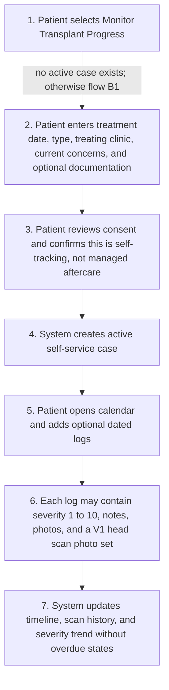
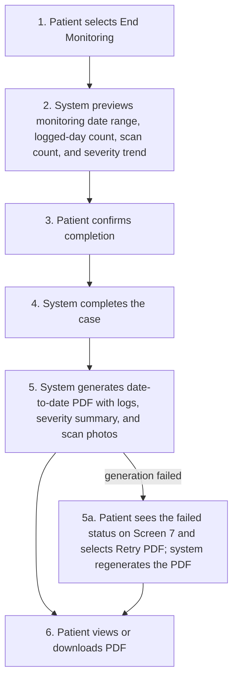
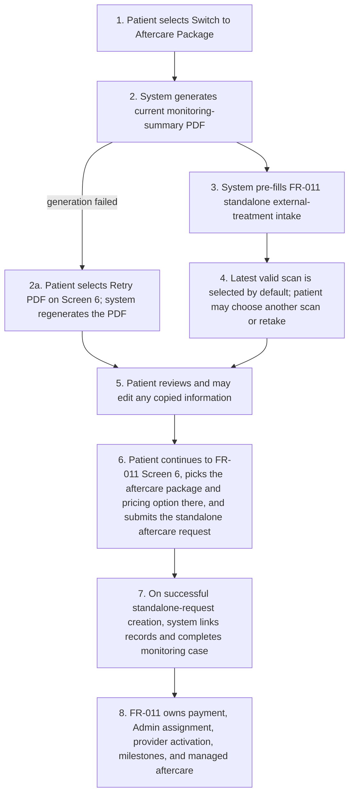
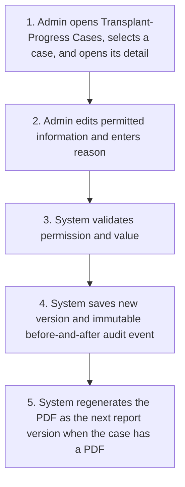
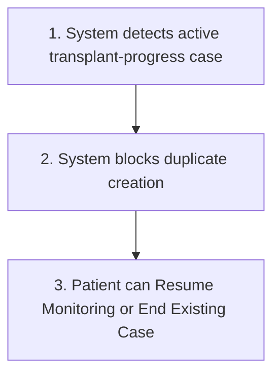
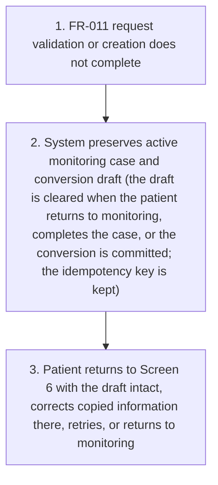

# FR-038 - Monitor Your Transplant Progress

**Module**: P-05: Aftercare & Progress Monitoring | P-07: 3D Scan Capture & Viewing | A-01: Patient Management & Oversight | S-03: Notification Service | S-05: Media Processing Service
**Feature Branch**: `fr038-monitor-transplant-progress`
**Created**: 2026-08-17
**Status**: ✅ Documentation Approved (baseline 2026-11-25); implementation reconciliation pending
**Source**: FR-038 from system-prd.md; product-owner requirements confirmed 2026-08-17; reuses compatible standalone-treatment intake from FR-011 and scan contracts from FR-002

---

## Executive Summary

Monitor Your Transplant Progress is a self-service utility for patients whose hair transplant may have been performed outside Hairline and who want to record recovery progress without buying an aftercare package. The patient creates one active transplant-progress monitoring case, records optional day-by-day entries, severity ratings, notes, photos, and standardized head scan photo sets, and may complete the case with a downloadable summary report.

This feature is intentionally distinct from FR-011 aftercare. It has no provider advice, no assigned provider, no required logging schedule, no clinical milestones, no overdue/compliance state, and no aftercare obligation. This separation avoids clinic conflicts of interest and prevents a free self-tracking tool from being represented as managed aftercare.

The patient may convert the active monitoring case into FR-011 standalone aftercare. Conversion completes the monitoring case only after the standalone-aftercare request is successfully created, pre-fills compatible external-treatment information, lets the patient edit every copied field, selects the latest scan by default while permitting another scan or a retake, and carries the monitoring-summary PDF into the aftercare request. FR-011 then exclusively owns package selection, payment, Admin assignment, provider activation, milestones, and managed aftercare.

**V1 scan terminology**: In V1, all references to a “3D head scan” mean the standardized multi-view head scan photo set defined by FR-002. True 3D capture and viewing remain V2 scope. This meaning is set once in FR-037 REQ-037-045 and applies here.

---

## Module Scope

### Multi-Tenant Architecture

- **Patient Platform (P-05, P-07)**: External-treatment intake, self-paced calendar, daily logs, scans, completion, PDF export, and conversion to FR-011 standalone aftercare.
- **Provider Platform (Not applicable)**: No operational surface. Providers cannot view, advise, or manage FR-038 cases.
- **Admin Platform (A-01)**: Full case visibility and audited editing for support, privacy, and operational correction.
- **Shared Services (S-03, S-05)**: Patient notifications, secure scan processing, PDF generation, and conversion orchestration.

### Multi-Tenant Breakdown

**Patient Platform (P-05, P-07)**:

- Creates a transplant-progress case using treatment details compatible with FR-011 standalone aftercare intake.
- Adds optional logs on any date with recovery severity/condition rating, notes, photos, and V1 head scan photo sets.
- Views a calendar, scan history, and trend summary without mandatory prompts.
- Completes the case, downloads the summary PDF, or converts the active case into standalone aftercare.

**Provider Platform (Not applicable)**:

- No provider is assigned to an FR-038 case.
- No provider dashboard, advice, chat, review queue, or patient-data access is included.
- Provider access to copied information begins when the Admin assigns the provider to the FR-011 request, under FR-011 rules and before payment. (REQ-038-050)

**Admin Platform (A-01)**:

- Views all self-service cases and supports the patient when needed.
- May edit any case information with actor, timestamp, reason, before-value, and after-value audit history.
- Cannot turn an FR-038 case into provider-managed monitoring; conversion to FR-011 is the only managed-aftercare route.

**Shared Services (S-03, S-05)**:

- Stores monitoring media and logs securely.
- Generates date-to-date PDF summaries asynchronously.
- Transfers compatible fields, a selected scan, and PDF into an FR-011 standalone-aftercare request idempotently.
- Sends export-ready, completion, and conversion notifications to the patient. (REQ-038-042)

### Communication Structure

**In Scope**:

- System confirmations, reminders (on by default; the patient can change or switch them off), export-ready notifications, and conversion status notifications.
- Admin support actions visible in audit history where appropriate.

**Out of Scope**:

- Provider advice, provider assignment, provider chat, clinic review, diagnosis, and prescriptions.
- FR-012 secure messaging. (REQ-038-063)
- FR-011 milestone/task communications before standalone aftercare is purchased, assigned, and activated. (REQ-038-063)
- Automated clinical interpretation of severity or scan changes.

### Entry Points

- Patient selects **Aftercare: Monitor Transplant Progress** from FR-003 Screen 1: Service Selection. (REQ-038-062)
- Patient opens the active case from the patient home/dashboard monitoring card. (REQ-038-062)
- Patient opens a completed or converted case from the same card, which also lists previous completed and converted cases, each opening its Screen 7 read-only. (REQ-038-062)
- Admin opens **Transplant-Progress Cases** (Screen 8). (REQ-038-062)
- Patient selects **Switch to Aftercare Package** from active-case actions or Screen 5. (REQ-038-062)

---

## Business Workflows

### Main Flow: Patient Self-Monitors Transplant Progress

**Actors**: Patient, System
**Trigger**: Patient selects Aftercare: Monitor Transplant Progress
**Outcome**: An active self-service case is created and longitudinal tracking is available

### Alternative Flows

**A1: Patient Completes Case and Exports Summary**

- **Trigger**: Patient selects End Monitoring.
- **Outcome**: Case becomes completed and its PDF summary becomes available.

**A2: Patient Converts Active Case into FR-011 Standalone Aftercare**

- **Trigger**: Patient selects Switch to Aftercare Package.
- **Outcome**: A distinct FR-011 standalone request is created from reviewed data and the monitoring case is completed by conversion.

**A3: Admin Corrects Monitoring Information**

- **Trigger**: Authorized Admin resolves a support or data-quality issue.
- **Outcome**: Corrected value is visible while original value and reason remain auditable.

**B1: Active Transplant-Progress Case Already Exists**

- **Trigger**: Patient attempts to create another active FR-038 case.
- **Outcome**: Duplicate creation is blocked and the existing case is offered.

**B2: Standalone Aftercare Conversion Fails or Is Abandoned**

- **Trigger**: Required FR-011 information is invalid, request creation fails, or patient exits before request creation.
- **Outcome**: The monitoring case remains active and no partial conversion is committed.

---

## Screen Specifications

> **Tenant screen ownership**:
>
> - **Patient App / Patient Platform (P-05, P-07)**: Screens 1-7 cover external-treatment intake, the active monitoring calendar, daily logs, scan capture/history, completion, PDF export, and conversion into FR-011 standalone aftercare.
> - **Provider Dashboard / Provider Platform**: No FR-038 provider-facing screens. Providers cannot access or advise self-service transplant-progress cases; any provider screens reached after conversion are owned by FR-011.
> - **Admin Dashboard / Admin Platform (A-01)**: Screens 8-9 cover support visibility, audited case correction, export history, and conversion provenance. There is no provider-assignment control.

### Patient Platform Screens

#### Screen 1: Transplant-Progress Monitoring Intake

**Purpose**: Creates a self-service case using information compatible with FR-011 standalone aftercare. (REQ-038-024, REQ-038-020)

| Field Name | Type | Required | Description | Validation Rules | Graph field |
| --- | --- | --- | --- | --- | --- |
| Treatment Date | date | Yes | Date transplant was performed | Not in future | ENT-monitoring-case.treatment_date |
| Treatment Type | select | Yes | Transplant/procedure type | Active treatment-type value | ENT-monitoring-case.treatment_type |
| Treating Clinic | text | Yes | External clinic name | 1 to 200 characters | ENT-monitoring-case.treating_clinic |
| Treating Country | select | No | Country of treatment | Active FR-028 country | ENT-monitoring-case.treating_country |
| Treatment Documentation | file list | No | Existing treatment records | PDF/JPG/PNG; maximum 10MB each; malware scan (REQ-038-077) | ENT-monitoring-case.treatment_documentation |
| Current Concerns | textarea | No | Current recovery concern or symptom | Maximum 2000 characters | ENT-monitoring-case.current_concerns |
| Initial Severity | slider | Yes | Starting condition/recovery rating; the first point of the severity trend, plotted on the case creation date in date order with the logs | Integer 1 to 10 | ENT-monitoring-case.starting_severity |
| Initial Photos | file list | No | Current-condition photos | Maximum 5; secure image limits | ENT-monitoring-case.initial_photos |
| Initial Head Scan | capture | No | V1 multi-view photo set; capture opens Screen 4; the scan is held with the intake draft and saved when the case is created (REQ-038-049) | FR-002 quality contract | ENT-monitoring-scan.photo_set |
| Self-Service Acknowledgment | checkbox | Yes | Confirms no provider monitoring or required cadence | Must be selected (REQ-038-021) | ENT-monitoring-case.self_service_acknowledged |

**Business Rules**:

- See REQ-038-001 and REQ-038-019.
- This intake does not purchase aftercare and does not create an FR-011 request. (REQ-038-023)
- See Business Rule 4 (FR-037 REQ-037-024).

#### Screen 2: Transplant-Progress Dashboard and Calendar

**Purpose**: Shows the self-paced longitudinal record and case actions.

| Field Name | Type | Required | Description | Validation Rules | Graph field |
| --- | --- | --- | --- | --- | --- |
| Case Status | badge | Yes | Active | Derived | ENT-monitoring-case.status |
| Treatment Summary | component | Yes | Date, type, and clinic | Current case data | ENT-monitoring-case.treatment_date, ENT-monitoring-case.treatment_type, ENT-monitoring-case.treating_clinic |
| Calendar | calendar | Yes | Dates with logs/scans | Patient-local timezone (REQ-038-032) | ENT-monitoring-entry.log_date |
| Logged Days | number | Yes | Unique dates with entries | Derived | ENT-monitoring-case.logged_days |
| Severity Trend | chart | Yes | Rating over time | Derived | ENT-monitoring-case.severity_trend |
| Add Log | action | Yes | Opens Screen 3 | Active case only (REQ-038-033) | no graph field (control) |
| Switch to Aftercare Package | action | Yes | Opens Screen 6 | Active case only (REQ-038-033) | no graph field (control) |
| End Monitoring | action | Yes | Opens Screen 5 | Active case only (REQ-038-033); allowed while a conversion draft is open, and completion discards the draft (REQ-038-044) | no graph field (control) |
| Scan History | action | Yes | Opens Screen 4 | Current case only (REQ-038-049) | no graph field (control) |
| Reminder Preference | control | Yes | Reminder schedule: on by default with the Admin schedule; the patient changes it or switches it off | Reminders stop when the case is completed or converted (REQ-038-031) | ENT-monitoring-case.reminder_preference |

**Business Rules**:

- The system must not display overdue, missed milestone, compliance, or required-frequency states.
- Reminders are on by default with the Admin schedule; the patient changes the schedule or switches them off with Reminder Preference, without affecting case status. Reminders stop when the case is completed or converted. (REQ-038-031)
- No provider identity or advice controls appear.

#### Screen 3: Daily Transplant-Progress Log

**Purpose**: Records a dated recovery observation with a consistent structure. (REQ-038-026)

| Field Name | Type | Required | Description | Validation Rules | Graph field |
| --- | --- | --- | --- | --- | --- |
| Log Date | date | Yes | Observation date | Not in future and not before treatment date | ENT-monitoring-entry.log_date |
| Severity | slider | Yes | Patient-rated condition | Integer 1 to 10 | ENT-monitoring-entry.severity |
| Notes | textarea | No | Recovery observation | Maximum 3000 characters | ENT-monitoring-entry.notes |
| Photos | file list | No | Supporting photos | Secure image limits | ENT-monitoring-entry.photos |
| Head Scan | capture/select | No | V1 photo set; capture opens Screen 4 | FR-002 quality contract | ENT-monitoring-scan.photo_set |

**Business Rules**:

- Patient edits and deletes of their own entries while the case is active, with every version auditable, follow FR-037 REQ-037-040.
- Multiple entries on one date are allowed and Logged Days counts that date once, as set in FR-037 REQ-037-041.
- No automated clinical advice is generated from a score or image. (REQ-038-029)

#### Screen 4: Head Scan Capture and History

**Purpose**: Captures and compares standardized scan photo sets within the self-service case.

| Field Name | Type | Required | Description | Validation Rules | Graph field |
| --- | --- | --- | --- | --- | --- |
| Capture Guidance | component | Yes | Front, top, left, and right guidance | FR-002 V1 contract | no graph field (guidance display) |
| Photo Set | capture/upload | Yes | Standardized multi-view photos | Quality and completeness checks (REQ-038-047) | ENT-monitoring-scan.photo_set |
| Captured At | datetime | Yes | Scan timestamp | System generated | ENT-monitoring-scan.captured_at |
| Scan History | list | Yes | Prior scans grouped by date | Current case only (REQ-038-049) | ENT-monitoring-scan.case_id, ENT-monitoring-scan.captured_at |

**Business Rules**:

- See the V1 scan terminology in the Executive Summary (FR-037 REQ-037-045).
- A scan set that fails the quality check cannot be saved; it must be retaken to be saved. (REQ-038-048)
- Screen 4 opens from Scan History on Screen 2, from the head-scan capture on Screens 1 and 3, and from the retake on Screen 6. A scan captured from Screen 1 is held with the intake draft and saved when the case is created. (REQ-038-049)
- Scans remain inaccessible to providers until the Admin assigns the provider to the FR-011 request, under FR-011 rules. (REQ-038-050)

#### Screen 5: Complete or Convert Monitoring Case

**Purpose**: Lets the patient end self-tracking or begin standalone-aftercare conversion.

| Field Name | Type | Required | Description | Validation Rules | Graph field |
| --- | --- | --- | --- | --- | --- |
| Case Summary | component | Yes | Date range, logged days, scans, and severity trend | Derived (REQ-038-038) | ENT-monitoring-case.monitoring_period, ENT-monitoring-case.logged_days, ENT-monitoring-case.scan_count, ENT-monitoring-case.severity_trend |
| Completion Choice | radio | Yes | Complete and export, or Switch to Aftercare Package | Single selection (REQ-038-080) | no graph field (control) |
| Confirmation | checkbox | Yes | Acknowledgment that depends on the choice: Complete, "this case will end"; Switch, "your case stays active until your aftercare request is created" | Must be selected (REQ-038-081) | no graph field (control) |

**Business Rules**:

- Explicit completion ends the case immediately after confirmation. (REQ-038-039)
- See REQ-038-015 and REQ-038-068 (flow B2).
- A completed or converted case is read-only except for Admin audited correction (one rule, owned by FR-037 REQ-037-054).

#### Screen 6: Convert to Standalone Aftercare

**Purpose**: Reviews the pre-filled information and the monitoring PDF before continuing into FR-011 Screen 6, where the patient picks the package and pricing option.

| Field Name | Type | Required | Description | Validation Rules | Graph field |
| --- | --- | --- | --- | --- | --- |
| External Treatment Details | editable component | Yes | Treatment date, type, clinic, concerns, documentation | FR-011 standalone validation | ENT-monitoring-conversion.treatment_details_draft |
| Selected Head Scan | select/capture | No | Latest valid scan by default, another scan, or retake (retake opens Screen 4) | FR-002 quality contract | ENT-monitoring-conversion.selected_scan_id |
| Monitoring Summary PDF | attachment | Yes | Current date-to-date report | System-generated PDF (REQ-038-064) | ENT-monitoring-conversion.export_id |
| PDF Status | status | Yes | Generating, ready, or failed; Retry PDF is offered when failed | Derived (REQ-038-064) | ENT-monitoring-export.generation_state |
| Retry PDF | action | Conditional | Regenerates the conversion PDF | Shown only when PDF Status is failed (REQ-038-041) | no graph field (control) |
| Continue to Aftercare Request | action | Yes | Continues to FR-011 Screen 6, where the patient picks the package and pricing option, submits the standalone request, and pays later per FR-011 Workflow 2 | Fields valid and PDF status ready (REQ-038-066) | no graph field (control) |

**Business Rules**:

- Every copied field is editable before standalone request creation. After a failed or abandoned request the patient returns to this screen with the draft intact and corrects copied fields here. (REQ-038-068)
- The patient may replace copied documentation and may select another scan or retake.
- FR-038 does not calculate price, take payment, assign a provider, or activate aftercare. (REQ-038-072)
- See Business Rules 4 and 5 (REQ-038-044).
- The patient picks the package and pricing option on FR-011 Screen 6; this screen only reviews what is sent. (REQ-038-017)
- The PDF is regenerated when logs or the selected scan change after it was made; a repeated Switch reuses the existing draft PDF unless data changed; the export-ready notice for the conversion PDF opens this screen only while the conversion draft is open, otherwise Screen 7. (REQ-038-064)
- Transfer only data explicitly reviewed in the conversion draft. (REQ-038-067)
- FR-011 must accept the generated monitoring PDF as treatment documentation/additional case context. (REQ-038-010)

#### Screen 7: Monitoring Summary and PDF Export

**Purpose**: Displays the completed or converted case and the downloadable report, read-only.

| Field Name | Type | Required | Description | Validation Rules | Graph field |
| --- | --- | --- | --- | --- | --- |
| Monitoring Period | date range | Yes | The earlier of the case creation date and the earliest log date, through the date the case was completed or converted | Derived (REQ-038-035) | ENT-monitoring-case.monitoring_period |
| Treatment Summary | component | Yes | Treatment date, type, clinic | Case snapshot | ENT-monitoring-case.treatment_date, ENT-monitoring-case.treatment_type, ENT-monitoring-case.treating_clinic |
| Logged Days | number | Yes | Unique dates logged | Derived | ENT-monitoring-case.logged_days |
| Severity Summary | component | Yes | First (the earliest-dated point, the Initial Severity unless a log is dated earlier), latest, minimum, maximum, average, and trend; a case with no log shows the Initial Severity as first, latest, minimum, maximum, and average, with a one-point trend | Derived (REQ-038-034) | ENT-monitoring-case.severity_summary, ENT-monitoring-case.latest_severity, ENT-monitoring-case.severity_trend |
| Log Timeline | list | Yes | Date-to-date entries and notes | Chronological | ENT-monitoring-entry.log_date, ENT-monitoring-entry.notes |
| Head Scan Photos | gallery | Yes | Scans grouped by date | Authorized access only | ENT-monitoring-scan.photo_set |
| PDF Status | status | Yes | Generating, ready, or failed | Derived | ENT-monitoring-export.generation_state |
| Download PDF | action | Conditional | Downloads ready report | Signed access link, a new link on each Download (REQ-038-076) | no graph field (control) |
| Retry PDF | action | Conditional | Regenerates the report | Shown only when PDF Status is failed (REQ-038-041) | no graph field (control) |

**Business Rules**:

- PDF includes treatment summary, complete date-to-date log, scan photos, logged-day count, and severity summary. (REQ-038-040)
- Failed generation shows the failed status here and can be retried with Retry PDF without reopening the case. (REQ-038-041)
- The latest report version is shown; an Admin correction regenerates the PDF as the next version. (REQ-038-045)
- See REQ-038-075.
- See REQ-038-076.
- When FR-011 ends a converted request as Rejected or Expired, the monitoring case stays converted and read-only; the patient may start a new standalone request from the same source data in FR-011, which uses a new idempotency key (FR-011 REQ-011-093, REQ-011-094). (REQ-038-082)

### Provider Platform Screens

No Provider Dashboard screens are defined in FR-038. This monitoring case is self-service only. Providers have no list, detail, advice, assignment, or media-access surface. If the patient successfully converts to standalone aftercare, the resulting provider workflow is governed by FR-011 Screens 8-12 and remains outside FR-038.

### Admin Platform Screens

#### Screen 8: Admin Monitoring Case List

**Purpose**: Gives Admin support and oversight visibility.

| Field Name | Type | Required | Description | Validation Rules | Graph field |
| --- | --- | --- | --- | --- | --- |
| Case List | table | Yes | All transplant-progress monitoring cases | Paginated (REQ-038-061) | ENT-monitoring-case (entity; list of cases) |
| Status Filter | multi-select | No | Active, Completed, Converted to aftercare | Valid values (REQ-038-061) | ENT-monitoring-case.status |
| Search | text | No | Patient or case identifier | Permission-scoped (REQ-038-061) | ENT-monitoring-case.patient_id |
| Last Log Date | datetime | Yes | Most recent patient entry | Derived (REQ-038-036) | ENT-monitoring-case.last_patient_log_at |
| Conversion State | badge | No | None, draft, or converted to FR-011 | Derived (REQ-038-037) | ENT-monitoring-case.conversion_state |

**Business Rules**:

- There is no assignment queue, provider field, or Type filter; this list is separate from the FR-037 Admin monitoring list. (REQ-038-061)
- Admin visibility does not imply clinical monitoring or advice responsibility. (REQ-038-060)

#### Screen 9: Admin Monitoring Case Detail and Audit

**Purpose**: Supports audited correction and conversion support.

| Field Name | Type | Required | Description | Validation Rules | Graph field |
| --- | --- | --- | --- | --- | --- |
| Case Data | editable component | Yes | Intake, logs, scans, and conversion link; case status is shown but not editable | Permission controlled | ENT-monitoring-case.treatment_date, ENT-monitoring-case.treatment_type, ENT-monitoring-case.treating_clinic, ENT-monitoring-case.treating_country, ENT-monitoring-case.treatment_documentation, ENT-monitoring-case.current_concerns, ENT-monitoring-case.starting_severity, ENT-monitoring-case.initial_photos, ENT-monitoring-case.status, ENT-monitoring-case.conversion_id, ENT-monitoring-entry.log_date, ENT-monitoring-entry.severity, ENT-monitoring-entry.notes, ENT-monitoring-entry.photos, ENT-monitoring-scan.photo_set |
| Edit Reason | textarea | Conditional | Reason for any mutation | Required before save | ENT-transplant-progress-audit-entry.reason |
| Export History | list | Yes | PDF versions and generation state | Read-only metadata | ENT-monitoring-export.report_version, ENT-monitoring-export.generation_state |
| Conversion Link | link | Conditional | Destination FR-011 request | Authorized access only | ENT-monitoring-conversion.destination_request_id |
| Audit History | timeline | Yes | Actor, action, reason, time, before and after values | Immutable (REQ-038-058) | ENT-transplant-progress-audit-entry.actor_id, ENT-transplant-progress-audit-entry.action, ENT-transplant-progress-audit-entry.reason, ENT-transplant-progress-audit-entry.occurred_at, ENT-transplant-progress-audit-entry.before_value, ENT-transplant-progress-audit-entry.after_value |

**Business Rules**:

- Admin may edit any information for operational correction, but no edit may erase historical values or provenance: version history, exports, and conversion provenance remain. (REQ-038-056)
- Admin cannot assign a provider to FR-038; the patient must convert to FR-011 for managed aftercare. (REQ-038-059)
- Only the Admin can correct the treatment date after the case exists. When the new date leaves logs dated before it, the Admin must correct or remove those logs in the same edit, otherwise the save is refused. (REQ-038-030)

---

## Business Rules

### General Module Rules

- **Rule 1**: A patient may have one active case per monitoring type; an active FR-038 case does not block an active FR-037 case. (REQ-038-001, REQ-038-018)
- **Rule 2**: See REQ-038-002.
- **Rule 3**: Logging frequency is entirely optional; the system has no overdue, missed-task, compliance, or milestone state. (REQ-038-004)
- **Rule 4**: Previous monitoring history is not linked to a new monitoring case. Conversion links only the source FR-038 case to its destination FR-011 standalone request. This is the same rule as FR-037 REQ-037-024, which covers both features.
- **Rule 5**: Completion and successful conversion are terminal outcomes, and source/destination cases remain distinct. The patient may end monitoring while a conversion draft is open; completion discards the draft, and a request creation arriving after completion is refused. (REQ-038-044)
- **Rule 6**: See REQ-038-017.
- **Rule 7**: The system must clearly state that self-tracking is not medical advice or provider-monitored aftercare. (REQ-038-022)
- Patients understand severity 1 means least severe and 10 means most severe. (REQ-038-025)

### Data & Privacy Rules

- Intake, logs, severity ratings, scans, documentation, exports, and conversion links are medical data. See system PRD, Platform-Wide Rules: Encryption in transit and at rest (REQ-SYS-004).
- Access is restricted to the patient and authorized Admin users while data belongs to FR-038. (REQ-038-012)
- Providers have no FR-038 access. Provider access to copied information begins when the Admin assigns the provider to the FR-011 request, under FR-011 rules and before payment. (REQ-038-050)
- Case records, entries, conversion provenance, PDF exports, and raw monitoring scan media are retained as set by the system PRD, Platform-Wide Rules: One 10-year retention period (REQ-SYS-002). FR-038 sets no separate period.
- See REQ-038-013.
- PDF and media download links expire and check the requester's permission each time they are used. See system PRD, Platform-Wide Rules: Download links expire and check permission (REQ-SYS-014).

### Admin Editability Rules

**Editable by Admin**:

- All monitoring intake information, entries, severity ratings, scan metadata, report regeneration, and conversion metadata when operational correction is required. Case status is not editable: completed and converted are final. No edit may erase historical values or provenance. (REQ-038-055)

**Fixed in Codebase (Not Editable)**:

- Self-service-only restriction, provider-access prohibition, one-active-case-per-type enforcement, audit immutability, encryption, and conversion idempotency.
- FR-011 ownership after successful handoff.

**Configurable with Restrictions**:

- Admin edits require permission, a reason, and version history. (REQ-038-057)
- Patient reminder defaults: Admin sets the reminder schedule (default once a month for 12 months from the case creation date) in the FR-030 notification settings; FR-038 only refers to that schedule. Reminders are on by default; the patient can change the schedule or switch it off, reminders stop when the case is completed or converted, and they cannot become mandatory milestones or compliance checks. (REQ-038-031)

### Payment & Billing Rules

- FR-038 is free and creates no invoice, charge, subscription, or refund. (REQ-038-071)
- If the patient converts, FR-011 and FR-007 exclusively own package pricing, checkout, payment status, invoice, subscription, and refund behavior, and FR-007 is invoked only after FR-011 package selection and checkout. (REQ-038-070)
- An incomplete or failed checkout must not create an FR-038 payment record. (REQ-038-073)

### Notification Events

- Notification events come from the FR-030 notification catalogue, which FR-020 mirrors. FR-038 uses the shared `monitoring.completed` and `monitoring.export_ready` events (also used by FR-037) and keeps no copies of them. `monitoring.export_ready` also fires when the conversion PDF is ready and when an Admin correction regenerates the PDF, not only for the first completion PDF. The notice opens Screen 6 only while the conversion draft is open and Screen 7 in every other case.
- FR-038 adds two events, both notifying the patient only: `monitoring.aftercare_conversion_started`, which fires when the patient selects Switch to Aftercare Package (flow A2 step 1), and `monitoring.converted_to_aftercare`, which fires when the standalone-aftercare request is successfully created (flow A2 step 7).
- The patient reminder in REQ-038-031 is sent through a progress-reminder event that FR-030 adds to its catalogue.
- The conversion-started notice goes out immediately after the patient selects Switch to Aftercare Package. Proposed wording, to be confirmed in notification copy review: "You have started switching to an Aftercare Package. Your monitoring case stays active until your aftercare request is created."

---

## Dependencies

- **FR-002**: V1 head scan photo-set capture and quality validation.
- **FR-003**: Service Selection gateway entry point.
- **FR-007**: Payment only after handoff into FR-011 checkout.
- **FR-011**: Standalone external-treatment intake, package selection, and managed aftercare.
- **FR-020**: Patient notification events and delivery preferences.
- **FR-026**: Privacy, security, consent, timezone, and file configuration.
- **FR-028**: Country configuration for external treatment information.
- **FR-030**: Notification catalogue entries and the notification settings (reminder schedule).
- **FR-037**: Shared monitoring entities and the single Rules that FR-038 refers to instead of restating.

---

## User Scenarios & Testing

### User Story 1 - Self-Track Transplant Progress (Priority: P1)

**As a** patient, **I want** to record transplant progress at my own pace **so that** I can maintain a personal recovery history.

**Acceptance Scenarios**:

1. Given no active FR-038 case, when valid external-treatment intake is submitted, then a self-service case opens without provider assignment.
2. Given an active case, when the patient logs on irregular dates, then all entries appear and no date is marked overdue.
3. Given a provider account, when provider routes are queried, then FR-038 cases and media are inaccessible.

### User Story 2 - Complete and Export Monitoring (Priority: P1)

**As a** patient, **I want** a summarized export **so that** I can keep or share my personal tracking record.

**Acceptance Scenarios**:

1. Given an active case, when the patient confirms completion, then the case becomes read-only and PDF generation begins.
2. Given a ready PDF, then it includes the treatment summary, complete date-to-date logs, scan photos, logged-day count, and severity summary.
3. Given PDF generation failure, then retry succeeds without reopening or duplicating the case.

### User Story 3 - Convert to Standalone Aftercare (Priority: P1)

**As a** patient, **I want** to reuse my progress data when purchasing aftercare **so that** I do not enter it again.

**Acceptance Scenarios**:

1. Given an active case, when conversion opens, then FR-011-compatible data is pre-filled and every copied field is editable.
2. Given multiple scans, then the latest is selected by default and another scan or retake is available.
3. Given successful FR-011 standalone-request creation, then the monitoring case becomes converted, remains distinct, and links to the request with PDF provenance.
4. Given failed or abandoned request creation, then the monitoring case remains active.

### Edge Cases

- Treatment date is corrected after several logs: only the Admin can correct it, and logs dated before the new date must be corrected or removed in the same edit, otherwise the save is refused. (REQ-038-030)
- Patient logs multiple entries and scans on the same date.
- The latest scan attempt fails quality and is not saved; the earlier saved scan is used. (REQ-038-048)
- A case with no log shows the Initial Severity as first, latest, minimum, maximum, and average, with a one-point trend, and completion and conversion stay allowed. (REQ-038-034)
- FR-011 payment fails after a standalone request is created; FR-011 owns the pending/failed payment state while the FR-038 conversion link remains intact. (REQ-038-069)
- Conversion is retried after network timeout without duplicate standalone requests.
- Admin corrects data after PDF generation; a new report version is generated. (REQ-038-045)

---

## Functional Requirements Summary

### Core Requirements

- **REQ-038-001**: System MUST enforce one active transplant-progress monitoring case per patient.
- **REQ-038-002**: FR-038 MUST remain self-service only with no provider advice, assignment, queue, or data access.
- **REQ-038-003**: Refers to FR-037 REQ-037-003 (optional dated logs with severity 1 to 10, notes, photos, and V1 head scan photo sets); it applies to transplant-progress cases.
- **REQ-038-004**: System MUST NOT impose required cadence, milestones, overdue status, or compliance obligations.
- **REQ-038-005**: Refers to FR-037 REQ-037-009 (patient completes the case and exports a date-to-date PDF summary); it applies to transplant-progress cases.
- **REQ-038-006**: Patient MUST be able to convert an active case into a distinct FR-011 standalone-aftercare request.

### Data Requirements

- **REQ-038-007**: Initial intake MUST capture FR-011-compatible external treatment details.
- **REQ-038-008**: Refers to FR-037 REQ-037-021 (conversion pre-fills compatible information and every copied field is editable); it applies to the FR-011 standalone-aftercare conversion.
- **REQ-038-009**: Refers to FR-037 REQ-037-022 (conversion selects the latest valid scan by default; another scan or retake is allowed); it applies to the FR-011 standalone-aftercare conversion.
- **REQ-038-010**: Conversion MUST attach a PDF containing treatment summary, logs, scan photos, logged-day count, and severity summary.
- **REQ-038-011** (retired): Replaced by the single FR-037 Rule REQ-037-024, which covers both features: previous monitoring history is never attached to a new monitoring case, and it links onward only through conversion. For FR-038 the destination is the FR-011 standalone-aftercare request.

### Security & Privacy Requirements

- **REQ-038-012**: System MUST restrict FR-038 data to the patient and authorized Admin users.
- **REQ-038-013**: System MUST audit all medical-data access, edits, exports, and conversions.
- **REQ-038-014**: Refers to FR-037 REQ-037-027 (Admin edits preserve version history and require a reason); it applies to transplant-progress cases.

### Integration Requirements

- **REQ-038-015**: Monitoring MUST remain active if FR-011 request creation fails and MUST terminate only after successful conversion commit or explicit completion.
- **REQ-038-016**: Conversion MUST be idempotent and MUST NOT create duplicate standalone-aftercare requests. A standalone request may be created from an FR-038 conversion with pre-filled fields, the attached monitoring PDF, an optional selected scan, and an idempotency key; a repeated key returns the existing request. The idempotency key is created once per case at the first Switch to Aftercare Package and is kept when the draft is cleared.
- **REQ-038-017**: After successful handoff, FR-011 MUST exclusively own package selection, payment, assignment, activation, milestones, and provider-managed aftercare.

### Display and Processing Requirements

- **REQ-038-065** (retired): The patient no longer picks a package in FR-038, so FR-038 shows no package list. Package availability and treatment compatibility are FR-011 template matters on FR-011 Screen 6.
- **REQ-038-074** (retired): Replaced by FR-011, which owns package selection on its Screen 6; there is no FR-038 package list that can become unavailable.
- **REQ-038-075**: The Log Timeline MUST list entries in chronological order.
- **REQ-038-076**: Download PDF MUST be available only when the report is ready, through a signed access link.
- **REQ-038-077**: System MUST scan uploaded treatment documentation and generated PDFs for malware; an uploaded file that fails the scan is rejected with an error and not stored, and a generated PDF that fails ends with generation status failed.
- **REQ-038-078**: System MUST NOT provide provider advice, provider assignment, provider chat, clinic review, diagnosis, prescriptions, FR-012 secure messaging, FR-011 milestone communications before standalone aftercare is purchased, assigned, and activated, or automated clinical interpretation of severity or scan changes.
- **REQ-038-079**: System MUST generate PDF summaries asynchronously and notify the patient when the PDF is ready.

---

## Appendix: Change Log

| Version | Date | Changes | Author |
| --- | --- | --- | --- |
| 1.4 | 2026-11-22 | Requirements graph programme baseline: PRD compressed to the checklist structure (each rule stated once, field rows tagged with graph field ids, dropped classes removed). No rule changes. Earlier history (v1.0 to v1.3) is in `archived/prd-baseline-2026-11-08/` and in git history. | Product Owner / Documentation |
| 1.5 | 2026-11-24 | Logic review pass 1: FR-011 hand-off lands on FR-011 Screen 6 and package choice stays in FR-011 (FR-038 Screen 6 ends at the review); conversion contract and commit order; provider access to copied data from FR-011 assignment; Screen 5 confirmation by choice; PDF status, retry, regeneration and repeat rules on Screens 6 and 7; completed or converted case reachable from the home card; only Admin corrects the treatment date; Initial Severity as first data point, monitoring period and zero-log summary; reminders on by default with a Screen 2 control and stop rule; Screen 4 and Screen 8 entry points; quality-failed scans are not saved; conversion draft set and cleared; Screen 8 filter values and audit Action column. | Product Owner / Documentation |
| 1.6 | 2026-11-24 | Logic review pass 2: monitoring period and first severity point in date order with logs dated before the case; zero-log summary shows the Initial Severity; failed request returns to Screen 6; Retry PDF on Screen 6; export-ready notice target by draft state; idempotency key lifetime; End Monitoring with an open draft discards it; previous cases listed on the home card; Screen 6 retake and Screen 1 capture entry; case status not Admin-editable; malware-scan outcome; default reminders run 12 months from the case creation date; stale Screen 6 pointer removed; main flow check folded into the entry branch. | Product Owner / Documentation |
| 1.7 | 2026-11-25 | Cross-FR alignment: Reminder Preference tied to ENT-monitoring-case.reminder_preference; a Rejected or Expired converted request leaves the monitoring case read-only and a new standalone request uses a new idempotency key (REQ-038-082, REQ-011-093, REQ-011-094). | Product Owner / Documentation |
| 1.8 | 2026-11-25 | Backlog points settled: platform-wide encryption, retention and download-link rules cited by REQ-SYS id, and the FR-007 invocation sentence folded into REQ-038-070 so the citation is exact. | Claude (AI Assistant) |

---

## Appendix: Approvals

Approved by the Product Owner as part of the requirements baseline of 2026-11-25. Record: `project-requirements/baseline-sign-off.md`. Changes after that date are listed in the Change Log above.

---

**Document Version**: 1.8
**Template Version**: 2.0.0
**Last Updated**: 2026-11-25
**Next Review**: Before implementation planning
