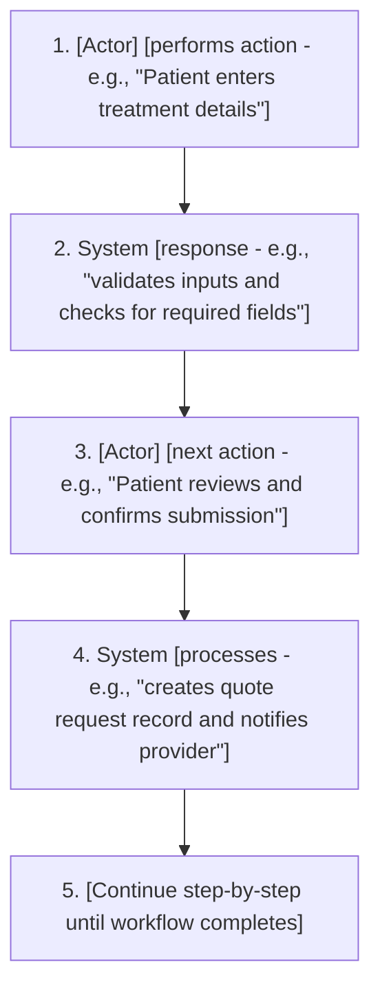
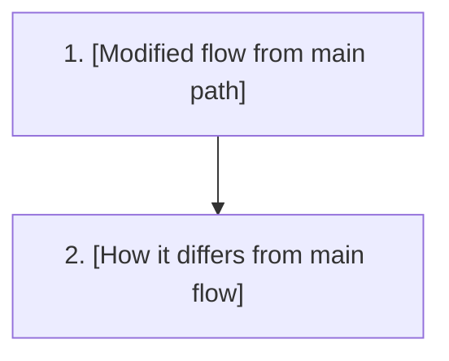
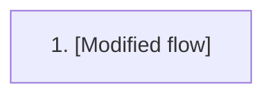
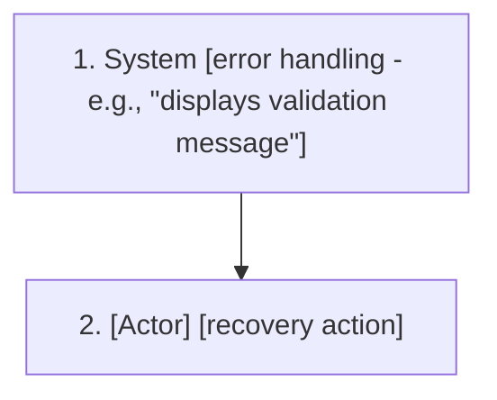
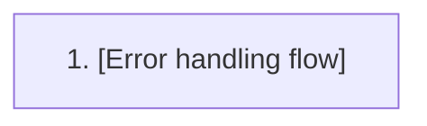

# FR-[###] - [FEATURE NAME]

**Module**: [Module codes - e.g., P-05: Aftercare & Progress Monitoring | PR-04: Aftercare Participation]
**Feature Branch**: `fr[###]-[module-name]`
**Created**: [DATE]
**Status**: Draft | ✅ Pending Approval | ✅ Verified & Approved
**Source**: [Source reference - e.g., FR-011 from system-prd.md, User request, Client transcription]

<!--
  A new PRD starts as Draft. Status moves to Verified & Approved only after the Product Owner approves it
  (see Appendix: Approvals).
-->

---

## Executive Summary

<!--
  ACTION REQUIRED: Provide clear module purpose and scope
  - What is the primary purpose of this feature/module?
  - What problem does it solve for users?
  - What value does it deliver to the business?
  - Which platforms (tenants) does it involve, and what does it mean for each?
  - How is it reached, and what activates it (entry points and activation triggers)?
-->

[Clear description of module purpose and scope]

**Multi-tenant implications**: [Which platforms are involved and what changes for each]

**Entry points and activation**: [How users or systems reach this feature and what triggers it]

---

## Module Scope

### Multi-Tenant Architecture

- **Patient Platform (P-XX)**: [Patient-facing capability summary]
- **Provider Platform (PR-XX)**: [Provider-facing capability summary]
- **Admin Platform (A-XX)**: [Admin oversight/configuration summary]
- **Shared Services (S-XX)**: [Shared services used by this module]

### Multi-Tenant Breakdown

**Patient Platform (P-XX)**:

- [What functionality exists in patient mobile app]
- [What data patients can view/edit]
- [What actions patients can perform]

**Provider Platform (PR-XX)**:

- [What functionality exists in provider web app]
- [What data providers can view/edit]
- [What actions providers can perform]

**Admin Platform (A-XX)**:

- [What functionality exists in admin web app]
- [What oversight/management capabilities admins have]
- [What configuration options admins control]

**Shared Services (S-XX)**:

- [Any shared/reusable backend services this feature requires]
- [APIs that serve multiple tenants]
- [Background processing or scheduled jobs]

### Communication Structure

**In Scope**:

- [Explicit list of communication features INCLUDED in this module]
- [e.g., "Email notifications for aftercare task completion"]
- [e.g., "In-app messages between patient and provider"]

**Out of Scope**:

- [Explicit list of communication features NOT included in this module]
- [e.g., "Video calls between patient and provider (handled by separate module)"]
- [e.g., "SMS notifications (handled by S-03: Notification Service)"]

### Entry Points

[Describe how users/systems access this feature and what triggers its availability]

- [e.g., "Patient-initiated via mobile app flow"]
- [e.g., "Provider opens dashboard module"]
- [e.g., "Admin publishes configuration to activate feature"]

---

## Business Workflows

### Main Flow: [Workflow Name]

**Actors**: [List all involved parties - e.g., Patient, Provider, Admin, System]
**Trigger**: [What initiates this workflow - e.g., "Patient taps 'Request Quote' button"]
**Outcome**: [Expected result - e.g., "Quote request submitted and provider notified"]

**Flow Diagram**:

<!--
  ACTION REQUIRED: Represent the workflow as a Mermaid diagram.
  - Use `flowchart TD` (Top → Down) for consistent readability.
  - Keep the original step text inside node labels (prefer quoted labels: ["..."]).
  - Do NOT use backslash-escaped quotes like `\"` inside Mermaid labels (many renderers fail to parse it).
    - Use `&quot;` instead when you need quotes inside a label.
  - If step text includes `<` or `>` (e.g., password special-character lists), use `&lt;` and `&gt;` inside the label.
  - If the diagram layout starts looking like it’s flowing “backwards” (e.g., right-to-left arrows), prefer:
    - One arrow per line (avoid long `A --> B --> C` chains on a single line).
    - If using `subgraph`, add `direction TB` inside each subgraph.
-->

### Alternative Flows

<!--
  ACTION REQUIRED: Document all alternative paths and variations
  Use naming convention: A1, A2, B1, B2, etc.
  A = Alternative happy path
  B = Error/exception path

  Mermaid guidance:
  - Use one Mermaid diagram per alternative flow (do not combine multiple alternatives into one diagram with subgraphs).
    Combining alternatives often creates confusing auto-layout (e.g., arrows that appear “flipped”).
  - Put the alternative flow title in Markdown (e.g., **A1: ...**) and keep only the step content inside the diagram nodes.
-->

**A1: [Alternative scenario name - e.g., "Patient selects multiple procedures"]**

- **Trigger**: [When this alternative occurs]
- **Outcome**: [How this path resolves]
- **Flow Diagram**:

**A2: [Another alternative - e.g., "Provider requests clarification"]**

- **Trigger**: [When this alternative occurs]
- **Outcome**: [Result]
- **Flow Diagram**:

**B1: [Error scenario name - e.g., "Required field missing"]**

- **Trigger**: [What causes this error]
- **Outcome**: [How system recovers or how user can retry]
- **Flow Diagram**:

**B2: [Another error scenario - e.g., "Network connection lost"]**

- **Trigger**: [Error condition]
- **Outcome**: [Recovery path]
- **Flow Diagram**:

[Add more alternative flows as needed: A3, A4, B3, B4, etc.]

---

## Screen Specifications

<!--
  ACTION REQUIRED: Document all screens/views in this module
  Include web pages (provider/admin) and mobile screens (patient)
-->

### Screen 1: [Screen Name - e.g., "Quote Request Form"]

**Purpose**: [What this screen accomplishes - e.g., "Allows patient to submit treatment quote request"]

**Data Fields**:

<!--
  ACTION REQUIRED: Every row carries its graph field id in the last column (C-PRD-6, C-PRD-14).
  - Use the id of the field in the requirements graph (see local-docs/project-requirements/graph/).
  - A row with no graph field (a static label, a control, an app setting) says so and gives the reason,
    for example: no graph field (control).
-->

| Field Name | Type | Required | Description | Validation Rules | Graph field |
|------------|------|----------|-------------|------------------|-------------|
| [field1] | text/number/date/select/checkbox | Yes/No | [Purpose and usage] | [e.g., "Max 500 chars"] | [graph field id - e.g., ENT-quote-request.status] |
| [field2] | [type] | Yes/No | [Purpose] | [Validation] | [graph field id, or no graph field (reason)] |
| [field3] | [type] | Yes/No | [Purpose] | [Validation] | [graph field id, or no graph field (reason)] |

**Business Rules**:

- [Specific rule governing screen behavior - e.g., "Procedure field pre-populated if patient has prior consultation"]
- [Validation rule - e.g., "At least one procedure must be selected"]
- [State change rule - e.g., "Submit button disabled until all required fields complete"]
- [Data privacy rule - e.g., "Provider identity hidden until payment confirmed"]

**Notes**:

- [Implementation guidance - e.g., "Use autocomplete for clinic selection"]
- [UX considerations - e.g., "Show progress indicator for multi-step form"]
- [Technical constraints - e.g., "Maximum 5 procedure images uploadable"]

---

### Screen 2: [Screen Name]

**Purpose**: [What this screen accomplishes]

**Data Fields**:

| Field Name | Type | Required | Description | Validation Rules | Graph field |
|------------|------|----------|-------------|------------------|-------------|
| [field] | [type] | Yes/No | [Purpose] | [Validation] | [graph field id, or no graph field (reason)] |

**Business Rules**:

- [Rule 1]
- [Rule 2]

**Notes**:

- [Note 1]

---

[Repeat for all screens in this module]

---

## Business Rules

### General Module Rules

<!--
  ACTION REQUIRED: Define overarching rules that apply to the entire module
  - State each rule once, here or in the one screen it governs, and cite it elsewhere by its REQ id (C-PRD-7).
  - Business rules only. A rule that is really a technical note is not a PRD section; keep the business rule and drop the note.
-->

- **Rule 1**: [General rule applicable to entire module - e.g., "All quote requests expire after 30 days if no provider response"]
- **Rule 2**: [Another general rule - e.g., "Maximum 3 active quote requests per patient at any time"]
- **Rule 3**: [Cross-cutting concern - e.g., "All timestamps displayed in user's local timezone"]

### Data & Privacy Rules

<!--
  ACTION REQUIRED: Define data access restrictions and privacy requirements
  Reference Principle II from constitution: Medical Data Privacy & Security
-->

- **Privacy Rule 1**: [Data access restriction - e.g., "Provider identity anonymized until patient confirms payment"]
- **Privacy Rule 2**: [Encryption requirement - e.g., "Patient medical images encrypted at rest using AES-256"]
- **Privacy Rule 3**: [Data retention - e.g., "Quote requests archived after 90 days, permanently deleted after 2 years"]
- **Audit Rule**: [Logging requirement - e.g., "All access to patient medical data must be logged with timestamp and user ID"]
- **HIPAA/GDPR**: [Compliance notes if applicable - e.g., "Patient consent required before sharing data with provider"]

### Admin Editability Rules

<!--
  ACTION REQUIRED: Explicitly state what admins CAN and CANNOT edit (C-PRD-17)
  Keep this subsection only where admin override or configuration applies
-->

**Editable by Admin**:

- [What admins can modify - e.g., "Quote expiration period (default 30 days, range 7-90 days)"]
- [Configuration options - e.g., "Maximum active quote requests per patient (default 3, range 1-10)"]
- [Content management - e.g., "Procedure catalog and pricing templates"]

**Fixed in Codebase (Not Editable)**:

- [What is hard-coded - e.g., "Encryption algorithms (AES-256)"]
- [Security parameters - e.g., "Password requirements (min 8 chars, 1 uppercase, 1 number)"]
- [System limits - e.g., "Maximum image upload size (10MB per file)"]

**Configurable with Restrictions**:

- [Semi-editable items - e.g., "Admin can disable certain payment methods but cannot modify payment gateway integration"]

### Payment & Billing Rules *(if applicable)*

<!--
  ACTION REQUIRED: Define payment-related rules if this module involves transactions
  Delete this section if not applicable
-->

- **Payment Rule 1**: [Payment flow rule - e.g., "Payment required before provider contact information revealed"]
- **Payment Rule 2**: [Refund policy - e.g., "Full refund if provider doesn't respond within 48 hours"]
- **Billing Rule 1**: [Invoicing rule - e.g., "Invoice generated immediately upon successful payment"]
- **Currency Rule**: [Multi-currency handling - e.g., "Prices displayed in patient's selected currency"]

---

## Dependencies

<!--
  ACTION REQUIRED: One short list of related FRs (C-PRD-9).
  - One bullet per related FR: the FR id, then one line on what this module takes from it or gives to it.
  - Name the FR that owns each shared rule or screen; do not restate the rule here.
  - No separate lists for external services, data prerequisites, assumptions or technical notes.
    A business rule that used to sit in one of those lists belongs in Business Rules.
-->

- **FR-XXX**: [Related FR name; what this module takes from it or gives to it - e.g., "FR-001 Patient Authentication & Profile; the authenticated session provides the patient ID"]
- **FR-YYY**: [Related FR name; the shared rule, screen or event it owns - e.g., "FR-020 Notifications & Alerts; owns the push and email notices this module raises"]

---

## User Scenarios & Testing

<!--
  IMPORTANT: User stories should be PRIORITIZED as user journeys ordered by importance.
  Each user story/journey must be INDEPENDENTLY TESTABLE - meaning if you implement just ONE of them,
  you should still have a viable MVP that delivers value.

  Assign priorities (P1, P2, P3, etc.) to each story, where P1 is the most critical.
  Think of each story as a standalone slice of functionality.
-->

### User Story 1 - [Brief Title] (Priority: P1)

[Describe this user journey in plain language]

**Why this priority**: [Explain the value and why it has this priority level]

**Independent Test**: [Describe how this can be tested independently - e.g., "Can be fully tested by submitting a quote request and verifying provider receives notification"]

**Acceptance Scenarios**:

1. **Given** [initial state], **When** [action], **Then** [expected outcome]
2. **Given** [initial state], **When** [action], **Then** [expected outcome]
3. **Given** [initial state], **When** [action], **Then** [expected outcome]

---

### User Story 2 - [Brief Title] (Priority: P2)

[Describe this user journey in plain language]

**Why this priority**: [Explain the value and why it has this priority level]

**Independent Test**: [Describe how this can be tested independently]

**Acceptance Scenarios**:

1. **Given** [initial state], **When** [action], **Then** [expected outcome]
2. **Given** [initial state], **When** [action], **Then** [expected outcome]

---

### User Story 3 - [Brief Title] (Priority: P3)

[Describe this user journey in plain language]

**Why this priority**: [Explain the value and why it has this priority level]

**Independent Test**: [Describe how this can be tested independently]

**Acceptance Scenarios**:

1. **Given** [initial state], **When** [action], **Then** [expected outcome]

---

[Add more user stories as needed, each with assigned priority]

### Edge Cases

<!--
  ACTION REQUIRED: Document boundary conditions and error scenarios
-->

- What happens when [boundary condition - e.g., "patient uploads 100 images"]?
- How does system handle [error scenario - e.g., "provider doesn't respond within 7 days"]?
- What occurs if [edge case - e.g., "patient deletes account while quote request active"]?
- How to manage [concurrency - e.g., "two providers respond simultaneously to same request"]?

---

## Functional Requirements Summary

<!--
  ACTION REQUIRED: Consolidate all MUST-have requirements from above sections.
  Each requirement should be testable and traceable to user stories/workflows.
  Use the format: **REQ-XXX-YYY**: where XXX is the module's FR number (e.g., 001 for FR-001)
  and YYY is the sequential order within this specific document (e.g., 001, 002, 003...).
  This ensures unique and structured referencing for auditing.
-->

### Core Requirements

- **REQ-XXX-001**: System MUST [specific capability derived from workflows - e.g., "allow patients to submit quote requests with medical images"]
- **REQ-XXX-002**: System MUST [capability - e.g., "notify providers within 1 minute of quote request submission"]
- **REQ-XXX-003**: Users MUST be able to [key interaction - e.g., "track quote request status in real-time"]
- **REQ-XXX-004**: System MUST [data requirement - e.g., "persist quote request data for minimum 2 years"]
- **REQ-XXX-005**: System MUST [behavior - e.g., "log all quote request lifecycle events for audit trail"]

### Data Requirements

- **REQ-XXX-006**: System MUST [entity management - e.g., "maintain quote request history for each patient"]
- **REQ-XXX-007**: System MUST [relationship - e.g., "link quote requests to specific procedures from catalog"]

### Security & Privacy Requirements

- **REQ-XXX-008**: System MUST [security - e.g., "anonymize provider identity until payment confirmed"]
- **REQ-XXX-009**: System MUST [privacy - e.g., "encrypt patient medical images at rest and in transit"]
- **REQ-XXX-010**: System MUST [compliance - e.g., "obtain explicit patient consent before sharing data with provider"]

### Integration Requirements

- **REQ-XXX-011**: System MUST [API requirement - e.g., "expose RESTful API for quote request submissions"]
- **REQ-XXX-012**: System MUST [external service - e.g., "integrate with payment gateway for request processing fees"]

### Marking Unclear Requirements

*Example of flagging ambiguities:*

- **REQ-XXX-013**: System MUST authenticate users via [NEEDS CLARIFICATION: auth method not specified - email/password, SSO, OAuth, biometric?]
- **REQ-XXX-014**: System MUST retain quote request data for [NEEDS CLARIFICATION: retention period not specified - 1 year, 2 years, indefinitely?]

---

## Appendix: Change Log

| Date | Version | Changes | Author |
|------|---------|---------|--------|
| [DATE] | 1.0 | Initial PRD creation | [Name/AI] |
| [DATE] | 1.1 | [Description of changes] | [Name] |

---

## Appendix: Approvals

<!--
  Keep this section short (C-PRD-28). A new PRD is a Draft and carries no approval.
  Do not copy the approval wording of the requirements baseline sign-off from an existing PRD:
  that approval covers only the PRDs that existed on the baseline date, not this one.
  When the Product Owner approves this PRD (C-PRD-23), replace the line below with one approval statement
  that names the approval record, and move Status in the header to Verified & Approved (C-PRD-24).
-->

Draft. Awaiting Product Owner approval; no approval is recorded yet.

---

**Template Version**: 3.0.0 (compressed PRD structure)
**Constitution Reference**: Hairline Platform Constitution v1.1.1, Part C (C-PRD-1 to C-PRD-28)
**Based on**: FR-035 Patient Help Center & Support Submission and FR-027 Legal Content Management (compressed PRDs)
**Last Updated**: 2026-11-25
